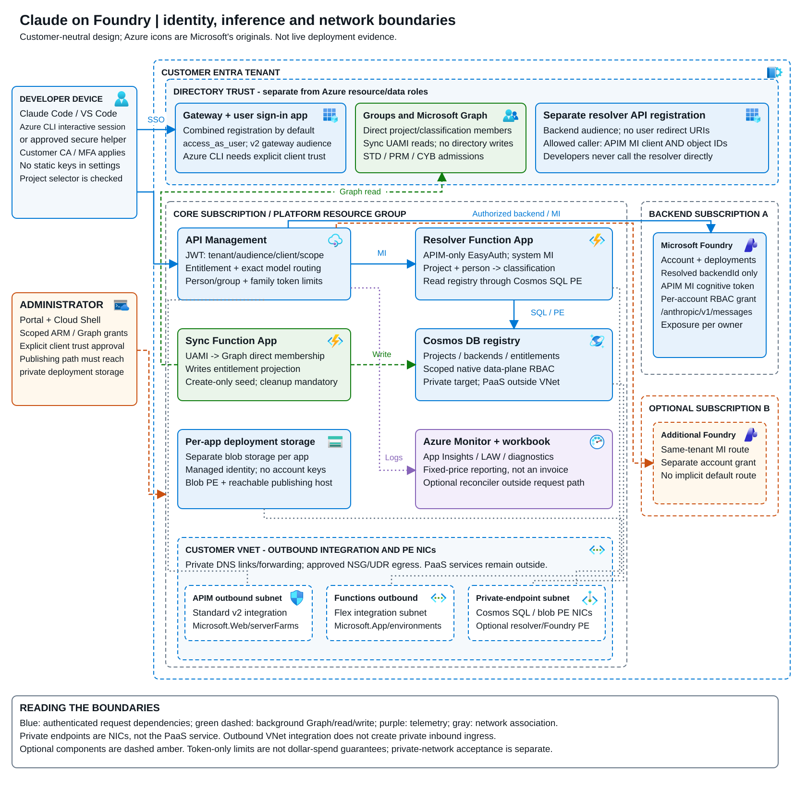
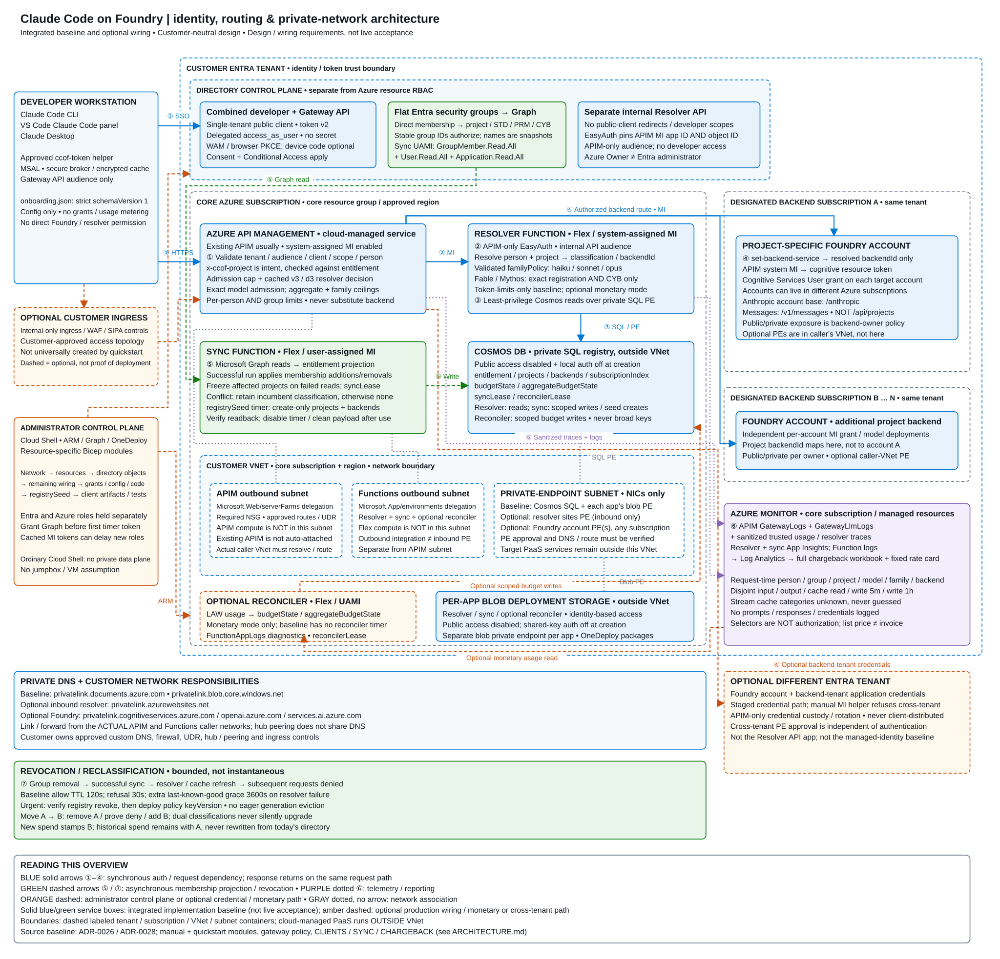
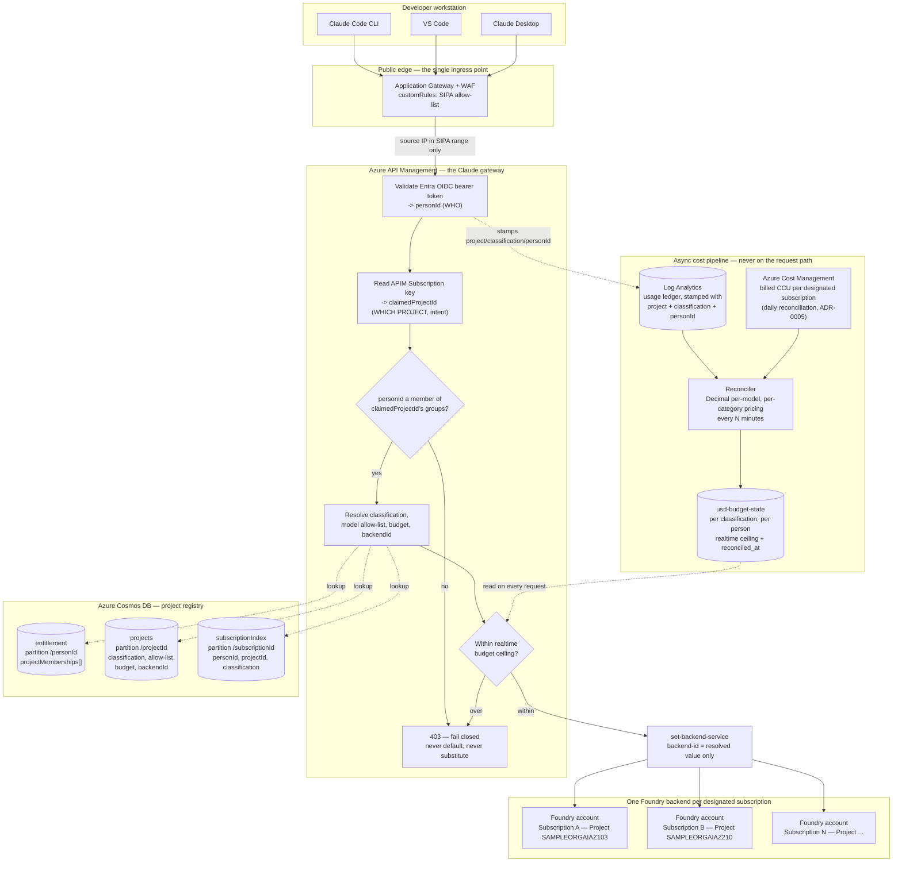
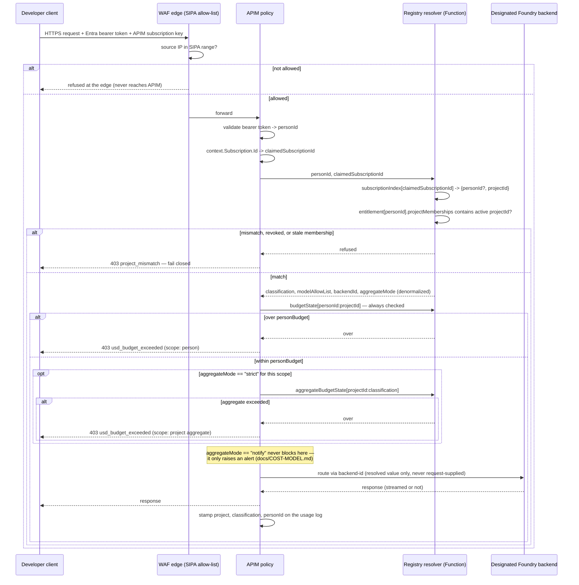

# Architecture

## Current integrated network and trust overview

[](diagrams/ccof-architecture-overview.svg)

The editable draw.io file has an **Overview** page and a **Detailed network and trust**
page. Both use [unmodified Microsoft Azure icons](diagrams/icons/azure/ATTRIBUTION.md),
embedded locally with their source hashes; no remote icon fetch is needed.



[Open full-size SVG](diagrams/ccof-network-architecture.svg) ·
[Download editable draw.io source](diagrams/ccof-network-architecture.drawio) ·
[PNG preview](diagrams/ccof-network-architecture.png) ·
[Local vector generator](diagrams/ccof-network-architecture.py)

**Reading the diagram:** blue arrows are synchronous authentication/request dependencies
(responses return on the same path); green dashed arrows are asynchronous membership projection;
purple dotted arrows are telemetry; orange dashed arrows are administration or optional
credential/monetary paths. Gray dotted lines associate services with network attachments, not
request hops. Dashed labeled containers identify trust, subscription and network boundaries;
amber dashed components are optional, not universally deployed.

### Working flows

1. **Developer authentication.** CLI and VS Code can use an explicitly approved Azure CLI
   delegated-client route (manual session token, or a small CLI-backed helper), or the
   original `ccof-token` helper with secure MSAL storage/broker. Azure CLI uses its own
   OAuth client ID and requires **both** API-scope preauthorization and APIM's allowed-client
   entry; it does not become the gateway audience or a resolver caller. Entra policy still
   applies. Manual token sessions do not refresh inside an already-running client.
   Desktop remains a separately configured, schema-checked supported profile.
   The default combined single-tenant
   developer/Gateway API registration exposes delegated `access_as_user`, issues v2 tokens and
   has no client secret. WAM/browser PKCE and explicitly approved optional device code obtain
   the **gateway** audience. Strict schema-version-1 `onboarding.json` is configuration only:
   it neither grants entitlement nor meters usage.
   This APIM design does not implement the separate Claude apps gateway's native `/login`
   and bootstrap endpoints. See the complete [manual client routes](runbooks/PUBLIC-ACCESS-WORKBOOK.md#13-hand-configurable-developer-sign-in-and-gateway-testing).
2. **Gateway admission and resolution.** APIM validates tenant, audience, authorized client,
   delegated scope and person, applies a per-person admission cap, and checks `x-ccof-project`
   against membership. On a decision-cache miss/refresh, its system identity calls the separate
   Resolver API. EasyAuth pins **both** APIM identity application and object IDs. Developers have
   no resolver scopes, public-client redirects on that registration, or direct Foundry permission.
3. **Private registry and authorization.** The resolver reads Cosmos through Functions outbound
   integration and its SQL private endpoint, returning the authorized project/classification,
   exact model admission and `backendId`. APIM enforces aggregate **and** family ceilings for
   person/group. Haiku/Sonnet/Opus are registered explicitly; Fable/Mythos also require CYB.
   Prefixes never grant access. Cosmos public access and local authentication are disabled.
4. **Backend routing.** `set-backend-service` selects only the resolved project backend. Same-tenant
   Foundry accounts may span Azure subscriptions; APIM's system identity obtains a cognitive-resource
   token with a per-account grant. Use the account's `/anthropic` base and `/v1/messages`, **not**
   `/api/projects`. A different-tenant backend requires the separately managed optional credential
   path; those credentials never go to developers, and the manual MI helper refuses cross-tenant use.
5. **Membership and administration.** The sync UAMI reads direct group members via Graph and
   writes the Cosmos entitlement projection under scoped permissions. Stable group IDs authorize;
   exact display names are informational snapshots. The new grant helper requests
   `GroupMember.Read.All`, `User.Read.All` and `Application.Read.All`; grant before the timer's first
   token, since cached MI tokens delay newly granted roles. Resource-specific Bicep, Graph grants,
   configuration and OneDeploy run from the admin control plane. The sync app's create-only
   `registrySeed` timer seeds/verifies project/backend descriptors inside the private network,
   then disables and cleans its payload. Azure Owner is not an Entra administrator.
6. **Reporting, not authorization.** APIM GatewayLogs/GatewayLlmLogs, sanitized trusted usage/
   resolver traces, resolver/sync App Insights and Function logs reach Log Analytics and the full
   fixed-rate Azure Monitor chargeback workbook. Attribution is stamped at request time; disjoint
   input/output/cache-read/cache-write-5m/cache-write-1h categories are reported without logging
   prompts, responses or credentials. Stream cache categories remain unknown. Workbook selectors
   are not access controls, list-price reporting is not a Marketplace invoice or dollar enforcement,
   and historical group attribution is never rewritten using today's membership.
7. **Revocation and classification changes.** Group removal must successfully sync and refresh the
   resolver/cache before new requests are denied. Baseline allow TTL is 120 seconds, refusal TTL
   30 seconds, with an additional 3600-second last-known-good allowance on resolver failure;
   this is not instant revocation. Urgent revocation verifies the registry change then deploys a
   new policy `keyVersion`, not eager generation eviction. Dual classification membership retains
   the incumbent (or none); deliberately remove A, prove denial, then add B. Subsequent spend
   belongs to B while historical A spend remains A.

### Optional boundaries and evidence limits

Cloud-managed APIM, Functions, Cosmos, storage and Foundry **do not reside in the subnet containing
their private endpoints**. The core VNet contains distinct APIM outbound
(`Microsoft.Web/serverFarms`, with NSG), Flex outbound (`Microsoft.App/environments`) and PE
subnets. Each app's private/keyless deployment blob storage has its own PE. Resolver inbound
`sites` Private Link is separate and optional: baseline HTTP may be public with strict APIM-only
EasyAuth. Foundry public/private exposure is its owner's policy. Existing APIM is not automatically
attached to the VNet created by quickstart.

Actual APIM caller networks must resolve and route to the chosen resolver/Foundry endpoints.
Cosmos/blob DNS is baseline; optional resolver and Foundry DNS namespaces are listed in the image.
Hub peering alone does not share DNS. Customer-approved firewall/UDR/custom-DNS, hub, internal-only
ingress and WAF wiring are requirements/options, not a universal deployed topology. Ordinary Cloud
Shell performs control-plane operations; it has no implicit private data-plane reachability and
does not imply a VM. The monetary reconciler is optional; the selected token-limits-only core has
no reconciler timer dependency.

**Source precedence / evidence:** this overview describes the current integrated design under
[ADR-0026](adr/0026-combined-developer-gateway-registration.md) and
[ADR-0028](adr/0028-core-module-reconciliation.md), checked against
[manual deployment](MANUAL-DEPLOYMENT.md), [clients](CLIENTS.md),
[Entra prerequisites](QUICKSTART-PREREQUISITES.md), [gateway](GATEWAY.md),
[sync](SYNC.md), [chargeback](CHARGEBACK.md) and [network](NETWORK.md), plus
[`network.bicep`](../infra/prereqs/network.bicep),
[`function-app.bicep`](../infra/prereqs/function-app.bicep),
[`configuration.bicep`](../infra/manual/configuration.bicep),
[`main.bicep`](../infra/quickstart/main.bicep),
[`customer-form.bicepparam`](../infra/quickstart/customer-form.bicepparam) and
the [gateway policy template](../infra/gateway/policy/claude-messages.template.xml).
It is **design/wiring documentation, not live acceptance** of newly combined authentication,
family-policy admission, routing or load behavior. The older diagrams and prose below preserve
earlier design context (including subscription keys, mandatory WAF and legacy monetary paths);
they must not be read as the current baseline deployment contract.

This design reuses the gateway, policy-engine and Cosmos-projection patterns already proven in
`naveenneog/claude-code-foundry-gateway` (read-only reference; never modified from this project — see
`docs/CHARTER.md`). It replaces that repository's two-tier, nested-group identity model with an
open-ended project/classification registry, and adds project-specific backend routing and
cross-project membership. See ADR-0002
for the decisions behind every component below, and `docs/NETWORK.md` for the network-accurate view
(VNets, subnets, private endpoints, the SIPA edge control, and cross-subscription connectivity) of
the logical diagram below.

## 1. System overview



**Why two different "subscription" concepts appear here, deliberately:**

| Term | What it is | What it does in this design |
|---|---|---|
| **Azure subscription** | A billing/management boundary in Azure | Each project's designated Foundry backend lives in its own Azure subscription (the customer's explicit requirement — see "Project-specific routing" below) |
| **APIM Subscription** | An API Management access-key concept, unrelated to Azure subscriptions ([Microsoft Learn, "Subscriptions in Azure API Management"](https://learn.microsoft.com/azure/api-management/api-management-subscriptions), ms.date 2025-12-09, retrieved 2026-10-09: "It's not the same as an Azure subscription") | One is issued per `{person, project}` pair. Its key is the unforgeable signal for "which project this request's spend bills to" — a provisioned secret, not a client-settable header, which is what makes cross-project membership safe to allow (decision 2 below) |

## 2. Request-time resolution — the dual-factor design

A person can belong to more than one project. Nothing the request supplies may pick which project a
request bills to (that would let a caller in project A's groups simply ask for project B's budget or
backend). Instead, resolution uses **two independent, unforgeable signals that must agree**:

1. **WHO** — the Entra OIDC bearer token's `oid` claim (already how this gateway authenticates today).
2. **WHICH PROJECT, as a declared intent** — the APIM Subscription key presented with the request,
   issued specifically for this `{person, project}` pair at project-onboarding time.

Resolution **cross-checks** both: the key declares an intent, and the registry confirms the person is
still actually, currently, a member of that project's classification group. Either alone is
insufficient — a leaked subscription key is useless without a valid token for a member of that
project, and a valid token for a person in project A cannot reach project B without also presenting
project B's key.



The per-person check always runs; the aggregate check only runs — and only ever refuses — when that
scope's `aggregateMode` is `strict`. A `notify`-mode aggregate never blocks a request; it only drives
the alerting path in `docs/COST-MODEL.md`.

## 3. Resolver caching and latency — what it costs, and how it's bounded

Five containers instead of one naively multiplies the per-request Cosmos read count. The design keeps
it to **three point reads always, a conditional fourth, in two parallel waves** (corrected
2026-10-11: an earlier revision said all four were independent, but step 3's key needs the
`projectId` that steps 1 and 2 verify):

1. `subscriptionIndex[subscriptionId]` — verifies the key's `personId` matches the token's, returns
   `projectId`.
2. `entitlement[personId]` — that project's membership entry, with `classification`, `modelAllowList`,
   `backendId` and `aggregateMode` **denormalized into it at sync time** (`docs/LLD.md` §1), so
   `projects` is never read on the request path at all.
3. `budgetState[personId:projectId]` — **per person**, the realtime ceiling (corrected 2026-10-09:
   budget is a per-person allowance, not pooled across a classification's members — `docs/LLD.md` §1).
   Kept as its own document rather than denormalized into `entitlement`, because the reconciler writes
   it on a different, much shorter cadence (minutes) than membership changes (hours).
4. `aggregateBudgetState[projectId:classification]` — **conditional**: only read when step 2's
   denormalized `aggregateMode` says `strict` for this scope. A `notify`-mode scope skips this read
   entirely on the request path — it is never consulted for a blocking decision, only for the
   reconciler's own alerting (`docs/COST-MODEL.md`).

Steps 1 and 2 are keyed by what the request carries and are issued together; steps 3 and 4 are issued
together once 1 and 2 have verified the project (`src/resolver/decide.ts`,
`tests/resolver-parallel-reads.test.ts`). A refusal from an earlier check stands even if a concurrent
read failed. Each is a Cosmos point read, which costs the same 1 RU regardless of how
large the registry grows (the reference repository's own measurement: a 500,000-record container's
point reads were still 1 RU, p99 51 ms). The reference repository's own resolver measurements set the
realistic latency envelope this design inherits:

| Path | p50 | p95/p99 | Cause |
|---|---|---|---|
| Cache hit (warm instance) | ~5 ms | ~10 ms | No Cosmos call |
| Cache miss, in-VNet | ~91 ms | p99 301 ms, max 389 ms | A real Cosmos round trip |
| Cold/idle instance, no pre-warming | — | up to 2 of 3 first requests refused after 15 min idle | Azure Functions cold start, not Cosmos |
| Concurrent misses, uncoalesced | — | refusals under burst | N concurrent misses become N separate Cosmos calls if not coalesced within the process |

**Two cache TTLs, not one**, because the three lookups change at different rates: the identity/project
membership cache (1, 2) reuses the reference repository's existing `entitlement-cache-seconds`
(1 hour default) since it only changes when the periodic sync runs; the budget ceiling cache (3) must
be held for **no longer than the reconciliation tick interval** (`docs/COST-MODEL.md`, minutes, not an
hour) — caching it for an hour would silently defeat the ±2-3% design. Always-ready/pre-warmed Function
instances and coalescing concurrent misses for the same key are reused as-is from the reference
repository's own fix for exactly this failure mode. (Neither is configured on the PoC Function App yet:
it has no always-ready instance and the resolver does not coalesce; `docs/status/WP-RES.md`.)

**Stale state does not deny everyone** (ADR-0008).
Entitlement records persist until a sync changes them, so a stopped sync denies no one; only a
malformed record answers 503, for that person. Budget state past its `validUntil` is served with the
last-known ceiling and marked degraded until an administrator-set hard limit, then refused with 503.
The grace window and hard limit are app settings with no code default; without valid settings the
resolver refuses every request and reports itself unhealthy (`GET /api/health`).

**Who may call the resolver** ([ADR-0009](adr/0009-resolver-entra-auth-for-apim-managed-identity.md)).
App Service Authentication on the Function App admits only APIM's managed identity, with a token for
the resolver's own app registration (`ccof-resolver-api`); other callers get 401 (no or wrong token)
or 403 (another identity). There is no function key. The resolver trusts the `personId` in the
request body only because of that gate: APIM sets it from the developer token it validated. The
function code refuses every request if App Service Authentication is off.

## 4. Group membership → entitlement — the write side, not shown in §2's read-only sequence

Adding a person to `SAMPLEORGAIAZ103STD` in Entra ID does not, by itself, make a request succeed — a sync
step has to turn that group membership into a registry write, in both directions. **Corrected
2026-10-09**: an earlier draft of this design treated removals as safe to leave to the slow periodic
sync alone ("errs toward still-refused"). That reasoning was backwards — a *removed* person keeping
access is the actual risk, not the safe direction. The corrected design uses **Microsoft Graph change
notifications** (webhooks) symmetrically for both additions and removals, confirmed real for group
resources — up to a 30-day subscription, renewable
([Microsoft Learn, "Change notifications API overview"](https://learn.microsoft.com/graph/api/resources/change-notifications-api-overview),
retrieved 2026-10-09) — with the reference repository's existing periodic poll-sync (30 min–12 h,
2 h default) kept only as the backstop for missed deliveries and subscription renewal gaps.
**Refined 2026-10-11** (`docs/MARKETPLACE-COST.md` §9):
- A group subscription lasts at most 41,760 minutes (under 29 days).
- Graph allows 100 subscriptions per app per tenant, so the fast path is one subscription on `/groups`
  read with delta queries, not one subscription per group. Whether that subscription fires on member
  changes is not documented (U-24).
- Groups have no `missed`-notification signal, so the periodic delta reconciliation is required, not
  optional.
- The subscription needs `Group.Read.All`.

```mermaid
sequenceDiagram
    participant Admin as Admin / dynamic membership rule
    participant Entra as Entra ID group
    participant Hook as Graph change-notification subscription
    participant Sync as Periodic sync (backstop; 30min-12h, 2h default)
    participant Graph as Microsoft Graph
    participant Cosmos as entitlement + projects
    participant Issue as Self-service key issuance (additions only)

    Admin->>Entra: add or remove person, SAMPLEORGAIAZ103STD
    par Fast path — both directions, seconds to a few minutes
        Entra-->>Hook: change notification (add or remove)
        Hook->>Graph: confirm the change (validate, avoid acting on a spoofed payload)
        Hook->>Cosmos: write the single affected membership (active, or inactive — never hard-delete)
    and Fast path — additions only, self-service
        Issue->>Graph: live check, the person's own delegated token: "am I in this group?"
        Issue->>Cosmos: write just this one projectMembership entry (eager)
        Issue-->>Admin: subscription key issued immediately
    and Slow path — authoritative backstop for both directions
        Sync->>Graph: paginated membership read, every registered project's groups
        Graph-->>Sync: current membership, all groups
        Sync->>Cosmos: diff -> add new, mark removed inactive (never hard-delete)
    end
    Note over Cosmos: the resolver's cached entry expires within<br/>entitlement-cache-seconds (1h default)
```

**Time to access/removal:** additions ≈ near-immediate via self-service (no wait on a webhook at all,
since the person's own delegated check needs no subscription); removals ≈ seconds to a few minutes via
the webhook, or up to the sync interval (2 h default) plus cache TTL (1 h) ≈ **~3 hours worst case**
if relying on the poll backstop alone (webhook subscription lapsed, or a missed delivery). See
`docs/PERMISSIONS.md` for exactly which Graph permission this needs and who must grant it — the same
grant the reference repository already found was not available in its own test tenant (U17/U19
there), so this is not assumable for SampleOrg's tenant either.

## 5. Project-specific backend routing

The customer's explicit requirement: **a project's traffic must reach only its designated Azure
subscription's backend, by construction.** Each project registers exactly one `backendId` (an APIM
Backend entity, pointing at that subscription's Foundry account). The routing key comes only from
the resolved registry record (step 2 above), never from anything the caller supplies — the same
fail-closed principle the reference repository already applies to authorization itself.

## 6. The async cost pipeline (never on the request path)

Pricing by the customer's actual, negotiated rate and dollar-accurate enforcement are a **periodic,
authoritative reconciler**, not a synchronous per-request lookup — Azure API Management's real-time
counters cannot weight tokens by price, and a synchronous external pricing call on every request would
add latency and a single point of failure at 25,000-developer scale. See `docs/COST-MODEL.md` for the
full design, including the two-tier (fast counter + slow exact reconciler) refinement that keeps
enforcement lag from being dominated by Log Analytics' own ~3-10 minute ingestion latency, and how the
realtime ceiling is kept tight enough to hit the ±2-3% target. `docs/MARKETPLACE-COST.md`
(ADR-0005) covers how the customer's contract rate
is resolved from Marketplace CCU billing, including prompt-cache tokens, and how per-project figures
are tied to the invoice.

## 7. Why this reuses, rather than replaces, the reference repository's infrastructure

| Component | Reused as-is | Extended |
|---|---|---|
| Cosmos account, private endpoint, resolver Function App | Yes (same account, same network path) | New containers (`projects`, `subscriptionIndex`, `budgetState`); `entitlement` gains `projectMemberships[]` |
| `llm-token-limit` / realtime token counters | Yes (mechanism) | Ceiling is now recomputed per reconciliation tick, not a static per-tier constant |
| USD reconciler's per-model, per-category Decimal pricing | Yes, wholesale | Attribution gains a `project`/`classification` dimension; a fast approximate counter now feeds the realtime ceiling between ticks (`docs/COST-MODEL.md`) |
| Application Gateway + WAF, the unused `customRules` hook | Yes, as-is | Populated with the real SIPA range once known (U-3) |
| `set-backend-service` / Backend entities | Yes (mechanism) | One Backend per designated subscription, selected only from the resolved registry value |
| Scheduled projection sync (30 min–12 h interval) | Yes, mechanism and defaults | Adds an eager, self-service fast path for additions (§4), issuing an APIM Subscription key |
