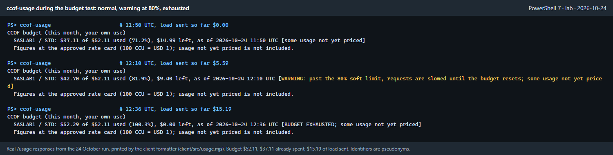
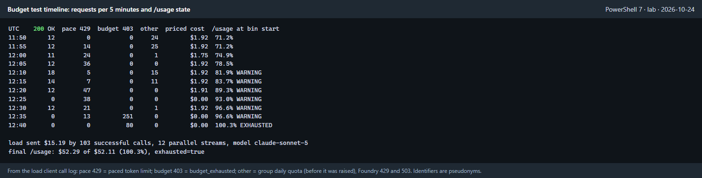
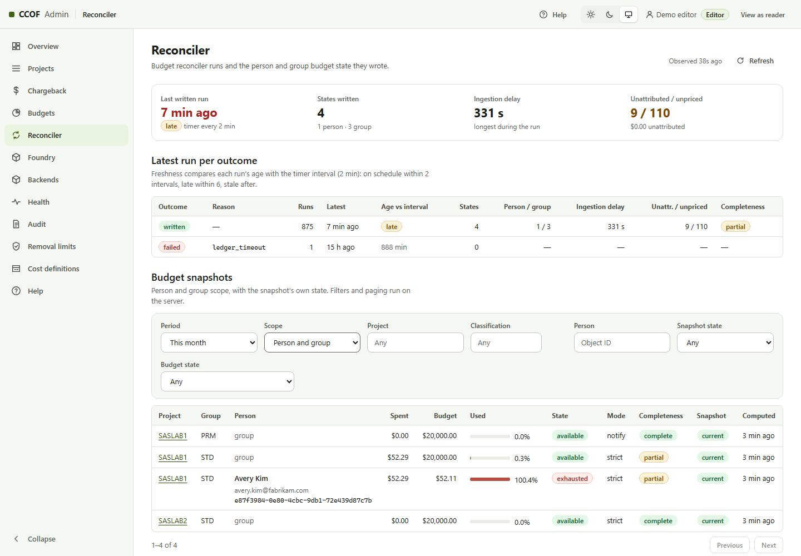

# Budgets, the 80% warning and spend pacing

This page explains, for budget owners and developers, what happens as a person's monthly budget is
used. The design record is [ADR 0035](adr/0035-budget-soft-limit-and-spend-pacing.md); terms are in
the [glossary](GLOSSARY.md).

## What a developer sees

| Spend this month | What happens |
| --- | --- |
| Below the soft limit (for example 80%) | Requests work. The gateway keeps each person's spend rate low enough that the remaining budget lasts at least one pacing window (for example 30 minutes). |
| At or above the soft limit | `/usage` and `ccof-usage` show a **WARNING**. The allowed spend rate halves, so some requests receive `429` with a `Retry-After` header. The admin console shows the person as `warning`. |
| At the budget (100%) | Requests are refused with `403 budget_exhausted` until the next month or a budget increase. |

*Lab test, 24 October 2026. The client printed these lines from real `/usage` responses.*

## Why spend can still pass 100%

Cost is known only after a request finishes and its usage reaches Log Analytics. The reconciler
then computes spend every few minutes. With the shipped settings this takes about 13 minutes
(ingestion about 9, reconciler interval 2, gateway decision cache 2; [ADR 0035](adr/0035-budget-soft-limit-and-spend-pacing.md#consequences)).
Requests admitted during that time still complete. Pacing limits how much they can add.

| Lab run (Sonnet, 12 parallel requests) | Budget | Final spend | Over |
| --- | --- | --- | --- |
| Pace limit changing every reconciler run (run 1) | $25.00 | $27.03 | 8.1% |
| Pace limit rounded to a power of two (run 2, stopped by the test's $9 cap) | $35.00 | $37.11 | 6.0% |
| Same, $15 of load on $37 already spent (run 3) | $52.11 | $52.29 | 0.3% |

The remaining overshoot is about one batch of a person's parallel requests (12 Sonnet requests cost
about $1.92). It is tracked as BSL-05 in [UNKNOWNS](UNKNOWNS.md).

*Pace 429s start before 80% because pacing applies at every spend level; the rate halves past 80%.
Budget 403s start five seconds after the reconciler marked the budget exhausted.*

## What the admin sees

The Reconciler page lists each person's spend against their budget, with the budget state
(`available`, `warning`, `exhausted`) and whether all usage has been priced.

*Lab data with pseudonymous names and IDs. Group budgets were raised to $20,000 for the test.*

## Settings

Both reconciler settings are required together; with neither, the reconciler behaves as before.

| Setting | Example | Effect |
| --- | --- | --- |
| `RECONCILER_SOFT_LIMIT_PERCENT` | `80` | Percentage of the budget at which the warning starts and the pace halves (1-99) |
| `RECONCILER_PACING_WINDOW_MINUTES` | `30` | Minutes over which the remaining budget is spread (1-120, at least the reconciler interval) |

A shorter window allows faster spend but more overshoot: a review simulation reached about 149% of
budget with 10 minutes and about 100% with 30 ([ADR 0035](adr/0035-budget-soft-limit-and-spend-pacing.md#consequences)).
How to set them: [admin operations, soft limit and spend pacing](runbooks/ADMIN-OPERATIONS.md#limits-and-budgets).

### Disaster recovery settings (DR-05)

Optional; with none set the reconciler behaves as before. Design: [DR required changes](DR-ACTIVE-PASSIVE.md#required-changes).

| Setting | Default | Effect |
| --- | --- | --- |
| `RECONCILER_LEDGER_GATEWAY_RESOURCE_IDS` | not set (the single `RECONCILER_LEDGER_GATEWAY_RESOURCE_ID` is used) | Comma-separated APIM resource IDs (1-4, no duplicates) whose logs are read as one ledger; a request ID in both gateways' logs is counted once. Must include `RECONCILER_LEDGER_GATEWAY_RESOURCE_ID` when both are set |
| `RECONCILER_CONTINUITY_GATE` | `off` | `on` checks gateway/LLM request coverage, the period's persisted coverage marker and spend monotonicity before writing |
| `RECONCILER_LEDGER_COVERAGE_START_AT` | not set | Required when the gate is `on`. UTC timestamp when APIM gateway and LLM diagnostics were enabled and verified before model traffic was allowed. Existing current-period states without a coverage marker remain refused |

Set the coverage start before traffic is allowed and keep the value unchanged for the deployment.
Quiet periods are valid. A backend-forwarded model request without a matching LLM usage row, or an
LLM usage row without a gateway request, is not.
For the first gate-on run, enable diagnostics first and keep the writers fenced until the coverage
check passes; the resulting budget states retain the period's coverage marker.
