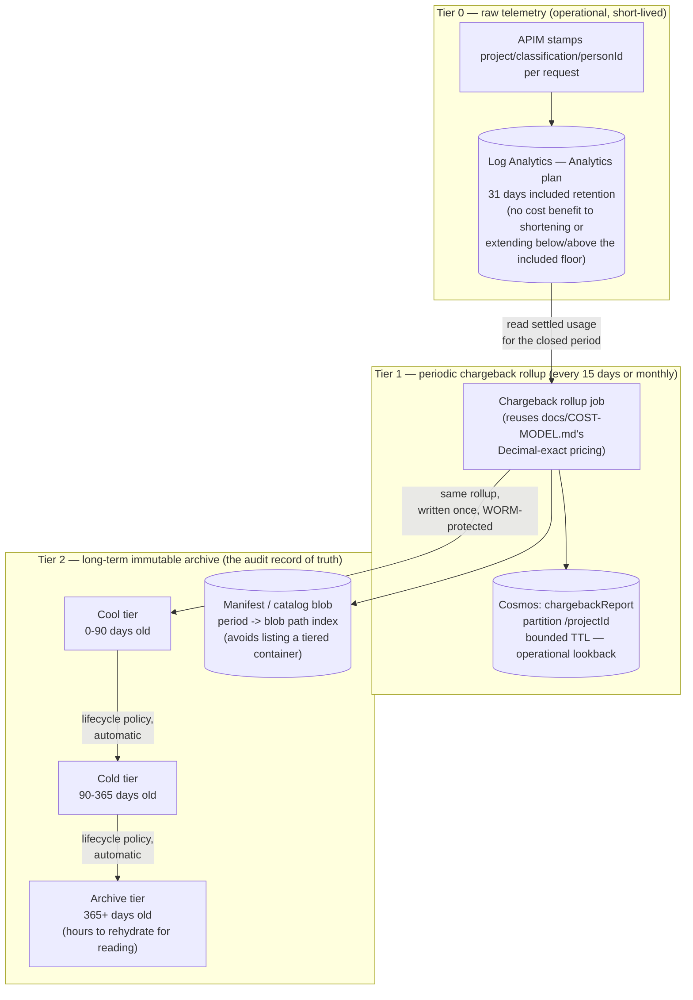
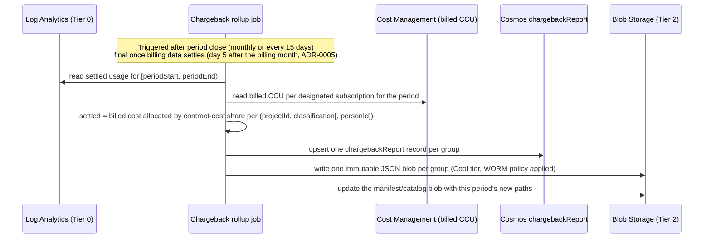
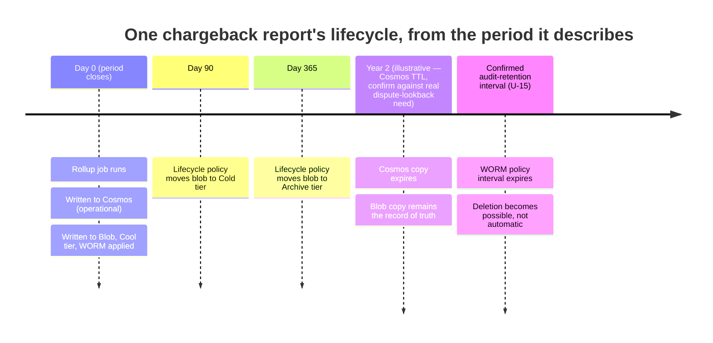

# Chargeback reports — retention and archival

**Decision record:** `docs/adr/0004-chargeback-report-retention-and-archival.md`. This document is
the detailed design the ADR references — diagrams, schemas, and the specific thresholds a build
would start from. It does not itself authorize building anything (see `docs/ROADMAP.md` Phase 7 /
packet P-5, and the backlog todos tracked alongside this packet) — no live resource in this document
has been created.

## Requirement, stated precisely

Chargeback reports, generated either **monthly** or on a **15-day (semi-monthly)** cadence, must be
retained for audit purposes in a way that is both **cost-efficient and storage-efficient**, while
remaining **genuinely usable for an audit** — retrievable, attributable to a real period, and
resistant to silent alteration. This is in tension with Log Analytics' own default behaviour: the
raw data APIM stamps every request with (`docs/ARCHITECTURE.md`'s `LAW` node) is the
highest-cardinality data this system produces, and naively keeping all of it for as long as an audit
requirement might demand is the most expensive way to satisfy that requirement.

## The three-tier model



### Tier 0 — raw telemetry stays cheap and short-lived

No change to `docs/COST-MODEL.md`'s existing design: APIM stamps every request into a Log Analytics
table on the **Analytics** plan (needed for the reconciler's near-real-time reads, `docs/COST-MODEL.md`'s
3-10 minute ingestion-lag budget). Retention stays at the workspace default — 31 days is already
included in the ingestion price; there is no cost reason to go lower, and extending it is charged
per GB/month at the Analytics rate for data whose only remaining purpose, once a period's rollup
exists, is reconciler replay/debugging, not audit. This table is **not** the audit artifact.

**Named fallback, not built by default** (depends on U-16): if request-level detail must itself be
retained for audit beyond the operational window, switch this one table to the **Auxiliary / Lake**
plan rather than extending Analytics retention — "minimal" ingestion cost, full KQL, native up-to-12-
year total retention, and the plan Microsoft explicitly positions for "data required for auditing and
compliance" (Microsoft Learn, "Tables in Azure Monitor Logs", retrieved 2026-10-10). This is a
table-plan configuration change, not a new pipeline, which is why it is a fallback rather than a
parallel build.

### Tier 1 — the periodic rollup job



**Cadence is a configuration value, not a hard-coded choice** — the owner asked for both monthly and
15-day options to be possible. A `ChargebackPeriodType` of `"monthly"` (calendar month) or
`"semi-monthly"` (1st-15th, 16th-end-of-month) determines `periodStart`/`periodEnd` for the job; both
produce the same record shape, just a different `periodId` and a different trigger frequency. Nothing
else in this design depends on which one a deployment picks.

**Why the job reads Tier 0, not `budgetState`**: `budgetState` (`docs/LLD.md`) is a live, overwritten-
every-tick realtime ceiling — exactly the wrong shape for a report that must describe a *closed,
immutable* period. The rollup independently re-aggregates settled usage for `[periodStart, periodEnd)`
from the same source the reconciler itself reads, so a chargeback report is reproducible evidence, not
a snapshot of a mutable field that has since moved on.

### Tier 2 — long-term, immutable, lifecycle-tiered archive

| Property | Setting | Why |
|---|---|---|
| Format | One JSON blob per `(projectId, classification, period)` | Human- and tool-readable without a specialized reader; small enough per-file that the format's verbosity doesn't matter at this record count (one per project x classification x period, not per request) |
| Naming | `chargeback/{projectId}/{classification}/{periodType}/{periodStart}_{periodEnd}.json` | A period's report is locatable by path alone, without needing the catalog, for a known project/classification |
| Container | Dedicated container in a dedicated storage account — **not** the Function App's deployment storage account | Keeps a compliance-sensitive, immutable data set operationally and permission-wise separate from deployment artifacts (separation of concerns, not just naming hygiene) |
| Immutability | **Time-based retention (WORM) policy**, interval = the customer's confirmed audit-retention requirement (U-15 — not yet known, not assumed) | A written report cannot be altered or deleted by anyone, including an account Owner, until the policy interval expires — the one property this design adds that neither Log Analytics option has |
| Lifecycle — 0-90 days | Cool tier | Recent periods are the ones most likely to be pulled for a near-term dispute or month-close review; Cool's 30-day minimum is comfortably inside this window |
| Lifecycle — 90-365 days | Cold tier | Still online (no rehydration wait) at a lower cost than Cool, for data unlikely to be queried but not yet "effectively never" |
| Lifecycle — 365+ days | Archive tier | Lowest cost; accepted trade-off is up to ~15 hours to rehydrate before reading — reasonable for audit access, which is not latency-sensitive by nature, unlike the realtime path this design never touches |
| Catalog | A small manifest blob (or the Cosmos `chargebackReport` container's own metadata) listing every archived report's path, period, and project | Finds a specific period's blob without listing a container that may contain years of Archive-tier entries — listing itself stays cheap (blob metadata remains readable even while archived) but still shouldn't be the lookup mechanism at scale |

**Early-deletion and re-tiering cost, acknowledged, not a blocker**: moving or deleting a blob before
its tier's minimum (30/90/180 days for Cool/Cold/Archive) incurs a prorated early-deletion charge
(Microsoft Learn, "Access tiers for blob data"). Because this design's lifecycle policy only *advances*
a blob forward with age (Cool → Cold → Archive, never the reverse, never early), this cost is not
expected to be incurred in normal operation — it is relevant only if a report must be manually
deleted or re-tiered ahead of schedule, which the WORM policy itself prevents until its interval
expires, by design.

## Retention timeline (one report's life)



The Cosmos copy's own retention is intentionally **shorter** than the Blob copy's — Cosmos exists for
fast operational lookback (a recent dispute, a Workbook UI), not as the audit record of truth. Letting
it expire earlier via a Cosmos per-item TTL is itself a cost-efficiency decision: Cosmos storage is not
priced for multi-year cold retention the way Archive-tier Blob Storage is.

## Cosmos schema addition

### `chargebackReport` (new; partition key `/projectId`, document id `"<projectId>:<classification>:<periodId>"`)

```json
{
  "id": "SAMPLEORGAIAZ103:STD:2026-10-SEMI2",
  "projectId": "SAMPLEORGAIAZ103",
  "classification": "STD",
  "periodType": "semi-monthly",
  "periodId": "2026-10-SEMI2",
  "periodStart": "2026-10-16T00:00:00Z",
  "periodEnd": "2026-11-01T00:00:00Z",
  "totalSpend": 4821.17,
  "currency": "USD",
  "activeMemberCount": 19,
  "perPersonBreakdown": [
    { "personId": "<Entra object id>", "spend": 243.90 }
  ],
  "basis": "settled",
  "rateCardVersion": "2026-10-11",
  "contractScheduleVersion": "2026-10-01",
  "captureVarianceCcu": 1240.5,
  "generatedAt": "2026-11-01T02:00:00Z",
  "blobPath": "chargeback/SAMPLEORGAIAZ103/STD/semi-monthly/2026-10-16_2026-11-01.json",
  "ttl": 63072000
}
```

`perPersonBreakdown` is the same per-person figures a `strict`-mode aggregate scope already tracks
intra-period in `budgetState` (`docs/LLD.md`) — this record is a closed-period snapshot of that same
accounting, not a new pricing concept. `basis: "settled"` means billed CCU allocated by contract-cost
share, and `captureVarianceCcu` is the period's billed minus predicted CCU for the project's designated
subscription ([ADR-0005](adr/0005-real-cost-from-marketplace-ccu-billing.md); replaced
`rateSource: "cost-management-price-sheet"` on 2026-10-11). `ttl` (Cosmos's own per-item expiry,
seconds) is illustrative
at 2 years; the real figure is a cost/dispute-window trade-off the owner should set, independent of
the Blob copy's own, separately-configured WORM retention (U-15).

## Options considered (storage mechanism for the long-term copy)

| Option | Cost at rest | Audit usability | Immutability |
|---|---|---|---|
| **A — Blob Storage, Cool → Cold → Archive lifecycle, WORM policy (recommended)** | Lowest, shrinking further with age | High — JSON, path-addressable, catalog-indexed; Archive-tier reads accept hours-scale latency | Yes — tamper-evident until the policy interval expires, even against an Owner |
| **B — Log Analytics, Auxiliary/Lake plan, aggregated table instead of raw** | Low (minimal ingestion), but priced per ingested row, not per report — less efficient than a handful of yearly blobs once volume is high | Medium — full KQL, but slower queries, and no native "one file per period" artifact to simply hand an auditor | No — Log Analytics has no WORM/legal-hold equivalent |
| **C — Cosmos only, no TTL, kept indefinitely** | Highest of the three for cold data | High day-to-day (point reads), but the container holds years of data, including the vast majority that is never read again | No — ordinary Cosmos RBAC permissions, no time-based immutability |

Option A is the recommendation carried into ADR-0004. Option B remains the named fallback
specifically for the (separate, unresolved) question of request-level retention, not as a replacement
for the periodic rollup.

## What this does not solve, and should not be asked to

- **The audit-retention duration itself** (how many years a WORM policy's interval should be set to)
  is a legal/compliance/contractual figure, not a technical one — `docs/UNKNOWNS.md` U-15. This design
  is retention-*period-agnostic*: the mechanism (lifecycle tiers + WORM) works the same regardless of
  what that number turns out to be; only the policy's configured interval changes.
- **Whether request-level detail must survive long-term** (`docs/UNKNOWNS.md` U-16) is likewise not
  answered here — the Auxiliary/Lake fallback is named and costed, not built, pending that answer.
- **Rate accuracy** (whether the rollup's figures are the customer's real, discounted cost) is
  [ADR-0005](adr/0005-real-cost-from-marketplace-ccu-billing.md) (`docs/MARKETPLACE-COST.md`): the rollup
  records settled figures that sum to each designated subscription's billed CCU.
- **Who is authorized to read an Archive-tier report, or to configure/alter a WORM policy itself**
  is a `docs/PERMISSIONS.md`/`docs/CHECKPOINT-SETUP.md`-shaped question (a new checkpointed stage, most
  likely) — not addressed by this document, which is scoped to the data's shape and lifecycle, not
  who may act on it.
