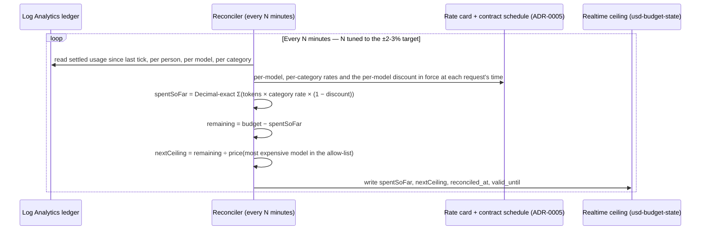

# Cost model — matching a classification's dollar budget to actual billed consumption

**Target, stated by the owner:** a $250/month Standard budget should be matched by actual Azure-billed
CCU consumption to within **±2-3%**, regardless of which models in Standard's allow-list a person
actually uses, with the tolerance explicitly allowing for streaming/completion-token slop.

This is two separate problems that must both be right for the end result to hold:

1. **Rate accuracy** — is $1 of internally tracked spend really $1 of what Azure bills? (Addressed by
   ADR-0005 (internal record, not published) and `docs/MARKETPLACE-COST.md`, which
   replaced an earlier plan to read a negotiated CCU unit price from Cost Management. That price does not
   exist: the CCU price is fixed at $0.01 and discounts reduce the CCU quantity. The rate is a versioned
   list rate card times the customer's private-offer discount schedule, checked daily against billed CCU.)
2. **Enforcement precision** — given a correct rate, how tightly does the *system* stop a person at
   their configured $250? This document is about problem 2.

## Where the slop comes from

Azure API Management's real-time policy engine counts tokens, but cannot weight them by price — a
single `llm-token-limit` counter cannot distinguish a Haiku token from an Opus token. Dollar-accurate
enforcement is therefore necessarily a **periodic, Decimal-exact reconciler** (reading settled usage,
pricing it exactly per model and per category, comparing to the budget), not a single real-time
check. Two sources of overshoot follow directly from that:

| Source | Why it exists | Bound |
|---|---|---|
| **Reconciliation-window lag** | Between reconciler ticks, a person can keep spending at realtime-token speed before the next tick notices they crossed $250 | `(most expensive allowed model's output rate) × (tokens one identity can generate in the tick interval)` |
| **Log Analytics ingestion lag** | The reconciler reads settled usage from Log Analytics, which typically takes **3-10 minutes** to ingest a resource log (Microsoft Learn, "Log data ingestion time in Azure Monitor") — a **floor** under the reconciliation-window lag above, independent of how often the reconciler script itself runs | `max(reconciler_tick_interval, 3-10 minutes)` — a 1-minute reconciler tick buys nothing if the data it reads is still minutes stale |
| **Streaming/completion-token estimation** | A streamed response's exact output-token count is only known when the stream ends; reading a stream's usage mid-flight ends the stream (the reference repository's own measured finding) | Bounded by a pre-charge-then-true-up design (below), not by shortening the reconciler interval |
| **Prompt-cache tokens** (added 2026-10-11) | APIM's `llm-token-limit` counts prompt and completion tokens only. For streamed responses the gateway records no cache categories at all. Cache reads (0.025-0.1× input) and cache writes (1.25× or 2× input) are billed (`docs/MARKETPLACE-COST.md` §4, §7) | Cache writes are not bounded by a token ceiling. The bound needs per-request cache categories in the fast counter (U-17). Until then this is a delayed stop at the reconciler's figure plus the daily calibration (ADR-0005) |

**This floor matters: running the reconciler every minute does not give one-minute responsiveness if
the pipe it reads from is itself minutes behind.** The design below (§ "Two-tier telemetry") removes
this floor from the critical path rather than accepting it.

## Two-tier telemetry — removing the Log Analytics floor from the fast loop

A single telemetry path (Log Analytics → reconciler) conflates two different needs: a **fast,
approximate** signal to keep the realtime ceiling honest, and a **slow, exact** signal for
authoritative pricing and the month-end true-up against the actual invoice. Splitting them removes
the Log Analytics ingestion floor from the part of the design that actually needs to be fast:

| Tier | Path | Latency | Role |
|---|---|---|---|
| **Fast, approximate** | The policy itself writes a cheap running counter (a `budgetState`-adjacent value in Cosmos, not Log Analytics) immediately after each response, using the response's own reported usage or the pre-charge estimate for a stream | Sub-second to a few seconds — bounded by the write itself | Feeds the realtime ceiling between reconciler ticks; approximate, never the number used for an invoice |
| **Slow, exact** | Log Analytics → reconciler, Decimal per-model, per-category pricing, as originally designed | Minutes (reconciler tick, floored at 3-10 min by Log Analytics ingestion) | Authoritative correction of the fast counter's drift; the only path used for the Cost Management settled-day true-up (8-24 hours later, Packet B's method) |

With this split, the overshoot bound for the realtime ceiling becomes a function of the **fast
counter's** write latency (sub-second class), not Log Analytics' ingestion pipe — materially tighter,
and the one that actually makes a sub-5-minute ±2-3% target achievable. The slow path still runs
exactly as designed below; it now corrects drift rather than being the only signal the realtime guard
has.

## Design: a shrinking realtime ceiling, kept honest by a periodic exact reconciler



**Why the ceiling is computed against the *most expensive allowed model's* rate, not an average:**
this bounds the worst case — if the person switches to the priciest model in their classification's
allow-list for the remainder of the tick interval, the realtime guard still cannot let them exceed the
target tolerance. A person who only ever uses the cheapest model is *not* artificially throttled
early, because `remaining` (the numerator) only shrinks by what they actually spent, not by an assumed
worst-case rate applied retroactively — the worst-case rate only shapes how far the *next* interval's
ceiling reaches, not what already happened. This is what makes the design work "regardless of the
models they use": the $ accounting is exact and model-agnostic; only the safety margin for the next
few minutes is deliberately pessimistic.

## Solving for the reconciliation interval N

```
max_overshoot = N_minutes × 60 × tokens_per_second_per_identity × price_per_output_token(most_expensive_model)
```

`tokens_per_second_per_identity` is **not yet measured** for a single identity's sustained worst-case
throughput (the reference repository's 500,000-identity measurements are aggregate across many
identities, not a per-identity bound — logged as U-5). A worked illustrative example, to be replaced
with a real measurement before this ships:

> If a single identity can sustain at most ~50 requests/minute of ~2,000 output tokens each against
> the most expensive model Standard allows (illustratively, $25 per million output tokens):
> `100,000 tokens/minute × $25 / 1,000,000 = $2.50/minute`. To bound overshoot to 3% of $250 ($7.50),
> `N ≤ 7.50 / 2.50 = 3 minutes`.

**Without the two-tier split above, this conclusion is optimistic**: Log Analytics' own ~3-10 minute
ingestion lag floors the *effective* reconciliation lag regardless of how small N is set, which could
already exceed the $7.50 target on its own for a high-throughput, expensive-model user. The two-tier
telemetry design is what makes a sub-5-minute target achievable in practice — the fast counter is not
an optional nicety here, it is load-bearing for the stated tolerance.

The real figure depends on this gateway's actual per-identity rate limits and the real price of the
most expensive model in each classification — both measurable, neither assumable (U-5 in
`docs/UNKNOWNS.md`).

## Streaming: pre-charge, then true up

A streamed request's exact output-token count is unknown until the stream completes. The design:
charge a conservative **estimate** against the realtime ceiling when the stream starts (for example,
the request's `max_tokens` parameter, the worst case the client itself declared), then correct the
ledger with the **actual** count once Log Analytics records the completed stream — refunding the
difference if the actual count was lower, or recording the true spend if higher. The next
reconciliation tick always uses the corrected, actual figure; the pre-charge estimate only shapes the
realtime ceiling during the stream's own lifetime. An in-flight stream is never counted as zero spend.
This covers output tokens. A stream's prompt-cache categories are not recorded by Log Analytics today
(`docs/MARKETPLACE-COST.md` §4, U-17).

## Project/classification aggregate budgets — added 2026-10-09

Everything above enforces **one person's** own budget. A project also needs to know, and optionally
cap, **everyone's spend in a classification combined** — and a choice between hard-blocking once that
total is exceeded and merely reporting it, so a human can approve a higher budget rather than being
surprised by a blanket refusal. This reuses the reference repository's existing `strict`/`notify`
enforcement-mode precedent (its `ADR-0019`, read-only reference) rather than inventing a new concept.

### The two modes, precisely

- **`aggregateMode: "strict"`** — once `aggregateBudgetState.spentSoFar` (`docs/LLD.md`) exceeds
  `aggregateBudget`, **every** member of that classification is refused further requests (403,
  scope `project aggregate`), even one still comfortably within their own `personBudget`. This is a
  hard capacity ceiling, not a per-person one.
- **`aggregateMode: "notify"`** — the aggregate is never a blocking condition. Exceeding it instead
  raises an alert (reusing the reference repository's existing email-backed action-group alerting
  pattern, already used for its scheduled reconciler) naming the project, the classification, the
  configured `aggregateBudget`, the actual `spentSoFar`, and the `worstCasePotential` (every active
  member spending their own full personal allowance). This is the "report, to get approval to raise
  the budget" behaviour: visibility without disruption, as a deliberate choice per project.

Per-person budgets are **never** governed by `aggregateMode` — they stay `strict`, unconditionally,
matching the reference repository's own rule that "a person's own dollar budget is always enforced."

### The capacity check when adding a member

Admitting a new person to a classification (`docs/CHECKPOINT-SETUP.md` Stage 4) is exactly where an
aggregate cap should be checked **before** the fact, not only discovered after real spend accrues:

```
worstCasePotential = (activeMemberCount + 1) × personBudget
```

If `worstCasePotential > aggregateBudget` for a `strict`-mode scope, the addition itself has two
configurable behaviours (an `onboardingMode`, independent of `aggregateMode`):

- **`onboardingMode: "block"`** — the addition is refused until the project's `aggregateBudget` is
  raised (a role-gated, checkpointed action — `docs/CHECKPOINT-SETUP.md`) or an explicit override is
  recorded, naming who approved the overcommit and why.
- **`onboardingMode: "warn"`** (the default for `notify`-mode scopes) — the addition proceeds, and the
  same alert as above is raised, flagged as "capacity, not yet spend" so it reads differently from an
  actual overspend alert.

This is a forward-looking, worst-case check — it cannot know future spend, only the ceiling every
member *could* reach — which is deliberately conservative: it would rather over-alert on a project
that in practice never has every member maxing out their allowance simultaneously, than under-alert
and let real spend silently exceed what anyone approved.

### Raising the aggregate budget — its own checkpointed, audited action

Approving a higher `aggregateBudget` is not a plain config edit. It uses the same scoped custom role
and checkpoint mechanism as project registration (`docs/CHECKPOINT-SETUP.md` Stage 3/4), recording
*who* approved the increase, when, and the stated reason — the same "which identity did this" audit
trail this design already applies to every other setup stage. A report/alert is the trigger for a
human to review; the actual increase is a deliberate, attributable write, never an automatic
self-service bump.

## Options considered

| Option | Mechanism | Accuracy | Cost / risk |
|---|---|---|---|
| **A — shrinking realtime ceiling + periodic exact reconciler (recommended)** | As above: the ceiling is recomputed every tick from real Decimal-exact spend and the worst-case remaining rate | Tunable to the ±2-3% target by solving for N against measured throughput | Reconciler runs every few minutes instead of every five; proportionally more reconciler compute, no new request-path dependency |
| **B — periodic-only (today's reference-repository mechanism, as-is)** | A fixed per-tier token ceiling, trued up only at reconciliation; no per-tick recomputation | Looser bound — overshoot is fixed by the tier's static ceiling, not shrinking as spend accrues | Simplest; already built in the reference repository; a reasonable starting point if ±2-3% is not yet required |
| **C — synchronous pre-charge via an external call per request** | A request-path call to a budget service that decrements a $ balance before admitting the request | Tightest in principle for non-streamed requests; still needs a streaming true-up for output tokens | Adds request-path latency and a new single point of failure at 25,000-developer scale — the reference repository deliberately avoided exactly this shape for its existing budget checks; not recommended unless Option A, tuned, cannot reach the target |

**Recommended: Option A**, with Option B as the safe fallback already proven at the reference
repository's scale if the tuned interval under Option A turns out to need per-identity throughput
numbers this design does not yet have measured (U-5).

## What this does not solve, and should not be asked to

If the *rate* itself is wrong (Anthropic list price instead of the customer's real negotiated CCU
rate), no amount of enforcement precision fixes the end result — a perfectly-enforced $250 ceiling
priced at the wrong rate matches the wrong number of actual dollars. Rate accuracy is
ADR-0005 (internal record, not published) (`docs/MARKETPLACE-COST.md`), not a concern
of this document.
