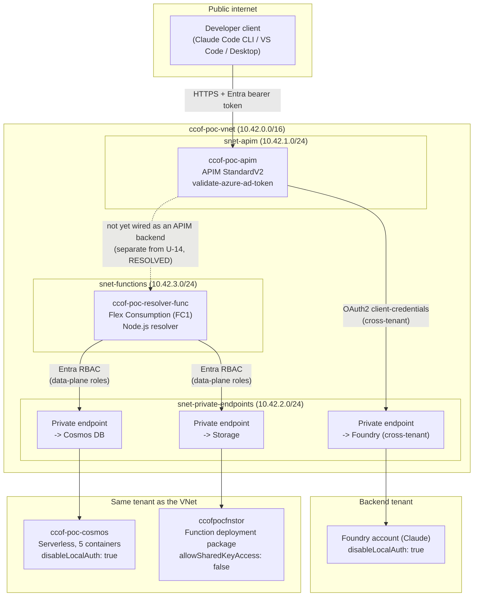

# Deploy the claude-code-on-foundry proof of concept

This guide walks through deploying the live proof of concept this repository's `docs/STATUS.md`
documents: a private-network Azure API Management gateway in front of Claude on Microsoft Foundry,
a Cosmos DB registry, and a resolver Function App, using the exact resources, commands, and
Azure CLI output produced while building this PoC. Every command below was run against a real Azure
subscription — see `docs/STATUS.md` for the full chronological log, including issues that did not
make it into this guide's happy path.

> [!NOTE]
> This is a **proof of concept walkthrough**, not a production deployment guide. Production use needs
> the segregated-role, checkpointed path in `docs/CHECKPOINT-SETUP.md` instead of one operator running
> every command below.

## Architecture



See `docs/NETWORK.md` for the complete, customer-scale topology (SIPA edge control, App Gateway, the
resolver's own private endpoint, and every designated subscription's backend) — this diagram shows only
what is actually deployed in this PoC.

## Prerequisites

### Tools

| Requirement | Why |
|---|---|
| Azure CLI 2.60.0+ | Flex Consumption plan support (`az functionapp list-flexconsumption-locations`) |
| Node.js 22+ locally | `node --test` for unit tests; Node 26+ runs `.ts` files natively for local dev (no build step needed for that) |
| `gh` CLI, signed in | Only if you reproduce the jump-box code-deployment step, which clones this (private) repo |

### People and roles

Each deployment step is performed by one of these people. In the proof of concept the owner held
every role. A customer deployment gives them to different people. `docs/PERMISSIONS.md` lists what
each service identity holds.

| Person | Microsoft Entra role | Azure role and scope | Workbook steps | Proof of concept (2026-10-11) |
|---|---|---|---|---|
| Platform deployer | None | Contributor on the platform resource group, plus Role Based Access Control Administrator or User Access Administrator there for role assignments. Creating resource groups and registering resource providers needs Contributor on the subscription | 1, 2, 3, 5, 6, 7a, 8, 9, 10, 12 | The owner: Owner on the tenant root management group, inherited |
| Entra privileged administrator | Privileged Role Administrator, activated through Privileged Identity Management (PIM) for the task. Global Administrator also works | None | 7b, once per tenant | The owner, by PIM activation |
| Entra application administrator | Cloud Application Administrator or Application Administrator. The owner of a registration can change that registration. Creating a registration needs no role while "Users can register applications" is Yes | None | 4a, 9 (registration), 13 (redirect URIs) | The owner, as owner of both registrations |
| Backend owner, per designated subscription | None in the same-tenant case. In the cross-tenant case, Application Administrator in the backend's tenant (`docs/PERMISSIONS.md` #10) | Role Based Access Control Administrator or User Access Administrator on the Foundry account, to assign Cognitive Services User | 3 (approval), 4 | The owner, in the backend's tenant |
| Onboarding operator | None while "Users can create security groups" is Yes; otherwise Groups Administrator | Cosmos data-plane write on `projects`, from a runner inside the VNet | 11 | The coordinator, for the pilot |
| Group owner (project lead) | None. Owner of the classification group; "Only the group's owners can update membership" for non-administrators | None | Adds and removes members after step 11 | The owner |
| Developer | None | None | Signs in from Claude Code or Claude Desktop (13) | The owner |

Sources:
- Microsoft Graph v1.0, "Grant an appRoleAssignment to a service principal": Privileged Role
  Administrator is "the least privileged role supported for Microsoft Graph and Azure AD Graph app
  roles".
- Microsoft Learn:
  - "Grant tenant-wide admin consent to an application".
  - "Delegate application management administrator permissions".
  - "Set up self-service group management".
  - "Assign Azure roles using the Azure portal": role assignments need
    `Microsoft.Authorization/roleAssignments/write`, "such as Role Based Access Control Administrator
    or User Access Administrator".
  - "How to use role-based access control in Azure API Management".

### Tenant settings

These settings decide whether steps 4a, 11 and 13 need a directory role. Each was read on
2026-10-11 from the gateway tenant (`GET /policies/authorizationPolicy`).

| Setting | Proof of concept value | When it is turned off |
|---|---|---|
| Users can register applications (`allowedToCreateApps`) | Yes | An Application Developer or Application Administrator creates the registrations |
| Users can create security groups (`allowedToCreateSecurityGroups`) | Yes | A Groups Administrator creates the classification groups |
| User consent (`permissionGrantPoliciesAssigned`) | `microsoft-user-default-allow-consent-apps`, `microsoft-user-default-recommended` | A Cloud Application Administrator or Application Administrator grants tenant-wide consent for the Developer Sign-in app's delegated permissions |

> [!IMPORTANT]
> This subscription enforces a **private-network-and-Entra-auth-only** policy baseline on every PaaS
> resource this PoC touches (Foundry, Cosmos DB, Storage — confirmed live, `docs/STATUS.md`). If your
> subscription has the same posture, read "Troubleshooting" before you start — several steps below only
> work from inside the VNet, not from your own machine.

## Deployment workbook

The steps in order: who performs each, with which role, how it is verified, and its state in the
proof of concept. Steps 8 to 13 are being built in parallel (`docs/PILOT.md`). Each one's section
is added to this guide when its pull request merges.

| # | Step | Performed by | Role and scope | Verified by | Proof of concept |
|---|---|---|---|---|---|
| 1 | Resource group and resource providers | Platform deployer | Contributor on the subscription | `az provider show -n <namespace> --query registrationState` | Done, 2026-10-09 |
| 2 | Network: VNet, NSG, APIM | Platform deployer | Contributor on the resource group | APIM `provisioningState` is `Succeeded` | Done, 2026-10-09 |
| 3 | Private endpoint to the Foundry backend | Platform deployer; the backend owner approves the connection | Contributor on the resource group; Contributor or Owner on the Foundry account | Connection state `Approved` | Done, 2026-10-09 (cross-tenant, manual approval) |
| 4 | Backend authentication | Backend owner | Same tenant: Role Based Access Control Administrator on the Foundry account. Cross-tenant: Application Administrator in the backend's tenant | A gateway call returns 200 | Done, 2026-10-09. Cross-tenant client secret, which expires about 2026-10-16 |
| 4a | App registrations: Gateway API, Developer Sign-in | Entra application administrator | None while "Users can register applications" is Yes | The gateway accepts a developer token | Done, 2026-10-09 |
| 5 | Cosmos DB registry and data-plane role assignments | Platform deployer | Contributor on the resource group. Its `*` actions include `Microsoft.DocumentDB/databaseAccounts/sqlRoleAssignments/write` (role definition read 2026-10-11) | `az cosmosdb sql role assignment list` | Done, 2026-10-09 |
| 6 | Resolver Function App | Platform deployer | Contributor on the resource group | The function answers `/api/resolve` | Done, 2026-10-10 |
| 7 | Group sync identity (7a) and Microsoft Graph permission (7b) | 7a platform deployer; 7b Entra privileged administrator | 7a: Managed Identity Contributor or Contributor on the resource group. 7b: Privileged Role Administrator | `GET /servicePrincipals/<id>/appRoleAssignments` lists `GroupMember.Read.All` | Done, 2026-10-11 |
| 8 | Telemetry: Log Analytics workspace, APIM diagnostics | Platform deployer | Contributor on the resource group | Gateway records in `ccof-poc-law` | Live, 2026-10-11; pull request #3 in review |
| 9 | Resolver authentication: App Service Authentication and registration `ccof-resolver-api` (ADR-0009) | Platform deployer; Entra application administrator for the registration | Contributor on the Function App | A call without a token returns 401 | In review, pull request #6 |
| 10 | Group sync Function App | Platform deployer | Contributor on the resource group; Cosmos data-plane roles as in step 5 | A run reads the registered groups and writes `entitlement` | In progress, branch `wp/sync` |
| 11 | Classification groups and project registration (onboarding Stages 1 and 3) | Onboarding operator | Stage 1: as in Tenant settings. Stage 3: Cosmos data-plane write on `projects` | The groups exist with their owners; the `projects` document reads back | In review, pull request #2 |
| 12 | Gateway policy revision | Platform deployer | API Management Service Contributor on the APIM instance, which Contributor includes | Tests against the revision URL | In progress, branch `wp/gw` |
| 13 | Workstation clients | Developer; Entra application administrator adds redirect URIs | None for the developer | A message from Claude Code and Claude Desktop through the gateway | In progress, branch `wp/client` |

### Plan the deployment

Before a stage, each person can see, read-only, what the checkpoint records, what already exists,
which roles they hold against each stage's requirements, and what to run next or whom to hand off to:

```powershell
pwsh -NoProfile -File scripts/Get-DeploymentPlan.ps1 -AnswersPath <answers.json> -CheckpointPath <checkpoint.json> -SubscriptionId <subscription id>
```

The report sends only GET requests and writes no file except the plan object named by `-JsonPath`.
Its rows, verdicts and rules are in `docs/DEPLOYMENT-STAGES.md`, Plan the deployment.

## Step 1 — Resource group and resource providers

```powershell
az group create --name ccof-poc-rg --location eastus2

# Needed by this PoC's resources - confirmed live, not guessed (docs/STATUS.md):
az provider register --namespace Microsoft.Network
az provider register --namespace Microsoft.ApiManagement
az provider register --namespace Microsoft.Web            # APIM VNet integration needs this too
az provider register --namespace Microsoft.CognitiveServices
az provider register --namespace Microsoft.DocumentDB
az provider register --namespace microsoft.operationalinsights  # Application Insights
az provider register --namespace Microsoft.App            # Flex Consumption's VNet integration (see Troubleshooting)
```

## Step 2 — Network: VNet, NSG, APIM

Deploys `infra/poc/main.bicep`: a VNet with three subnets, the NSG with Microsoft's documented minimum
9 rules for APIM VNet integration, and a non-zonal APIM StandardV2 instance.

```powershell
az deployment group create `
  --resource-group ccof-poc-rg `
  --template-file infra/poc/main.bicep `
  --parameters namePrefix=ccof-poc apimPublisherEmail=<you>@example.com `
               existingFoundryAccountResourceId=<your Foundry account's resource ID>
```

> [!TIP]
> **Availability zones**: this template defaults to non-zonal. Zone-redundant StandardV2 and
> PremiumV2 were both found restricted on this specific subscription/region combination
> (`AvailabilityZonesNotSupportedInSku`, `ApiServiceCreationDisabledForSubscription` — `docs/STATUS.md`
> Phase 1). Pass `apimZones=['1','2','3']` and `apimCapacity=3` once your subscription supports it.

**Verify**: the deployment output includes `apimGatewayUrl` (e.g.
`https://ccof-poc-apim.azure-api.net`) and `apimPrincipalId` (APIM's managed identity, used in Step 4).


## Step 3 — Private endpoint to the Foundry backend

If your Foundry account is in a **different Entra tenant** from the VNet (the common case for a
backend borrowed from another business unit), the private endpoint connection needs **manual**
approval from an identity in the backend's own tenant — auto-approve fails cross-tenant with
`LinkedAuthorizationFailed` (`docs/NETWORK.md`, `docs/STATUS.md` Phase 1).

```powershell
# From the backend account's own tenant/subscription:
az network private-endpoint-connection list `
  --resource-group <backend's resource group> `
  --name <foundry account name> `
  --type Microsoft.CognitiveServices/accounts

az network private-endpoint-connection approve `
  --id <connection id from the list above> `
  --description "Approved for claude-code-on-foundry PoC"
```


> [!NOTE]
> The private link resource name is visible unredacted in this screenshot (the user's own PoC resource
> name, not a customer identity or secret) — every other screenshot in this guide has subscription IDs,
> tenant IDs, and personal names replaced with placeholders.

## Step 4 — Backend authentication: same-tenant vs. cross-tenant

See `docs/NETWORK.md`, "Backend authentication: managed identity only works same-tenant", for the full
decision table. **Same-tenant backend** (the common case):

```powershell
az role assignment create `
  --assignee <apimPrincipalId from Step 2> `
  --role "Cognitive Services User" `
  --scope <Foundry account resource ID>
```

**Cross-tenant backend** (this PoC's actual shape) needs a client-credentials app registration **in
the backend's own tenant** instead — managed identity cannot cross a tenant boundary (confirmed live:
`"Tenant provided in token does not match resource token"`, `docs/UNKNOWNS.md` U-9). See
`docs/CHECKPOINT-SETUP.md`'s "Stage 2 in detail" table for the full micro-steps; the resulting APIM
policy is `infra/poc/claude-messages-policy.xml`, whose header comment documents a live-discovered
gotcha: never splice a `{{named-value}}` secret directly inside a C# string literal inside an APIM
`@{ }` expression — it silently corrupts the value (`AADSTS7000215`).


## Step 4a — Entra App Registrations (developer-facing auth)

Separate from Step 4's backend auth: two app registrations, created once per gateway, not per project
(`docs/CHECKPOINT-SETUP.md` Stage 0a) — a confidential **Gateway API** app (its App ID URI is the
audience APIM's `validate-azure-ad-token` policy checks every request against) and a public-client
**Developer Sign-in** app (what Claude Code CLI/VS Code/Desktop actually sign a developer into).


## Step 5 — Cosmos DB registry

```powershell
.\infra\poc\create-cosmos-containers.ps1 `
  -ResourceGroup ccof-poc-rg -AccountName ccof-poc-cosmos -SubscriptionId <your sub id>
```

Creates the serverless account and all 5 containers from `docs/LLD.md` §1
(`entitlement`, `projects`, `subscriptionIndex`, `budgetState`, `aggregateBudgetState`).


> [!IMPORTANT]
> This subscription forces `disableLocalAuth: true` on Cosmos automatically (an Azure Policy with a
> `modify` effect, `CosmosDB_LocalAuth_Modify` — confirmed via `az policy state list`, not assumed).
> Any reader/writer needs Cosmos's own **data-plane** RBAC, a separate system from Azure control-plane
> roles:
> ```powershell
> az cosmosdb sql role assignment create `
>   --account-name ccof-poc-cosmos --resource-group ccof-poc-rg `
>   --role-definition-id 00000000-0000-0000-0000-000000000002 `
>   --principal-id <the reader/writer's principal id> --scope "/"
> ```
> `00000000-0000-0000-0000-000000000002` is the built-in **Cosmos DB Built-in Data Contributor** role
> id; use `...0001` for the read-only **Data Reader** role.

## Step 6 — Resolver Function App (Flex Consumption)

```powershell
npm ci
npm run build   # tsc -p tsconfig.json - produces dist/, needed since Azure's Node 22 runtime
                # does not run .ts natively the way local Node 26+ does (ADR-0003)

az deployment group create `
  --resource-group ccof-poc-rg `
  --template-file infra/poc/phase3-cosmos-function.bicep `
  --parameters namePrefix=ccof-poc existingVnetName=ccof-poc-vnet
```

Deploys `ccof-poc-resolver-func` on the **Flex Consumption (FC1)** plan — chosen over Premium EP1
specifically for cost: FC1 is true pay-per-use with no fixed monthly floor unless
`alwaysReadyInstanceCount` is raised above its default of 0, versus EP1's researched ~$150/month fixed
cost for one always-warm instance (`docs/STATUS.md` Phase 3; Microsoft Learn, "Create and manage
function apps in a Flex Consumption plan", ms.date 2026-09-08).

Grant the Function App's own managed identity the Cosmos and Storage data-plane roles (its Bicep-
granted Storage role was found live to attach to the wrong principal — verify with
`az functionapp identity show`, not just the Bicep output, before trusting it):

```powershell
$principalId = az functionapp identity show --name ccof-poc-resolver-func `
  --resource-group ccof-poc-rg --query principalId -o tsv

az cosmosdb sql role assignment create --account-name ccof-poc-cosmos `
  --resource-group ccof-poc-rg --role-definition-id 00000000-0000-0000-0000-000000000002 `
  --principal-id $principalId --scope "/"

az role assignment create --assignee-object-id $principalId --assignee-principal-type ServicePrincipal `
  --role "Storage Blob Data Owner" `
  --scope "/subscriptions/<sub>/resourceGroups/ccof-poc-rg/providers/Microsoft.Storage/storageAccounts/ccofpocfnstor"
```


Package and deploy the code. **Do not upload the zip directly to the deployment container's blob
storage** — Microsoft's own documentation states this plainly ("Deployment technologies in Azure
Functions (flex-consumption-plan)": "Push deployment tools first send the source package to the
app's deployment endpoint; they don't upload directly to the deployment container"), and this
project lost a full debugging session (U-14, eight ruled-out hypotheses, `docs/STATUS.md`) to
exactly that mistake before finding the right mechanism. Use `az functionapp deployment source
config-zip`, which calls the platform's `OneDeploy` API correctly:

```powershell
# Build a production-only package in a separate staging folder (keeps your dev node_modules intact):
npm run build
Copy-Item dist, host.json, package.json, package-lock.json <staging> -Recurse
cd <staging>; npm ci --omit=dev
Compress-Archive -Path dist, host.json, package.json, package-lock.json, node_modules -DestinationPath deploy.zip -Force

az functionapp deployment source config-zip --resource-group ccof-poc-rg `
  --name ccof-poc-resolver-func --src deploy.zip
```

Verify against `/admin/functions` (master key via `az functionapp keys list`, not Kudu — Kudu's
`vfs`/`logstream` endpoints 404 on Flex Consumption), then with a real HTTP call:

```powershell
$key = az functionapp keys list --name ccof-poc-resolver-func --resource-group ccof-poc-rg --query masterKey -o tsv
Invoke-RestMethod "https://ccof-poc-resolver-func.azurewebsites.net/admin/functions?code=$key"

$fkey = az functionapp function keys list --name ccof-poc-resolver-func --resource-group ccof-poc-rg `
  --function-name resolve --query default -o tsv
Invoke-WebRequest "https://ccof-poc-resolver-func.azurewebsites.net/api/resolve?code=$fkey" -Method Post `
  -Body '{"personId":"...","subscriptionId":"..."}' -ContentType application/json
```

> [!NOTE]
> U-14 is resolved (`docs/STATUS.md`, 2026-10-10). The function app serves real HTTP requests; a
> seeded `{personId, subscriptionId}` returns HTTP 200 with the resolved `projectId`/
> `classification`/`backendId`/`personCeilingTokensPerMinute`, and an unknown subscription returns
> HTTP 403 `{"error":"not_authorized"}`, proven end to end over the public endpoint. What this PoC
> does **not** yet do is wire APIM's own policy to call this function as a backend (a separate,
> not-yet-built integration step, distinct from U-14).

## Step 7 — Group sync identity and Microsoft Graph permission

Access follows Entra group membership. A sync job reads the members of every registered
classification group and writes each person's entitlement to Cosmos. The resolver reads Cosmos on
each request (`docs/PILOT.md`, contract C-4). The job runs with no person signed in, so it holds an
application permission.

| Item | Value |
|---|---|
| Identity | User-assigned managed identity `ccof-poc-sync-id`: principal `<sync-identity-principal-id>`, client `<sync-identity-client-id>` |
| Permission | Microsoft Graph application permission `GroupMember.Read.All`, app role `98830695-27a2-44f7-8c18-0c3ebc9698f6` (the same in every tenant). Its description in Microsoft Graph: "Allows the app to read memberships and basic group properties for all groups without a signed-in user." It grants no write access |
| Microsoft Graph service principal | `<graph-service-principal-object-id>` in the gateway tenant. The id differs per tenant: `az ad sp show --id 00000003-0000-0000-c000-000000000000 --query id -o tsv` |
| Why a user-assigned identity | It exists before the sync app, so the grant precedes the app's first token request. Its ids survive redeployment of the app. A re-created system-assigned identity gets new ids (ADR-0009, "Consequences") |

**Order.** The grant precedes the sync app's first Microsoft Graph token request (step 10). Azure
caches managed identity tokens "per resource URI for around 24 hours", and "it isn't possible to
force a managed identity's token to be refreshed before its expiry" (Microsoft Learn, "Best practice
recommendations for managed system identities", updated 2026-02-19). A token issued before the grant
lacks the permission. The sync app is deployed with its timer disabled until the grant is verified.

### 7a — Identity (platform deployer)

Role: Managed Identity Contributor or Contributor on the resource group. Managed Identity
Contributor includes `Microsoft.ManagedIdentity/userAssignedIdentities/write` (role definition read
2026-10-11).

```powershell
az identity create -n ccof-poc-sync-id -g ccof-poc-rg --subscription <subscription id> --location eastus2 `
  --tags purpose=ccof-entitlement-sync owner=coordinator packet=M1.7-WP-SYNC
```

The output's `principalId` and `clientId` are recorded in the table above.

### 7b — Permission (Entra privileged administrator)

Role: Privileged Role Administrator, or Global Administrator. Application Administrator and Cloud
Application Administrator can grant app roles of other APIs, not of Microsoft Graph (sources under
"People and roles"). The Entra admin center has no control that assigns an application permission
to a managed identity. Microsoft documents Azure CLI and Microsoft Graph PowerShell for this
("Assign a managed identity to an application role", updated 2026-02-19).

1. **Role activation.** Entra admin center → ID Governance → Privileged Identity Management → My
   roles → Microsoft Entra roles → Eligible assignments → **Activate** on Privileged Role
   Administrator, with a reason. Activation is time-bound.
2. **Session.** The Azure portal is opened in a new private browser window, then Cloud Shell. A new
   sign-in picks up the activated role; applications can cache a person's role state (Microsoft
   Learn, "Activate Microsoft Entra roles in PIM", updated 2026-04-24).
   `az account show --query tenantId -o tsv` prints the gateway tenant id.
3. **Grant.** One line, which works in Cloud Shell's Bash and PowerShell:

   ```bash
   az rest --method post --url https://graph.microsoft.com/v1.0/servicePrincipals/<sync-identity-principal-id>/appRoleAssignments --headers Content-Type=application/json --body '{"principalId":"<sync-identity-principal-id>","resourceId":"<graph-service-principal-object-id>","appRoleId":"98830695-27a2-44f7-8c18-0c3ebc9698f6"}'
   ```

   On a Windows workstation the body goes in a file (`--body @grant.json`), because `az.cmd`
   re-parses quoted arguments through `cmd.exe`.

   The response contains `"appRoleId": "98830695-27a2-44f7-8c18-0c3ebc9698f6"`,
   `"principalDisplayName": "ccof-poc-sync-id"` and `"resourceDisplayName": "Microsoft Graph"`.

### 7c — Verification

- **Command:**
  `az rest --method get --url https://graph.microsoft.com/v1.0/servicePrincipals/<sync-identity-principal-id>/appRoleAssignments`
  lists one assignment with app role `98830695-...`. Global Reader is enough to run it.
- **Portal:** Entra admin center → Entra ID → Enterprise apps → All applications, Application type
  filter set to Managed Identities → `ccof-poc-sync-id` → Permissions → Admin consent tab.

### Revocation

Entra admin center → Enterprise apps → `ccof-poc-sync-id` → Permissions → Admin consent → the
permission's **…** menu → **Revoke permission** (Microsoft Learn, "Review permissions granted to
enterprise applications"). The command form is
`az rest --method delete --url https://graph.microsoft.com/v1.0/servicePrincipals/<principal id>/appRoleAssignments/<assignment id>`.
A token the sync already holds stays valid until it expires (the 24-hour cache above). Stopping the
sync Function App ends its use of the permission at once.

### Proof of concept record

| Date | Event |
|---|---|
| 2026-10-11 | The coordinator created the identity, using the owner's Azure CLI sign-in |
| 2026-10-11T12:00:15Z | The owner granted the permission from Cloud Shell (PowerShell) after a PIM activation. Assignment id `iHcMGU9CdU2-AXjB2W3yEg4u9UnMMMFFnfE6szf521M` |
| 2026-10-11 | The coordinator verified the assignment with the 7c command |

In a customer tenant the grant depends on that tenant's Privileged Role Administrator (U-7).
Without it, the sync runs on a person's delegated sign-in and is started by hand
(`docs/PERMISSIONS.md`, #2).

## Verify

```powershell
# Unit + the live Cosmos integration test (the latter only passes from inside the VNet - see
# Troubleshooting; it honestly self-skips with a clear reason everywhere else):
npm test

# Cosmos registry, directly:
az cosmosdb sql container list --account-name ccof-poc-cosmos --resource-group ccof-poc-rg `
  --database-name ccof --query "[].id" -o tsv

# The gateway's network path (works end-to-end today, including the cross-tenant backend auth leg):
curl -X POST https://ccof-poc-apim.azure-api.net/anthropic/v1/messages `
  -H "Content-Type: application/json" `
  -H "Authorization: Bearer <a real developer Entra token - see below>" `
  -d '{\"model\":\"claude-haiku-4-5\",\"max_tokens\":50,\"messages\":[{\"role\":\"user\",\"content\":\"hi\"}]}'
```

Getting a real developer token needs the actual Developer Sign-in app's own client id, not
`az login`/`az account get-access-token` — Azure CLI's first-party app was never authorized as a
client of the Gateway API app, so it fails with `AADSTS90072` regardless of account or tenant. Use
`infra/poc/dev-signin-test/get-dev-token.mjs` (MSAL Node, the same interactive flow a real CLI/IDE
integration uses) instead — see that folder's `README.md`.

## Troubleshooting

Every entry below is a real error message encountered live while building this PoC, not a
hypothetical — see `docs/STATUS.md` for the full chronological context of each.

| Symptom | Cause | Fix |
|---|---|---|
| `Authorization_RequestDenied` (403) granting `GroupMember.Read.All` (Step 7b) | The session lacks an active Privileged Role Administrator or Global Administrator role. Either the role is not activated, or it was activated after the session signed in | Resolved by a PIM activation followed by a new sign-in in a private browser window |
| `Permission being assigned already exists on the object` (400) on Step 7b | The assignment already exists | No change needed; Step 7c shows the existing assignment |
| `Resource '<id>' does not exist` on Step 7b | The portal or Cloud Shell is signed in to a different directory, or the principal id is wrong | Resolved by switching to the gateway tenant (Settings → Directories + subscriptions). `az account show --query tenantId` shows the active tenant |
| `AvailabilityZonesNotSupportedInSku` creating APIM | Zone-redundant StandardV2 not available on this subscription/region | Deploy non-zonal (this guide's default), or try a different region |
| `ApiServiceCreationDisabledForSubscription` creating PremiumV2 | PremiumV2 creation disabled region-wide for this subscription | Use StandardV2 instead |
| `LinkedAuthorizationFailed` approving a private endpoint | Cross-tenant private endpoints cannot auto-approve | Use `manualPrivateLinkServiceConnections` and approve from the target's own tenant (Step 3) |
| `CannotChangePrivateLinkConnectionOnPrivateEndpoint` | Azure does not allow retargeting an existing private endpoint | Delete and recreate it against the new target |
| `"Tenant provided in token does not match resource token"` calling a Foundry/Cognitive Services backend | A managed identity's token is always minted in its own home tenant; rejected cross-tenant regardless of RBAC | Use OAuth2 client-credentials with an app registration in the backend's own tenant instead (Step 4) |
| `AADSTS7000215` (invalid client secret) despite a verified-correct stored secret | `{{named-value}}` spliced directly inside a C# string literal inside an APIM `@{ }` expression silently corrupts the value | Bind the named value to a policy variable first (`value="{{...}}"` attribute form), then reference `context.Variables[...]` |
| `404` calling a Foundry/APIM route that should exist | The APIM backend entity's URL is missing the `/anthropic` path prefix | Backend URL must be `https://<account>.services.ai.azure.com/anthropic`, not just the bare host |
| `"Local Authorization is disabled"` reading/writing Cosmos with a key | `CosmosDB_LocalAuth_Modify` Azure Policy forces `disableLocalAuth: true` | Use Entra RBAC (`DefaultAzureCredential`) and Cosmos's own data-plane role assignments (Step 5) |
| `403 "blocked by your Cosmos DB account firewall"` from a local machine | `CosmosDB_PublicNetwork_Modify` Azure Policy forces `publicNetworkAccess: Disabled`, and it is silently reverted if you try to change it | Run from inside the VNet (a private-endpoint-reachable caller), not a local machine |
| `AADSTS90072` from `az account get-access-token --scope api://<app>/.default` for **any** account/tenant | Azure CLI's own first-party app was never authorized as a client of your custom API | Use the actual public-client app's own client id via MSAL (`infra/poc/dev-signin-test/`), not Azure CLI's identity |
| `SubscriptionNotRegisteredForFeature ... AllowBringYourOwnPublicIpAddress` creating a VM | A subscription feature flag, not a resource provider | `az feature register --namespace Microsoft.Network --name AllowBringYourOwnPublicIpAddress`, then re-register `Microsoft.Network` |
| `"requires any of the following delegation(s) [Microsoft.App/environments]"` on a Flex Consumption subnet | Flex Consumption's VNet integration is internally Container-Apps-based (service link name `legionservicelink`) despite using the `Microsoft.Web/serverFarms` SKU | Delegate the subnet to `Microsoft.App/environments`, not `Microsoft.Web/serverFarms` (a plausible-looking web search result claimed the latter; the live ARM error is authoritative) |
| Storage blob upload 403 from a local machine, even with Storage Blob Data Contributor granted | `StorageAccount_PublicNetwork_Modify` Azure Policy, same family as Cosmos's | Run from inside the VNet; also needs its own private endpoint (`publicNetworkAccess: Disabled` ≠ "reachable from inside the VNet generally" — it means private-endpoint-only) |
| `PackageUriDownloadException ... 409 (Public access is not permitted on this storage account.)` from `az functionapp deploy --src-url` | That specific command has the platform *download* the package from a storage URL over the public path, which the storage account's network restriction blocks | Use `az functionapp deployment source config-zip` instead — it *pushes* the package through the SCM site's own deployment endpoint (publicly reachable, since `publicNetworkAccess: Enabled` on the site), which the platform then places into deployment storage internally. Confirmed this is also the actual, and only, way to make the host discover the code at all (U-14, resolved) |
| `/admin/functions` stayed empty no matter what was uploaded to the deployment container directly (`az storage blob upload`) | Flex Consumption's deployment container is the platform's own private destination; writing a blob into it directly does not notify the host of a new deployment (confirmed in Microsoft's own "Deployment technologies" doc) | Deploy only through a tool that calls the real deployment endpoint — `az functionapp deployment source config-zip`, VS Code publish, Core Tools, or the IaC `/onedeploy` extension. Never `az storage blob upload` to the deployment container (U-14, resolved — see above row and `docs/STATUS.md`) |

## Clean up

```powershell
az group delete --name ccof-poc-rg --yes --no-wait
```

Deletes every resource created in this guide. The cross-tenant backend app registration
(`docs/CHECKPOINT-SETUP.md` Stage 2) and the Foundry account itself (never created by this PoC, only
connected to) are not in this resource group and are not deleted by this command.

## Next steps

- `docs/ARCHITECTURE.md` — the full logical design this PoC proves pieces of
- `docs/CHECKPOINT-SETUP.md` — the segregated-role, checkpointed path for a real customer deployment
- `docs/STATUS.md` — the complete, chronological log of every live finding, including ones not
  summarized in this guide's Troubleshooting table
- `docs/ROADMAP.md` — what Phase 4-6 (cost enforcement, checkpointed tooling, multi-project routing)
  still need to prove
