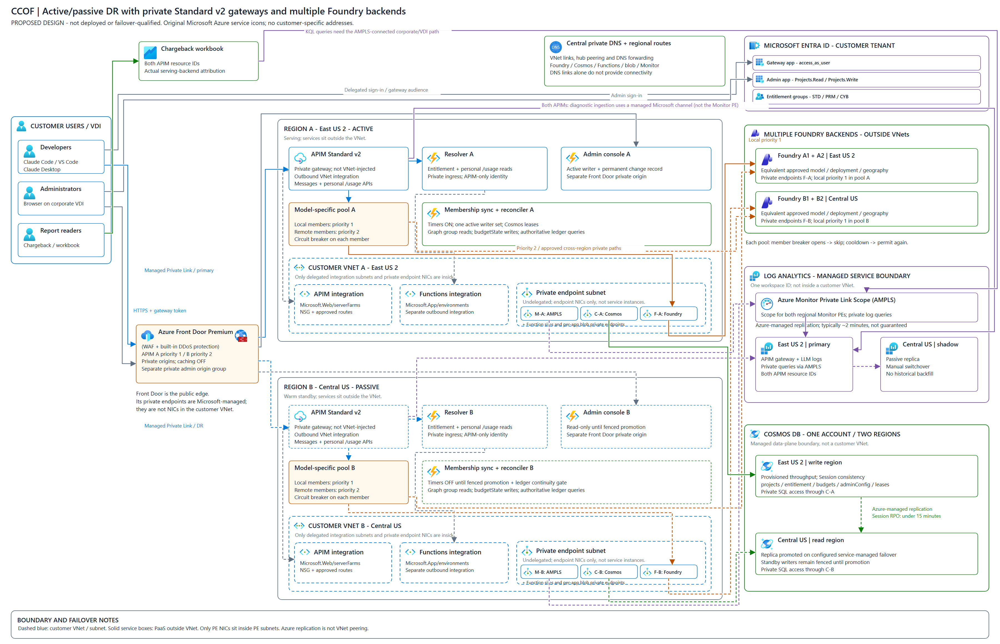

# Disaster recovery: active/passive across two regions

Design for keeping CCOF serving developers when one Azure region is lost. Decision record:
[ADR 0033](adr/0033-dr-active-passive.md). The Azure-icon diagram is generated from
[dr-network-architecture.py](diagrams/dr-network-architecture.py).
The [Mermaid view](diagrams/dr-active-passive.mmd) retains the logical flows.

Status: proposed design, not deployed or failover-qualified. The diagram uses **Standard v2** APIM
in each region, private behind Front Door Premium, and multiple Foundry backend members with
priority pools and per-member circuit breakers. The staged templates deploy one region today; the
changes this design needs are listed under [Required changes](#required-changes).

DR-01 through DR-06 baseline implementation merged to `main` on 2026-10-25. DR-05R coverage-aware
continuity work and the remaining two-region qualification are on `feat/dr-standby`, not merged.
[The implementation contract](design/DR-IMPLEMENTATION.md) prepares identity and network handoffs
before runtime deployment. Backend pools are **optional per project**, off by default; admins select
the primary and permitted compatible fallback backends. The diagram depicts the enabled case,
not permission to route every project to every Foundry account.

[Open the scalable diagram](images/dr/dr-active-passive.svg) for full-size viewing and browser zoom.

The diagram keeps the left-to-right flow: customer users and Front Door, active/passive application
regions, then managed Foundry and data services. Logos are unmodified
[Microsoft Azure architecture icons](diagrams/icons/azure/ATTRIBUTION.md), embedded in the SVG.

### Network and managed-service boundaries

| Boundary | What the diagram places there |
| --- | --- |
| Regional customer VNet | APIM outbound integration subnet, Functions outbound integration subnet, and a separate undelegated private-endpoint subnet. APIM Standard v2 and Functions compute remain outside these subnet boundaries. |
| Private-endpoint subnet | NICs for Foundry, Cosmos SQL, Azure Monitor, Function sites and app blob storage. The target services are not hosted inside the subnet. |
| Cosmos service boundary | One managed account with East US 2 write and Central US read locations. Regional SQL private endpoints reach the account; Azure manages replication outside customer VNet routing. |
| Azure Monitor service boundary | The logical Log Analytics workspace, its passive managed shadow, and Azure Monitor Private Link Scope (AMPLS). Each regional Monitor PE connects to the shared scope for private queries. |
| Front Door private ingress | Microsoft-managed private endpoints to the APIM and admin origins, not endpoints in the customer PE subnets. |

APIM diagnostic settings send resource logs through a managed Microsoft channel; they do not traverse
the customer's Monitor private endpoint. AMPLS controls private client ingestion/query paths. Private
query access also requires the approved corporate/VDI DNS and network path; an Azure Portal login
alone does not supply it. See
[Azure Monitor Private Link network controls](https://learn.microsoft.com/azure/azure-monitor/fundamentals/private-link-design#control-network-access-to-ampls-resources).

The boundaries are regional/network boundaries, not asserted physical availability-zone placements.
No AZ1/AZ2 allocation or unverified Standard v2 zonal configuration is implied.

## Decisions

| Topic | Decision | Reason |
| --- | --- | --- |
| Topology | **Active/passive.** Region A serves all traffic; Region B is a warm standby that Front Door uses only when Region A is unhealthy. | One writer for Cosmos, one reconciler and one set of APIM token counters at a time. Active/active would split per-person token limits across two independent APIM instances ([llm-token-limit](https://learn.microsoft.com/azure/api-management/llm-token-limit-policy)). |
| Region pair | **East US 2 (A) + Central US (B), proposed.** | Both list Standard v2 and the selected Claude models; East US 2 can replicate Log Analytics to Central US. Exact model availability, capacity and network paths still need deployment checks. |
| Edge | **Azure Front Door Premium with a WAF policy.** DDoS protection is the built-in Front Door edge protection; no separate DDoS Network Protection plan is needed for the Front Door endpoint. | [Application DDoS protection](https://learn.microsoft.com/azure/web-application-firewall/application-ddos-protection#platform-ddos-protection-differs-by-platform). Front Door reaches each APIM through Private Link ([guide](https://learn.microsoft.com/azure/frontdoor/standard-premium/how-to-enable-private-link-apim)). |
| APIM | **Two separate Standard v2 instances**, one per region, same rendered policies; private inbound through Front Door and outbound VNet integration for backends. | Standard v2 supports inbound Private Link and outbound integration, but not full VNet injection. Regional DR does not depend on the unresolved Standard v2 zone-support documentation; Premium v2 remains an alternative. |
| Foundry backends | **Model-specific priority pools in each APIM**, with circuit breakers on individual backend members. Local endpoints have priority 1; approved remote endpoints priority 2. | Backend failures can be isolated without switching the whole APIM region. The diagram's A1/A2 and B1/B2 are illustrative, not a required minimum of four accounts. |
| Cosmos DB | **Provisioned throughput, one write region (East US 2), one read region (Central US), Session consistency, service-managed failover.** | Matches today's Session setting, so no application change. Serverless can't add a second region ([serverless](https://learn.microsoft.com/azure/cosmos-db/serverless#use-serverless-resources)). Strong consistency over two regions loses write availability when one region fails ([reliability](https://learn.microsoft.com/azure/reliability/reliability-cosmos-db)). |
| Log Analytics | **One workspace in East US 2 with workspace replication to Central US.** One workspace ID stays the single source of truth for the ledger, workbook and admin console. | [Workspace replication](https://learn.microsoft.com/azure/azure-monitor/logs/workspace-replication). |
| Budget enforcement during an outage | **Unchanged: fail closed.** When budget figures go older than `RESOLVER_BUDGET_STATE_HARD_LIMIT_SECONDS`, budget-enforced requests are refused, as today. After switchover the reconciler restarts only after the ledger continuity gate passes. | A ledger with a gap would compute lower spend and loosen budgets. A grace mode would be a code and policy change and a weaker control; it can be added later as a separate decision. |

## Region pair evaluation

| Requirement | East US | West Central US | **East US 2** | **Central US** |
| --- | --- | --- | --- | --- |
| Claude on Foundry (Global Standard) | Yes | Yes | Yes | Yes |
| APIM Standard v2 | Listed | Not listed | Listed | Listed |
| APIM Premium v2 | Not listed | Not listed | Listed\* | Listed\* |
| Log Analytics replication | Primary; replica only outside East US / East US 2 / South Central US | Primary only, not a replica location | Primary | Replica location |

\* Both show a temporary restriction on creating new Premium v2 instances on the
[region availability page](https://learn.microsoft.com/azure/api-management/api-management-region-availability).
Premium v2 is not the baseline in the updated diagram. Standard v2 in the same regions preserves
the topology, with capacity and feature limits assessed for the workload.

East US + West Central US was the starting proposal. It fails two requirements: neither region
offers APIM Premium v2, and West Central US can't hold a Log Analytics replica
([supported regions](https://learn.microsoft.com/azure/azure-monitor/logs/workspace-replication#supported-regions)).
Both remain valid as **Foundry** locations: a Foundry deployment can be in a different region from
the APIM that calls it, at the cost of cross-region latency.

Claude Global Standard quota is shared across regions within a subscription
([quota scope](https://learn.microsoft.com/azure/foundry/foundry-models/concepts/claude-models-quotas-limits)).
The second Foundry endpoint adds availability, not capacity.

## APIM tier and private access

Standard v2 is the baseline in the updated diagram. The topology uses two separate instances,
and neither v2 tier spans regions. Standard v2 is not injected into the customer VNet: private
inbound access and outbound integration are separate connections.

| Capability | Standard v2 | Premium v2 |
| --- | --- | --- |
| East US 2 and Central US | Available | Listed; new instances temporarily restricted |
| East US / West Central US | East US yes; West Central US no v2 tier | Neither |
| Outbound VNet integration (private Foundry) | Yes | Yes |
| Inbound private endpoint (Front Door Private Link) | Yes | Yes |
| VNet injection | No | Yes |
| Max scale units | 10 | 30 |
| Availability zones | The reliability guide lists it; the features-by-tier table doesn't. Confirm on a test deployment. | Yes |

Private gateway behind Front Door Premium:

- Front Door Premium connects to each APIM gateway over Private Link: origin type API Management,
  target sub-resource Gateway. The connection is then approved on the APIM side.
- APIM public network access is then turned off; this is possible only after a private endpoint exists.
- For Standard v2 and Premium v2 behind Front Door Premium, private endpoints work with any supported
  VNet configuration, including the outbound integration CCOF uses
  ([private endpoint limitations](https://learn.microsoft.com/azure/api-management/private-endpoint#limitations)).
- Front Door remains the public entry point, where the WAF and built-in DDoS protection apply. Only
  the APIM gateway endpoint supports inbound Private Link.
- An admin console route through Front Door needs its own Private Link origin to the admin Function App.
- Front Door's managed private endpoint is not an endpoint deployed into the customer's subnet.
  A separate customer-VNet endpoint is needed only if approved callers also need direct private access.

Sources: [v2 networking](https://learn.microsoft.com/azure/api-management/v2-service-tiers-overview#networking-options),
[features by tier](https://learn.microsoft.com/azure/api-management/api-management-features),
[APIM reliability](https://learn.microsoft.com/azure/reliability/reliability-api-management).

## Multiple Foundry backends and circuit breakers

The diagram separates two failure boundaries:

| Boundary | Mechanism | Effect |
| --- | --- | --- |
| APIM or application-region failure | Front Door priority origins A then B | New requests move to the other APIM instance when its readiness and routing conditions permit. |
| One Foundry endpoint fails or throttles | APIM backend pool with priority tiers and a circuit breaker per member | Subsequent backend selections exclude an open member and can select another eligible local member, then an approved remote member. The APIM can stay in the active region. |

Each model-specific pool contains only endpoints that serve the approved model, deployment name,
hosting/version, data-processing geography and authentication mode. This is not automatic
substitution of Sonnet with Haiku or another model. Membership in a pool must preserve the
project's routing and residency policy.

Circuit-breaker behaviour:

1. **Closed:** APIM sends traffic to eligible members at the highest available priority.
2. **Open:** the configured failure threshold trips the member's breaker. APIM excludes that member
   for its trip duration. The design considers backend 429 and selected 5xx responses, with
   `acceptRetryAfter` where appropriate. Thresholds and cooldowns require load-test qualification.
3. **Cooldown elapsed:** APIM permits traffic to that member again; renewed failures can trip it
   again. A backend pool is not a guarantee that a failed request is retried.
4. **No eligible member:** the request fails, typically with 503. The design does not replay a
   partially delivered stream. Retrying a generation after an ambiguous failure can duplicate
   execution and charges.

The publisher's read-back verifies breaker count, interval, status ranges, trip duration,
`Retry-After`, and no-response reasons before marking a revision published. A registered backend's
breaker-setting update is audited but does not automatically create a project routing revision.
Switching failover off and on with an unchanged pool can reuse a previously published revision; do
not assume that it queued a new publication. The metadata-only republish path remains unqualified.

Breaker decisions are approximate and local to gateway instances; there is no globally shared
breaker state between the two APIM services. A breaker does not create extra quota: Claude
deployments can share subscription-wide limits, so both local and remote members may throttle.

Both regional APIMs need private DNS and HTTPS reachability to every permitted pool member,
including remote members through approved peering or hub routing. Each APIM managed identity needs
Foundry access on every account it may call. A DNS zone link alone does not provide that network
path. Front Door Private Link protects the inbound leg, not these outbound connections.

Accounting retains the logical project/pool selection and the actual serving backend/deployment.
The pool layer must not lose the ledger's backend, model and inference-geography attribution.
The existing policy selects one backend; the pools and breakers in this diagram are additions,
not current deployed behaviour.

Source: [APIM backend pools and circuit breakers](https://learn.microsoft.com/azure/api-management/backends).

## Behaviour by failure

| Failure | Effect | Recovery |
| --- | --- | --- |
| One zone in Region A | Depends on each deployed service's validated zone support; this design does not assume Standard v2 zone redundancy | Service recovery or Front Door regional failover, according to the failed dependency |
| APIM A unhealthy | Front Door health probes fail; new requests go to APIM B. Streams in flight are cut and clients retry. | Automatic (Front Door) |
| Region A lost | Front Door moves traffic to Region B. Cosmos fails over to Central US by service-managed failover. Log Analytics needs a manual switchover. Region B sync and reconciler stay off until the runbook promotes them. | Runbook below |
| Cosmos write region lost only | Region B resolver keeps reading. Writes (admin changes, sync, reconciler) wait for failover. | Service-managed failover |
| Log Analytics primary lost only | Requests continue. Usage logging and reconciliation pause; budget figures age and, past the hard limit, budget-enforced requests are refused. | Manual workspace switchover, then continuity gate |
| One Foundry backend lost | Its breaker opens after the configured threshold; subsequent selections can use another eligible member without moving the APIM origin | Backend-pool selection; thresholds and private remote paths must be qualified |
| All compatible Foundry backends unavailable | No eligible inference target; requests fail. Switching APIM does not repair a shared model-provider or quota outage | Restore a compatible backend or capacity; no silent model substitution |

Recovery figures documented by Microsoft:

- Cosmos with Session consistency: RPO under 15 minutes for a region outage.
- Log Analytics replication: typically about 2 minutes, not guaranteed. Logs ingested before
  replication was enabled are not copied.
- Front Door: shifts traffic when health probes fail. If every origin fails, it round-robins across
  all of them ([health probes](https://learn.microsoft.com/azure/frontdoor/health-probes#complete-health-probe-failure)).

## Failover runbook (Region A lost)

1. **Confirm.** Azure Service Health shows the Region A incident, and Front Door shows origin A unhealthy.
2. **Traffic.** Confirm Front Door is routing to APIM B. If origin A still answers but is degraded,
   disable origin A in the origin group.
3. **Cosmos.** Confirm Central US is the write region (service-managed failover). If it hasn't moved
   and the outage is confirmed, run a forced failover
   ([how-to](https://learn.microsoft.com/azure/cosmos-db/how-to-manage-database-account#perform-forced-failover-for-your-azure-cosmos-db-account)).
4. **Log Analytics.** Trigger the workspace switchover
   ([switch over](https://learn.microsoft.com/azure/azure-monitor/logs/workspace-replication#switch-over-to-your-secondary-workspace)).
   Expect a few minutes for DNS-based rerouting. The REST call is
   `POST .../providers/Microsoft.OperationalInsights/locations/<standby region>/workspaces/<name>/failover?api-version=2025-02-01`
   with `Content-Type: application/json` and body `{}`: without a body the service returns HTTP 415, and
   `az rest` without `--body` waited 55 minutes in the lab without starting the operation. Failback is
   `POST .../workspaces/<name>/failback` with the same body. The replica holds only data ingested after
   replication was enabled: in a month where replication started after the month began, the ledger is
   incomplete while switched over and the gate refuses `spend_would_decrease` (UNKNOWNS DR-17).5. **Ledger continuity gate.** Before enabling the Region B reconciler:
   - the workspace answers the ledger query for the current month;
   - the newest APIM A record in the replica is within the replication lag of the outage start;
   - APIM B records are arriving.
   - `RECONCILER_LEDGER_COVERAGE_START_AT` is the verified diagnostics start, earlier than any
     model traffic allowed through either gateway.

   With `RECONCILER_CONTINUITY_GATE=on` and both APIM IDs in
   `RECONCILER_LEDGER_GATEWAY_RESOURCE_IDS`, the reconciler compares backend-forwarded model requests
   with LLM usage rows, verifies the persisted period coverage marker, and refuses spend decreases
   before writing. A quiet interval alone is not a gap. If a check fails, keep both writers off,
   preserve the gate, and record the missing evidence; budget-enforced requests are refused once
   figures pass the hard limit.
6. **Promote Region B writers.** Set `AzureWebJobs.syncEntitlement.Disabled=false` on sync B and
   enable the reconciler B timer. Admin B becomes writable once Cosmos accepts writes in Central US.
7. **Verify.**
   - An admitted model call returns 200 through Front Door.
   - `/ccof-usage/me/usage` returns current figures.
   - The admin console change record accepts a test edit.
   - A reconciler run completes.

**Failback:** run the same steps in reverse once Region A is healthy. Before re-enabling the Region A
writers, turn off the Region B writers, so only one region writes at a time.

## Required changes

| Area | Change | Effort |
| --- | --- | --- |
| Staged deployment | A `secondaryRegion` section. Stage 1 creates Region B resources using Standard v2; Stages 3, 5 and 7 apply grants, settings (timers off) and code to Region B. Cosmos needs a second region and provisioned throughput. Zone redundancy and any Premium v2 option are explicit, separately validated choices. | Medium |
| Front Door | New template: profile, WAF policy, origin group with both APIM origins over Private Link, probes, no caching. The client `gatewayUrl` becomes the Front Door host. | Medium |
| Accounting | **Implemented (DR-05, 2026-10-25).** The ledger query, reconciler, workbook and admin chargeback queries take a list of up to 4 APIM resource IDs. Reconciler: optional `RECONCILER_LEDGER_GATEWAY_RESOURCE_IDS` (comma-separated); `RECONCILER_LEDGER_GATEWAY_RESOURCE_ID` stays valid, and when both are set the single ID must be in the list (`single_not_in_list`) ([settings.ts:212](../src/reconciler/settings.ts#L212)). `CcofUsageLedger` filters both gateway tables with `in~` and keeps one row per `gatewayRequestId` (the APIM `CorrelationId`) ([ledger.kql:12](../analytics/ledger.kql#L12), [:33](../analytics/ledger.kql#L33), [:107](../analytics/ledger.kql#L107)). Workbook answer `gatewayResourceIds` ([config.ts:74](../analytics/workbooks/config.ts#L74)); admin `ADMIN_GATEWAY_RESOURCE_IDS` ([chargeback.ts:52](../admin/src/chargeback.ts#L52)). Deployment inputs: `reconciler.ledgerGatewayResourceIds` in [app-settings.bicep:128](../infra/quickstart/modules/app-settings.bicep#L128) and [Core.D2Steps.psm1:156](../scripts/Core.D2Steps.psm1#L156), `gatewayResourceIds` in [ReconcilerDeploy.psm1:58](../infra/reconciler/ReconcilerDeploy.psm1#L58), `ledgerGatewayResourceIds` in [Session-Helpers.ps1:334](../scripts/manual/Session-Helpers.ps1#L334). Without a list each path renders the same settings as before (`tests/Test-DrLedgerGateways.ps1`). `/ccof-usage/me/usage` reads budget state from Cosmos, not gateway logs, and is unchanged. | Medium |
| Continuity gate | **DR-05R implemented on `feat/dr-standby`, off by default.** `RECONCILER_CONTINUITY_GATE=on` requires `RECONCILER_LEDGER_COVERAGE_START_AT`. The gate correlates backend-forwarded model requests with `ApiManagementGatewayLlmLog`, detects LLM rows without a gateway request, rejects requests before verified coverage, refuses current-period states with a missing or changed coverage marker, and retains the `spend_would_decrease` guard. It no longer treats a quiet interval or a late first request as a gap. Gate settings pass through quick-start/staged Bicep, Core D2, standalone reconciler answers, and manual settings generation. Existing unmarked October states remain fenced; the October diagnostic start is later than the month start. Tests: `tests/reconciler-continuity.test.ts`, `tests/reconciler-settings.test.ts`, `tests/Test-DrLedgerGateways.ps1`, and `tests/Test-StagedStages.ps1`. | Small |
| Health | A Front Door probe target per region that checks resolver readiness and Cosmos reachability. Today `/api/health` checks only configuration and authentication. | Small |
| Backends | Model-specific pools, compatible local/remote members, per-member circuit breakers, private routing and identity grants from both APIMs; preserve actual-backend accounting and test streaming failures | Medium |
| Log Analytics | Enable workspace replication. Associate DCRs with the workspace DCE if any are used. Replicate log alert rules to Region B. | Small |
| Private log queries | Azure Monitor Private Link Scope associated with the workspace, Monitor private endpoints in both regional PE subnets, approved private DNS/forwarding and connected corporate/VDI access. Diagnostic ingestion is a separate managed channel. | Small |
| Testing | A failover drill in a lab: drain origin A, Cosmos failover, workspace switchover and the continuity gate, then failback | Medium |

## Out of scope

- Active/active. It needs per-person token limits shared across APIM instances, which APIM
  counters don't provide.
- Entra ID. It is a global service; no regional failover applies.
- Moving the Region A Foundry account or its model deployments.
