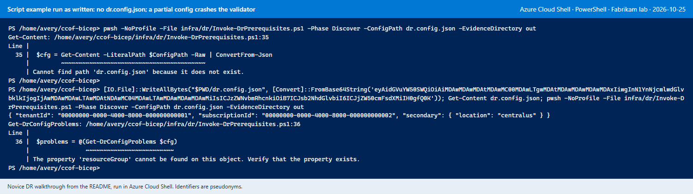
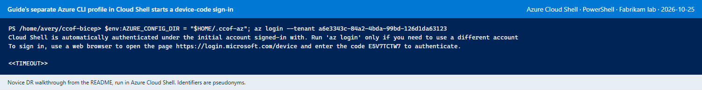
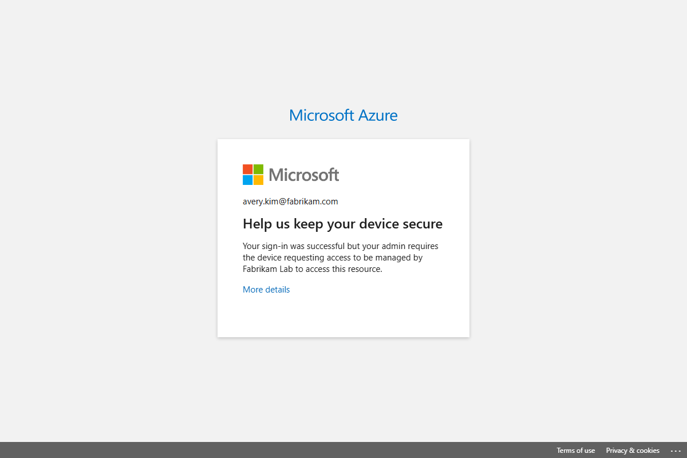
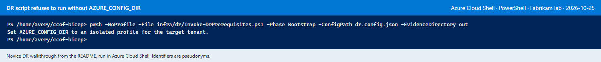
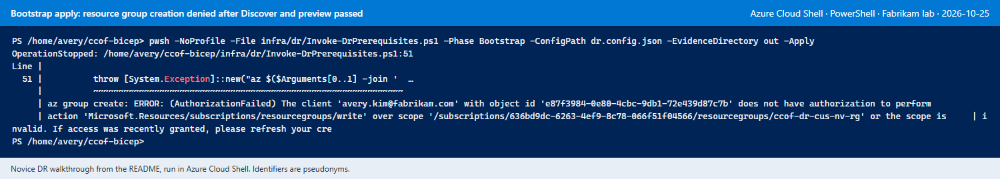
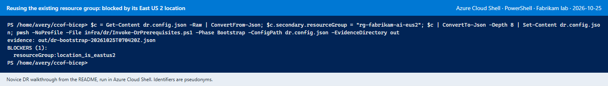
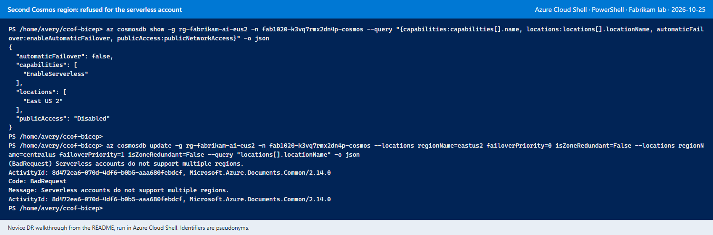
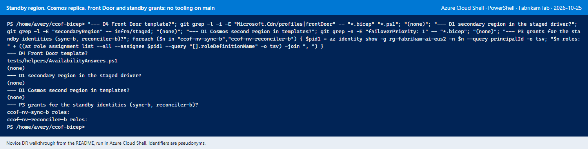

# DR deployment from the documentation: novice walkthrough, 2026-10-25

**Test record.** A first-time operator started at the README on `main` (`8cab948`) and tried to set
up disaster recovery (DR) in Azure Cloud Shell using only the documentation. Every step that has
tooling on `main` was applied for real, not only previewed. Environment: the Fabrikam lab
(primary region East US 2, existing single-region deployment from the
[step-by-step guide](runbooks/DEPLOY-STEP-BY-STEP.md)), standby region Central US.

Screenshots: Cloud Shell images are rendered from the captured Cloud Shell transcripts, because the
Cloud Shell terminal draws text on a canvas that cannot be pseudonymised in place. Browser pages are
live captures with page text pseudonymised before capture. Names, IDs and subscriptions are
pseudonyms with the same shape as the real values.

## Result

| DR stage ([DR implementation](design/DR-IMPLEMENTATION.md#prerequisite-first-dr-stages)) | Tooling on `main` | Outcome in Cloud Shell |
| --- | --- | --- |
| P0 discover | `infra/dr/Invoke-DrPrerequisites.ps1 -Phase Discover` | Passed after N-02 to N-05 |
| P1/P2 identity and network bootstrap | Same script, `-Phase Bootstrap -Apply`, then `-Phase Verify` | Applied and verified after N-06 to N-08: standby VNet, three subnets, APIM NSG, five DNS links, two-way peering `Connected`, two identity shells |
| P3 access handoff | None | Blocked (N-10): the standby identities have no role assignments and no script grants them |
| Per-project backend failover (DR-02 to DR-04) | Admin console, `Publish-ProjectRouting.ps1`, snapshot apply | Switched on and served through the project's pool (N-12, N-15); publishing and the gateway test cannot run in Cloud Shell (N-13) |
| Log Analytics workspace replication | None; Microsoft Learn link | Enabled to Central US after N-09 (state `Succeeded`) |
| D1 standby services: second Cosmos region, regional APIM and Function Apps | None | Blocked: the staged default Cosmos account is serverless and cannot add a region (N-11); no standby-region template (N-14) |
| D2 to D6: configuration, code, Front Door, acceptance, failure drill | None | Blocked (N-14); matches ROADMAP packets DR-05, DR-07 and DR-08 (pending) |

A novice cannot complete DR from the documentation today. The prerequisites, per-project backend
failover and workspace replication can be set up; a second serving region cannot.

## Issues and required fixes

Severity: **Blocker** stops the DR setup; **High** stops a novice without outside help;
**Medium** needs code reading or trial and error; **Low** causes confusion only.

| # | Severity | Where | What the novice hit | Fix required |
| --- | --- | --- | --- | --- |
| N-01 | High | README, DR docs | The README calls DR "design, not yet deployable" and links two design documents. Neither has a runbook: no ordered commands, no statement of which stages can be run today. | A DR runbook in `docs/runbooks/` with the runnable stages (P0-P2, backend failover, workspace replication), their commands and checks, and the stages that are not available yet. The README's DR row links to it. |
| N-02 | High | `infra/dr/Invoke-DrPrerequisites.ps1` | The script's own example names `dr.config.json`, which does not exist. The configuration fields appear only in `tests/Test-DrPrerequisites.ps1`. | `infra/dr/dr.config.example.json` with every field and `REPLACE-` placeholders, and a field table in the runbook (source of each value). |
| N-03 | Medium | `infra/dr/DrPrerequisites.psm1` `Get-DrConfigProblems` | A partial configuration stops with `The property 'resourceGroup' cannot be found on this object` (strict mode) instead of listing the missing fields. | Read each field through a null-safe accessor and report `secondary.resourceGroup:required` and so on; add a test with a partial configuration. |
| N-04 | High | [Step-by-step guide](runbooks/DEPLOY-STEP-BY-STEP.md), "A separate Azure CLI sign-in" | In Cloud Shell, setting `AZURE_CONFIG_DIR` and running `az login` starts a device-code sign-in; the tenant's Conditional Access refuses it ("requires the device … to be managed"). | A Cloud Shell variant in the guide: keep Cloud Shell's built-in sign-in and run `az account set --subscription`. A separate profile applies to workstations. |
| N-05 | High | `Invoke-DrPrerequisites.ps1` line 65 | The script refuses to run without `AZURE_CONFIG_DIR`, which conflicts with N-04 in Cloud Shell. Setting it to Cloud Shell's own profile (`$HOME/.azure`) works. | Accept Cloud Shell (environment variable `ACC_CLOUD` present) without the variable, or document `$env:AZURE_CONFIG_DIR = "$HOME/.azure"` for Cloud Shell. |
| N-06 | Low | Cloud Shell | The session is ephemeral (files lost at timeout), the default subscription is another one, and Bicep is not installed. | Runbook preamble: `az account set`, `az bicep install`, and keep `dr.config.json` and evidence outside the session (download or a storage-backed Cloud Shell). |
| N-07 | Medium | Bootstrap | Discover and the Bootstrap preview passed, then `-Apply` failed with `AuthorizationFailed` on resource-group creation. Nothing checks this permission earlier. | Discover checks `Microsoft.Resources/subscriptions/resourceGroups/write` when the standby resource group does not exist, or the preview states that creating it needs that permission. |
| N-08 | Medium | Bootstrap | Reusing the existing (East US 2) resource group is refused with `resourceGroup:location_is_eastus2`. The override `secondary.allowResourceGroupInOtherRegion: true` exists only in the code. | Name the override in the blocker message and in the example configuration and runbook, with its meaning (resource group metadata stays in the primary region). |
| N-09 | Medium | Workspace replication | The DR design links Microsoft Learn only. In Cloud Shell's Azure CLI, `az monitor log-analytics workspace update` has `--replication-enabled` but no replication location (`unrecognized arguments: --replication-location`). Learn's method is a full-object REST PUT, which resets settings omitted from the body. | A script or runbook block that reads the workspace, adds `properties.replication` and writes the full object back (the method used here; SKU and retention unchanged), with the check `properties.replication.provisioningState == Succeeded`. |
| N-10 | Blocker | P3 access handoff | The standby identities from Bootstrap have no role assignments, and no script or command list grants them. The handoff table lists roles but not exact scopes. | A P3 step (Bicep or script) granting the standby identities their roles at exact scopes, with read-back; until then, a command list per identity in the runbook. |
| N-11 | Blocker | D1, Cosmos DB | The staged deployment's default is `cosmosCapacityMode: serverless`. Adding Central US fails: `Serverless accounts do not support multiple regions`. The DR design needs provisioned throughput, but the deployment guide does not ask for that choice, and no migration path from serverless is documented. | Ask for the DR intent at Step 1 of the deployment guide (provisioned throughput when DR is planned). Document the migration for existing serverless deployments (new provisioned account, data copy, switch of `COSMOS_ENDPOINT`). |
| N-12 | Low | [Admin operations](runbooks/ADMIN-OPERATIONS.md#d-optional-per-project-backend-failover-admin-33) step 3 | Switching failover back on with unchanged fallbacks went straight to `verified` (the earlier pool revision was reused); the runbook says the state becomes `pending publication`. | Runbook note: an unchanged, already verified pool is reused; a changed fallback list needs publication. |
| N-13 | Medium | Admin operations step 4 and 5; guide Step 8 | `Publish-ProjectRouting.ps1` and the guide's Step 8 token request fail in Cloud Shell: `Audience api://… is not a supported MSI token audience`. Azure PowerShell in Cloud Shell fails the same way, and `az login --scope` is the device-code flow refused in N-04. These steps were run from an approved workstation. | State in both documents that these steps need a workstation sign-in (or a Conditional Access-approved device), and why. A longer-term option is publishing from the admin app's own identity, so the console can publish. |
| N-14 | Blocker | D1 to D6 | No template or script for the standby APIM and Function Apps, a second Cosmos region, Front Door Premium, Azure Monitor Private Link Scope, two-APIM accounting, the ledger continuity gate or promotion. The staged driver has no `secondaryRegion` section. | Implement ROADMAP packets DR-05, DR-07 and DR-08; until then the README states which DR parts are deployable. |
| N-15 | Medium | [Cloud Shell quickstart](runbooks/CLOUD-SHELL-QUICKSTART.md) section 5 | The snapshot apply example uses quickstart names (`$prefix-sync-func`, `$prefix-sync-ai`); staged deployments name the apps `<prefix>-<suffix>-sync` and `<prefix>-<suffix>-sync-ai`. The admin runbook's "next entitlement sync (or snapshot apply)" has no command. | Show how to read the actual sync app and Application Insights names (`az functionapp list`), and link the snapshot block from admin operations step 5. |
| N-16 | Low | Admin console, project Settings | The backend field shows "Inventory unavailable: type the APIM backend ID". | Name the missing permission or setting behind the inventory read, or hide the hint when the backend is already set. |

## Evidence

### Cloud Shell start (N-06)

### Configuration (N-02, N-03)

### Sign-in in Cloud Shell (N-04, N-05)

### Bootstrap (N-07, N-08)

### Cosmos DB and workspace replication (N-09, N-11)

### Per-project backend failover (N-12, N-13, N-15)

### Missing tooling (N-10, N-14)

## Changes made in the lab

| Change | Created or changed | Reversal |
| --- | --- | --- |
| Standby network and identities (Bootstrap) | VNet `ccof-dr-nv-vnet` (Central US, `10.80.0.0/22`) with `snet-apim`, `snet-functions`, `snet-pe`; NSG `ccof-dr-nv-nsg-apim`; peerings `to-ccof-dr-nv-vnet` and `to-fab1020-vnet`; link `ccof-dr-nv-vnet-link` in five private DNS zones; identities `ccof-nv-sync-b` and `ccof-nv-reconciler-b`; all in the existing resource group | Delete the peering on the primary VNet, the five links, the VNet, the NSG and the two identities |
| Workspace replication | Workspace `fab1020-k3vq7rmx2dn4p-law` replicates to Central US | REST PUT with `properties.replication.enabled: false` |
| Backend failover | Project SASLAB1 failover on (verified pool revision 1); one snapshot apply | Project Settings > Backend failover: clear the switch, then a snapshot apply |

Model calls: one Claude Haiku request of 16 output tokens.
