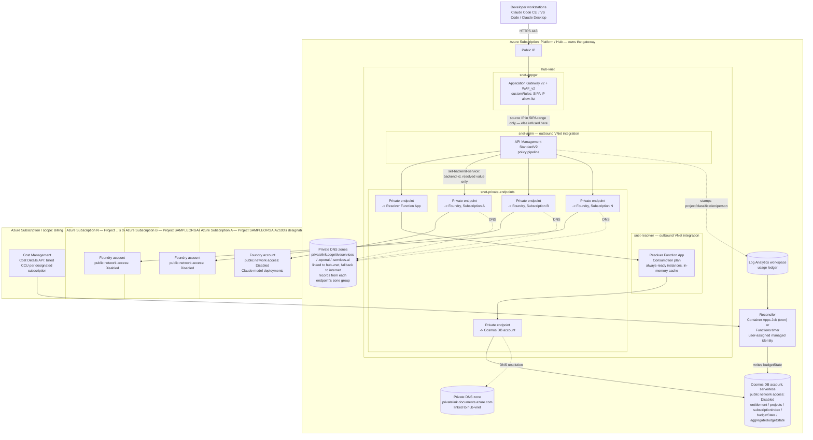
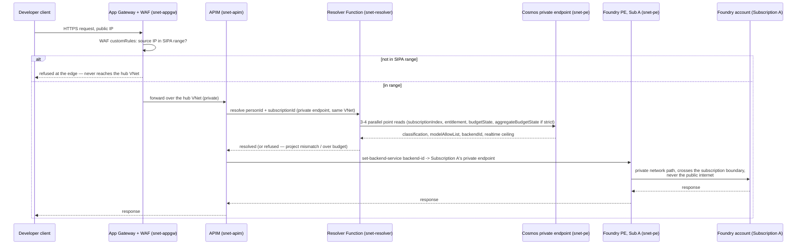

# Network architecture and bill of materials

This is the network-accurate view of `docs/ARCHITECTURE.md`'s logical diagram: real VNets, subnets,
private endpoints, the SIPA edge control, and cross-subscription connectivity to each project's
designated Foundry backend.

## Key fact this design relies on

A private endpoint's **network object** (the NIC, the private IP) must live in the same region and
subscription as the VNet it is deployed into. The **private-link resource it targets does not** —
`Microsoft.CognitiveServices/accounts` (Foundry) is a natively supported private-link resource type,
same as Cosmos DB ([Microsoft Learn, "What is a private endpoint?"](https://learn.microsoft.com/azure/private-link/private-endpoint-overview),
ms.date 2026-08-11, retrieved 2026-10-09: "The private endpoint must be deployed in the same region
and subscription as the virtual network. The private-link resource can be deployed in a different
region..."; the private-link resource table there lists "Foundry Tools —
`Microsoft.CognitiveServices/accounts`" explicitly). **This means every designated subscription's
Foundry account needs no VNet of its own** — only public network access disabled and a private
endpoint connection approved. Every private endpoint connecting to it lives in the hub, not the spoke.
This is materially simpler than the Private Link *Service* (customer-service, load-balancer-fronted)
pattern Packet G's original research described — that pattern is for your own custom services; first-
party PaaS resources like Foundry and Cosmos use the simpler, direct private-endpoint mechanism.

## Private DNS for the Foundry private endpoints

A private endpoint carries traffic only for clients whose DNS answers with its address. A Foundry account
has three host names, one per public suffix, and each suffix has its own zone:
`privatelink.cognitiveservices.azure.com`, `privatelink.openai.azure.com` and
`privatelink.services.ai.azure.com` ([MS Learn, "Azure Private Endpoint private DNS zone values"](https://learn.microsoft.com/azure/private-link/private-endpoint-dns),
ms.date 2026-08-11, retrieved 2026-10-11). The design ([ADR-0013](adr/0013-foundry-private-dns-in-the-hub.md)):

- The three zones live in the hub and are linked to the hub VNet, without auto-registration.
- Each Foundry private endpoint has one zone group that names the three zones, so Azure writes and removes
  the endpoint's A records with the endpoint.
- The links set `resolutionPolicy: NxDomainRedirect`. A name with no record in these zones, such as an
  account with a private endpoint in another network, then resolves publicly instead of returning NXDOMAIN
  to everything in the hub ([MS Learn, "Fallback to internet for Azure Private DNS zones"](https://learn.microsoft.com/azure/dns/private-dns-fallback),
  ms.date 2025-02-04, retrieved 2026-10-11).
- The zones answer only inside linked VNets. On-premises clients need a DNS Private Resolver or a forwarder.
- `infra/poc/foundry-private-dns.bicep` deploys this for one endpoint; the VNet and the endpoint are
  parameters.

In the PoC the endpoint has no zones yet, so APIM resolves the account's public address and the endpoint
carries no bytes (`docs/STATUS.md`, 2026-10-11, Correction 1). The change was applied and measured on
2026-10-11: APIM's calls moved to the endpoint within about five minutes, with no failed call. It was rolled
back the same day because the owner scheduled network changes after the live testing. The steps to apply it
again, with its checks and rollback, are in `docs/status/WP-NET.md`.

## Backend authentication: managed identity only works same-tenant

The private network path above is **tenant-agnostic** — a private endpoint connects across
subscriptions and across tenants identically, subject only to the target approving the connection.
**Authentication to the backend is not tenant-agnostic.** APIM's managed identity (used to call
`Microsoft.CognitiveServices/accounts` with `<authentication-managed-identity>`) always mints its
token in the identity's own home tenant. Cognitive Services validates the token's issuing tenant
against the resource's own tenant and rejects a mismatch with `"Tenant provided in token does not
match resource token"` — even when the identity correctly holds the Cognitive Services User role on
the target account (proved live 2026-10-09, see `docs/UNKNOWNS.md` U-9 and `docs/STATUS.md` Phase 2).

This means the designated-subscription routing model in `docs/LLD.md` has two distinct backend
shapes, not one:

| Backend tenant relationship | Auth mechanism | Secret management |
|---|---|---|
| Same tenant as the gateway, any subscription (the common case — "Multiple Subscriptions is way to add different subscription") | `<authentication-managed-identity>`, Cognitive Services User role per backend | None — no secret exists |
| Different tenant from the gateway (rarer — e.g. a backend borrowed from another business unit's tenant) | OAuth2 client-credentials against an app registration created **in the backend's own tenant**, Cognitive Services User role, secret stored as an APIM named value | A secret that must be rotated on whatever lifetime cap that tenant's policy enforces (the Validation tenant proven here caps it at 7 days — see U-10, OPEN: no rotation automation yet) |

The standard alternative to a stored secret, Federated Identity Credentials (Workload Identity
Federation), was attempted first and found blocked by the backend tenant's own Conditional
Access/app-management policy in this proof (multi-tenant app registrations refused, external-tenant
FIC issuers refused). A tenant without that restriction should prefer FIC over a stored secret — it
has no expiring credential to rotate. **Decide which shape a given project's backend needs at Stage 2
of `docs/CHECKPOINT-SETUP.md`, before provisioning it**, since the two shapes need different app
registrations and different APIM configuration.

## Full network topology

**Why Foundry accounts sit in their own subscriptions with no VNet, while everything else sits in the
hub:** the designated subscription owns billing and access control for its own Foundry account (so
that subscription's team retains ownership and Cost Management visibility for their own spend), but
the actual *network path* to it is entirely the hub's — the private endpoint, the DNS zone, and the
routing policy all live where the gateway lives. The spoke subscription's only obligation is: disable
public network access, and approve the hub's private endpoint connection request.

## Sequence flow across the network boundary

No hop after the WAF ever touches the public internet again: App Gateway to APIM, APIM to the
resolver, the resolver to Cosmos, and APIM to every designated subscription's Foundry account are all
private-endpoint or VNet-internal paths.

## Bill of materials

| Resource | Type | Lives in | Purpose |
|---|---|---|---|
| Public IP | `Microsoft.Network/publicIPAddresses` | Hub | The one public IP for the whole design |
| Application Gateway v2 + WAF_v2 | `Microsoft.Network/applicationGateways` | Hub, `snet-appgw` | The single public ingress; SIPA allow-list via `customRules` |
| API Management (StandardV2) | `Microsoft.ApiManagement/service` | Hub, `snet-apim` (outbound VNet integration) | Policy pipeline: auth, resolution, budget check, routing |
| Resolver Function App | `Microsoft.Web/sites` (Consumption, or Premium for always-ready) | Hub, `snet-resolver` | Cosmos lookups + in-memory cache, called by APIM |
| Cosmos DB account (serverless) | `Microsoft.DocumentDB/databaseAccounts` | Hub | `entitlement`, `projects`, `subscriptionIndex`, `budgetState`, `aggregateBudgetState` containers |
| Private endpoints (×4+N) | `Microsoft.Network/privateEndpoints` | Hub, `snet-private-endpoints` | One each to Cosmos, the deployment storage account, the resolver Function (if privately called), and every designated subscription's Foundry account |
| Private DNS zones (×5) | `Microsoft.Network/privateDnsZones` | Hub, linked to `hub-vnet` | Cosmos (`privatelink.documents.azure.com`), Storage blob (`privatelink.blob.core.windows.net`), and Foundry's three zones (`privatelink.cognitiveservices.azure.com`, `privatelink.openai.azure.com`, `privatelink.services.ai.azure.com`), whose links fall back to the internet. Each Foundry private endpoint has a zone group naming the three ([ADR-0013](adr/0013-foundry-private-dns-in-the-hub.md)) |
| Deployment storage account | `Microsoft.Storage/storageAccounts` | Hub | **Added 2026-10-09, found live, not originally anticipated**: a Flex Consumption Function App (the resolver's chosen plan, ADR-0003) needs a storage account for its own deployment package and runtime state, separate from any data the application itself stores. `allowSharedKeyAccess: false`, Entra RBAC only, same as every other resource here — and, confirmed live, needs its **own** private endpoint: `publicNetworkAccess: Disabled` means private-endpoint-only, not "reachable from anywhere already inside the hub VNet" (`docs/STATUS.md` Phase 3, U-13) |
| Reconciler | `Microsoft.App/jobs` (Container Apps Job, cron) or a Functions timer | Hub | Reads Log Analytics + Cost Management, writes `budgetState` (per person) and `aggregateBudgetState` (per project/classification); reuses the reference repository's custom-role-per-identity pattern |
| Log Analytics workspace | `Microsoft.OperationalInsights/workspaces` | Hub | Usage ledger APIM stamps every request to |
| Foundry account (× one per project) | `Microsoft.CognitiveServices/accounts` | Each project's **own, designated** subscription | Hosts that project's Claude model deployments; public network access disabled |
| Cost Management scope | n/a (an API, not a deployable resource) | Each designated subscription | Cost Details API or a daily export, for billed CCU; Cost Management Reader on each designated subscription ([ADR-0005](adr/0005-real-cost-from-marketplace-ccu-billing.md)) |
| Custom roles (×2+) | `Microsoft.Authorization/roleDefinitions` | Hub, created once (`docs/CHECKPOINT-SETUP.md` Stage 0) | Project-onboarding identity; reconciler identity — minimal, named `actions`, no broader RBAC |
