# Staged deployment live run — 2026-10-20

Result: **all nine stages passed** in a new lab resource group, ending with authenticated
model calls through the gateway and live data in the Admin V3 console.

| Field | Value |
| --- | --- |
| Driver and templates | `infra/staged` at this commit; configuration from `staged.config.example.json` with lab values (kept private) |
| Target | Lab subscription, new RG `ccof-staged-20261020-rg`, eastus2. The earlier Stage 1 RG `ccof-stage1-20261020-rg` was deleted first (approved) |
| Exposure choices (lab) | Cosmos and storage public access `Disabled` (private endpoints only); Function Apps `Enabled` with authentication; new APIM `BasicV2` with public ingress (approved) |
| Backend | Existing Foundry account in another RG: `claude-haiku-4-5`, `claude-sonnet-5`, `claude-opus-5-5` |
| Entra | Existing lab registrations and groups, merged (see finding 4) |
| Sync | `delegated-snapshot`: no Graph application permission |
| Final inventory | 42 resources in the RG, plus one role assignment on the Foundry account |

## Timeline

| Stage | Deployment (Azure) | Stage wall time | Result |
| --- | --- | --- | --- |
| 0 read-only checks | — | 41 s | Providers registered, eastus2 offers Flex, backend has the 3 deployments |
| 1 resources | `stage1-services` 2 min 05 s | apply + resume-verify 43 s | 34 creates; zero settings, keyless storage, no database, zero grants |
| 2 network | `stage2-network` 8 min 54 s | 11 min 07 s | 5 private endpoints Approved with DNS; 4 apps VNet-integrated |
| 3 schema | `stage3-schema` 2 min 46 s | 3 min 17 s | Database and 9 containers |
| 4 grants | `stage4-grants` 4 min 44 s | 5 min 21 s | 10 RG-scoped Azure grants, 13 Cosmos data grants, 1 Foundry grant |
| 5 Entra | — | 48 s | Scopes, preauthorization, redirects merged; groups read |
| 6 configuration | `stage6-config` 13 s (rerun 10 s) | 72 s | Settings, resolver auth, API, policy, telemetry, workbook |
| 7 code and data | — | 21 min 24 s | 4 packages, seed, snapshot (1 member admitted), client file |
| 8 acceptance | — | 2 min 23 s | 401/200/403 matrix, admin endpoints, telemetry |

### Rerun check

After the driver was split into files by responsibility (below), it ran again against the same
RG: Stage 0 passed, Stage 4 what-if reported `NoChange=28` (the grants converge), Stage 5 preview
listed only merges, and Stage 8 passed the full acceptance matrix again in 29 s.

## Screenshots

Command-output captures render the live stage logs. Identifiers have their middle masked;
no token or setting value is shown.

**Stage 0 — read-only checks**
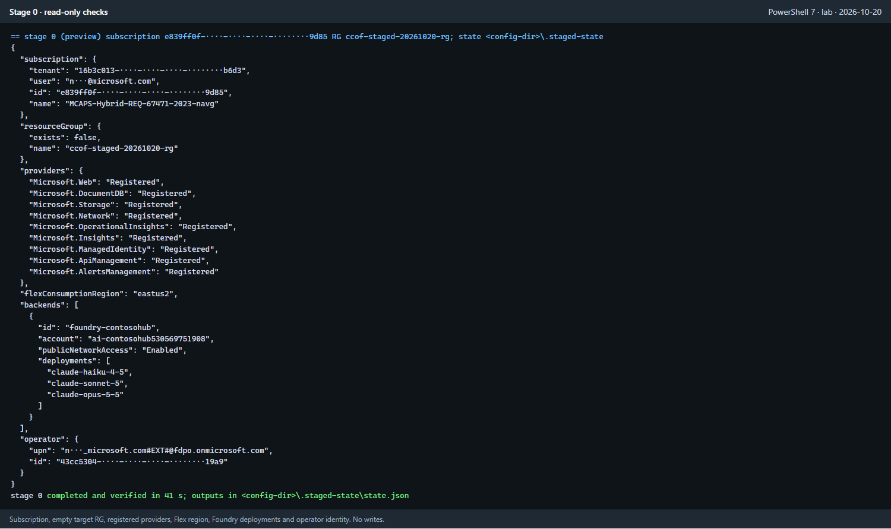

**Stage 1 — preview, then apply and verify**
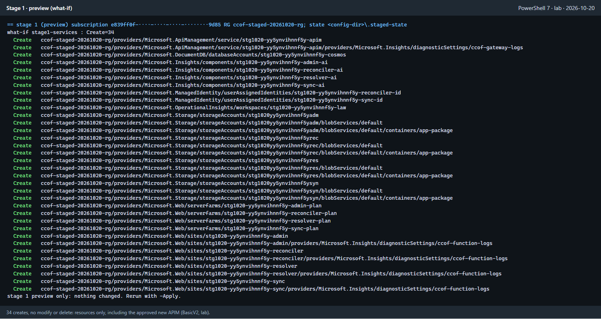
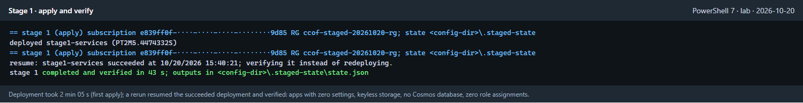

**Stage 2 — network**
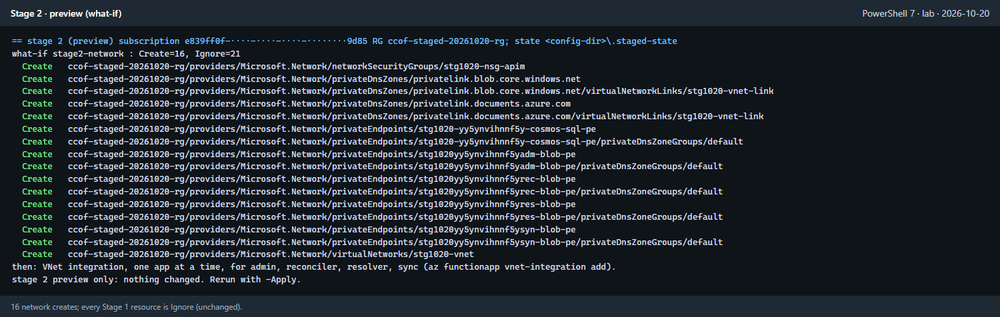
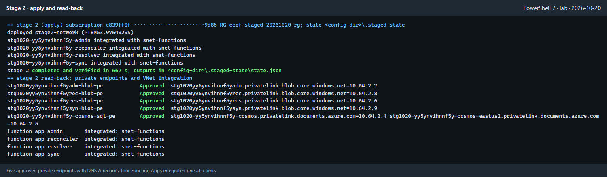

**Stage 3 — Cosmos schema**
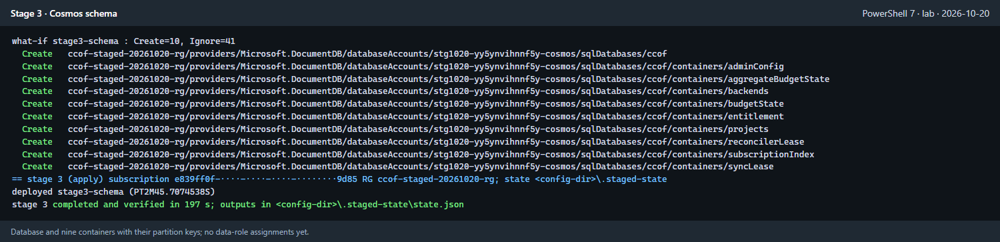

**Stage 4 — runtime grants**
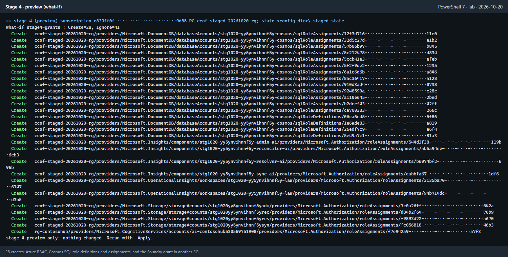
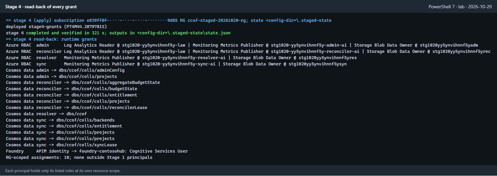

**Stage 5 — Entra**
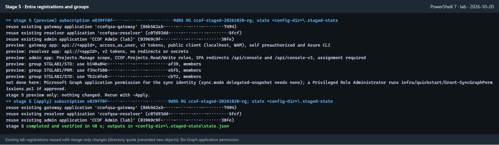

**Stage 6 — configuration**
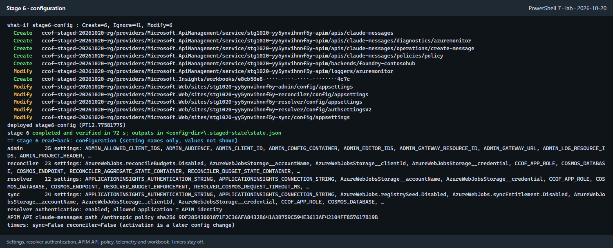

**Stage 7 — code, seed, snapshot, client file**
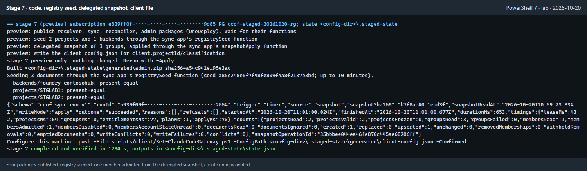

**Stage 8 — acceptance**
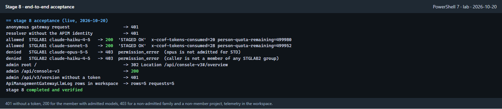

**Admin V3 on the deployed admin app.** The API refused the Azure CLI client until
`admin.extraAllowedClientIds` listed it, then served chargeback and onboarding data.
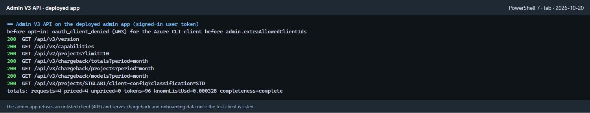

The console captures load the deployed console. The capture harness answered only
`/api/console-v3/config` with demo mode, to skip the interactive Microsoft sign-in, and sent
every API call to the deployed app with a real signed-in user token. The top bar therefore
reads "Demo editor"; all data comes from the deployed API.

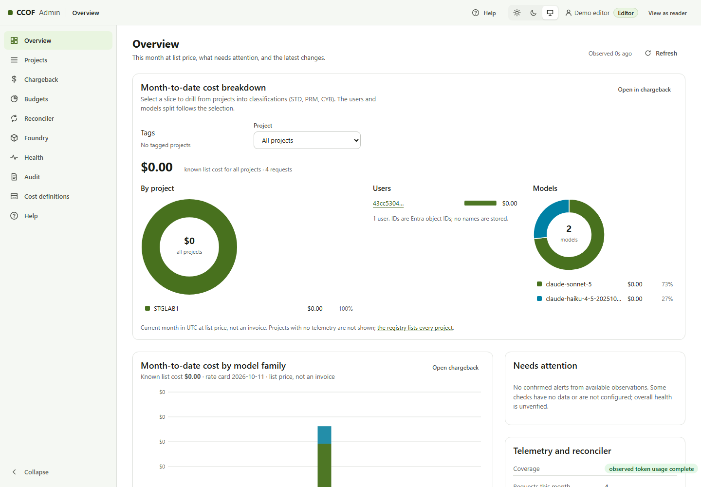
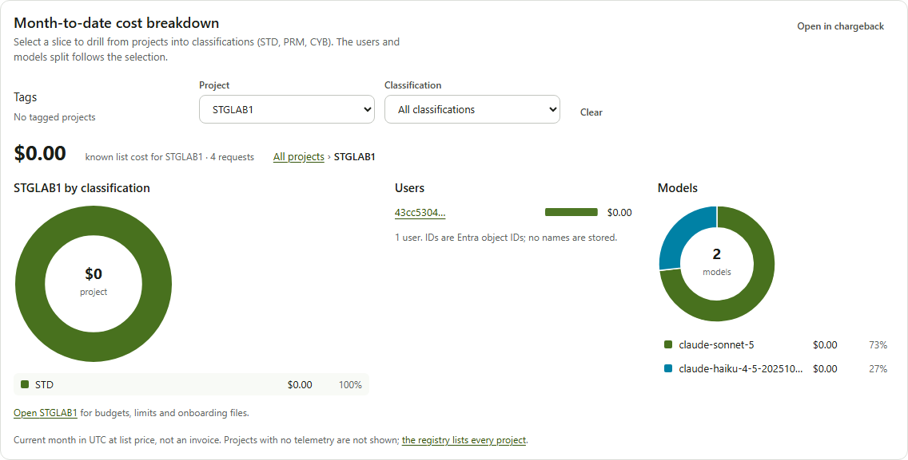
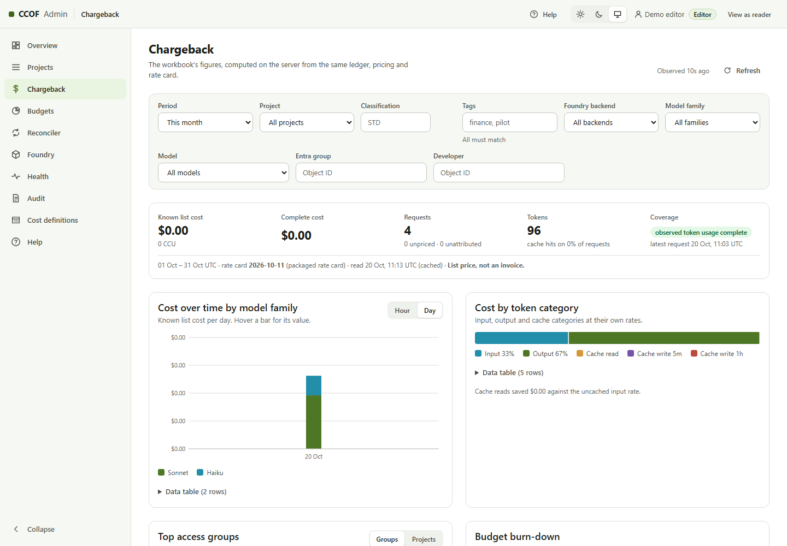
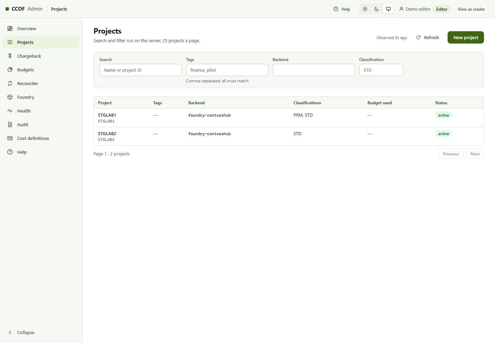
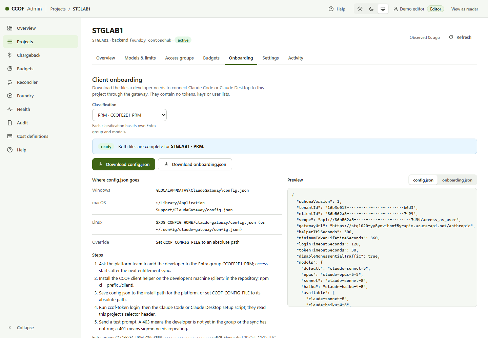
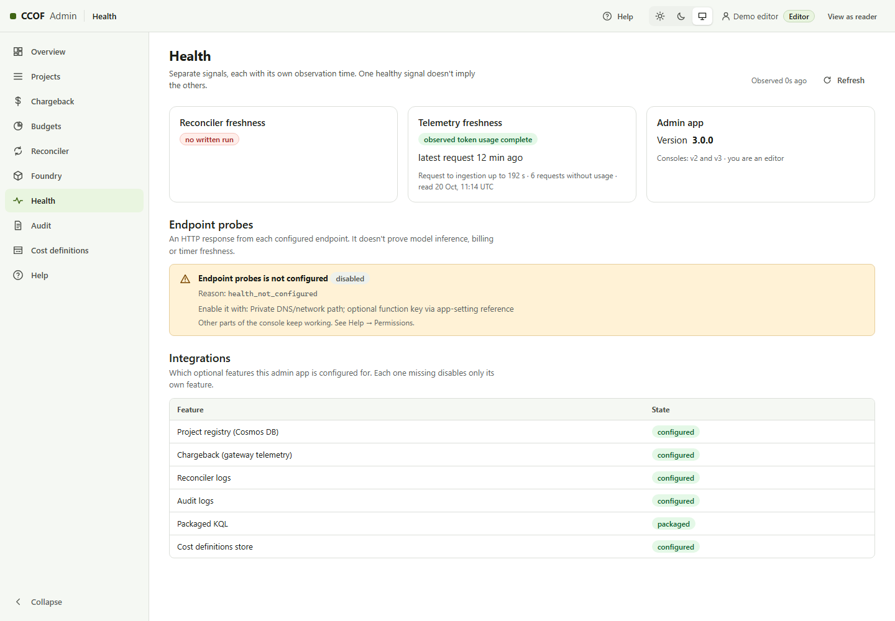
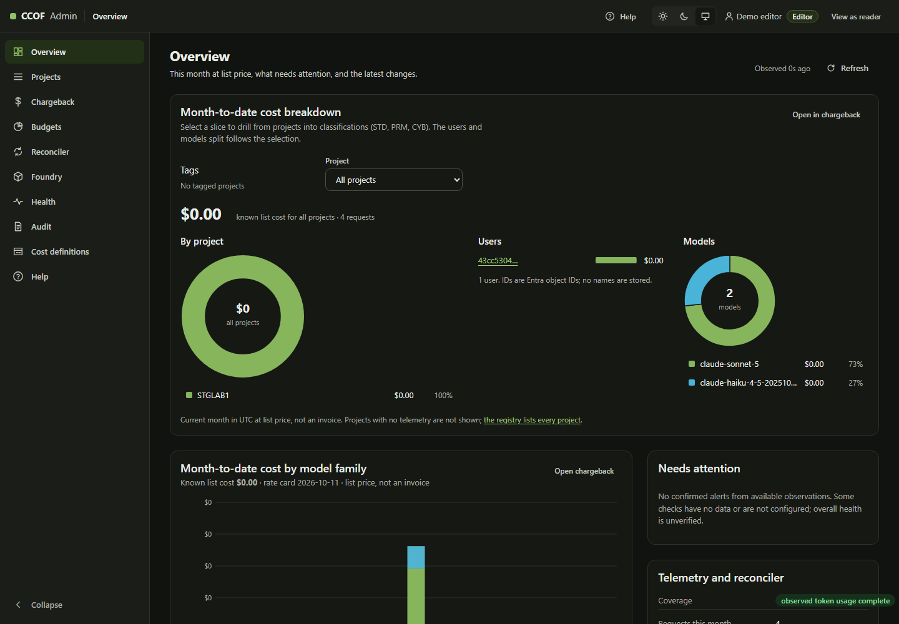

Chargeback read $0.000328 known list cost for 4 priced requests (96 tokens), coverage
complete. The console rounds this to $0.00 (finding 9).

## Findings and fixes

| # | Stage | Observed | Change |
| --- | --- | --- | --- |
| 1 | all | The driver exited silently: dot-sourcing `Deploy-Quickstart.ps1 -DotSourceOnly` sets `$DotSourceOnly` in the caller's scope | The driver keeps its own switch before dot-sourcing |
| 2 | 1 | What-if failed (`DeploymentWhatIfResourceInvalidResponse`) on the APIM diagnostic setting with a conditional `scope: apim!` | APIM and its setting moved to [`apim-service.bicep`](../infra/staged/apim-service.bicep), deployed as a conditional module; the Stage 1 test now checks the module's condition |
| 3 | 1, 2 | `az functionapp show` returns Flex values under `properties`, so public access read as empty | `Get-StgSite` reads both shapes |
| 4 | 5 | Creating an app registration failed with `Directory_QuotaExceeded` for the operator | `entra.existing` reuses registrations by app ID with merge-only updates; groups by `groupId`. The existing lab admin console's redirect URI was preserved (read back) |
| 5 | 5 | Graph rejected a one-item list (`StartArray expected`): PowerShell unrolls single-item function output | List helpers return arrays intact |
| 6 | 5 | A display name with parentheses was refused before reaching `az.cmd` | Configuration validation limits Entra names to letters, digits, space, `.`, `_`, `-` |
| 7 | 8 | `Invoke-WebRequest -MaximumRedirection 0` throws on a 302 | The admin redirect is read with an `HttpClient` that does not follow redirects |
| 8 | 8 | The admin API answered `403 oauth_client_denied` to the Azure CLI client | Expected control. `admin.extraAllowedClientIds` (empty by default) lists a test client explicitly; the lab listed Azure CLI |
| 9 | console | Sub-cent costs display as $0.00 | Not changed in this run; logged for the admin console |
| 10 | 7 | The seed reported `present-equal` for all documents | Its first timer run at 10:57:00 UTC created them; the driver read the third run's line (App Insights). Create-only, so reruns are safe |

## Limits

- Exposure: the lab used public Function ingress (with authentication) and a public `BasicV2`
  APIM. A private-only deployment needs `StandardV2` with outbound VNet integration, private
  endpoints for the Function Apps, and a build agent inside the network for Stage 7; not run here.
- Entra creation of new registrations and groups was not exercised (finding 4); the merge path was.
- No least-privilege identity per stage was used: one operator, able to create role assignments and app registration changes, ran all stages.
  The permission table is from the resource operations, not a restricted-identity test.
- Portal screenshots were not captured: the capture browser profile's Portal session had expired.
- Reconciler and sync timers stay off; budget states and scheduled sync were not exercised.
- No load test and no 10,000-project scale test.

## Retained state

The lab RG `ccof-staged-20261020-rg` and its APIM `BasicV2` remain deployed and incur charges.
The lab Entra registrations keep the merged entries (new admin redirect URIs, Azure CLI
preauthorization on the reused gateway app). Removing them, or the RG, is a separate approved step.
Private evidence (logs, state, read-back JSON, generated policy and client file) is kept outside
the repository.

Runbook: [configurable staged deployment](runbooks/STAGED-DEPLOYMENT-V2.md).
