# Standard v2 and Foundry staged runs — SASET MSFT FDPO and Contoso, 2026-10-20

Two independent runs of [`Invoke-StagedDeployment.ps1`](../infra/staged/Invoke-StagedDeployment.ps1)
with a **Standard v2** API Management instance, a **new private Foundry account** created by Stage 1,
and a separate configuration and state directory each. Stage numbers in this report are the order\nbefore 2026-10-21 (network = Stage 2, schema 3, grants 4, Entra 5, configuration 6); the runbook now\nruns the network as Stage 6. Runbook:
[configurable staged deployment](runbooks/STAGED-DEPLOYMENT-V2.md).

| | SASET MSFT FDPO | Contoso |
| --- | --- | --- |
| Tenant / subscription | FDPO tenant, subscription "SASET MSFT FDPO" | Contoso tenant, "ME-MngEnvMCAP189112" subscription |
| Operator access | Reader on the subscription; Owner on one resource group only | Owner at the tenant root management group; directory role Global Reader active (others eligible through PIM) |
| Resource group | Existing shared RG `rg-lab-shared` (holds another team's APIM and Foundry); `sharedResourceGroup: true` | New RG `rg-lab2` |
| APIM | New Standard v2, outbound VNet integration on `snet-apim`, public ingress | Same |
| Foundry | New account, public access Disabled, private endpoint; Claude Haiku 4.5 and Sonnet 5 deployed | New account, public access Disabled, private endpoint; **no model**: the subscription cannot buy the Claude offer |
| Entra | Existing lab registrations and groups, merged (operator's directory quota is exhausted) | **New** gateway, resolver and admin registrations and three new security groups |
| Graph application permission | Not attempted (delegated snapshot) | Attempted; refused with no change: no active Privileged Role Administrator or Global Administrator role |
| Result | **Stages 0-8 verified; 200 for admitted models** | Stages 0-8 verified; model calls blocked by the subscription type |

## Results by stage

| Stage | SASET MSFT FDPO | Contoso |
| --- | --- | --- |
| 0 | Pass (53 s): providers, Flex region, Claude models offered in eastus2 | First run failed correctly: `Microsoft.AlertsManagement` NotRegistered. Registered by the subscription Owner, then pass (48 s) |
| 1 | what-if: 37 creates, the 4 existing SASET resources `Ignore`. First apply failed (finding 1); guarded rerun verified (273 s) | Same finding 1; guarded rerun verified (156 s) |
| 2 | 6 private endpoints Approved with DNS; APIM `External` on `snet-apim`, identity unchanged; 4 apps integrated (740 s) | Same (759 s) |
| 3 | 9 containers (196 s) | 9 containers (198 s) |
| 4 | Azure RBAC, 13 Cosmos data grants, Cognitive Services User on the new Foundry (322 s) | Same (322 s) |
| 5 | Merge into existing registrations (48 s) | 3 applications and 3 groups created (83 s); Graph grant refused (no active admin role) |
| 6 | Settings, resolver auth, API, policy, workbook (75 s) | Same (78 s) |
| 7 | First attempt failed (finding 6); rerun: 4 packages, seed, snapshot 1 member admitted, client file (1279 s) | Same failure, rerun verified (1404 s) |
| 8 | 401 anonymous and resolver; **200 Haiku, 200 Sonnet**; 403 Opus (not admitted for STD); 403 non-member project; admin 302/200/401; both request IDs found in `ApiManagementGatewayLlmLog` (300 s) | 401/401; 403/403; admin 302/200/401; no allowed pair (no model). A member's admitted request returned **404 DeploymentNotFound from the private Foundry**: authentication, policy, Standard v2 VNet routing and the Foundry private endpoint all worked (38 s) |

## Evidence

Command-output captures of the live logs and read-back JSON. Identifiers are masked in the middle;
local paths are replaced by `<config-dir>`; no token or setting value is shown.

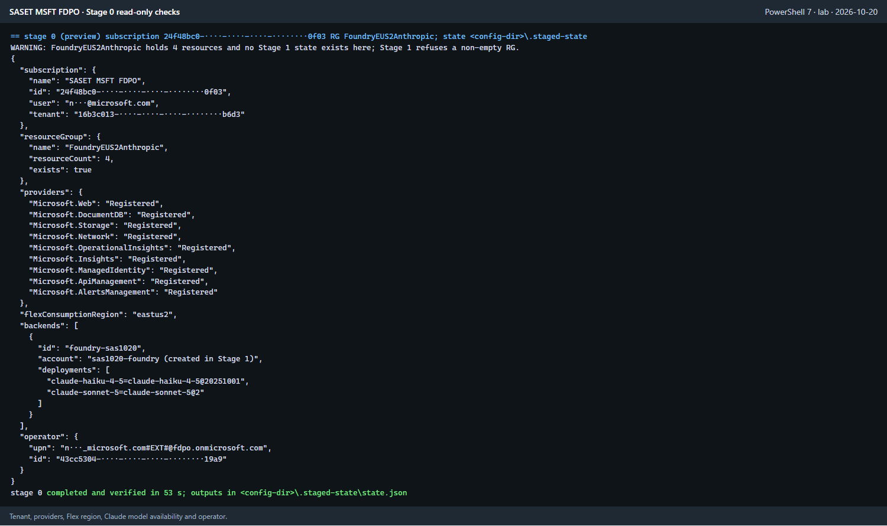
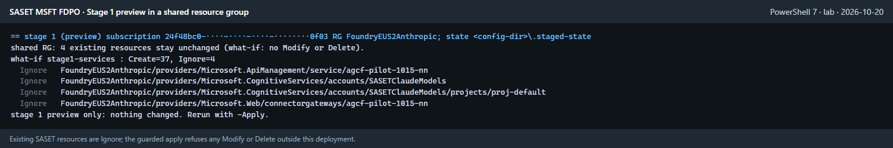
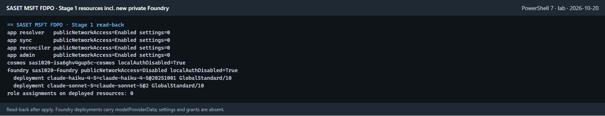
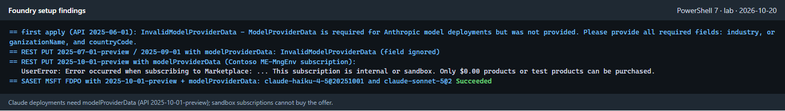
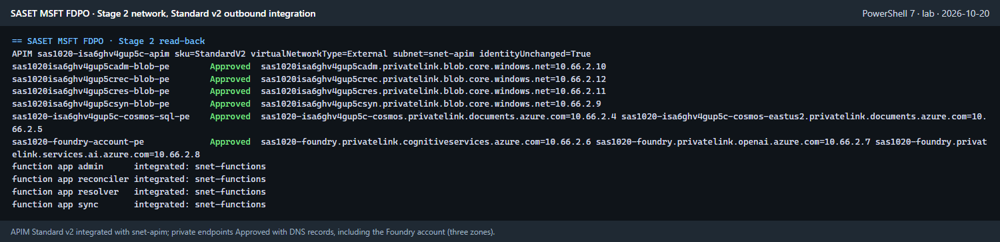
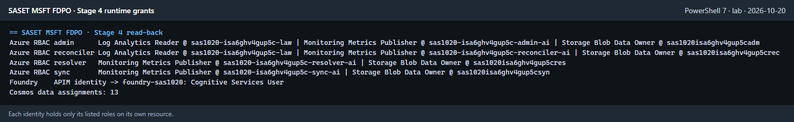
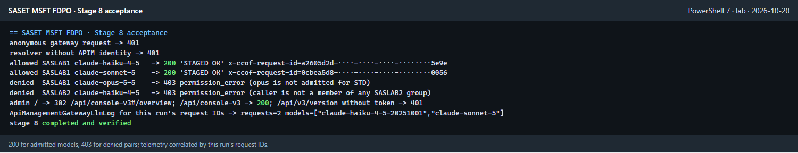
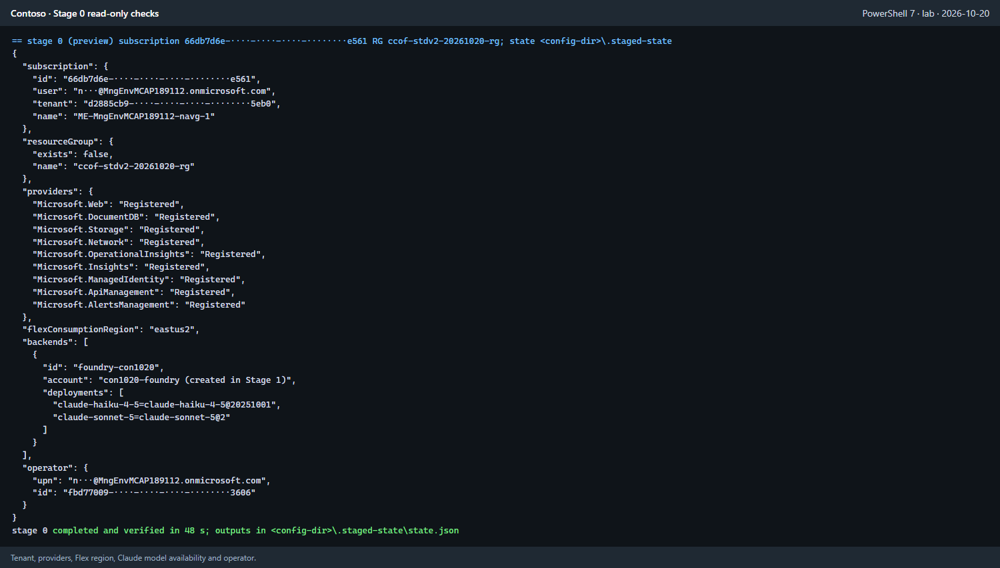
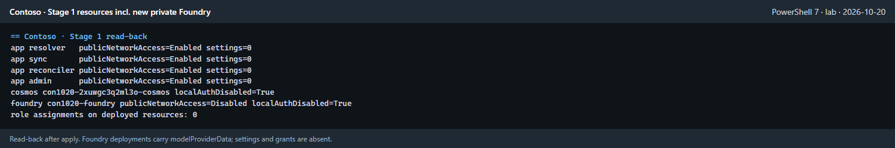
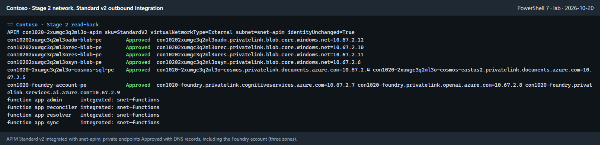
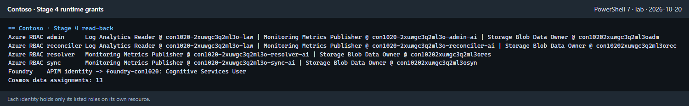
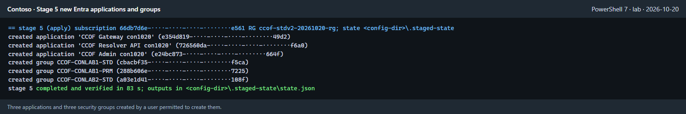
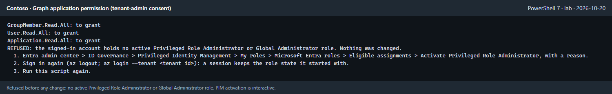
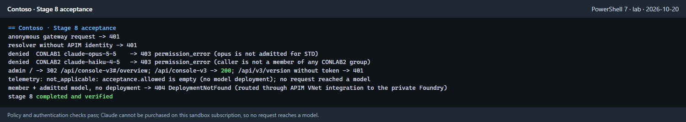

## Findings and changes

| # | Observed | Change |
| --- | --- | --- |
| 1 | Claude deployments failed with `InvalidModelProviderData`. Preflight passed; the deployment failed. API versions 2025-06-01, 2025-07-01-preview and 2025-09-01 ignore `modelProviderData` | [`foundry-account.bicep`](../infra/staged/foundry-account.bicep) deploys models with `2025-10-01-preview` and `properties.modelProviderData`. `stage1.foundry.modelProviderData` (organizationName, countryCode, industry) is required configuration with no default: it is the Anthropic attestation that accepts the Marketplace offer for the real organization. The lab runs used `Microsoft`, `US`, `technology` |
| 2 | Contoso subscription: "This subscription is internal or sandbox. Only $0.00 products or test products can be purchased." | Subscription limit, not a template defect. `stage1.foundry.modelDeploymentsBlocked` records the reason; Stage 0 warns and Stage 8 records telemetry as not applicable |
| 3 | Standard v2 alone did not integrate APIM with the VNet | Stage 2 PATCHes APIM to `virtualNetworkType: External` on the APIM subnet (keeping its identity), waits for `Succeeded`, and verifies subnet and identity |
| 4 | Foundry provisioning and its private path were outside the stages | Stage 1 optionally creates the account and deployments; Stage 2 creates its private endpoint with the cognitiveservices, openai and services.ai zones |
| 5 | SASET allows writes only in an RG that holds another team's resources | `sharedResourceGroup: true`: Stage 1 compares changes with exact resource IDs in the prior Stage 1 deployment operations; name prefixes do not establish ownership, and all deletes are refused |
| 6 | Stage 7 of both runs, started at the same time from one checkout, failed: `npm ci` EPERM on `admin/node_modules` | Run Stage 7 for one target at a time per checkout (documented). Sequential reruns passed |
| 7 | State could be reused across targets | `state.json` now records tenant, subscription and RG; a mismatch stops with `state_target_mismatch`. Offline test with a negative control |
| 8 | Telemetry acceptance counted any recent rows | Stage 8 queries `ApiManagementGatewayLlmLog` for exactly this run's `x-ccof-request-id` values (APIM `context.RequestId` = `CorrelationId`) and requires every one |
| 9 | Graph application consent needs an active Privileged Role Administrator or Global Administrator. Azure CLI cannot activate PIM (token lacks the RoleManagement scopes) | Unchanged: interactive PIM activation, then `Grant-SyncGraphPermissions.ps1`. The script refused safely |
| 10 | A direct call to the private Foundry from outside the VNet returned `PermissionDenied` (RBAC), not a network error | Inconclusive about the network: the service checked RBAC first, and no model role was granted to the operator. Account read-back shows public access `Disabled`, default action `Deny` |
| 11 | Stage 1 recheck counted resources and role assignments created by later stages | The verifier now scopes inventory to Stage 1 deployment targets and checks Stage 4 grant counts against verified Stage 4 state |
| 12 | Stage 8 used the default project header when configuration selected another name | Acceptance probes now use `gateway.projectHeaderName` for anonymous, admitted and denied calls |
| 13 | Re-running Stage 2 in `create` mode could reapply the authoritative VNet subnet list | An existing VNet with saved Stage 2 state skips that deployment and verifies or reconciles the remaining integrations; an existing VNet without state is refused |
| 14 | New Stage 2 DNS-link verification could fail on the earlier deployment output shape, which did not include `vnetId` or Foundry zone IDs | The VNet ID is derived from `functionsSubnetId`; missing Foundry zone IDs are derived from the create-mode resource group or existing-mode configuration |
| 15 | Downstream stages could become stale when verification snapshots or duration values changed | Stable output hashes and exact state migrations now separate transient verification data from operational outputs; Stage 1, 2 and 4 migrations also check ARM outputs |

## Final bug-bash recheck — 2026-10-20

- Stage 1 verify-only inventory passed in SASET (139 s) and Contoso (129 s).
- Stage 4 grants were reapplied and verified with exact Stage 1 resource scopes in SASET (62 s) and
  Contoso (64 s).
- Stage 2 retries skipped the authoritative VNet deployment and verified DNS links, private
  endpoints, Function App integration and Standard v2 APIM integration in SASET (101 s) and Contoso
  (111 s). No network resources were redeployed.
- Stage 8 passed in SASET (157 s): anonymous/resolver 401, two admitted model calls 200, two denied
  calls 403, admin 302/200/401, and both request IDs found in telemetry. Contoso passed in 16 s:
  anonymous/resolver 401, zero admitted calls because no model is available, two denied calls 403,
  admin 302/200/401; telemetry was correctly marked not applicable.
- Offline checks passed: 344 staged contract checks; the staged customer deployment compile/parse
  checks; 88 quickstart checks; and the public-manual artifact checks.

## Network-last recheck — 2026-10-21 (new stage numbers)

The stages were renumbered so that the network is Stage 6, the last setup stage, and both
deployments were rechecked with the new driver. Both `state.json` files moved to the new keys on
first read (backup `state.layout1.json`).

| | SASET MSFT FDPO | Contoso |
| --- | --- | --- |
| `network.mode` | `create` (lab) | `verify` (default): the existing VNet treated as customer-built |
| Stages rerun | 2 schema (210 s, deployment `stage2-schema`), 3 grants (65 s, `stage3-grants`), 5 configuration (99 s, `stage5-config`), 6 network (117 s; VNet deployment skipped, integrations verified), 8 | 6 network (91 s), 7 code and data (1306 s), 8 |
| Stage 6 result | Endpoints, DNS links, 4 apps and APIM integration verified | `Test-NetworkConfiguration.ps1`: 19 PASS, 0 FAIL; nothing changed |
| Stage 8 | Anonymous/resolver 401; 200, 200; 403, 403; admin 302/200/401; 2 of 2 request IDs in telemetry | Anonymous/resolver 401; 403, 403; admin 302/200/401; telemetry not applicable (no model) |

Live negative control (Contoso, separate state copy): `functionsSubnetId` pointed at `snet-apim`.
Stage 6 reported 5 FAIL rows and stopped with `verify_failed`; the saved state kept `snet-functions`.

Found during this recheck and fixed ([B-16 to B-20](../BUGS-FOUND.md)): the network check recursed
into its own `Az` function and never reached Azure; it failed on an unrelated same-named DNS zone in
`ccof-poc-rg`; the schema stage could not be rerun after grants; Stage 7 could not be rerun after a
successful snapshot. One Contoso Stage 7 attempt stopped at `graph_unauthorized`; Azure CLI and a
direct snapshot run read the same groups with HTTP 200 minutes later, and the rerun passed.
## Portal walkthrough with Playwright

The guide's manual Portal steps were turned into 20 Portal steps per run (generated from each
run's real resource IDs, with the text each page is expected to show). Two dedicated Edge
profiles were signed in to FDPO and Contoso by the account owner. On 2026-10-20 those sessions
ended when the automation closed the windows; on 2026-10-21 the profiles were reopened, the
sessions were still valid, and the walkthrough ran against both deployments. No authentication was
intercepted or bypassed.

| Check | Result |
| --- | --- |
| Guide and reports rendered in Edge (Playwright) | 39 images load, 26 local links and 1 anchor resolve, 0 page errors; a hidden image was reported broken (negative control) |
| Guide PowerShell blocks | Parse without errors |
| Manual Portal steps covered by deep links | Every section 0-8 and the Foundry section maps to 1-4 Portal steps (20 per run) |
| Portal walkthrough, Contoso (2026-10-21) | 19 of 20 steps pass. `06-apim-apis`: the APIs blade stayed on "Service is getting ready..." in four afternoon attempts; it passed in the morning run, and ARM lists the `Claude Messages (staged)` API with the service `Succeeded` |
| Portal walkthrough, FDPO/SASET (2026-10-21) | 20 of 20 steps pass (`00-subscription-access` and `06-apim-apis` on a targeted rerun) |
| Walkthrough negative control | `06-resolver-auth` opened on the Function App overview (without the Authentication menu entry) reports `mismatch`; the Authentication blade reports `pass` |

Walkthrough fixes made during the run (in [tests/playwright](../tests/playwright/README.md)):
- Sub-blade deep links such as `/managedidentities`, `/networking`, `/virtualNetwork` and `/users`
  opened the resource overview. Those steps now open the overview and select the entry through the
  blade's menu search; IAM steps also select **Role assignments**.
- `06-resolver-auth` previously passed on any page that contained "Microsoft"; it now requires
  "Require authentication". The subscription check now requires "Active permanent assignments".
- A new browser tab stopped at the account picker. The walker reuses the signed-in Portal tab and
  its host (`ms.portal.azure.com` for FDPO) instead; no account was selected on the operator's
  behalf.
- In the shared FDPO resource group (56 resources) and subscription IAM (60 inherited
  assignments), the expected rows sat outside the rendered list. Those steps type into the
  blade's own filter box.

Both lab runs set `stage1.functionsPublicNetworkAccess` to `Enabled` (the default is `Disabled`), so
the Function App networking blade shows public inbound access; the resolver still requires
authentication and returned 401 to the anonymous Stage 8 probe. The guide embeds 13 Contoso
captures with GUIDs, the signed-in account, the directory name and the subscription name masked;
pages that list people (subscription access, group members) are not published.

Rerun steps: [tests/playwright](../tests/playwright/README.md).

## Retained resources

Both deployments remain and incur charges (Standard v2 APIM, Flex apps, Cosmos, Foundry). SASET
resources share `rg-lab-shared` with another team: removal must name the `lab1-*`
resources individually, never the RG. Contoso objects: RG `rg-lab2`, three
`CCOF ... lab2` app registrations, three `CCOF-CONLAB*` groups. Removal is a separate approval.
