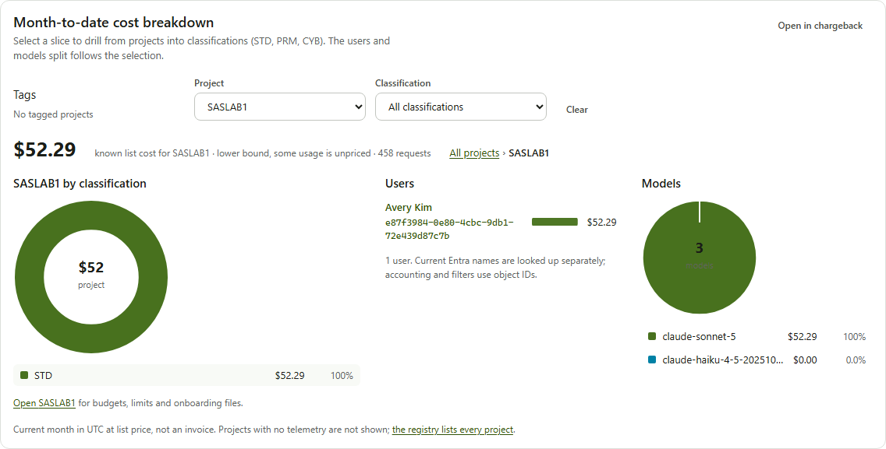
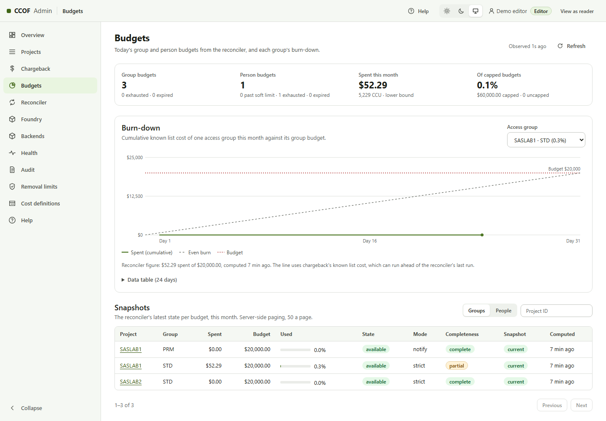
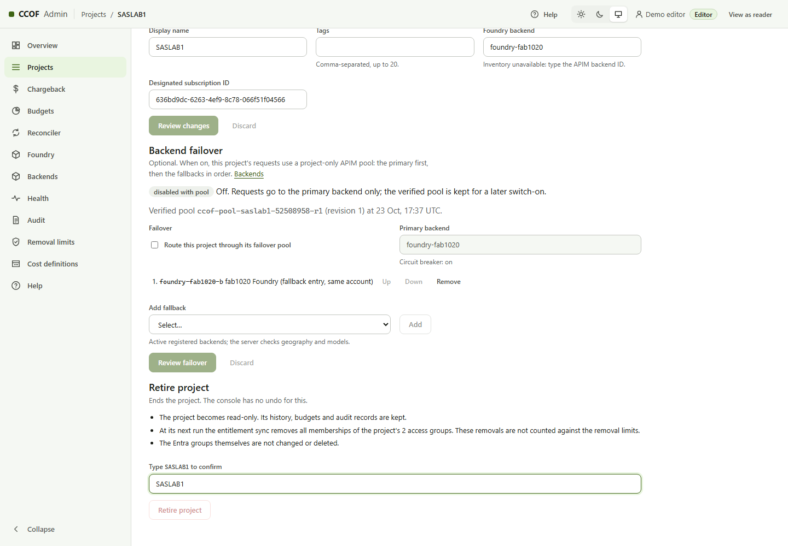
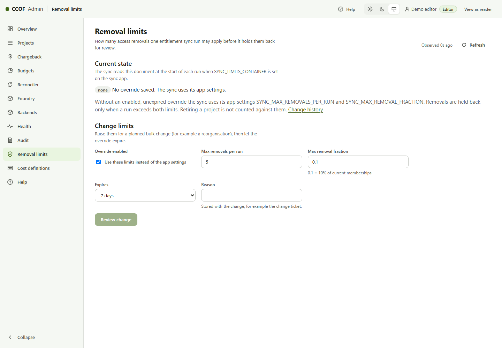
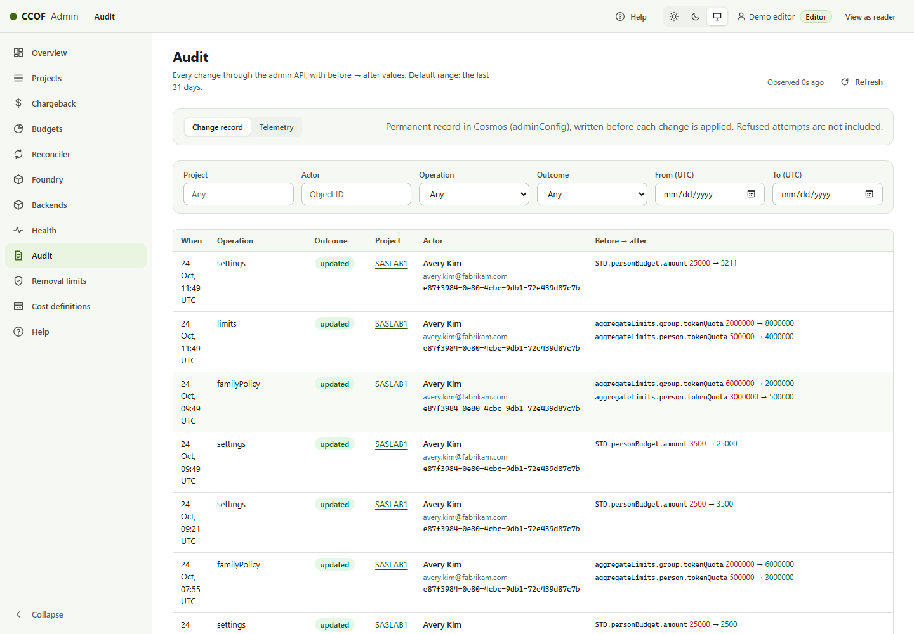

# 2. Admin console operations and Foundry onboarding

Applies to Admin **3.3.0**, deployed using the [deployment runbook](DEPLOYMENT-RUNBOOK.md).
Who: CCOF administrators with the `CCOF.Projects.Write` (editor) or `CCOF.Projects.Read` (reader) app role.
The console is `https://<actual-admin-host>/api/console-v3`.
Developer setup is in [user onboarding](USER-ONBOARDING.md).

The current model is **project > classification > Entra group**, with one backend per project.
The group-centric redesign in the separate `CCOF` repository is not part of this release.

## 1. Access and first checks

| Role | What the person can do |
| --- | --- |
| `CCOF.Projects.Read` | Read projects, reports, audit and client onboarding exports |
| `CCOF.Projects.Write` | Read plus create/edit projects, models, limits, budgets, cost definitions, retirement and sync removal limits |
| Entra group owner | Add/remove direct group members in Entra; this is not an admin-console app role |
| Azure/Foundry operator | Provision models, networking, APIM backends and runtime grants; console editor alone cannot do these |

The admin enterprise app requires assignment. The UI and API both enforce the read/write split.
A missing integration reports `disabled`, `permission_required`, `unavailable` or `partial`;
it is not evidence that the underlying account/user/budget is absent.

Initial checks: `/api/v3/version` reports 3.3.0; Health shows the intended telemetry/resource
scopes; the reader has no save/retire controls; the editor can perform a reviewed test edit.
Names beside object IDs are current Entra labels, not historical accounting keys.
`User.Read.All` on the **admin managed identity** and `ADMIN_USER_NAMES_ENABLED=true` enable them.



## 2. Console page map

| Page | Use / interpretation |
| --- | --- |
| Overview | Month-to-date known list cost, project/classification/user/model breakdown, freshness and coverage |
| Projects | Search/filter projects by tags, backend and classification; open a project |
| Project > Overview | Routing, group budgets and cost history |
| Models & limits | Admitted deployment names, aggregate and per-family person/group token limits |
| Access groups | Group object IDs and classification mappings |
| Budgets | Per-person/group monthly amounts, strict/notify group behavior and budget assistant |
| Onboarding | Classification-specific `config.json` and `onboarding.json`, previews and completeness |
| Settings | Display name, tags, backend/subscription change, one-way retirement |
| Activity | Permanent project change records; telemetry fallback where the record is unavailable |
| Chargeback | Period/project/classification/user/model filters, coverage and CSV export |
| Reconciler / Budgets | Run freshness and calculated budget snapshots, not Azure invoice amounts |
| Foundry | Read-only inventory and project-to-backend visibility; no model/account/backend creation |
| Audit | Permanent change record by default; Telemetry also shows refused attempts |
| Removal limits | The sync's count/fraction override, reason, expiry and history |
| Cost definitions | Approved console rate card and model mappings; export/deploy to reconciler separately |

All cost figures identify their rate card, period and coverage. Missing/unpriced usage is not zero.
The pricing basis is list price with **100 CCU = USD 1**, not a negotiated invoice allocation.
Definition: [`admin/src/chargeback.ts`](../../admin/src/chargeback.ts).

## 3. Onboard a project and its people

1. The Entra owner creates the approved direct-membership security groups, records their object
   IDs and adds the intended people. Example names: `CCOF-PROJECT01-STD`, `CCOF-PROJECT01-PRM`.
   Group search requires admin managed-identity `GroupMember.Read.All` and
   `ADMIN_GRAPH_ENABLED=true`; pasted IDs are not proof of a valid group.
2. The editor opens **Projects > New project**, enters a stable project ID, display name,
   existing APIM backend ID and its designated subscription. Project IDs use letters/digits,
   `_` and `-`, up to 80 characters, starting with a letter/digit.
3. **Access groups** maps each classification to a distinct group ID. Classifications are named
   identifiers; STD/PRM/CYB are examples, not automatic spending tiers.
4. **Models & budget** selects actual Foundry deployment names on that backend, then person/group
   limits and budgets. Aliases shown by a client do not create server-side model access.
5. The final review shows the project JSON. Save creates it; duplicate IDs are refused.
6. The next successful entitlement sync materializes memberships. In delegated-snapshot mode the
   operator applies a fresh snapshot; adding a user in Entra alone does not trigger that workflow.
7. A reconciler run produces budget state for budget-enabled access. Strict initial onboarding can
   block until fresh budget state exists.
8. **Project > Onboarding > classification** produces both files for those users. The banner must
   say ready; `REPLACE-...` fields mean the admin client settings are incomplete.


### Limits and budgets

| Control | Meaning |
| --- | --- |
| Aggregate person TPM/quota | Across the classification's allowed families for that person |
| Aggregate group TPM/quota | Shared token ceiling across members of that project/classification |
| Per-family limits | Additional ceilings for that family, not a replacement for aggregate limits |
| Person budget | Monthly USD or CCU budget per person **in this project** |
| Group budget | Monthly shared amount for this classification; fixed, not automatically multiplied by membership |
| `strict` | Group budget exhaustion participates in blocking |
| `notify` | Group budget monitoring without that strict group block; other policies still apply |
| Budget assistant | Per-user suggestions based on the entered monthly budget, workload/cache mix, model prices and work schedule; no member-count input |

The assistant's result is not a dollar guarantee. Cached reads, cache writes, output mix and
workload changes affect cost. **Apply to limits** fills a draft; review/save is still required.
Fable/Mythos families require `CYB` under the current family contract.
There is no cross-project per-person spending cap.

**Soft limit and spend pacing** ([plain-English summary](../BUDGETS.md), [ADR 0035](../adr/0035-budget-soft-limit-and-spend-pacing.md)).
The reconciler app settings `RECONCILER_SOFT_LIMIT_PERCENT` and `RECONCILER_PACING_WINDOW_MINUTES`
(answers `reconciler.softLimitPercent` and `reconciler.pacingWindowMinutes`; examples use 80 and 30)
apply to every person budget of the deployment. With both set:

| Spend | Effect |
| --- | --- |
| Below the soft limit | The gateway's per-person token limit lets the remaining budget be spent over at least one window |
| At or past the soft limit | Pace halves (two windows). `/usage` shows a WARNING; Reconciler/Budgets shows `warning` and a "past soft limit" count |
| At the budget | Blocked, as before |

The window is at least the reconciler interval (answers validation rejects less) and should exceed ingestion delay plus interval plus the gateway decision cache (`allowTtlSeconds`); about 13 minutes with the shipped values
(`maxIngestionDelaySeconds` on the reconciler run line). With neither setting, the reconciler writes
the unpaced ceiling (the whole remaining budget per minute), which the gateway also applies.
A pace 429 is answered like other token limits, with `Retry-After`. The ceiling is rounded down to a
power of two. Overshoot is about one burst of the person's parallel requests (live tests: 6-8% of a
$25-35 budget, then 0.3% of $52.11, with 12 parallel Sonnet streams; [budgets](../BUDGETS.md)).



### Multiple groups/projects

Within one project, if a user is in multiple classification groups, sync retains an incumbent
classification only when it remains among those groups. Otherwise no classification is admitted
for that conflict; `classification_conflict` is reported. This is not "highest budget wins".

Across projects, the client selects a project with the configured selector header, normally
`x-ccof-project`. The resolver verifies membership; it does not trust the header as authorization.
Missing selection with multiple active memberships returns `project_selection_required`.
Sources: [`sync/plan.ts`](../../src/sync/plan.ts),
[`sync/membership.ts`](../../src/sync/membership.ts), [client selection](../CLIENTS.md).

## 4. Change an existing project

Models/limits, budgets and settings use a review followed by an ETag-guarded save. A concurrent
edit returns `etag_mismatch`; refreshing and reviewing the change again is safer than overwriting.
Backend changes require both `backendId` and `designatedSubscriptionId`.
The API does not replace group IDs through the Settings endpoint.

Edits reach the gateway after the relevant sync/cache refresh. A successful console save is not
proof that a membership update or a fresh budget calculation has run.

## 5. Removal and project retirement

| Intended action | Supported procedure / effect |
| --- | --- |
| Remove one user's access | Group owner removes direct membership in Entra; next successful sync removes entitlement, subject to sync safety limits |
| Planned bulk member removal | Approved temporary **Removal limits** override, with reason and expiry; confirm the next sync used it |
| End a project | **Settings > Retire project**, type the exact project ID, then Retire. The project is permanently read-only in this console. |
| Delete an Entra group | Separate directory operation, not the retirement action. A failed/deleted group read freezes its project; it is not reliable offboarding. |

Retirement records `status: retired` and `retiredAt`. The upgraded sync removes every membership
of that project without reading its groups and outside the ordinary removal limits.
Other projects remain intact. Group objects, reporting and audit history are retained.
There is no reactivate/delete button. Old sync code freezes rather than removes a retired
project, so the 3.2 admin **and sync packages** are required.



The removal guard withholds ordinary removals only when **both** the maximum count and fraction
are exceeded. Retired memberships are excluded from that fraction's base.
An enabled, valid, unexpired override is read from `adminConfig` at each run when sync has
`SYNC_LIMITS_CONTAINER=adminConfig` and its container-level Data Reader grant.
Missing/disabled/expired/invalid/unreadable overrides fall back to app settings.
The UI offers expiry up to 90 days or no expiry; a reason is recorded. Disabling a test override
restores app-setting behavior. [Sync contract](../SYNC.md).



## 6. Audit and change investigation

The `adminConfig` change record is written **before** a change is applied, then completed.
With that store configured, an unwritable record refuses the change as
`503 change_log_unavailable`. The record is retained by the console but is **not immutable/WORM**:
the admin runtime identity has Cosmos replace permission.

| Outcome | Interpretation |
| --- | --- |
| `created`, `updated`, `retired` | Store returned a confirmed result |
| `refused` | A definite conflict/version refusal after recording; not applied |
| `unconfirmed` | Store call raised an error; it may have committed. Read the current item before retrying. |
| `pending` | Completion was not recorded; current item and telemetry need investigation |

**Audit > Change record** filters by project, actor object ID, operation, outcome and UTC dates.
Default range is 31 days, maximum one query range 93 days; older records can be queried in
successive ranges. **Telemetry** includes refused authentication/validation attempts and uses
workspace retention. Current names are display labels; object IDs remain the evidence keys.
No-op project edits do not create change records.



## 7. Add another same-tenant Foundry backend

The Foundry console page is inventory only. This task crosses Azure provisioning, network,
APIM, registry and project administration; a console editor cannot complete it alone.

### Required change sheet

| Value | Source / approval |
| --- | --- |
| Foundry account ARM ID, tenant, subscription, RG, location | Foundry Overview / JSON view |
| Claude deployment name, version, geography and capacity | Foundry model deployment; actual deployed name, not just a model-catalog label |
| Anthropic endpoint base | Account endpoint details, normally `https://<account>.services.ai.azure.com/anthropic` |
| New backend ID | Stable unique identifier, for example `foundry-team02` |
| APIM principal | Existing APIM > Managed identities; no identity replacement |
| Private endpoint/DNS/IPs | Network owner; APIM caller path verified |
| Rate card and report metadata | Pricing owner; new model/geography priced before strict budgeting |

### A. Foundry portal: model and private access

1. **Azure Portal > Microsoft Foundry > account > Overview** establishes the exact account.
   In the Foundry portal, **Models / model catalog > approved Claude model > Deploy** selects
   version, deployment name, region/geography and capacity.
2. Marketplace eligibility, offer approval and the real organization/country/industry attestation
   are complete before deployment. Sandbox/internal subscription rejection is a stop, not a
   reason to claim deployment without a model.
3. The actual Anthropic endpoint is copied from deployment/account endpoint information.
   A Foundry project URL, OpenAI endpoint and `/v1/messages` URL are not the backend base.
4. **Networking > Private endpoint connections** shows Approved; private DNS links and
   resolution from APIM's VNet are verified before the route is used.
5. **Account > Access control (IAM) > Add role assignment > Cognitive Services User** selects
   the existing APIM managed identity and this account scope.


Same tenant, different subscription is supported when grants/network work. Cross-tenant
authentication is a different design; APIM's managed-identity token stays in its own tenant.
The documented alternative is in [Network: backend authentication](../NETWORK.md#backend-authentication-managed-identity-only-works-same-tenant).

### B. APIM Portal and authoritative configuration

| Portal location | Value / check |
| --- | --- |
| **APIM > Backends > Add** (or the Backend tab under APIs in that Portal layout) | Name = approved backend ID; HTTP URL = Anthropic base. This creates an APIM backend entity, not a Cosmos registry record. |
| **APIM > APIs > Claude Messages > Design > All operations > Inbound policy** | Runtime selects the resolver-returned backend. Managed identity audience/resource is `https://cognitiveservices.azure.com`. No caller-supplied arbitrary URL/key. |
| **APIM > Network > Outbound > VNet integration** | Existing dedicated subnet, private Foundry DNS/route reachability |
| **APIM > APIs > Claude Messages > Settings / diagnostics** | Existing logger/diagnostics and request correlation remain enabled |


The Portal is useful for inspection, but the generated policy and staged JSON remain the
configuration source. Manually replacing the complete policy can remove entitlement checks.
`az apim update` is not used for this task; preserve the existing managed identity.

For the supported staged configuration path:

1. Add the backend's actual ID, account, subscription, URL, resource audience and deployment-
   geography map to `backends[]` in the **existing private staged JSON**. Existing entries remain.
2. Stage 3 preview/apply adds the Foundry role and verifies it. Cross-subscription scope
   permissions belong to the access owner.
3. Stage 5 preview/apply renders and deploys the expanded APIM backend/policy/workbook metadata.
   It writes complete app settings; approved manually enabled admin feature settings are
   restored afterwards as described in the deployment guide.
4. Stage 6 in `verify` mode checks the customer network. The endpoint for a different
   subscription/RG is created by the customer; the automatic endpoint modes have a narrower
   target restriction.
5. The backend descriptor below is created through an approved Cosmos data-plane session from
   the private operator host, in the existing `backends` container (`/backendId`). It is a
   **new-item** operation; an existing different descriptor needs reviewed ETag-based replacement.
6. Only after that, a new project selects this backend, or an existing project's Settings
   changes backend ID **and** designated subscription, followed by sync and functional tests.

```json
{
  "id": "foundry-team02",
  "backendId": "foundry-team02",
  "status": "active",
  "apiFormat": "anthropic-messages",
  "auth": {
    "mode": "managed-identity",
    "resource": "https://cognitiveservices.azure.com"
  }
}
```

Portal path for the approved data writer: **Cosmos DB > Data Explorer > database > backends >
Items > New Item**. Account IAM Contributor alone does not grant item access. A private account
needs the approved data-plane network path. The URL belongs in APIM, not in this descriptor.
The admin API cannot write backend descriptors.

Stage 7 can create missing backend descriptors during an initial full seed, but rerunning it
also republishes all apps and compares configured seed projects with existing data. It is not
a day-two "add backend only" command. The older `Stage2-RegisterBackend.ps1` belongs to a separate
checkpoint workflow with D2/D3 prerequisites, not the staged 0-8 state.
Sources: [`backend.ts`](../../src/resolver/backend.ts),
[`Staged.Application.ps1`](../../infra/staged/Staged.Application.ps1),
[`Deploy-Quickstart.ps1`](../../infra/quickstart/Deploy-Quickstart.ps1).

### C. Acceptance and rollback

| Test | Required evidence |
| --- | --- |
| Admitted user/model/project | 200 through **APIM**, backend routing to the intended Foundry account, request-correlated telemetry |
| Wrong project/model | 403; selector cannot grant membership |
| Missing token | 401 |
| Cost attribution | Intended project/classification/person/backend and geography, no unpriced model, current rate card |
| Fresh budget | Reconciler observes usage and the correct scope, without claiming invoice precision |

Before a routing edit, record the project's previous backend/subscription and ETag, and retain
the approved APIM policy/configuration. Rollback restores routing through a fresh reviewed save,
then syncs. The old backend stays until verification completes; deleting it first breaks rollback.

### D. Optional per-project backend failover (admin 3.3)

Failover is off for every project until an editor switches it on. Contract:
[ADR 0034](../adr/0034-dr-project-routing-and-prerequisites.md),
[DR implementation](../design/DR-IMPLEMENTATION.md).


| Step | Where | Result |
| --- | --- | --- |
| 1. Register the primary | **Backends** > Register backend: the project's APIM backend ID, Foundry `/anthropic` URL, deployments, inference geography, an enabled circuit breaker | Registry entry in `adminConfig`; no project changes |
| 2. Register fallbacks | Same page; the circuit breaker is optional | Same |
| 3. Choose fallbacks | Project > **Settings** > Backend failover: switch on, add fallbacks in order, review | State `pending publication`; requests keep their current route |
| 4. Publish | `infra/dr/Publish-ProjectRouting.ps1 -AdminBaseUrl … -AdminScope api://<admin app>/Projects.Manage -ApimResourceId <each APIM> -Apply` | Project pool `ccof-pool-<project>-<hash>-r<revision>` and members created, read back, publication recorded; state `verified` |
| 5. Sync | Next entitlement sync (or snapshot apply) | Memberships carry `routeBackendId`; the gateway sends this project to its pool |
| Switch off | Same section, clear the switch | State `disabled with pool`; after the next sync the project routes direct again |

The server refuses a fallback that is disabled, in another inference geography, missing any model
the project admits, equal to the primary or not registered, and refuses switching on while the
primary has no enabled breaker. A primary-backend change is refused while failover is on. Each
member carries its registry breaker on a project-only APIM entity, so one project's breaker never
moves another project. Usage stays on the primary backend ID; the serving member is in
`ApiManagementGatewayLogs.BackendId`.

Behaviour measured on Fabrikam lab (2026-10-23): the request that trips a breaker fails once (no retry);
later requests go to the next member until the trip time ends. Breaker state is per gateway node,
so a second node can return one more failure before its own breaker opens. Only managed-identity
backends route to a pool.

## 8. Troubleshooting

| Symptom | Check |
| --- | --- |
| Search disabled / names absent | Graph permission on admin managed identity, matching feature setting and Graph egress |
| Saved project but user denied | Group membership, last successful sync, classification conflict, selected model, fresh budget state |
| `change_log_unavailable` | Admin `adminConfig` permission/network; no change applied before append refusal |
| `unconfirmed` audit outcome | Current item and ETag before another save; possible server commit |
| Foundry not found / missing deployments | Inventory scope/Reader permission and correct tenant, not automatic resource deletion |
| New backend 401/403 | APIM managed identity, account-scoped grant and tenant; backend audiences are not gateway audiences |
| New backend connection failure | Private DNS, endpoint approval, firewall/routes and correct `/anthropic` base |
| Model usage unpriced | Exact deployment-to-model mapping and effective rate card/geography |

References: [Admin API/settings](../ADMIN-V3.md), [sync](../SYNC.md),
[pricing/chargeback](../CHARGEBACK.md),
[Claude on Foundry](https://learn.microsoft.com/azure/developer/ai/how-to/deploy-claude-foundry).
