# Deploy CCOF step by step

**For:** someone deploying CCOF for the first time. **Time:** about one hour of commands once the
prerequisites below are ready; approvals, model capacity and network work can take longer
([deployment runbook](DEPLOYMENT-RUNBOOK.md#readiness-and-the-one-hour-target)).
**Result:** developers can call Claude through your own API Management gateway, with project access,
token limits, budgets and reports. Terms such as APIM, Foundry, resolver and reconciler are explained
in the [glossary](../GLOSSARY.md).

CCOF is deployed in nine steps, numbered 0 to 8. Each step below has the same parts:

| Part | Meaning |
| --- | --- |
| **What it does** | The Azure or Entra objects the step creates or checks |
| **Who runs it** | The permission the person running the step needs |
| **Script** | The deployment driver runs the step, checks the result in Azure and records it. This is the path tested end to end in the lab. |
| **Azure CLI** | The same work with `az` commands |
| **Portal** | The same work, or the check of its result, in the Azure Portal |
| **Check** | What a correct result looks like, with screenshots from a lab deployment |

Screenshots come from the **Fabrikam lab** deployment. Run outputs are read-only previews taken on
24 October 2026; Portal pages were captured live from the signed-in Portal on the same day. Names, IDs
and subscriptions in them are pseudonyms with the same shape as the real values.

## How the three ways fit together

- The driver keeps a record of each finished step in `<config folder>\.staged-state\state.json`.
  A step will not start before the steps it depends on are recorded
  ([driver reference](STAGED-DEPLOYMENT-V2.md#how-a-stage-runs)).
- Steps 1, 2, 3 and 5 are Bicep deployments. The driver's preview writes the exact parameter file
  it uses to `.staged-state\<deployment name>.parameters.json`. The Azure CLI and Portal routes for
  these steps deploy the same template with that file.
- After a step is done with the Azure CLI or the Portal, running the driver's apply for the same step
  redeploys the same template and parameters. Deployments are incremental, so Azure makes no further
  change; the driver then reads the result back and records the step
  ([deployment modes](https://learn.microsoft.com/azure/azure-resource-manager/templates/deployment-modes)).
  Step 1 accepts this only when the earlier deployment is named `stage1-services`.
- Steps 4 and 7 are scripts that call Microsoft Graph and the Function Apps. Their Azure CLI routes
  below reproduce the main objects; the driver also verifies them and writes the client file.
- Mixing routes within one step was not run in the lab; each route on its own was.

## Before you start

### Tools

| Tool | Check | Source |
| --- | --- | --- |
| PowerShell 7.2 or later | `$PSVersionTable.PSVersion` | [Install PowerShell](https://learn.microsoft.com/powershell/scripting/install/installing-powershell-on-windows) |
| Node.js 22 or later and npm | `node --version` | [nodejs.org](https://nodejs.org/) |
| Git | `git --version` | [git-scm.com](https://git-scm.com/) |
| Azure CLI with Bicep | `az version` and `az bicep version` | [Install the Azure CLI](https://learn.microsoft.com/cli/azure/install-azure-cli) |

Azure Cloud Shell (PowerShell) has the first three and the Azure CLI; its Bicep CLI is added with
`az bicep install` ([Cloud Shell sign-in](#a-separate-azure-cli-sign-in)). Cloud Shell reaches Azure
management endpoints, not private endpoints inside your network
([Cloud Shell quickstart](CLOUD-SHELL-QUICKSTART.md)).

### Source code

```powershell
git clone https://github.com/naveenneog/ccof-bicep.git
cd ccof-bicep
npm ci --ignore-scripts --no-audit --no-fund
npm run build
```

**Expect:** both npm commands end without `ERR!`.

### A separate Azure CLI sign-in

The driver never runs `az login`; it uses whichever account the Azure CLI is signed in with. A
separate profile folder keeps this deployment's sign-in apart from any other work on the machine.

The commands in this guide use the variables below. Paste this block once in each new PowerShell
window, after replacing each `REPLACE-...` value. The placeholders contain no `< >` characters, so a
value left unreplaced cannot be read by `cmd.exe` as a redirection (see below).

```powershell
$env:AZURE_CONFIG_DIR = "$HOME\.ccof-az"            # separate Azure CLI profile for this deployment
$tenant    = 'REPLACE-tenant-id'                    # Microsoft Entra ID > Overview > Tenant ID
$sub       = 'REPLACE-subscription-id'              # Subscriptions > your subscription
$rg        = 'REPLACE-resource-group'               # new, empty resource group for CCOF
$location  = 'eastus2'
$foundryRg = 'REPLACE-foundry-resource-group'       # resource group of an existing Foundry account
$foundry   = 'REPLACE-foundry-account'              # its name (AI Services account)
$cfg       = 'C:\private\ccof\staged.config.json'   # configuration file (next section)
$state     = 'C:\private\ccof\.staged-state'        # the driver writes its records here
```

With several Foundry accounts, the Foundry commands below are repeated for each entry in `backends`.

```powershell
az login --tenant $tenant
az account set --subscription $sub
az account show --query "{tenant:tenantId, subscription:id, user:user.name}" -o table
```

**Expect:** your tenant, subscription and account.

**In Azure Cloud Shell.** Cloud Shell is already signed in with the Portal account. A separate
profile and `az login` there start a device-code sign-in, which Conditional Access policies that
require a managed device refuse
([lab screenshot](../images/dr-novice/dr-n03b-conditional-access.png)). In Cloud Shell, the
variable block above is followed by this block instead of the sign-in block:

```powershell
Remove-Item Env:AZURE_CONFIG_DIR -ErrorAction SilentlyContinue   # keep Cloud Shell's own sign-in
$cfg   = "$HOME/ccof-private/staged.config.json"
$state = "$HOME/ccof-private/.staged-state"
az account set --subscription $sub        # Cloud Shell's default subscription can be another one
az bicep install                          # Cloud Shell has no Bicep CLI by default
az account show --query "{tenant:tenantId, subscription:id, user:user.name}" -o table
```

The deployment driver does not read `AZURE_CONFIG_DIR` (`infra/staged/Invoke-StagedDeployment.ps1`
and `infra/staged/Staged.*.ps1` contain no reference to it), so Cloud Shell needs no value for it.
Files under `$HOME` survive the session only when Cloud Shell has a storage account
([Persist files in Cloud Shell](https://learn.microsoft.com/azure/cloud-shell/persisting-shell-storage));
otherwise the configuration file and `.staged-state` are downloaded before the session ends.
Step 8 does not run in Cloud Shell ([Step 8](#step-8-test-end-to-end)).

On Windows, `az` passes its arguments through `cmd.exe`. Values containing `( ) | & < > ^` are
interpreted by `cmd.exe`, so this guide keeps them out of `az` arguments and puts request bodies in
files ([driver reference](STAGED-DEPLOYMENT-V2.md#how-a-stage-runs)).

### The configuration file

One JSON file holds every value the steps use. Copy the example to a private folder outside the
repository and replace each value that starts with `REPLACE`; the driver refuses a file that still
contains one.

```powershell
New-Item -ItemType Directory (Split-Path $cfg) -Force | Out-Null
Copy-Item infra\staged\staged.config.example.json $cfg
notepad $cfg                                        # Cloud Shell: code $cfg
```

| Field | What to enter | Where to find it |
| --- | --- | --- |
| `tenantId` | Directory (tenant) ID | Portal: **Microsoft Entra ID > Overview** |
| `subscriptionId` | Subscription for CCOF | Portal: **Subscriptions** |
| `resourceGroup`, `location` | A new, empty resource group and its region (for example `eastus2`) | Your naming standard |
| `stage1.prefix` | 3 to 8 lowercase letters or digits used in resource names | Your choice |
| `apim` and `stage1.approveNewPublicApimBootstrap` | **Either** an existing APIM: `apim.existing` with its `name`, `resourceGroup` and `subscriptionId` (system-assigned identity on). **Or** a new one: `approveNewPublicApimBootstrap: true` with `apimPublisherEmail` and `apimPublisherName`; it is created with public ingress, because APIM cannot be created private before a private endpoint exists. With neither, Step 3 stops with `apim_missing`. | [Stage 1 notes](STAGED-DEPLOYMENT-V2.md#stage-1-resources-only) |
| `stage1.apimZoneRedundant` | Optional; default `false`. `true` creates the new APIM (`approveNewPublicApimBootstrap: true`) as zone redundant. Requires `stage1.apimSku` `StandardV2`; with fewer than two `stage1.apimUnits` the driver prints a warning. For Standard v2 and Premium v2, zone redundancy can be chosen only when the instance is created and cannot be changed afterwards; units are spread across zones best-effort, and Microsoft recommends at least two units ([enable availability zones](https://learn.microsoft.com/azure/api-management/enable-availability-zone-support), [reliability in API Management](https://learn.microsoft.com/azure/reliability/reliability-api-management)). Sets `properties.zoneRedundant` with API version `2025-03-01-preview`; not yet deployed live ([UNKNOWNS](../UNKNOWNS.md) APIM-ZR-01, APIM-ZR-02). No effect on an existing APIM. | `infra/staged/main.bicep` (`apimZoneRedundant`), `infra/staged/apim-service.bicep` (`zoneRedundant`) |
| `stage1.cosmosCapacityMode` and `cosmos.capacityMode` | Cosmos DB capacity; the two fields go together. `serverless` and `serverless` (the default) for a single-region deployment. `provisioned` and `provisioned-autoscale` when disaster recovery is planned: a serverless account runs in one region and cannot add another ([Cosmos DB serverless](https://learn.microsoft.com/azure/cosmos-db/serverless); lab error `Serverless accounts do not support multiple regions`). With `provisioned-autoscale` the database gets autoscale throughput up to `cosmos.autoscaleMaxThroughput` RU/s (at least 1000). A serverless account can later be changed in place to provisioned throughput, one way only ([change capacity mode](https://learn.microsoft.com/azure/cosmos-db/how-to-change-capacity-mode)); this was not run in the lab. | `infra/staged/main.bicep` (`cosmosCapacityMode`: `serverless`, `provisioned`), `infra/staged/stage2-schema.bicep` (`capacityMode`: `serverless`, `provisioned-autoscale`) |
| `stage1.functionsPublicNetworkAccess` | `Enabled` for a deployment run from Cloud Shell or a workstation outside the VNet, which is the setting used in both lab runs ([run report](../STAGED-STDV2-RUNS-2026-10-20.md)). The resolver and admin apps still require Entra ID sign-in, and the resolver accepts only the APIM identity. The example file has `Disabled`; with it, APIM reaches the resolver and the operator publishes code only through `sites` private endpoints and a host inside the network ([network handoff](DEPLOYMENT-RUNBOOK.md#2-network-handoff)), which this guide does not create. | `infra/staged/main.bicep` (`functionsPublicNetworkAccess`) |
| `stage1.foundry` | `create: true` for a new Foundry account with Claude deployments, or `false` to use an existing one | [Foundry section](STAGED-DEPLOYMENT-V2.md#stage-1-foundry-optional) |
| `backends` | Each Foundry account, its deployment names and inference geography | Portal: Foundry account > **Models + endpoints** |
| `groups` | Project, classification and Entra group for each team, with allowed model families and budgets | [Admin operations](ADMIN-OPERATIONS.md#limits-and-budgets) |
| `network` | `mode: verify` and the three subnet IDs from your network team or from [The network](#the-network-before-step-0) | Step 6 below |
| `acceptance` | One allowed and one denied project/model pair for the final test | Step 8 below |

The full list of sections is in the [driver reference](STAGED-DEPLOYMENT-V2.md#configuration-file).

### The network (before Step 0)

With the default `network.mode: verify`, the configuration needs the IDs of three subnets in one
VNet before Step 0, because the driver checks them when it reads the file
([`Staged.Common.ps1`](../../infra/staged/Staged.Common.ps1)). Where a network team provides them,
their IDs go in `network.existing`. Otherwise, the repository template
[`infra/prereqs/network.bicep`](../../infra/prereqs/network.bicep) creates, once:

- the VNet with three subnets: private endpoints, Functions (delegated to `Microsoft.App/environments`)
  and APIM (delegated to `Microsoft.Web/serverFarms`);
- the APIM network security group with the nine rules from Microsoft's documented minimum for APIM
  VNet integration;
- default outbound access on the APIM and Functions subnets. VNets created after 31 March 2026 give
  new subnets no default outbound access, which leaves APIM and the Function Apps without a path
  to Microsoft Graph, Application Insights and Log Analytics unless a NAT gateway or firewall
  provides one ([default outbound access](https://learn.microsoft.com/azure/virtual-network/ip-services/default-outbound-access));
- the `privatelink.documents.azure.com` and `privatelink.blob.core.windows.net` DNS zones, linked
  to the VNet.

The template's subnet list is authoritative: it is run once, at creation, and not against a VNet
that already has other subnets.

```powershell
$netRg = 'REPLACE-network-resource-group'      # a group other than $rg: Step 1 refuses a non-empty group
$vnet  = 'REPLACE-vnet-name'
az group create -n $netRg -l $location
@{ '$schema' = 'https://schema.management.azure.com/schemas/2019-04-01/deploymentParameters.json#'; contentVersion = '1.0.0.0'
   parameters = @{ location = @{ value = $location }; tags = @{ value = @{ workload = 'ccof' } }
     vnetName = @{ value = $vnet }; addressSpace = @{ value = '10.64.0.0/16' }; apimNsgName = @{ value = "$vnet-nsg-apim" }
     subnets = @{ value = @{ apim = @{ name = 'snet-apim'; prefix = '10.64.1.0/24' }
                             privateEndpoints = @{ name = 'snet-private-endpoints'; prefix = '10.64.2.0/24' }
                             functions = @{ name = 'snet-functions'; prefix = '10.64.3.0/24' } } } } } |
    ConvertTo-Json -Depth 10 | Set-Content network.parameters.json
az deployment group create -g $netRg -n ccof-network -f infra/prereqs/network.bicep -p '@network.parameters.json' `
    --query "properties.outputs.{apim:apimSubnetId.value, privateEndpoints:privateEndpointSubnetId.value, functions:functionsSubnetId.value}" -o json
```

**Expect:** three subnet IDs. They go in `network.existing` as `apimSubnetId`,
`privateEndpointSubnetId` and `functionsSubnetId`. The address ranges are examples; the VNet must not
overlap networks it will be peered with, including a later disaster recovery VNet.

---

## Step 0: check the subscription (read-only)

**What it does.** Reads the tenant and subscription you are signed in to, the resource group, the
resource providers CCOF needs, whether the region offers Flex Consumption Function Apps, and the
Foundry model deployments. It creates nothing in Azure; it records the results in `state.json`.

**Who runs it.** Reader on the subscription, the resource group and each Foundry account, and read
access to the configured Entra groups (the driver reads the operator and the groups through
Microsoft Graph).

**Script**

```powershell
pwsh -File infra\staged\Invoke-StagedDeployment.ps1 -Stage 0 -ConfigPath $cfg
```

**Azure CLI**

```powershell
az account show --query "{tenant:tenantId, subscription:id, user:user.name}" -o table
az group exists -n $rg                                     # false is expected for a new deployment
az resource list -g $rg --query "[].name" -o tsv           # run only when the group exists; empty for a new deployment
foreach ($p in 'Microsoft.Web','Microsoft.DocumentDB','Microsoft.Storage','Microsoft.Network',
               'Microsoft.OperationalInsights','Microsoft.Insights','Microsoft.ManagedIdentity',
               'Microsoft.ApiManagement','Microsoft.AlertsManagement') {
    az provider show -n $p --query "{provider:namespace, state:registrationState}" -o tsv
}
az functionapp list-flexconsumption-locations --query "[].name" -o tsv
az cognitiveservices account deployment list -g $foundryRg -n $foundry `
    --query "[].{name:name, model:properties.model.name, version:properties.model.version, sku:sku.name}" -o table
```

**Expect:** your account, `false` (or an empty list) for the resource group, each provider
`Registered`, your region in the Flex Consumption list, and the Claude deployments named in
`backends`. A Foundry account that Step 1 will create (`stage1.foundry.create: true`) has no
deployments yet; the deployment list applies to existing accounts. The lab screenshot below ran
`az group show` on its existing resource group.

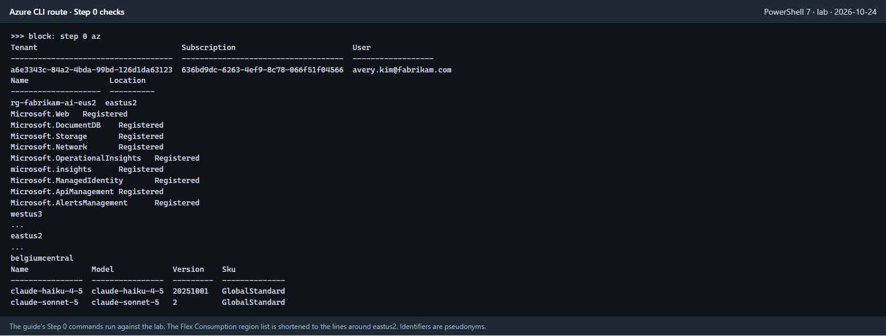

A provider that is not `Registered` is registered with `az provider register -n PROVIDER-NAME`, which
needs Contributor on the subscription.

**Portal**

1. **Subscriptions** > your subscription > **Access control (IAM)** > **Check access** > **View my access**:
   your role and its scope.
2. Same subscription > **Settings** > **Resource providers**: each provider above shows **Registered**.
3. **Resource groups** > your group: empty for a new deployment.

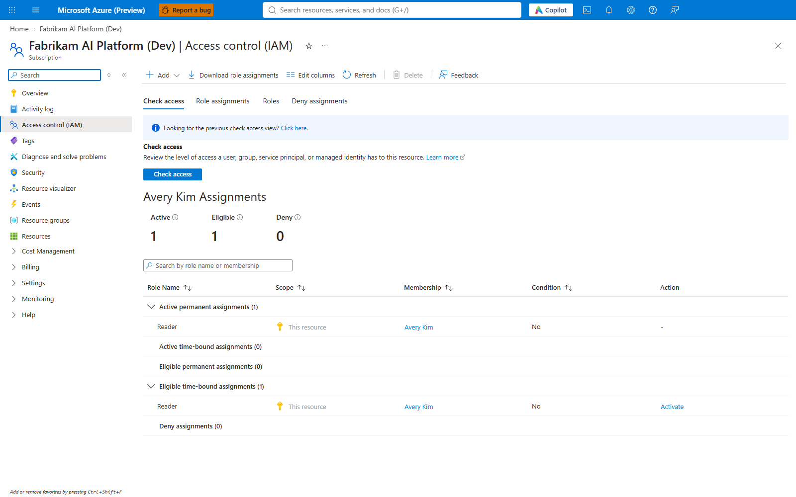

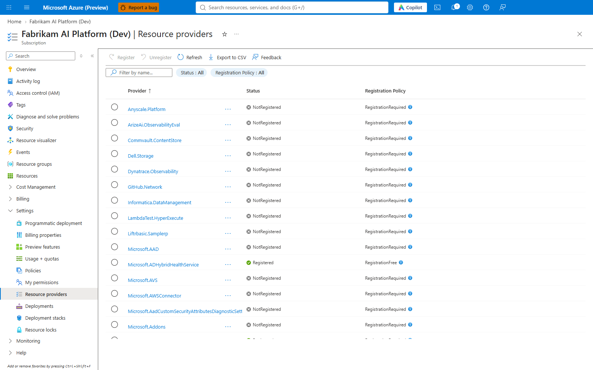

**Check.** The run ends with `stage 0 completed and verified`. A warning that the resource group is
not empty means Step 1 will refuse it unless `sharedResourceGroup` is set
([shared resource group](STAGED-DEPLOYMENT-V2.md#stage-1-in-a-shared-resource-group)).

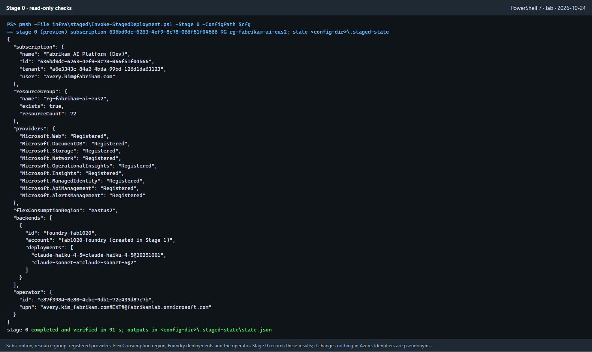

---

## Step 1: create the resources

**What it does.** Creates the Log Analytics workspace, the Cosmos DB account, two managed identities,
four Function Apps (resolver, sync, reconciler, admin) each with its own storage account and
Application Insights, and, if configured, a new API Management (APIM) instance and a Foundry account
with Claude deployments. No settings, data, permissions, network connections or code yet.

**Who runs it.** Contributor on the resource group (plus permission to create the group if it does
not exist). For a new Foundry account with Claude: permission to accept the Marketplace offer on the
subscription.

**Script**

```powershell
pwsh -File infra\staged\Invoke-StagedDeployment.ps1 -Stage 1 -ConfigPath $cfg          # preview
pwsh -File infra\staged\Invoke-StagedDeployment.ps1 -Stage 1 -ConfigPath $cfg -Apply   # create and verify
```

The preview lists every resource as `Create`; when the resource group does not exist yet, it reports
that and stops, and Apply creates the group. Apply took 156 and 273 seconds in the two lab runs of
20 October 2026 ([run report](../STAGED-STDV2-RUNS-2026-10-20.md)); creating a new APIM instance can
take longer.

**Azure CLI.** The driver writes the parameter file only when the resource group exists, so the order
is: create the group, run the driver preview, then deploy.

```powershell
az group create -n $rg -l $location
pwsh -File infra\staged\Invoke-StagedDeployment.ps1 -Stage 1 -ConfigPath $cfg    # writes the parameter file
az deployment group what-if -g $rg -n stage1-services `
    -f infra\staged\main.bicep -p "@$state\stage1-services.parameters.json"
az deployment group create -g $rg -n stage1-services --mode Incremental `
    -f infra\staged\main.bicep -p "@$state\stage1-services.parameters.json"
```

The deployment name `stage1-services` lets a later driver apply of Step 1 recognise and record it.

**Portal.** The Portal deploys ARM JSON templates, so the Bicep file is converted first:
`az bicep build -f infra\staged\main.bicep --outfile main.json`.

1. Search for **Deploy a custom template** > **Build your own template in the editor** > **Load file**
   > `main.json` > **Save**.
2. **Edit parameters** > **Load file** > `stage1-services.parameters.json` > **Save**.
3. Select the subscription and resource group > **Review + create** > **Create**.

The Portal names the deployment itself. The driver records Step 1 only for a deployment named
`stage1-services` in a non-empty resource group, so after a Portal Step 1 the later steps continue
with the Azure CLI and Portal routes, not the script. To create each resource through its own Portal
form instead, the [Azure Portal deployment guide](AZURE-PORTAL-DEPLOYMENT.md) lists every form and value.

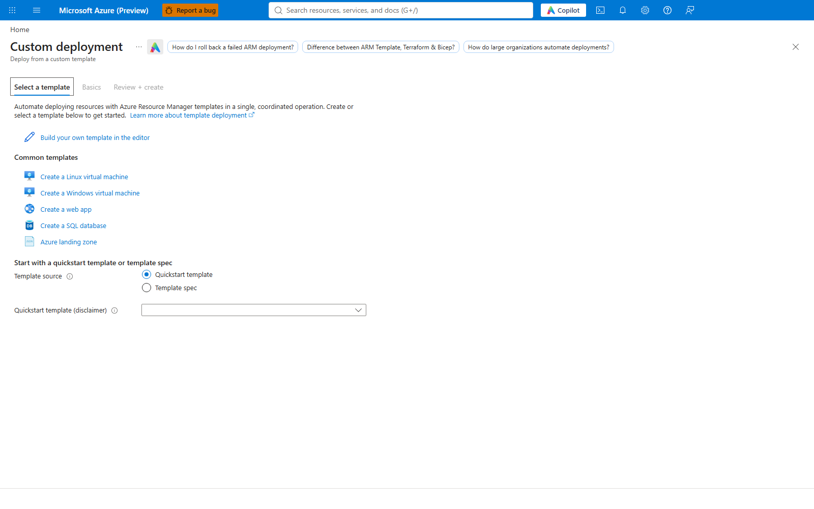

**Check**

- **Resource groups** > your group > **Overview**: the new resources.
- **Deployments**: `stage1-services` (or the Portal deployment) shows **Succeeded**.
- APIM > **Managed identities**: **System assigned** is **On**.

The Portal pages below were captured after all nine steps, so they also show resources and
deployments from later steps: the private endpoint in the resource-group list comes from Step 6, and
the deployments list includes the 20 October run, whose stage numbers were one higher for schema,
grants, Entra and configuration (network was Stage 2 then).

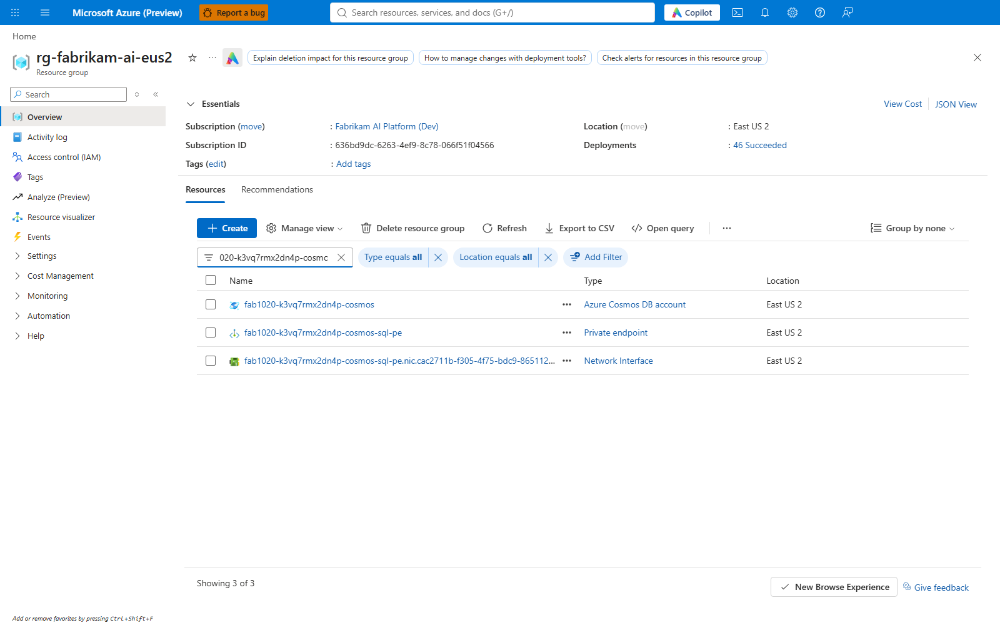

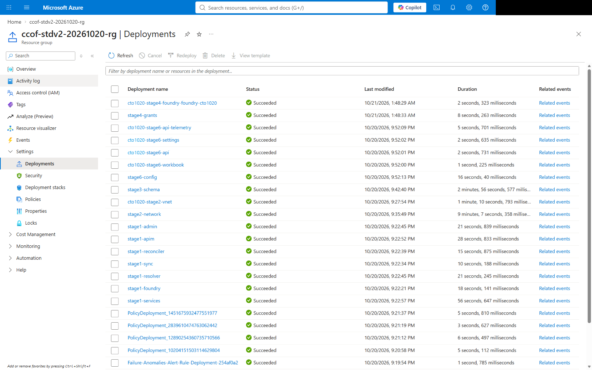

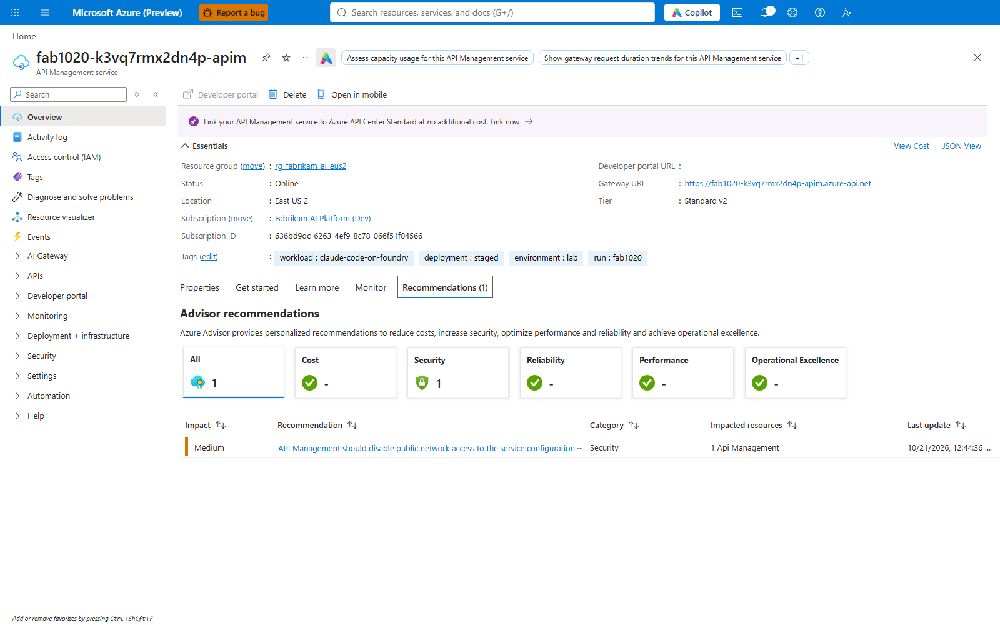

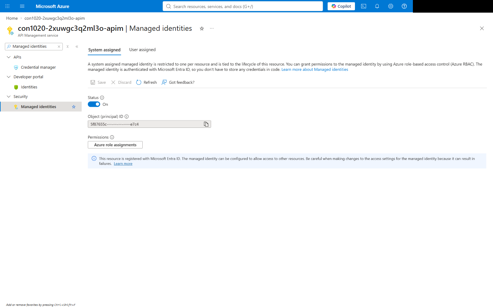

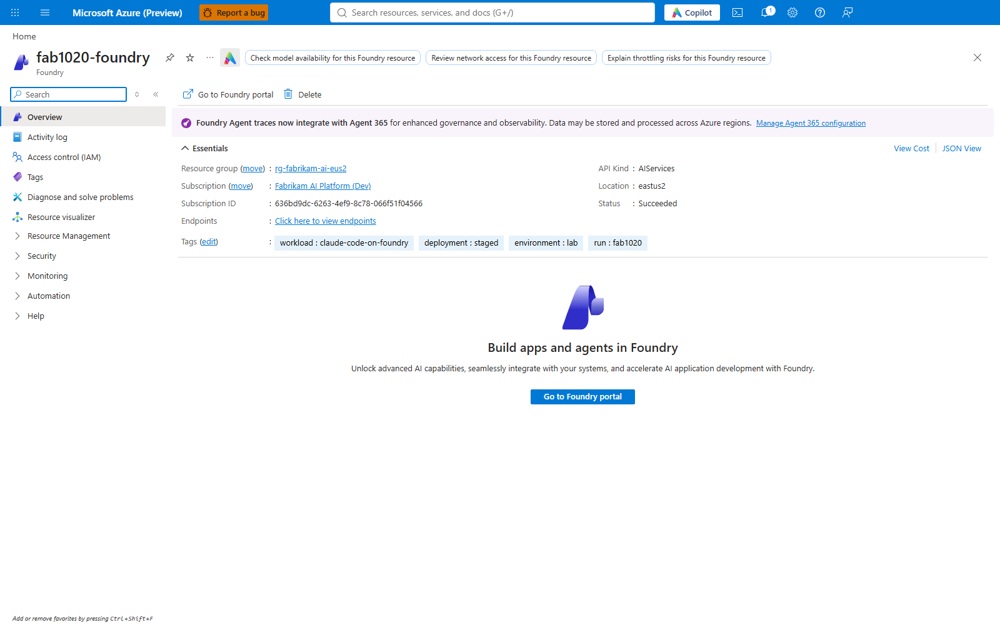

A run that has already finished Step 1 reports that no resource write will occur:

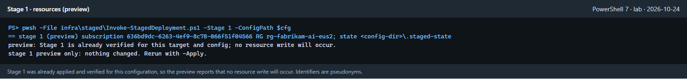

The first apply, from the 20 October lab run:


**Names for the later steps.** Step 1 names each resource `<prefix>-<suffix>-<role>`, where the
suffix is generated from the resource group and prefix. The later Azure CLI commands use these
variables; paste this block after Step 1 and in each new PowerShell window.

```powershell
$c             = Get-Content $cfg -Raw | ConvertFrom-Json
$db            = $c.cosmos.databaseName
$apps          = az functionapp list -g $rg --query "[].name" -o tsv
$resolverApp   = $apps | Where-Object { $_ -like '*-resolver' }
$syncApp       = $apps | Where-Object { $_ -like '*-sync' }
$reconcilerApp = $apps | Where-Object { $_ -like '*-reconciler' }
$adminApp      = $apps | Where-Object { $_ -like '*-admin' }
$cosmos        = az cosmosdb list -g $rg --query "[0].name" -o tsv
$cosmosId      = az cosmosdb show -g $rg -n $cosmos --query id -o tsv
if ($c.apim.existing) {                    # an existing APIM named in the configuration
    $apimSub = $c.apim.existing.subscriptionId; $apimRg = $c.apim.existing.resourceGroup; $apim = $c.apim.existing.name
} else {                                   # the APIM created by Step 1
    $apimSub = $sub; $apimRg = $rg; $apim = az apim list -g $rg --query "[0].name" -o tsv
}
$apimId        = az apim show --subscription $apimSub -g $apimRg -n $apim --query id -o tsv
$foundryId     = az cognitiveservices account show -g $foundryRg -n $foundry --query id -o tsv
"$resolverApp $syncApp $reconcilerApp $adminApp $cosmos $apim"
```

**Expect:** four app names, the Cosmos account and the APIM name. The image below shows this block
and the read-only checks of the later steps, run against the lab after all steps were complete.

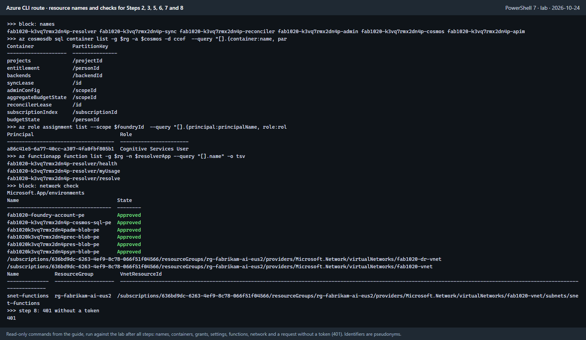

---

## Step 2: create the database containers

**What it does.** Creates the Cosmos DB database (default `ccof`) and its containers: `projects`,
`backends`, `entitlement`, `subscriptionIndex`, `syncLease`, `budgetState`, `aggregateBudgetState`,
`reconcilerLease` and, with the admin app, `adminConfig`.

**Who runs it.** Contributor on the Cosmos DB account.

**Script**

```powershell
pwsh -File infra\staged\Invoke-StagedDeployment.ps1 -Stage 2 -ConfigPath $cfg
pwsh -File infra\staged\Invoke-StagedDeployment.ps1 -Stage 2 -ConfigPath $cfg -Apply
```

**Azure CLI**

```powershell
az deployment group what-if -g $rg -n stage2-schema `
    -f infra\staged\stage2-schema.bicep -p "@$state\stage2-schema.parameters.json"
az deployment group create -g $rg -n stage2-schema --mode Incremental `
    -f infra\staged\stage2-schema.bicep -p "@$state\stage2-schema.parameters.json"
az cosmosdb sql container list -g $rg -a $cosmos -d $db `
    --query "[].{container:name, partitionKey:resource.partitionKey.paths[0]}" -o table
```

The same what-if run against the lab with the driver's parameter file returned `Succeeded` with the
same counts as the driver's preview (24 October 2026).

**Portal.** Deploy a custom template as in Step 1, with `stage2-schema.bicep` converted by
`az bicep build` and `stage2-schema.parameters.json`. In the lab on 24 October 2026 this reached
**Review + create** with the parameters filled in and **Create** available; **Create** was not
clicked. The Cosmos account has public network access disabled, so the Portal's Data Explorer cannot
list the containers from outside the network; the `az cosmosdb sql container list` command above
reads them through Azure Resource Manager.

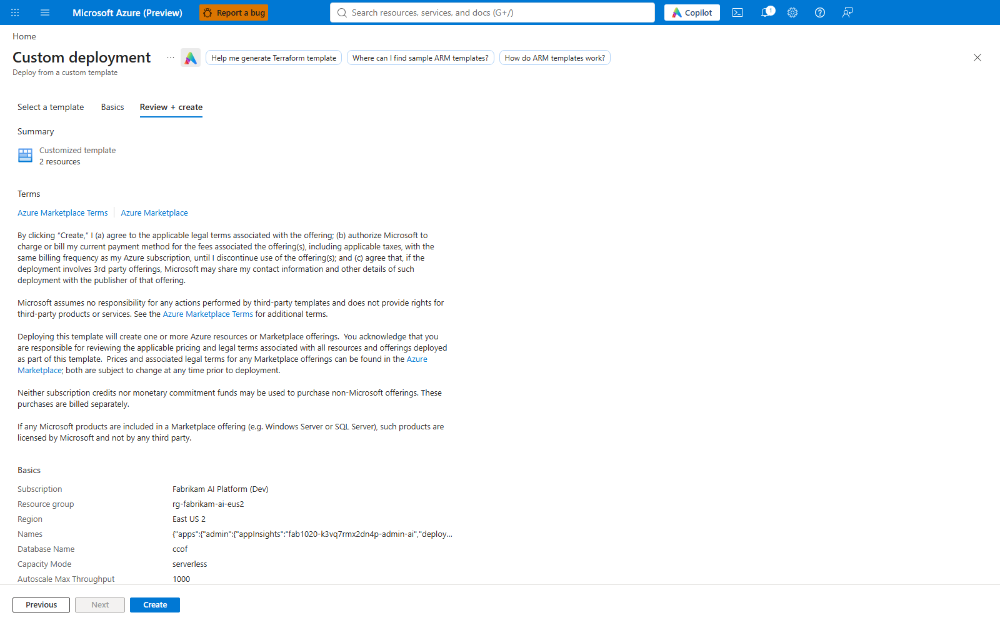

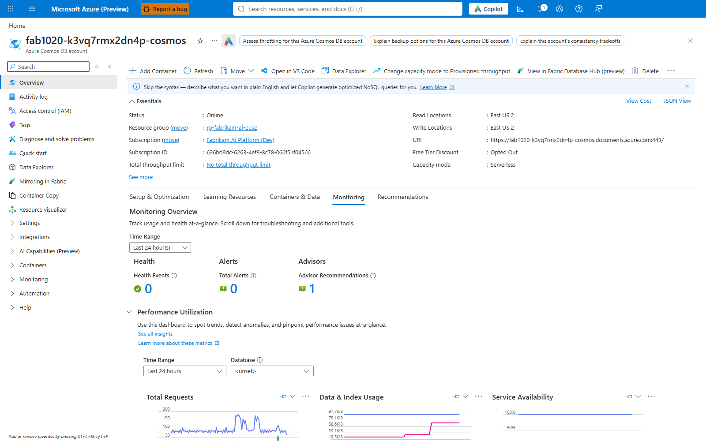

**Check.** On a later rerun, the preview can list containers as `Modify`: Azure stores default
indexing and conflict-resolution values that the template leaves unset, and the template does not
change them.

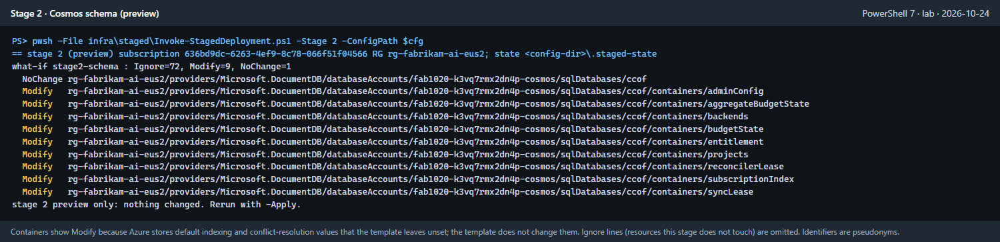

---

## Step 3: give each app its permissions

**What it does.** Gives each managed identity only the access it uses:

| Identity | Access |
| --- | --- |
| Each Function App | Storage Blob Data Owner on its own storage; Monitoring Metrics Publisher on its own Application Insights |
| Resolver | Read the Cosmos database |
| Sync | Write the `entitlement` and `syncLease` records derived from group membership; read and create (once) projects and backends; read `adminConfig` |
| Reconciler, admin | Read the Log Analytics workspace; reconciler writes budget state |
| Admin | Read, create and replace projects and `adminConfig` (no delete) |
| APIM | Cognitive Services User on each Foundry account |

The full table is in the [driver reference](STAGED-DEPLOYMENT-V2.md#stage-3-runtime-grants).

**Who runs it.** Role Based Access Control Administrator (or Owner) on the resource group and each
Foundry account, and Cosmos DB role-definition and role-assignment write on the Cosmos account.

**Script**

```powershell
pwsh -File infra\staged\Invoke-StagedDeployment.ps1 -Stage 3 -ConfigPath $cfg
pwsh -File infra\staged\Invoke-StagedDeployment.ps1 -Stage 3 -ConfigPath $cfg -Apply
```

**Azure CLI**

```powershell
az deployment group create -g $rg -n stage3-grants --mode Incremental `
    -f infra\staged\stage3-grants.bicep -p "@$state\stage3-grants.parameters.json"
az role assignment list --scope $foundryId `
    --query "[].{principal:principalName, role:roleDefinitionName}" -o table
az cosmosdb sql role assignment list -g $rg -a $cosmos `
    --query "[].{principal:principalId, scope:scope}" -o table
```

`az role assignment list` with an empty `--scope` falls back to the whole subscription, so the scope
value is checked before the command runs.

**Portal.** Azure role assignments are on each resource's **Access control (IAM)** > **Add role
assignment** > role > **Managed identity** > the app or APIM. Cosmos DB data-plane role assignments
cannot be managed in the Azure Portal ([Cosmos DB role-based access](https://learn.microsoft.com/azure/cosmos-db/how-to-connect-role-based-access-control));
use the script or Azure CLI for those.

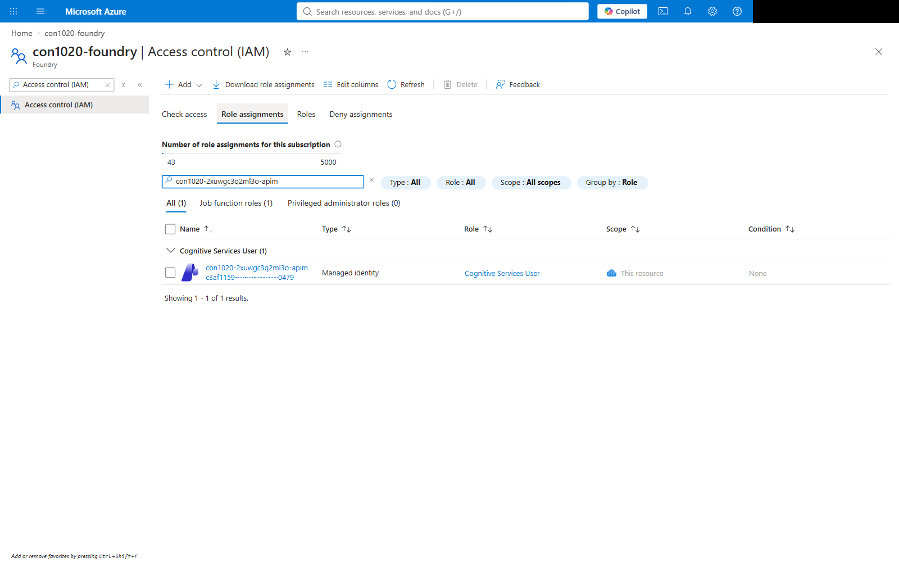

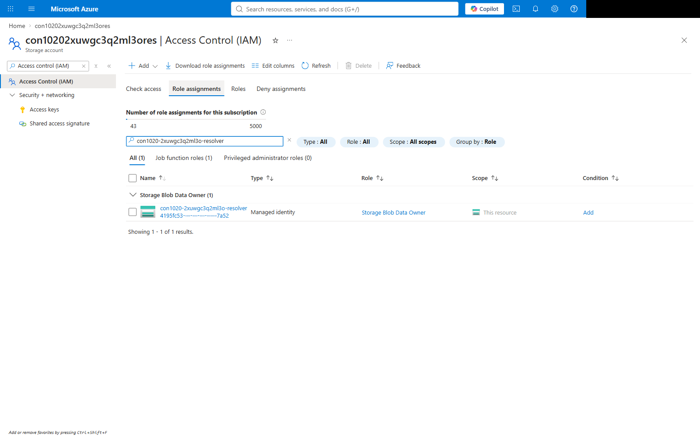

**Check.** Existing grants show `NoChange`; a grant in the template that does not exist yet shows
`Create`.

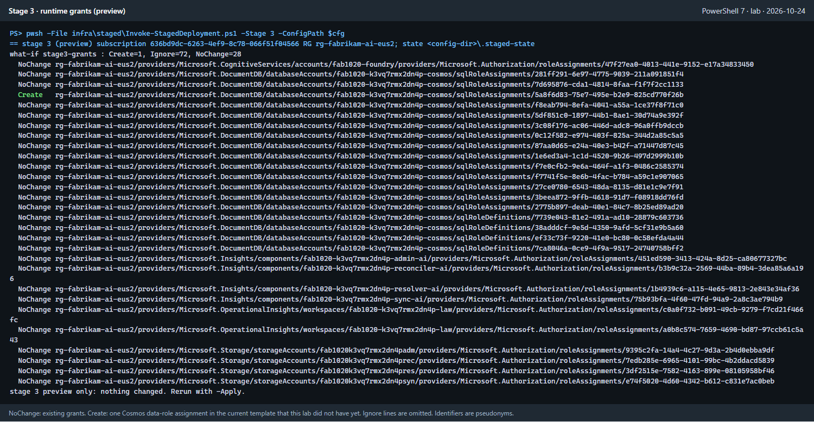

---

## Step 4: register the apps and groups in Entra ID

**What it does.** Creates, or merges into existing, three app registrations and the project groups:

| Registration | Used for |
| --- | --- |
| Gateway (also developer sign-in) | Token audience for APIM; delegated scope `access_as_user`; v2 tokens; public client redirects for sign-in |
| Resolver | Token audience that only APIM's managed identity calls |
| Admin | Admin console sign-in; scope `Projects.Manage`; app roles `CCOF.Projects.Read` and `CCOF.Projects.Write`; assignment required |

Each project classification (for example `PILOT1` / `STD`) has one security group; its direct members
get access to that project. Full settings: [deployment runbook](DEPLOYMENT-RUNBOOK.md#1-entra-administrator-handoff).

**Who runs it.** Application owner or Application Administrator; group owner or Groups Administrator.

**Script**

```powershell
pwsh -File infra\staged\Invoke-StagedDeployment.ps1 -Stage 4 -ConfigPath $cfg
pwsh -File infra\staged\Invoke-StagedDeployment.ps1 -Stage 4 -ConfigPath $cfg -Apply
```

**Azure CLI.** The script below creates all three registrations, their service principals, scopes,
roles, redirects and preauthorized clients, sets **assignment required** on the admin app and gives
one person the editor role. It ran in full in the Contoso test tenant on 24 October 2026; every value
was read back as shown and the registrations were then deleted. Request bodies are written to files
because of the `cmd.exe` rule above.

```powershell
# --- Values (replace) ---
$env_      = 'REPLACE-ENVIRONMENT'                  # for example lab or prod; letters, digits, '-' only
$adminHost = 'REPLACE-admin-app.azurewebsites.net'  # admin Function App host name, from Step 1
$editorUpn = 'REPLACE-editor@your-domain.com'       # a person who will edit projects in the console

# --- Gateway (developer sign-in and APIM token audience) ---
$gw = az ad app create --display-name "CCOF Gateway $env_" --sign-in-audience AzureADMyOrg `
    --is-fallback-public-client true --public-client-redirect-uris http://localhost --query appId -o tsv
az ad app update --id $gw --identifier-uris "api://$gw" `
    --public-client-redirect-uris http://localhost "ms-appx-web://Microsoft.AAD.BrokerPlugin/$gw"
$gwObj = az ad app show --id $gw --query id -o tsv
$gwScope = [guid]::NewGuid().ToString()
@{ api = @{ requestedAccessTokenVersion = 2; oauth2PermissionScopes = @(@{
    id = $gwScope; value = 'access_as_user'; type = 'User'; isEnabled = $true
    adminConsentDisplayName = 'Access the CCOF gateway'; adminConsentDescription = 'Call the CCOF gateway as the signed-in user'
    userConsentDisplayName = 'Access the CCOF gateway'; userConsentDescription = 'Call the CCOF gateway as you' }) } } |
    ConvertTo-Json -Depth 6 | Set-Content gateway-api.json
az rest --method PATCH --uri "https://graph.microsoft.com/v1.0/applications/$gwObj" --headers Content-Type=application/json --body '@gateway-api.json'
@{ api = @{ preAuthorizedApplications = @(
    @{ appId = $gw; delegatedPermissionIds = @($gwScope) },
    @{ appId = '04b07795-8ddb-461a-bbee-02f9e1bf7b46'; delegatedPermissionIds = @($gwScope) }) } } |
    ConvertTo-Json -Depth 6 | Set-Content gateway-preauth.json
az rest --method PATCH --uri "https://graph.microsoft.com/v1.0/applications/$gwObj" --headers Content-Type=application/json --body '@gateway-preauth.json'
az ad sp create --id $gw --query id -o tsv

# --- Resolver (called only by APIM's managed identity) ---
$res = az ad app create --display-name "CCOF Resolver API $env_" --sign-in-audience AzureADMyOrg --query appId -o tsv
az ad app update --id $res --identifier-uris "api://$res"
$resObj = az ad app show --id $res --query id -o tsv
@{ api = @{ requestedAccessTokenVersion = 2 } } | ConvertTo-Json -Depth 4 | Set-Content resolver-api.json
az rest --method PATCH --uri "https://graph.microsoft.com/v1.0/applications/$resObj" --headers Content-Type=application/json --body '@resolver-api.json'
az ad sp create --id $res --query id -o tsv

# --- Admin console ---
$readRole = [guid]::NewGuid().ToString(); $writeRole = [guid]::NewGuid().ToString()
@(@{ id = $readRole; value = 'CCOF.Projects.Read'; displayName = 'CCOF projects reader'; description = 'Read CCOF projects and reports'; allowedMemberTypes = @('User'); isEnabled = $true },
  @{ id = $writeRole; value = 'CCOF.Projects.Write'; displayName = 'CCOF projects editor'; description = 'Change CCOF projects, limits and budgets'; allowedMemberTypes = @('User'); isEnabled = $true }) |
    ConvertTo-Json -Depth 4 | Set-Content admin-roles.json
$adm = az ad app create --display-name "CCOF Admin $env_" --sign-in-audience AzureADMyOrg --app-roles '@admin-roles.json' --query appId -o tsv
$admObj = az ad app show --id $adm --query id -o tsv
$admScope = [guid]::NewGuid().ToString()
@{ identifierUris = @("api://$adm"); spa = @{ redirectUris = @("https://$adminHost/api/console", "https://$adminHost/api/console-v3") }
   api = @{ requestedAccessTokenVersion = 2; oauth2PermissionScopes = @(@{
     id = $admScope; value = 'Projects.Manage'; type = 'Admin'; isEnabled = $true
     adminConsentDisplayName = 'Manage CCOF projects'; adminConsentDescription = 'Use the CCOF admin console and API' }) } } |
    ConvertTo-Json -Depth 6 | Set-Content admin-app.json
az rest --method PATCH --uri "https://graph.microsoft.com/v1.0/applications/$admObj" --headers Content-Type=application/json --body '@admin-app.json'
@{ api = @{ preAuthorizedApplications = @(
    @{ appId = $adm; delegatedPermissionIds = @($admScope) },
    @{ appId = '04b07795-8ddb-461a-bbee-02f9e1bf7b46'; delegatedPermissionIds = @($admScope) }) } } |
    ConvertTo-Json -Depth 6 | Set-Content admin-preauth.json
az rest --method PATCH --uri "https://graph.microsoft.com/v1.0/applications/$admObj" --headers Content-Type=application/json --body '@admin-preauth.json'
$admSp = az ad sp create --id $adm --query id -o tsv
az ad sp update --id $admSp --set appRoleAssignmentRequired=true

# Give one person the editor role
$editor = az ad user show --id $editorUpn --query id -o tsv
@{ principalId = $editor; resourceId = $admSp; appRoleId = $writeRole } | ConvertTo-Json | Set-Content editor-assignment.json
az rest --method POST --uri "https://graph.microsoft.com/v1.0/servicePrincipals/$admSp/appRoleAssignedTo" --headers Content-Type=application/json --body '@editor-assignment.json'

# --- Read back ---
az ad app show --id $gw  --query "{uri:identifierUris[0], tokens:api.requestedAccessTokenVersion, scope:api.oauth2PermissionScopes[0].value, preauthorized:api.preAuthorizedApplications[].appId}" -o json
az ad app show --id $res --query "{uri:identifierUris[0], tokens:api.requestedAccessTokenVersion, redirects:publicClient.redirectUris}" -o json
az ad app show --id $adm --query "{uri:identifierUris[0], tokens:api.requestedAccessTokenVersion, scope:api.oauth2PermissionScopes[0].value, roles:appRoles[].value, spa:spa.redirectUris}" -o json
az ad sp show --id $admSp --query appRoleAssignmentRequired -o tsv
"gateway=$gw resolver=$res admin=$adm"     # record these in entra.existing in the configuration file
```

Groups and members, one per project classification:

```powershell
$group    = az ad group create --display-name 'CCOF-PILOT1-STD' --mail-nickname 'ccof-pilot1-std' --query id -o tsv
$memberId = az ad user show --id 'REPLACE-user@your-domain.com' --query id -o tsv
az ad group member add --group $group --member-id $memberId
az ad group member list --group $group --query "[].userPrincipalName" -o tsv
```

The printed app IDs go in the configuration file as `entra.existing.gatewayAppId`, `resolverAppId`
and `adminAppId`, and each group's ID as `groupId` in `groups`. A later driver Step 4 then reuses and
merges into these objects instead of creating new ones ([Stage 4 notes](STAGED-DEPLOYMENT-V2.md#stage-4-entra)).

**Portal.** **Microsoft Entra ID** > **App registrations** > **New registration**, then
**Expose an API**, **Authentication**, **App roles** and **Manifest** (`requestedAccessTokenVersion: 2`)
as listed in the [deployment runbook](DEPLOYMENT-RUNBOOK.md#app-registrations). Groups:
**Microsoft Entra ID** > **Groups** > **New group** (type **Security**) > **Members** > **Add members**.

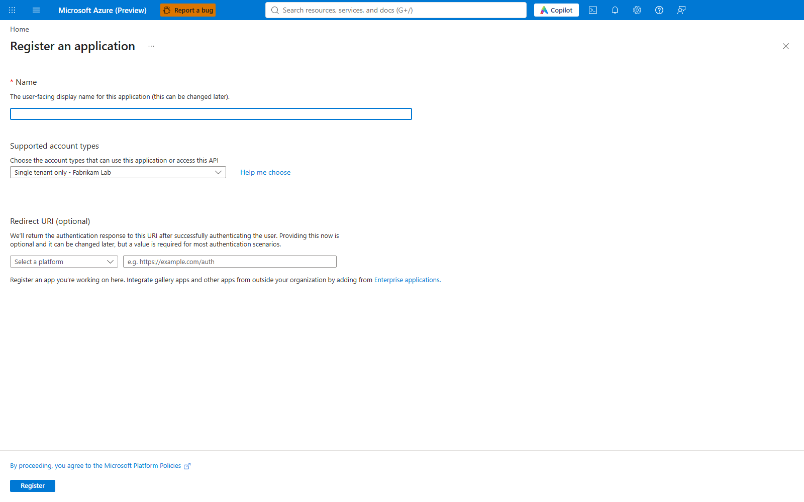

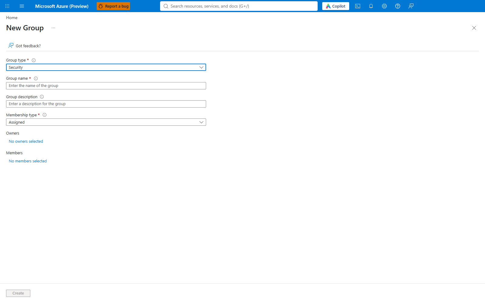

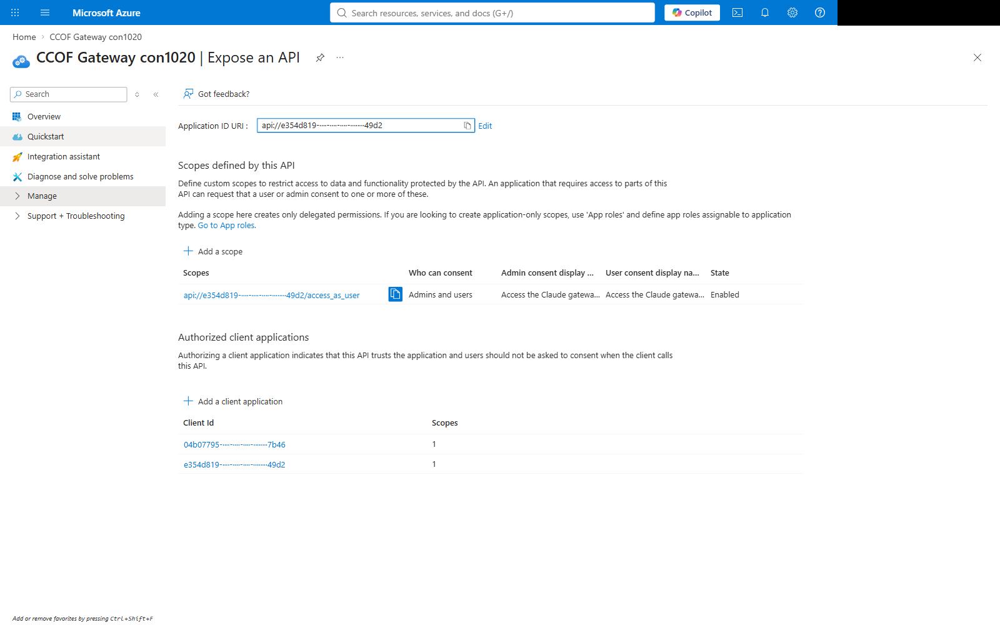

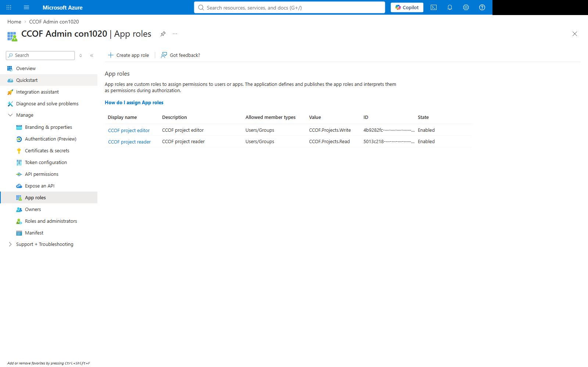

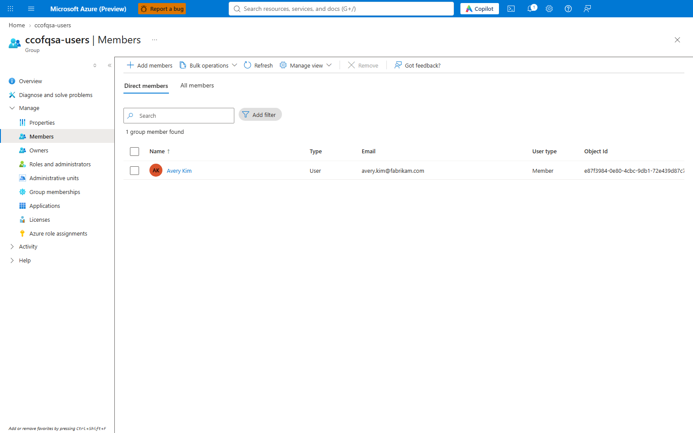

**Check.** The gateway app has identifier URI `api://<app ID>`, v2 tokens, the `access_as_user` scope
and its preauthorized clients; the resolver has its identifier URI and v2 tokens and no redirect URIs;
the admin app has `Projects.Manage`, both app roles, the two SPA redirects and **assignment required**
set to Yes; each group lists its members. The read-back lines at the end of the Azure CLI script show
these values.

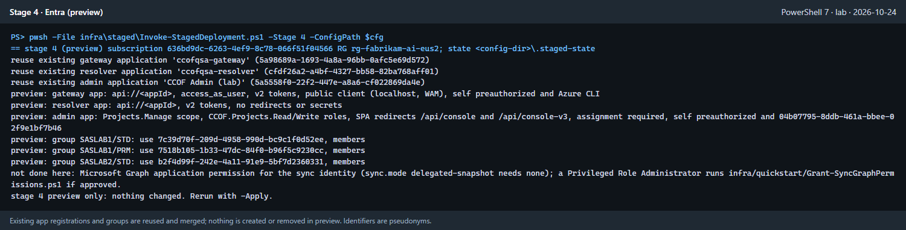

Unattended group sync also needs Microsoft Graph application permissions, granted by a Privileged
Role Administrator. Step 4 does not grant them; the default `sync.mode: delegated-snapshot` does not
need them ([permissions](../PERMISSIONS.md)).

---

## Step 5: configure the apps and the gateway

**What it does.** Writes each Function App's settings, turns on Entra sign-in for the resolver
(only APIM's identity may call it), and creates the gateway API at path `anthropic`, its policy,
the developer usage API, API logging and the chargeback workbook. Timers stay off unless the
configuration turns them on.

**Who runs it.** Website Contributor on the Function Apps, API Management Service Contributor on APIM,
and workbook write on the resource group.

**Script (recommended for this step)**

```powershell
pwsh -File infra\staged\Invoke-StagedDeployment.ps1 -Stage 5 -ConfigPath $cfg
pwsh -File infra\staged\Invoke-StagedDeployment.ps1 -Stage 5 -ConfigPath $cfg -Apply
```

The script renders the gateway policy from the configuration and checks it before deploying. Step 5
writes each app's settings as a complete set, so settings added by hand are replaced on the next run.

**Azure CLI.** The driver preview writes the rendered policy and the parameter file; the same
deployment then runs with:

```powershell
az deployment group create -g $rg -n stage5-config --mode Incremental `
    -f infra\staged\stage5-config.bicep -p "@$state\stage5-config.parameters.json"
az functionapp config appsettings list -g $rg -n $resolverApp --query "[].name" -o tsv
```

**Portal.** The parameter file holds the full gateway policy and is several hundred kilobytes; the
Portal route for this step was not tested. The Portal shows the result:

1. Function App > **Settings** > **Environment variables**: the setting names.
2. Resolver Function App > **Settings** > **Authentication**: **Require authentication**.
3. APIM > **APIs**: **Claude Messages (staged)**.

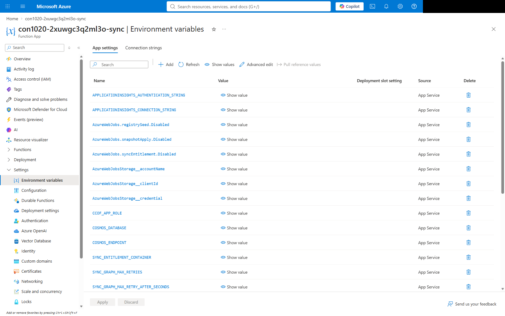

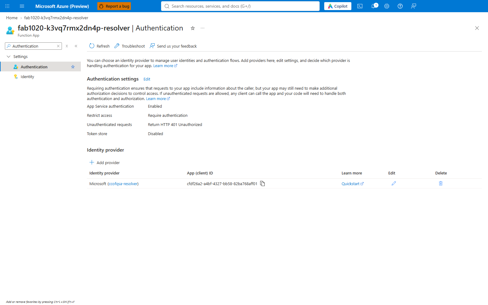

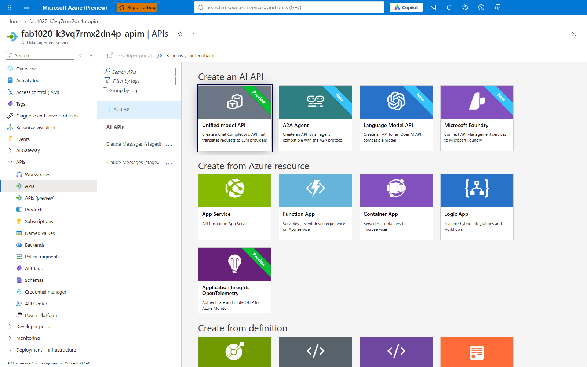

**Check.** Each app has its settings (the resolver has 14 in the lab), timers stay off unless
configured, the resolver's authentication returns 401 to callers other than APIM, and APIM has the
API at path `anthropic` with its policy. The driver's read-back compares the setting names and the
policy hash with what it deployed.

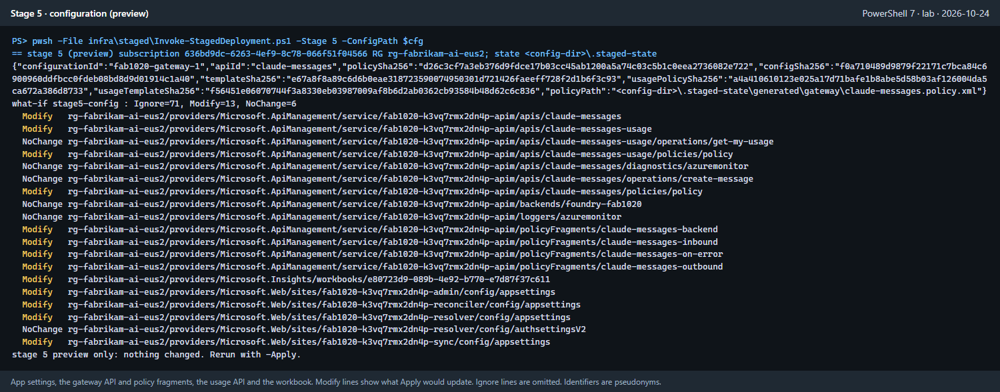

---

## Step 6: connect the network

**What it does.** With the default `network.mode: verify`, your network team builds the network and
Step 6 only checks it. The network needs:

- one VNet with three subnets: private endpoints (no delegation), Functions (delegated to
  `Microsoft.App/environments`) and APIM (delegated to `Microsoft.Web/serverFarms`, with a network
  security group);
- private endpoints for the Cosmos account (`Sql`), each app's storage (`blob`) and each private
  Foundry account (`account`), each approved and with a DNS zone group;
- private DNS zones `privatelink.documents.azure.com`, `privatelink.blob.core.windows.net` and, for
  private Foundry, `privatelink.cognitiveservices.azure.com`, `privatelink.openai.azure.com` and
  `privatelink.services.ai.azure.com`, linked to the VNet;
- each Function App joined to the Functions subnet, and APIM outbound integration on the APIM subnet.

Details: [driver reference](STAGED-DEPLOYMENT-V2.md#stage-6-network-last-setup-stage) and
[network](../NETWORK.md).

**Who runs it.** Checking: Reader on the VNet, endpoints, DNS zones and apps. Building: Network
Contributor on the VNet, private DNS zone write and link, and site write on the Function Apps.

**Script**

```powershell
pwsh -File infra\staged\Invoke-StagedDeployment.ps1 -Stage 6 -ConfigPath $cfg -Apply   # verify mode: checks only
```

The check alone, without the driver:
[`scripts\manual\Test-NetworkConfiguration.ps1`](../../scripts/manual/Test-NetworkConfiguration.ps1).

**Azure CLI: build.** The VNet, subnets, APIM network security group and the Cosmos and blob DNS
zones exist from [The network](#the-network-before-step-0). These commands add the Foundry DNS zones,
the private endpoints and the integrations, and skip zones and links that already exist.

```powershell
$netRg   = 'REPLACE-network-resource-group'
$vnet    = 'REPLACE-vnet-name'
$vnetId  = az network vnet show -g $netRg -n $vnet --query id -o tsv

# 1. Subnets: created before Step 0 (The network). Nothing to do here.

# 2. Private DNS zones, each linked to the VNet; existing zones and links are kept
#    (the last three only for a private Foundry account)
$zones = 'privatelink.documents.azure.com', 'privatelink.blob.core.windows.net',
         'privatelink.cognitiveservices.azure.com', 'privatelink.openai.azure.com', 'privatelink.services.ai.azure.com'
foreach ($z in $zones) {
    if (-not (az network private-dns zone list -g $netRg --query "[?name=='$z'].name" -o tsv)) {
        az network private-dns zone create -g $netRg -n $z
    }
    if (-not (az network private-dns link vnet list -g $netRg -z $z --query "[].virtualNetwork.id" -o tsv | Where-Object { $_ -eq $vnetId })) {
        az network private-dns link vnet create -g $netRg -z $z -n "$vnet-link-ccof" --virtual-network $vnetId --registration-enabled false
    }
}

# 3. Private endpoints with their DNS zone groups
function New-CcofEndpoint($Name, $TargetId, $GroupId, $Zone) {
    az network private-endpoint create -g $netRg -n $Name --vnet-name $vnet --subnet snet-private-endpoints `
        --private-connection-resource-id $TargetId --group-id $GroupId --connection-name $Name
    az network private-endpoint dns-zone-group create -g $netRg --endpoint-name $Name -n default `
        --private-dns-zone $Zone --zone-name ($Zone -replace '\.', '-')
}
New-CcofEndpoint "$cosmos-sql-pe" $cosmosId 'Sql' 'privatelink.documents.azure.com'
$storageStem = ($cosmos -replace '-cosmos$', '') -replace '-', ''      # the apps' storage accounts share this start
foreach ($id in (az storage account list -g $rg --query "[].id" -o tsv | Where-Object { ($_ -split '/')[-1] -like "$storageStem*" })) {
    New-CcofEndpoint "$(($id -split '/')[-1])-blob-pe" $id 'blob' 'privatelink.blob.core.windows.net'
}
# Private Foundry account (backends with privateEndpoint: true): one endpoint, three zones
New-CcofEndpoint "$foundry-account-pe" $foundryId 'account' 'privatelink.cognitiveservices.azure.com'
foreach ($z in 'privatelink.openai.azure.com', 'privatelink.services.ai.azure.com') {
    az network private-endpoint dns-zone-group add -g $netRg --endpoint-name "$foundry-account-pe" -n default `
        --private-dns-zone $z --zone-name ($z -replace '\.', '-')
}

# 4. Function Apps, one at a time
foreach ($app in $resolverApp, $syncApp, $reconcilerApp, $adminApp) {
    az functionapp vnet-integration add -g $rg -n $app --vnet $vnetId --subnet snet-functions
}

# 5. APIM Standard v2 outbound integration, through ARM (keeps the managed identity)
@{ properties = @{ virtualNetworkType = 'External'; virtualNetworkConfiguration = @{
    subnetResourceId = "$vnetId/subnets/snet-apim" } } } | ConvertTo-Json -Depth 5 | Set-Content apim-vnet.json
az rest --method PATCH --uri "https://management.azure.com${apimId}?api-version=2024-05-01" --body '@apim-vnet.json'
```

Private endpoints to resources in another subscription or tenant need approval by the target's
owner; the endpoint's connection state stays **Pending** until then.
`az apim update` is not used here: without `--enable-managed-identity true` it removes APIM's
managed identity, which the gateway needs to call Foundry and the resolver
([azure-cli source](https://github.com/Azure/azure-cli/blob/dev/src/azure-cli/azure/cli/command_modules/apim/custom.py)).
Joining several Function Apps to a subnet at the same time failed with `ServiceAssociationLinkLease`
in the lab, so they are joined one at a time.

**Azure CLI: check**

```powershell
foreach ($s in 'snet-functions', 'snet-apim') {
    az network vnet subnet show --ids "$vnetId/subnets/$s" --query "{subnet:name, delegation:delegations[0].serviceName}" -o tsv
}
az network private-endpoint list -g $netRg `
    --query "[].{name:name, state:privateLinkServiceConnections[0].privateLinkServiceConnectionState.status}" -o table
foreach ($z in 'privatelink.documents.azure.com', 'privatelink.blob.core.windows.net') {
    az network private-dns link vnet list -g $netRg -z $z --query "[].virtualNetwork.id" -o tsv
}
foreach ($app in $resolverApp, $syncApp, $reconcilerApp, $adminApp) {
    "$app " + (az functionapp vnet-integration list -g $rg -n $app --query "[].vnetResourceId" -o tsv)
}
az apim show --subscription $apimSub -g $apimRg -n $apim `
    --query "{type:virtualNetworkType, subnet:virtualNetworkConfiguration.subnetResourceId}" -o json
```

**Expect:** both subnets delegated, every endpoint `Approved`, your VNet in each zone's link list, each
app on `snet-functions`, and APIM `External` on `snet-apim`.

**Portal.** To build: **Private endpoints** > **Create**, with **Resource** set to the target (Cosmos
account `Sql`, storage account `blob`, Foundry account `account`), **Virtual Network** set to the
private-endpoint subnet and **DNS** set to integrate with the private DNS zone; then each Function
App > **Networking** > **Virtual network integration**, and APIM > **Network**. To check:

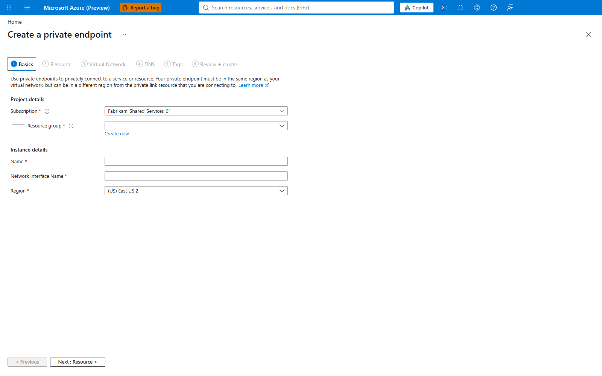

1. Foundry account > **Networking**: public access **Disabled**, private endpoint **Approved**.
2. APIM > **Network**: outbound virtual network integration on the APIM subnet.
3. Function App > **Networking**: outbound VNet integration on the Functions subnet.
4. Private DNS zone > **Virtual network links**: linked to the VNet.

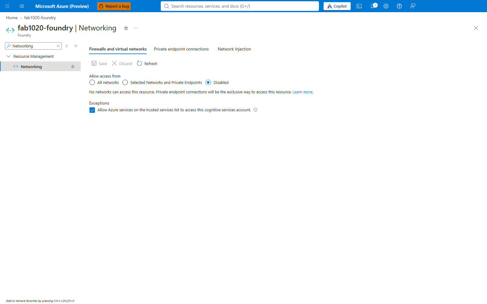

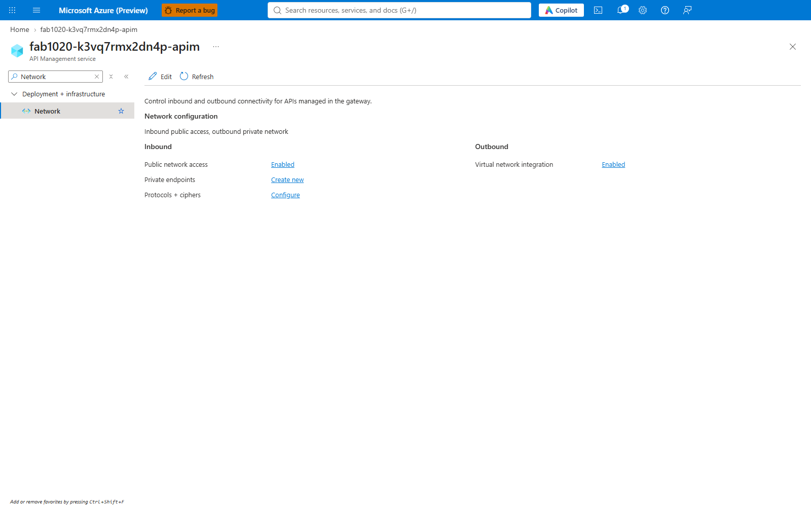

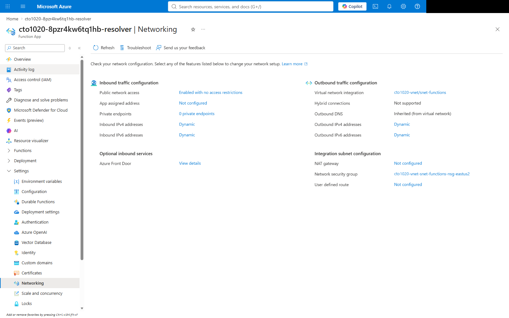

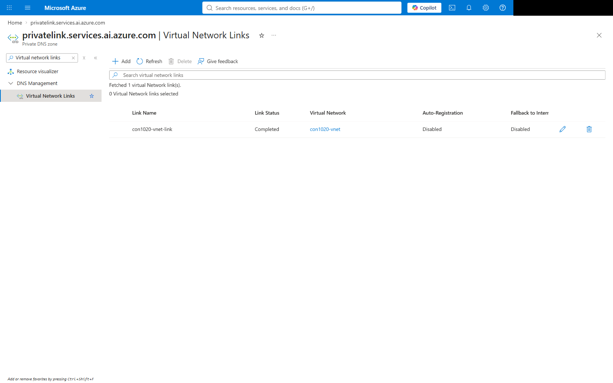

**Check.** In verify mode, Step 6 stops with `verify_failed` and lists each failing row. The lab ran
`network.mode: create`, where the driver also builds the network; on a rerun it only verifies:

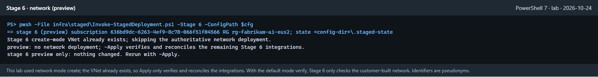

---

## Step 7: publish the code and load the first data

**What it does.** Publishes the Function App packages (resolver, sync, reconciler, and admin when
`stage1.includeAdmin` is true), waits until each app lists its functions, creates the project and
backend records once from the configuration, loads group membership with a one-time snapshot read
with your own Entra sign-in, and writes the developer client file `config.json`.

**Who runs it.** Website Contributor on the Function Apps; read access to the project groups in
Entra ID; and read access to the sync app's Application Insights, where the driver reads the result
of the record creation (`seed_query_failed` without it). Step 6 comes first: with private storage,
each app reads its package from its own storage account through its VNet integration.

**Script**

```powershell
pwsh -File infra\staged\Invoke-StagedDeployment.ps1 -Stage 7 -ConfigPath $cfg
pwsh -File infra\staged\Invoke-StagedDeployment.ps1 -Stage 7 -ConfigPath $cfg -Apply
```

Only one Step 7 runs at a time per checkout; a second one stops with `stage7_busy`. The lab apply on
24 October 2026 took 1,390 seconds.

**Azure CLI: packages**

```powershell
$packages = [ordered]@{ resolver = $resolverApp; sync = $syncApp; reconciler = $reconcilerApp }
foreach ($name in 'resolver', 'sync', 'reconciler') {
    pwsh -File scripts\portal\Build-PortalPackage.ps1 -App $name        # writes .env.portal-artifacts\NAME.zip
}
if ($c.stage1.includeAdmin) {
    pwsh -File admin\Build-AdminPackage.ps1 -OutFile .env.portal-artifacts\admin.zip
    $packages.admin = $adminApp
}
foreach ($name in $packages.Keys) {
    az functionapp deployment source config-zip -g $rg -n $packages[$name] --src ".env.portal-artifacts\$name.zip"
}
az functionapp function list -g $rg -n $resolverApp --query "[].name" -o tsv
```

`config-zip` is the zip deployment (OneDeploy) used for Flex Consumption apps by the driver and the
quickstart ([Flex Consumption plan](https://learn.microsoft.com/azure/azure-functions/flex-consumption-plan#deployment)).
The project/backend records and the membership snapshot without the driver are described in the
[Cloud Shell quickstart, step 5](CLOUD-SHELL-QUICKSTART.md) and the
[public access workbook](PUBLIC-ACCESS-WORKBOOK.md).

**Portal.** Function App > **Functions**: the resolver lists `health`, `myUsage` and `resolve`.

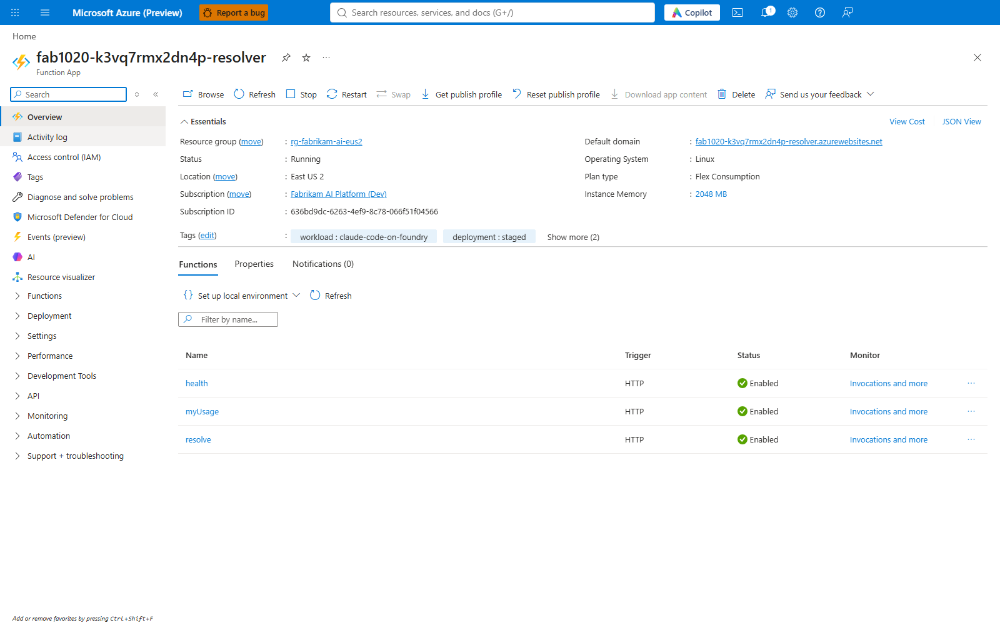

**Check.** The resolver lists `health`, `myUsage` and `resolve`; the sync app lists `syncEntitlement`;
the run reports the number of projects and backends seeded, the groups in the snapshot, and a client
file that passes `client\bin\validate-config.mjs`.

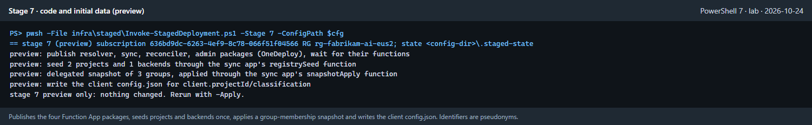


---

## Step 8: test end to end

**What it does.** Sends requests through the gateway: without a token (expect 401), for each allowed
project and model in `acceptance.allowed` (expect 200) and for each pair in `acceptance.denied`
(expect its `expectedStatus`, usually 403). It also calls the resolver without APIM's identity
(expect 401), checks the admin console, and looks for each successful request's `x-ccof-request-id`
in the `ApiManagementGatewayLlmLog` table within 15 minutes. Allowed requests use a few Claude tokens.

**Who runs it.** A member of each allowed project's group, with Azure CLI allowed as a client of the
gateway app (`entra.allowAzureCliClient: true`), and Log Analytics Reader on the workspace.

**Where it runs.** A workstation signed in with `az login`, on a device that meets the tenant's
Conditional Access policy; not Azure Cloud Shell. The driver (`infra/staged/Staged.Application.ps1`)
and the commands below request the gateway token with
`az account get-access-token --scope api://.../access_as_user`. Cloud Shell's managed-identity
credential refuses custom `api://` audiences (`Audience api://... is not a supported MSI token
audience`), and `az login --scope` in Cloud Shell is the device-code sign-in described under
[A separate Azure CLI sign-in](#a-separate-azure-cli-sign-in)
([lab screenshot](../images/dr-novice/dr-n11-token-audience.png)).

**Script**

```powershell
pwsh -File infra\staged\Invoke-StagedDeployment.ps1 -Stage 8 -ConfigPath $cfg -Apply
```

**Azure CLI and PowerShell.** The values come from the configuration file; the gateway app ID comes
from `entra.existing` or from Step 4's output.

```powershell
$gatewayAppId = if ($c.entra.existing) { $c.entra.existing.gatewayAppId } else { 'REPLACE-gateway-app-id' }
$gateway = (az apim show --subscription $apimSub -g $apimRg -n $apim --query gatewayUrl -o tsv) + '/' + $c.apim.apiPath
$token   = az account get-access-token --scope "api://$gatewayAppId/access_as_user" --query accessToken -o tsv
function Send-Claude($Project, $Model, [switch]$NoToken) {
    $h = @{ $c.gateway.projectHeaderName = $Project; 'anthropic-version' = '2023-06-01' }
    if (-not $NoToken) { $h.Authorization = "Bearer $token" }
    $b = @{ model = $Model; max_tokens = 24; messages = @(@{ role = 'user'; content = 'Reply with OK' }) } | ConvertTo-Json -Depth 5
    $r = Invoke-WebRequest -Uri "$gateway/v1/messages" -Method Post -Headers $h -Body $b -ContentType application/json -SkipHttpErrorCheck
    [pscustomobject]@{ project = $Project; model = $Model; status = [int]$r.StatusCode; requestId = "$($r.Headers['x-ccof-request-id'])" }
}
$first   = $c.acceptance.allowed[0]
$results = @(Send-Claude $first.project $first.model -NoToken)                         # expect 401
$results += $c.acceptance.allowed | ForEach-Object { Send-Claude $_.project $_.model }   # expect 200
$results += $c.acceptance.denied  | ForEach-Object { Send-Claude $_.project $_.model }   # expect expectedStatus
$results | Format-Table

$resolverHost = az functionapp show -g $rg -n $resolverApp --query properties.defaultHostName -o tsv
(Invoke-WebRequest "https://$resolverHost/api/resolve" -Method Post -SkipHttpErrorCheck).StatusCode     # expect 401
$adminHost = az functionapp show -g $rg -n $adminApp --query properties.defaultHostName -o tsv
(Invoke-WebRequest "https://$adminHost/" -MaximumRedirection 0 -SkipHttpErrorCheck -ErrorAction SilentlyContinue).StatusCode   # expect 302
(Invoke-WebRequest "https://$adminHost/api/v3/version" -SkipHttpErrorCheck).StatusCode                 # expect 401

# Telemetry: each successful request ID in the gateway log (allow up to 15 minutes)
$ids = ($results | Where-Object status -eq 200 | ForEach-Object { "'$($_.requestId)'" }) -join ','
$workspace = az monitor log-analytics workspace list -g $rg --query "[0].customerId" -o tsv
$laToken = az account get-access-token --resource https://api.loganalytics.io --query accessToken -o tsv
$query = @{ query = "ApiManagementGatewayLlmLog | where TimeGenerated > ago(2h) | where tolower(tostring(CorrelationId)) in ($ids) | summarize rows=count(), requests=dcount(CorrelationId)" } | ConvertTo-Json
(Invoke-RestMethod -Method Post -Uri "https://api.loganalytics.io/v1/workspaces/$workspace/query" `
    -Headers @{ Authorization = "Bearer $laToken" } -Body $query -ContentType application/json).tables[0].rows
```

The Log Analytics query travels in a request body from PowerShell, not as an `az` argument, so its
`|` and `( )` characters do not reach `cmd.exe`.

**Portal.** Log Analytics workspace > **Logs**:

```kusto
ApiManagementGatewayLlmLog
| where TimeGenerated > ago(1h)
| project TimeGenerated, CorrelationId, ModelName, PromptTokens, CompletionTokens
```

The **Logs** page opens in **Simple mode**; the mode menu at the right of the toolbar switches to
**KQL mode**, where the query is typed and **Run**.

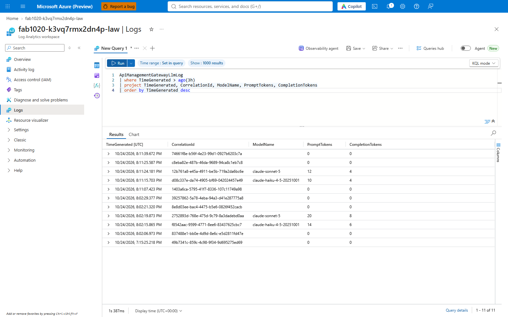

**Check.** 401 without a token; 200 for every allowed pair; the expected status for every denied pair;
401 from the resolver; 302 from the admin root and 401 from its API without a token; and the
telemetry query returns as many requests as there were 200 responses.

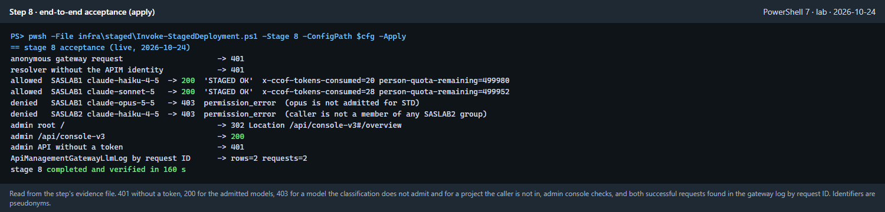

---
## After deployment

| Next | Guide |
| --- | --- |
| Add projects, people, models, limits and budgets | [Admin console operations](ADMIN-OPERATIONS.md) |
| Set up developers' machines and Claude Code | [User onboarding](USER-ONBOARDING.md) |
| Budget warnings at 80% and spend pacing | [Budgets and spend pacing](../BUDGETS.md) |

## When a step fails

| Message | Meaning | What to do |
| --- | --- | --- |
| `verify_failed: <reason>` | The step ran, but the read-back found something different | Fix the named item; rerun the same step |
| `stage_order` | A step it depends on is not recorded | Run the earlier step first |
| `stage_dependency_changed` | An earlier step was rerun with different results | Rerun this step |
| `stage_config_changed` | The configuration for an already-verified step changed | Preview and apply that step again |
| `state_target_mismatch` | The state folder belongs to another tenant, subscription or resource group | Use a separate configuration folder per environment |
| `stage7_busy` | Another Step 7 is running from this checkout | Wait for it to finish |
| `'charmap' codec` from `az` | The Azure CLI on Windows met a non-ASCII character | [`scripts/diagnostics/windows-az-utf8`](../../scripts/diagnostics/) |
| `AuthorizationFailed` | The signed-in account lacks the permission in **Who runs it** | Ask the owner of that scope; check `az account show` |

No step deletes resources, Entra objects or earlier permission grants
([recovery](STAGED-DEPLOYMENT-V2.md#recovery)).
