# Set up disaster recovery in Azure Cloud Shell (deployable parts)

**For:** an operator who has finished the single-region deployment in
[Deploy CCOF step by step](DEPLOY-STEP-BY-STEP.md) and now sets up the parts of disaster recovery (DR)
that can be deployed today. **Time:** about one hour of commands; workspace replication can take up
to one more hour to cover every table. **Result:** a standby-region network with two-way peering,
private DNS links and two identity shells; the Log Analytics workspace replicated to the standby
region; and, for chosen projects, backend failover through a project-only APIM pool.

The full two-region design is in [DR design](../DR-ACTIVE-PASSIVE.md) and
[DR implementation](../design/DR-IMPLEMENTATION.md) (stages P0-P3 and D1-D6); the contract is
[ADR 0034](../adr/0034-dr-project-routing-and-prerequisites.md). This runbook follows the issues found
in a first-time run in Cloud Shell, recorded in the
[DR walkthrough of 2026-10-25](../DR-NOVICE-WALKTHROUGH-2026-10-25.md) (issues N-01 to N-16). A second
serving region is not deployable yet; see [Not deployable yet](#not-deployable-yet).

Each step has the same parts as the deployment guide:

| Part | Meaning |
| --- | --- |
| **What it does** | The Azure objects the step creates or checks |
| **Who runs it** | The permission the person running the step needs |
| Commands | PowerShell blocks for Azure Cloud Shell, unless the step says *workstation* |
| **Expect** | The output of a correct run |
| **Check** | The Portal view or read-back of the result, with screenshots |

Screenshots come from the **Fabrikam lab** run of 25 October 2026. Cloud Shell images are rendered
from the captured transcripts; names, IDs and subscriptions in them are pseudonyms with the same
shape as the real values.

## Before you start

| Requirement | Source |
| --- | --- |
| A single-region deployment that passed Step 8 | [Deploy CCOF step by step](DEPLOY-STEP-BY-STEP.md#step-8-test-end-to-end) |
| A standby region where APIM, Function Apps, Container Apps environments, Cosmos DB and Log Analytics are offered; Step 3 checks this | [Region pair evaluation](../DR-ACTIVE-PASSIVE.md#region-pair-evaluation) |
| A standby address space that does not overlap the primary VNet or any network peered with it | Your network team |
| The deployment settings `admin.extraAllowedClientIds: ["04b07795-8ddb-461a-bbee-02f9e1bf7b46"]` (Microsoft Azure CLI) and `entra.allowAzureCliClient: true`, applied by Stages 4, 5 and 7. Step 3 stops with `entra.admin:azure_cli_not_preauthorized` without the first (N-17); [Step 2.0](#20-azure-cli-as-an-admin-client-workstation-n-17) sets both | [Stage 4](STAGED-DEPLOYMENT-V2.md#stage-4-entra), [DR implementation, Entra app registrations](../design/DR-IMPLEMENTATION.md#entra-app-registrations) |
| For backend failover (Step 6): a workstation or managed device that Conditional Access allows to sign in to the Azure CLI | [Deployment runbook, Entra handoff](DEPLOYMENT-RUNBOOK.md#1-entra-administrator-handoff) |

Permissions per step:

| Step | Runs in | Permission |
| --- | --- | --- |
| 2.0 Azure CLI as an admin client | Workstation | The deployment guide's permissions for Stages 4, 5 and 7 ([Deploy CCOF step by step](DEPLOY-STEP-BY-STEP.md#step-4-register-the-apps-and-groups-in-entra-id)) |
| 1, 2 Prepare and fill the configuration | Cloud Shell | Reader on the subscription, the primary VNet, the private DNS zones and each Foundry account; read access to app registrations in Entra ID |
| 3 Discover (P0) | Cloud Shell | Same as Step 2 |
| 4 Bootstrap (P1/P2) | Cloud Shell | Contributor on the standby resource group; for a new group, `Microsoft.Resources/subscriptions/resourceGroups/write` on the subscription; Network Contributor on the primary VNet (peering); Private DNS Zone Contributor on the DNS zones' resource group (links) |
| 4 Verify | Cloud Shell | Reader on the same scopes |
| 5 Workspace replication | Cloud Shell | `Microsoft.OperationalInsights/workspaces/write` and `Microsoft.Insights/dataCollectionEndpoints/write`, for example Monitoring Contributor ([Learn](https://learn.microsoft.com/azure/azure-monitor/logs/workspace-replication#permissions-required)) |
| 6.1, 6.2 Backends and project failover | Admin console | `CCOF.Projects.Write` (editor) app role |
| 6.3 Publish the pool | Workstation | Editor app role, and write access to backends on the APIM instance (for example API Management Service Contributor) |
| 6.4 Snapshot apply | Cloud Shell | Website Contributor on the sync Function App, read access to its Application Insights, and read access to the project groups in Entra ID |
| 6.5 Gateway test | Workstation | Member of the project's group; Log Analytics Reader on the workspace |

---

## Step 1: prepare Cloud Shell

**What it does.** Opens Azure Cloud Shell in PowerShell, selects the subscription, installs Bicep and
gets the source code. Nothing in Azure changes.

**Who runs it.** Any user who can open Cloud Shell, with Reader on the subscription.

1. Azure Portal > **Cloud Shell** icon in the top bar > **PowerShell**. If the shell shows `bash`,
   select **Switch to PowerShell** in the toolbar.
2. Cloud Shell is already signed in with your Portal account. The separate profile from the
   deployment guide (`AZURE_CONFIG_DIR` and `az login`) applies to workstations only. In Cloud Shell,
   `az login` starts a device-code sign-in, which Conditional Access refuses on many tenants
   ("requires the device to be managed"; N-04). The DR script accepts Cloud Shell's own sign-in.
3. Files in an ephemeral Cloud Shell session (no storage account) are deleted when the session ends
   ([ephemeral sessions](https://learn.microsoft.com/azure/cloud-shell/get-started/ephemeral)). A
   Cloud Shell with a storage account keeps `$HOME` between sessions
   ([persist files](https://learn.microsoft.com/azure/cloud-shell/persisting-shell-storage)). In an
   ephemeral session, the configuration file and the `out` evidence folder are downloaded before
   closing with **Manage files > Download** (N-06).

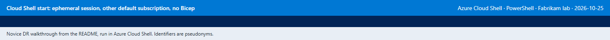

The commands in this runbook use the variables below. The block is pasted once per Cloud Shell
session, after each `REPLACE-...` value is replaced. The placeholders contain no `< >` characters, so
the same commands also work on Windows, where `az` passes arguments through `cmd.exe`.

```powershell
$tenant        = 'REPLACE-tenant-id'               # Microsoft Entra ID > Overview > Tenant ID
$sub           = 'REPLACE-subscription-id'         # subscription of the single-region deployment
$rg            = 'REPLACE-ccof-resource-group'     # resource group of the single-region deployment
$standbyRegion = 'REPLACE-standby-region'          # lowercase region name, for example centralus
$work          = "$HOME/ccof-dr"                   # private folder for the configuration and evidence
$cfg           = "$work/dr.config.json"
$out           = "$work/out"
New-Item -ItemType Directory -Force -Path $out | Out-Null
if (Test-Path "$HOME/ccof-bicep") { Set-Location "$HOME/ccof-bicep" }
```

**Expect:** no output.

```powershell
az account set --subscription $sub
az account show --query "{tenant:tenantId, subscription:id, user:user.name}" -o table
az bicep install
az bicep version
```

**Expect:** your tenant, subscription and account, then a Bicep version line. `AuthorizationFailed`
in a later step usually means Cloud Shell is back on its default subscription; this block is run again.

```powershell
Set-Location $HOME
if (-not (Test-Path ccof-bicep)) { git clone https://github.com/naveenneog/ccof-bicep.git }
Set-Location "$HOME/ccof-bicep"
git pull --ff-only
git log -1 --oneline
```

**Expect:** the latest commit of `main`.

---

## Step 2: fill the DR configuration

**What it does.** Reads the values the DR script needs and writes them to `dr.config.json` in `$work`,
starting from [`infra/dr/dr.config.example.json`](../../infra/dr/dr.config.example.json). All commands in this
step are read-only, except 2.0, which updates the single-region deployment's admin app when it does
not yet accept the Azure CLI.

**Who runs it.** Reader on the subscription, the primary VNet, the DNS zones and the Foundry accounts.

### 2.0 Azure CLI as an admin client (workstation, N-17)

The routing publisher (Step 6.3) requests a token for the admin app's `Projects.Manage` scope with the
Azure CLI. That needs two settings on the admin app, which are distinct checks
([DR implementation, Entra app registrations](../design/DR-IMPLEMENTATION.md#entra-app-registrations);
[ADR 0034](../adr/0034-dr-project-routing-and-prerequisites.md)):

| Setting | Written by | Without it |
| --- | --- | --- |
| Azure CLI (`04b07795-8ddb-461a-bbee-02f9e1bf7b46`) preauthorized for `Projects.Manage` | Stage 4, from `admin.extraAllowedClientIds` ([Stage 4](STAGED-DEPLOYMENT-V2.md#stage-4-entra)) | Step 3: `entra.admin:azure_cli_not_preauthorized`. Step 6.3: `AADSTS65001` `consent_required` for Microsoft Azure CLI |
| Azure CLI in the admin app setting `ADMIN_ALLOWED_CLIENT_IDS` | Stage 5, from the same list ([Stage 5](STAGED-DEPLOYMENT-V2.md#stage-5-configuration)) | Step 6.3: HTTP 403 `oauth_client_denied` from the admin API |

The staged example leaves `admin.extraAllowedClientIds` empty, so a deployment made with the default
has neither setting (N-17 in the [DR walkthrough](../DR-NOVICE-WALKTHROUGH-2026-10-25.md)). A gateway
token works without them; the gateway's own setting is `entra.allowAzureCliClient`. A new deployment
sets both values in its configuration file before Stage 4. For a deployment that is already done, the
block below adds them and reruns Stages 4, 5 and 7: Stage 5 reads `admin` in its inputs, and Stage 7
depends on Stage 5 ([driver reference](STAGED-DEPLOYMENT-V2.md#how-a-stage-runs)).

On the workstation, in the repository folder and the Azure CLI profile of the
[deployment guide](DEPLOY-STEP-BY-STEP.md#a-separate-azure-cli-sign-in):

```powershell
$stagedCfg = 'C:\private\ccof\staged.config.json'        # the deployment's configuration file
$azureCli  = '04b07795-8ddb-461a-bbee-02f9e1bf7b46'      # Microsoft Azure CLI (public client)
$s = Get-Content $stagedCfg -Raw | ConvertFrom-Json
if ($null -eq $s.admin) { $s | Add-Member admin ([pscustomobject]@{ v3Enabled = $true; extraAllowedClientIds = @() }) }
$ids = @(@($s.admin.extraAllowedClientIds) + $azureCli | Where-Object { $_ } | Select-Object -Unique)
$s.admin | Add-Member extraAllowedClientIds $ids -Force
$s.entra | Add-Member allowAzureCliClient $true -Force
$s | ConvertTo-Json -Depth 100 | Set-Content -Path $stagedCfg -Encoding utf8NoBOM
(Get-Content $stagedCfg -Raw | ConvertFrom-Json) | ForEach-Object { "admin.extraAllowedClientIds=$($_.admin.extraAllowedClientIds -join ',') entra.allowAzureCliClient=$($_.entra.allowAzureCliClient)" }
```

**Expect:** `admin.extraAllowedClientIds=04b07795-8ddb-461a-bbee-02f9e1bf7b46 entra.allowAzureCliClient=True`
(other client IDs already in the list are kept).

```powershell
pwsh -File infra\staged\Invoke-StagedDeployment.ps1 -Stage 4 -ConfigPath $stagedCfg
pwsh -File infra\staged\Invoke-StagedDeployment.ps1 -Stage 4 -ConfigPath $stagedCfg -Apply
pwsh -File infra\staged\Invoke-StagedDeployment.ps1 -Stage 5 -ConfigPath $stagedCfg -Apply
pwsh -File infra\staged\Invoke-StagedDeployment.ps1 -Stage 7 -ConfigPath $stagedCfg -Apply
```

**Expect:** the Stage 4 preview line `preview: admin app: ... self preauthorized and 04b07795-8ddb-461a-bbee-02f9e1bf7b46`,
then each apply ending with `stage N completed and verified`. Stage 7 republishes the packages and
applies a membership snapshot; the lab Stage 7 took about 23 minutes. Stage 8 is not required for DR;
a later Stage 8 run uses the new inputs.

```powershell
$adminAppId = 'REPLACE-admin-app-id'
$rg         = 'REPLACE-ccof-resource-group'
az ad app show --id $adminAppId --query "api.preAuthorizedApplications[].appId" -o tsv
$adminApp = az functionapp list -g $rg --query "[].name" -o tsv | Where-Object { $_ -match '-admin(-func)?$' }
az functionapp config appsettings list -g $rg -n $adminApp -o json | ConvertFrom-Json |
    Where-Object { $_.name -eq 'ADMIN_ALLOWED_CLIENT_IDS' } | ForEach-Object value
```

**Expect:** `04b07795-8ddb-461a-bbee-02f9e1bf7b46` in both outputs, next to the admin app's own ID.

The fields:

| Field | What to enter | Where to find it |
| --- | --- | --- |
| `tenantId`, `subscriptionId` | The deployment's tenant and subscription | `az account show --query "{tenant:tenantId, subscription:id}" -o table` |
| `tags` | Tags for every DR resource; letters, digits and `. _ : / -` only | Your naming standard |
| `primary.location` | Region of the single-region deployment | `az group show --name $rg --query location -o tsv` |
| `primary.vnetId` | Resource ID of the primary VNet | `az network vnet list --query "[].id" -o tsv` (the VNet in the deployment's `network.existing` subnet IDs) |
| `primary.addressSpaces` | Every address prefix of the primary VNet | `az network vnet show --ids $primaryVnetId --query addressSpace.addressPrefixes -o tsv` |
| `primary.peer` | `true` for two-way peering between the two VNets; `false` when the network team peers through a hub | Network team |
| `secondary.location` | Standby region | [Region pair evaluation](../DR-ACTIVE-PASSIVE.md#region-pair-evaluation) |
| `secondary.resourceGroup` | Resource group for the standby resources | See [Resource group choice](#resource-group-choice) |
| `secondary.vnetName`, `secondary.apimNsgName` | New names for the standby VNet and the NSG of its APIM subnet | Your naming standard |
| `secondary.addressSpace` | A range that overlaps neither `primary.addressSpaces` nor any peered network, for example a `/22` | Network team |
| `secondary.subnets.apim`, `.functions`, `.privateEndpoints` | Name and prefix of each subnet, inside `secondary.addressSpace`, not overlapping each other; at least `/27`, `/27` and `/28` | Minimums in `MaxPrefix`, [`DrPrerequisites.psm1`](../../infra/dr/DrPrerequisites.psm1) |
| `secondary.allowResourceGroupInOtherRegion` | `true` only when `secondary.resourceGroup` is an existing group in another region | [Resource group choice](#resource-group-choice) |
| `dnsZones.subscriptionId`, `.resourceGroup`, `.zoneNames` | The private DNS zones linked to the primary VNet; only the six `privatelink` zones CCOF uses are accepted | `az network private-dns zone list` (block below) |
| `identityNames` | Names for the standby sync and reconciler identity shells, for example `PREFIX-sync-b` and `PREFIX-reconciler-b` | Your naming standard |
| `foundryAccounts` | Subscription, resource group and name of each Foundry account in the deployment's `backends` | `az cognitiveservices account list` (block below) |
| `entra.gatewayAppId`, `.resolverAppId`, `.adminAppId` | Application (client) IDs of the three app registrations | `az ad app list --display-name` (block below) |

### Resource group choice

| Option | Configuration | Requirement |
| --- | --- | --- |
| A. New standby resource group (default) | `secondary.resourceGroup` is a new name in the standby region; `allowResourceGroupInOtherRegion: false` | `Microsoft.Resources/subscriptions/resourceGroups/write` on the subscription. Step 4 creates the group first, so a missing permission shows before any other change (N-07) |
| B. Existing resource group in another region | `secondary.resourceGroup` is an existing group, for example `$rg`; `allowResourceGroupInOtherRegion: true` | Contributor on that group. The resources are still created in the standby region; only the group's metadata stays in its own region, so it cannot be changed while that region is down (comment in [`Invoke-DrPrerequisites.ps1`](../../infra/dr/Invoke-DrPrerequisites.ps1)) |

Without the override, an existing group in another region stops Step 4 with
`resourceGroup:location_is_REGION` (N-08).

### 2.1 Primary network

```powershell
$primaryRegion = az group show --name $rg --query location -o tsv
$primaryRegion
az network vnet list --query "[].id" -o tsv
```

**Expect:** the primary region, then the resource ID of each VNet in the subscription. The primary VNet
is the one that holds the deployment's APIM, Functions and private-endpoint subnets.

```powershell
$primaryVnetId = 'REPLACE-primary-vnet-resource-id'
$primaryVnet = az network vnet show --ids $primaryVnetId -o json | ConvertFrom-Json
$primaryVnet.location
$primaryVnet.addressSpace.addressPrefixes
```

**Expect:** the primary region and the VNet's address prefixes, for example `10.64.0.0/16`.

### 2.2 Private DNS zones

```powershell
$approvedZones = 'privatelink.services.ai.azure.com', 'privatelink.cognitiveservices.azure.com', 'privatelink.openai.azure.com',
    'privatelink.documents.azure.com', 'privatelink.blob.core.windows.net', 'privatelink.azurewebsites.net'
az network private-dns zone list -o json | ConvertFrom-Json | Where-Object { $_.name -in $approvedZones } |
    Select-Object name, resourceGroup | Format-Table
```

**Expect:** the CCOF zones and their resource group (Step 6 of the deployment created or verified
them). When the zones are in another subscription, the list command takes `--subscription` with
that subscription's ID.

```powershell
$dnsSub = $sub                                     # the zones' subscription when it differs
$dnsRg  = 'REPLACE-dns-zone-resource-group'
$zoneNames = @(foreach ($z in $approvedZones) {
    $linked = az network private-dns link vnet list --subscription $dnsSub -g $dnsRg -z $z --query "[].virtualNetwork.id" -o tsv 2>$null
    if ($linked -contains $primaryVnetId) { $z }
})
$zoneNames
```

**Expect:** the zones that are linked to the primary VNet, usually three to six names. Only these are
linked to the standby VNet.

### 2.3 Foundry accounts and app registrations

```powershell
az cognitiveservices account list -o json | ConvertFrom-Json | Where-Object { $_.kind -eq 'AIServices' } |
    Select-Object name, resourceGroup, location | Format-Table
az ad app list --display-name 'CCOF' --query "[].{name:displayName, appId:appId}" -o table
```

**Expect:** the Foundry accounts named in the deployment's `backends`, then the gateway, resolver and
admin app registrations. `--display-name` matches the start of the name; the deployment's names are
in its `entra.gatewayAppDisplayName`, `resolverAppDisplayName` and `adminAppDisplayName`.

### 2.4 Write the configuration

The first part of the block holds the values chosen above; the rest copies the example and fills it.

```powershell
# --- Values (replace) ---
$standbyRg       = 'REPLACE-standby-resource-group'   # option A: new name; option B: existing group, for example $rg
$otherRegionRg   = $false                             # $true only for option B
$standbyVnet     = 'REPLACE-standby-vnet-name'
$standbySpace    = 'REPLACE-standby-address-space'    # for example 10.81.0.0/22
$apimPrefix      = 'REPLACE-apim-subnet-prefix'       # for example 10.81.0.0/24 (at least /27)
$functionsPrefix = 'REPLACE-functions-subnet-prefix'  # for example 10.81.1.0/24 (at least /27)
$pePrefix        = 'REPLACE-pe-subnet-prefix'         # for example 10.81.2.0/24 (at least /28)
$identityNames   = @('REPLACE-prefix-sync-b', 'REPLACE-prefix-reconciler-b')
$tags            = [ordered]@{ workload = 'ccof'; stage = 'dr-prerequisites' }
$foundryAccounts = @(
    [ordered]@{ subscriptionId = $sub; resourceGroup = 'REPLACE-foundry-resource-group'; name = 'REPLACE-foundry-account' }
)
$gatewayAppId    = 'REPLACE-gateway-app-id'
$resolverAppId   = 'REPLACE-resolver-app-id'
$adminAppId      = 'REPLACE-admin-app-id'

# --- Fill the example ---
$c = Get-Content infra/dr/dr.config.example.json -Raw | ConvertFrom-Json
$c.tenantId = $tenant
$c.subscriptionId = $sub
$c.tags = $tags
$c.primary.location = $primaryRegion
$c.primary.vnetId = $primaryVnetId
$c.primary.addressSpaces = @($primaryVnet.addressSpace.addressPrefixes)
$c.primary.peer = $true
$s = $c.secondary
$s.location = $standbyRegion
$s.resourceGroup = $standbyRg
$s.vnetName = $standbyVnet
$s.apimNsgName = "$standbyVnet-nsg-apim"
$s.addressSpace = $standbySpace
$s.subnets.apim = [ordered]@{ name = 'snet-apim'; prefix = $apimPrefix }
$s.subnets.functions = [ordered]@{ name = 'snet-functions'; prefix = $functionsPrefix }
$s.subnets.privateEndpoints = [ordered]@{ name = 'snet-private-endpoints'; prefix = $pePrefix }
$s | Add-Member allowResourceGroupInOtherRegion $otherRegionRg -Force
$c.dnsZones.subscriptionId = $dnsSub
$c.dnsZones.resourceGroup = $dnsRg
$c.dnsZones.zoneNames = $zoneNames
$c.identityNames = $identityNames
$c.foundryAccounts = $foundryAccounts
$c.entra.gatewayAppId = $gatewayAppId
$c.entra.resolverAppId = $resolverAppId
$c.entra.adminAppId = $adminAppId
$c | ConvertTo-Json -Depth 10 | Set-Content -Path $cfg
Get-Content $cfg
```

**Expect:** the configuration printed as JSON with your values. `primary.peer` is `$true` in this
block; for hub peering it is set to `$false` before the last two lines are run.

The configuration is checked offline, without any Azure call:

```powershell
Select-String -Path $cfg -Pattern 'REPLACE-'
Import-Module ./infra/dr/DrPrerequisites.psm1 -Force
Get-DrConfigProblems (Get-Content $cfg -Raw | ConvertFrom-Json)
```

**Expect:** no output from either command. Each problem is printed as `field:reason`, for example
`secondary.subnets.apim.prefix:too_small` or `secondary.addressSpace:overlaps_primary_10.64.0.0/16`;
the value is corrected in the block above and the block is run again.

In an ephemeral session, `dr.config.json` is downloaded now (**Manage files > Download**, path
`ccof-dr/dr.config.json`). Step 6.3 on the workstation reads the same file.

---

## Step 3: discover (P0, read-only)

**What it does.** Checks the signed-in tenant and subscription, the resource providers and their
availability in the standby region, the standby resource group, the primary VNet against the standby
address space, the DNS zones, the Claude deployments of each Foundry account and the three app
registrations ([DR stages](../design/DR-IMPLEMENTATION.md#prerequisite-first-dr-stages)). Nothing in
Azure changes.

**Who runs it.** Reader on the subscription, the primary VNet, the DNS zones and the Foundry
accounts; read access to app registrations.

```powershell
pwsh -NoProfile -File infra/dr/Invoke-DrPrerequisites.ps1 -Phase Discover -ConfigPath $cfg -EvidenceDirectory $out
```

**Expect:**

```text
evidence: /home/USER/ccof-dr/out/dr-discover-20261025T070256Z.json
Discover passed.
```

A failed check prints `BLOCKERS (N):` and one line per blocker; each is listed in
[When a step fails](#when-a-step-fails). The evidence file records every check, including the standby
resource group's state (`exists: false` for option A).

**Check.** `Get-Content (Get-ChildItem $out/dr-discover-*.json | Select-Object -Last 1)` shows
`checks.account`, `checks.providers`, `checks.primaryVnet` (with `overlaps: []`), `checks.dnsZones`,
`checks.foundry` and `checks.entra`, and `blockers: []`.

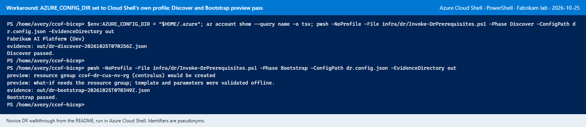

The screenshot is from the lab run before the script accepted Cloud Shell's sign-in: the
`$env:AZURE_CONFIG_DIR = "$HOME/.azure"` part of the first command is no longer needed. Its second
command is the option A preview without a resource group, which validates offline only; Step 4 below
creates the group first, so the preview lists every change.

---

## Step 4: create the standby network and identities (P1/P2)

**What it does.** Deploys [`infra/dr/dr-prerequisites.bicep`](../../infra/dr/dr-prerequisites.bicep)
into the standby resource group: the standby VNet with three subnets (APIM integration delegated to
`Microsoft.Web/serverFarms`, Functions integration delegated to `Microsoft.App/environments`, and an
undelegated private-endpoint subnet), the NSG of the APIM subnet, a link from each listed private DNS
zone to the standby VNet, two-way peering with the primary VNet (when `primary.peer` is true), and
the user-assigned identity shells. No application, role assignment, data or policy is created.

**Who runs it.** See the [permissions table](#before-you-start).

### 4.1 Resource group (option A only)

```powershell
$c = Get-Content $cfg -Raw | ConvertFrom-Json
$tagArgs = @($c.tags.PSObject.Properties | ForEach-Object { "$($_.Name)=$($_.Value)" })
az group create --name $c.secondary.resourceGroup --location $c.secondary.location --tags @tagArgs --query "{name:name, location:location}" -o table
```

**Expect:** the new group and the standby region. `AuthorizationFailed` on
`Microsoft.Resources/subscriptions/resourceGroups/write` means the account cannot create groups:
option B is used instead (Step 2.4 with `$otherRegionRg = $true` and an existing group), and this
block is skipped.

### 4.2 Preview

```powershell
pwsh -NoProfile -File infra/dr/Invoke-DrPrerequisites.ps1 -Phase Bootstrap -ConfigPath $cfg -EvidenceDirectory $out
```

**Expect:** one `what-if: Create` line per resource, then `Bootstrap passed.`:

| what-if line ends with | Resource |
| --- | --- |
| `/userAssignedIdentities/NAME` | Each name in `identityNames` |
| `/networkSecurityGroups/APIM-NSG-NAME` | NSG of the standby APIM subnet |
| `/privateDnsZones/ZONE/virtualNetworkLinks/STANDBY-VNET-link` | One per zone in `dnsZones.zoneNames` |
| `/virtualNetworks/STANDBY-VNET` | Standby VNet with its subnets |
| `/virtualNetworks/STANDBY-VNET/virtualNetworkPeerings/to-PRIMARY-VNET` | Peering from the standby VNet |
| `/virtualNetworks/PRIMARY-VNET/virtualNetworkPeerings/to-STANDBY-VNET` | Peering from the primary VNet |

A `Modify` or `Delete` of any other resource stops the preview with `whatIf:changes_existing_N`;
the evidence file lists the resource IDs.

### 4.3 Apply and verify

```powershell
pwsh -NoProfile -File infra/dr/Invoke-DrPrerequisites.ps1 -Phase Bootstrap -ConfigPath $cfg -EvidenceDirectory $out -Apply
pwsh -NoProfile -File infra/dr/Invoke-DrPrerequisites.ps1 -Phase Verify -ConfigPath $cfg -EvidenceDirectory $out
```

**Expect:** `Bootstrap passed.` after a few minutes, then `Verify passed.`, each after an
`evidence:` line. Verify reads back the VNet location and address space, each subnet's prefix,
delegation and NSG, the peering state `Connected`, each DNS link `Succeeded`, and each identity.

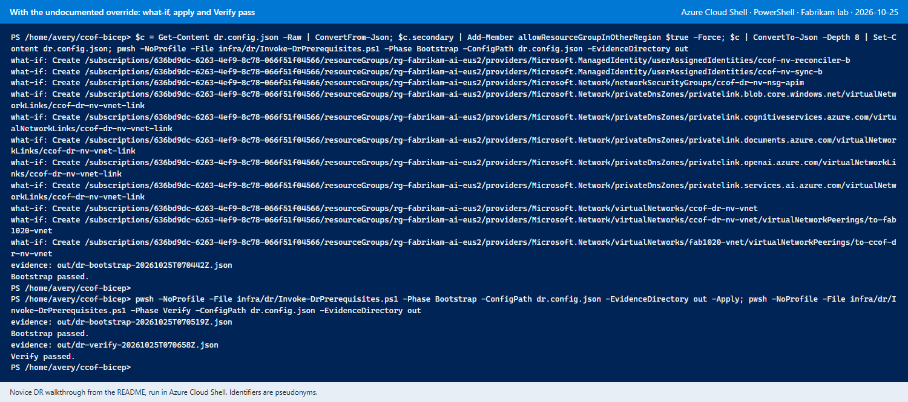

In the screenshot, the lab set `allowResourceGroupInOtherRegion` with an inline command in the first
line; Step 2.4 now writes it to the file.

**Check (Portal).**

1. **Virtual networks** > standby VNet > **Settings > Peerings**: the peering to the primary VNet shows
   **Connected**. The primary VNet's **Peerings** shows the peering to the standby VNet as **Connected**.
2. **Private DNS zones** > each zone in `dnsZones.zoneNames` > **Virtual network links**: the link
   `STANDBY-VNET-link` with link status **Completed**, next to the primary VNet's link.
3. **Managed Identities**: the identity shells in the standby region. They have no role assignments
   (see [Not deployable yet](#not-deployable-yet)).

In an ephemeral session, the `ccof-dr/out` folder is downloaded now (**Manage files > Download**,
one file at a time).

---

## Step 5: replicate the Log Analytics workspace

**What it does.** Turns on workspace replication: logs ingested from now on are also stored in a
hidden secondary workspace in the standby region, which can be switched over to during a regional
outage. Earlier logs are not copied, and replication is billed per ingested GB
([workspace replication](https://learn.microsoft.com/azure/azure-monitor/logs/workspace-replication)).
The secondary region must be in the same region group as the workspace; a workspace in East US,
East US 2 or South Central US cannot replicate to another region of that set.

**Who runs it.** `Microsoft.OperationalInsights/workspaces/write` and
`Microsoft.Insights/dataCollectionEndpoints/write` on the workspace, for example Monitoring Contributor.

The Azure CLI in Cloud Shell has `--replication-enabled` but no replication-location argument (N-09),
and the REST call is a full-object PUT: any setting left out of the body is reset. The block reads the
workspace, adds `properties.replication` and writes the whole object back, so SKU, retention and the
other settings stay unchanged.

```powershell
$workspace = az monitor log-analytics workspace list -g $rg --query "[0].name" -o tsv
$url = "https://management.azure.com/subscriptions/$sub/resourceGroups/$rg/providers/Microsoft.OperationalInsights/workspaces/${workspace}?api-version=2025-02-01"
$ws = az rest --method get --url $url | ConvertFrom-Json
"workspace=$workspace sku=$($ws.properties.sku.name) retention=$($ws.properties.retentionInDays)"
$body = [ordered]@{ location = $ws.location; tags = $ws.tags; properties = $ws.properties }
$body.properties | Add-Member replication ([ordered]@{ enabled = $true; location = $standbyRegion }) -Force
$body | ConvertTo-Json -Depth 20 | Set-Content "$work/ws-body.json"
az rest --method put --url $url --body "@$work/ws-body.json" --query "properties.replication" -o json
```

**Expect:** the workspace name with its SKU and retention, then `replication` with `"enabled": true`,
your standby region as `location` and `"provisioningState": "EnableRequested"`. `${workspace}` is
written with braces because PowerShell would otherwise read `$workspace?api` as one variable name.

```powershell
az rest --method get --url $url --query "{state:properties.replication.provisioningState, location:properties.replication.location, sku:properties.sku.name, retention:properties.retentionInDays}" -o table
```

**Expect:** `Succeeded`, the standby region, and the same SKU and retention as before, within a few
minutes. All tables can take up to one hour to start replicating
([enable and disable](https://learn.microsoft.com/azure/azure-monitor/logs/workspace-replication#enable-and-disable-workspace-replication)).

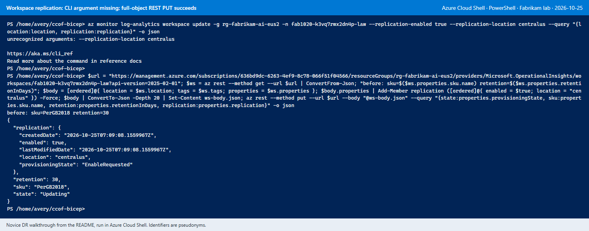

**Check (Portal).** Log Analytics workspace > **Overview** > **JSON View**: `properties.replication`
shows `enabled: true` and the standby region. The secondary workspace itself is not visible in the
Portal. Application Insights over Log Analytics workspaces is not supported by workspace replication
([deployment considerations](https://learn.microsoft.com/azure/azure-monitor/logs/workspace-replication#deployment-considerations)).

---

## Step 6: per-project backend failover (admin console 3.3)

**What it does.** For a chosen project, the gateway sends requests to a project-only APIM pool: the
primary backend first, then the fallbacks in order. A circuit breaker on the primary moves requests to
the next member while the primary fails. Projects with failover off keep their direct route
([admin operations 7D](ADMIN-OPERATIONS.md#d-optional-per-project-backend-failover-admin-33),
[ADR 0034](../adr/0034-dr-project-routing-and-prerequisites.md)).

**Who runs it.** See the [permissions table](#before-you-start). Steps 6.3 and 6.5 run on a
workstation: Cloud Shell's managed-identity sign-in cannot get tokens for the custom `api://`
audiences of the admin and gateway apps (`Audience api://... is not a supported MSI token audience`),
and `az login --scope` in Cloud Shell is the device-code flow refused in N-04 (N-13).

A fallback backend is an existing Foundry deployment that APIM can already reach: for a regional
fallback, a Foundry account in the standby region with the same models, its private endpoint, and the
Cognitive Services User grant for APIM's identity, as in
[admin operations section 7](ADMIN-OPERATIONS.md#7-add-another-same-tenant-foundry-backend).

### 6.1 Register the backends

Admin console > **Backends** > **Register backend**, once for the primary and once per fallback:

| Field | Primary | Fallback |
| --- | --- | --- |
| Backend ID | The project's existing APIM backend ID (the deployment's `backends[].id`) | Its own ID |
| URL | `https://ACCOUNT.services.ai.azure.com/anthropic` | Same form |
| Deployments, inference geography | Every model the project admits, with the same geography | Same models and geography |
| Circuit breaker | Enabled (required before failover can be switched on) | Optional |

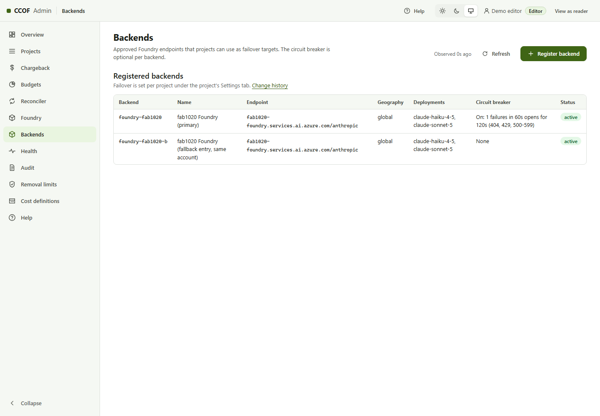

**Expect:** each backend listed with its URL; the primary shows its breaker.

### 6.2 Switch failover on for the project

Projects > project > **Settings** > **Backend failover**: select **Route this project through its
failover pool**, add the fallbacks in order under **Add fallback**, then **Review failover** >
**Save changes**.

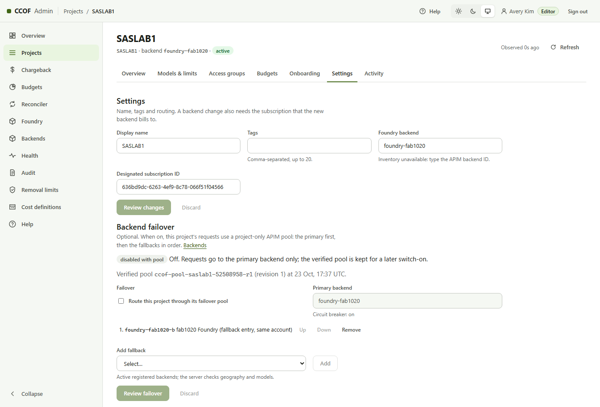

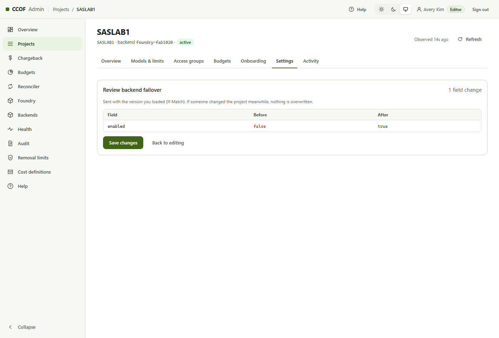

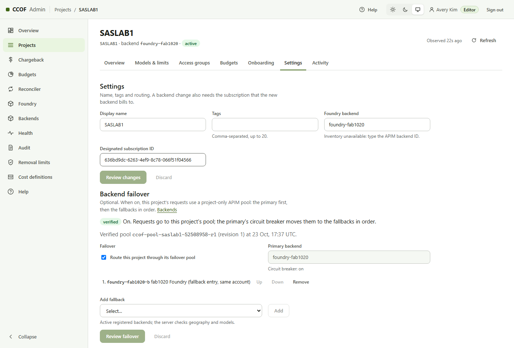

**Expect:** one of two states next to the switch:

| State | Meaning | Next |
| --- | --- | --- |
| `pending publication` | A new pool revision is needed (first switch-on or a changed fallback list) | 6.3 |
| `verified` | The fallback list equals an already verified pool revision, which is reused (N-12) | 6.4 |

The server refuses a fallback that is disabled, in another inference geography, missing a model the
project admits, equal to the primary or not registered, and refuses the switch while the primary has
no enabled circuit breaker. The hint "Inventory unavailable: type the APIM backend ID" under the
backend field does not block the change (N-16).

### 6.3 Publish the pool (workstation; only for `pending publication`)

On the workstation, in the repository folder from the deployment guide's
[Source code](DEPLOY-STEP-BY-STEP.md#source-code) step, with its separate Azure CLI profile
([A separate Azure CLI sign-in](DEPLOY-STEP-BY-STEP.md#a-separate-azure-cli-sign-in)):

```powershell
$env:AZURE_CONFIG_DIR = "$HOME\.ccof-az"
$tenant  = 'REPLACE-tenant-id'
$sub     = 'REPLACE-subscription-id'
$rg      = 'REPLACE-ccof-resource-group'
$project = 'REPLACE-project-id'
$cfg     = 'C:\private\ccof\dr.config.json'          # downloaded from Cloud Shell in Step 2
az login --tenant $tenant
az account set --subscription $sub
$c = Get-Content $cfg -Raw | ConvertFrom-Json
$adminApp  = az functionapp list -g $rg --query "[].name" -o tsv | Where-Object { $_ -match '-admin(-func)?$' }
$adminHost = az functionapp show -g $rg -n $adminApp --query properties.defaultHostName -o tsv
az apim list --query "[].id" -o tsv
```

**Expect:** your account after `az login`, then the resource ID of each APIM instance; the
deployment's instance is the one named in its `apim` section.

```powershell
$apimId = 'REPLACE-apim-resource-id'
pwsh -NoProfile -File infra/dr/Publish-ProjectRouting.ps1 -AdminBaseUrl "https://$adminHost" `
    -AdminScope "api://$($c.entra.adminAppId)/Projects.Manage" -ApimResourceId $apimId -ProjectId $project
```

**Expect:** a preview that changes nothing: `pending plans: 1 (filtered to PROJECT)`, the line
`PROJECT rN: pool ccof-pool-PROJECT-HASH-rN = 1:PRIMARY[breaker] > 2:FALLBACK`, one `member` line per
member with its request body, the `pool` body, and a table with outcome `preview`.

```powershell
pwsh -NoProfile -File infra/dr/Publish-ProjectRouting.ps1 -AdminBaseUrl "https://$adminHost" `
    -AdminScope "api://$($c.entra.adminAppId)/Projects.Manage" -ApimResourceId $apimId -ProjectId $project -Apply
```

**Expect:** `verified in APIM-NAME`, `published: state verified`, and outcome `published`. The console's
project **Settings** then shows `verified` and the pool name.

### 6.4 Refresh memberships (snapshot apply, Cloud Shell)

Memberships carry the pool ID only after the next entitlement sync. Staged deployments use
`sync.mode: delegated-snapshot` with the timer off, so a snapshot is applied. The snapshot lists every
group of every active project: a registered group missing from the snapshot freezes its project
(`snapshot_group_missing`; [SYNC.md](../SYNC.md)). The group IDs are on each project's
**Access groups** page; the deployment's Step 7 wrote its groups to
`.staged-state\generated\snapshot-groups.json`.

```powershell
$groupIds = @('REPLACE-group-object-id-1', 'REPLACE-group-object-id-2')
$syncApp  = az functionapp list -g $rg --query "[].name" -o tsv | Where-Object { $_ -match '-sync(-func)?$' }
$syncAi   = az resource list -g $rg --resource-type microsoft.insights/components --query "[].name" -o tsv | Where-Object { $_ -match '-sync-ai$' }
"sync app=$syncApp insights=$syncAi"
```

**Expect:** one sync Function App and one Application Insights name, for example `PREFIX-SUFFIX-sync`
and `PREFIX-SUFFIX-sync-ai` for a staged deployment (N-15). The quickstart names them
`PREFIX-sync-func` and `PREFIX-sync-ai`.

```powershell
npm ci --ignore-scripts --no-audit --no-fund
npx tsc -p tsconfig.json
@{ groupIds = $groupIds } | ConvertTo-Json | Set-Content "$work/groups.json"
@{ SYNC_TENANT_ID = $tenant; SYNC_GRAPH_MAX_RETRIES = '3'; SYNC_GRAPH_MAX_RETRY_AFTER_SECONDS = '30'; SYNC_GRAPH_TIMEOUT_SECONDS = '30' } |
    ConvertTo-Json | Set-Content "$work/snapshot-settings.json"
$snapshot = "$work/.env.sync-snapshot-$((Get-Date).ToUniversalTime().ToString('yyyyMMddTHHmmssZ')).json"
node dist/sync/cli.js snapshot --credential azure-cli --groups "$work/groups.json" --settings "$work/snapshot-settings.json" --out $snapshot
```

**Expect:** a last line `{"schema":"ccof.sync.snapshot.result.v1","outcome":"succeeded",...,"sha256":"..."}`
with the number of groups and members.

```powershell
$sha = 'REPLACE-sha256-from-the-line-above'
pwsh -File infra/sync/Invoke-SnapshotApplyThroughFunction.ps1 -Subscription $sub -ResourceGroup $rg `
    -FunctionApp $syncApp -AppInsights $syncAi -SnapshotPath $snapshot -ExpectedSnapshotSha256 $sha
```

**Expect:** after one to three minutes, a run line `{"schema":"ccof.sync.run.v1",...,"source":"snapshot",...,"outcome":"succeeded",...}`.
Azure PowerShell warnings about the default subscription do not affect the result. One apply from
Cloud Shell takes up to about 96 KiB of snapshot
([Cloud Shell quickstart, section 5](CLOUD-SHELL-QUICKSTART.md#5-load-group-members-delegated-snapshot-no-graph-application-permission)).

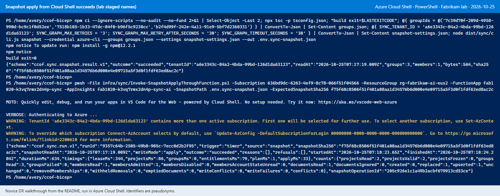

### 6.5 Test through the gateway (workstation)

In the same workstation window as 6.3, after the gateway's entitlement cache window
(`gateway.entitlementCache.allowTtlSeconds`, 120 seconds by default):

```powershell
$model   = 'REPLACE-model-deployment'               # a model the project admits, for example claude-haiku-4-5
$apiPath = 'anthropic'                              # apim.apiPath in the deployment configuration
$gateway = (az apim show -g $apimId.Split('/')[4] -n $apimId.Split('/')[8] --query gatewayUrl -o tsv) + "/$apiPath"
$token   = az account get-access-token --scope "api://$($c.entra.gatewayAppId)/access_as_user" --query accessToken -o tsv
$h = @{ 'x-ccof-project' = $project; 'anthropic-version' = '2023-06-01'; Authorization = "Bearer $token" }
$b = @{ model = $model; max_tokens = 16; messages = @(@{ role = 'user'; content = 'Reply with OK' }) } | ConvertTo-Json -Depth 5
$r = Invoke-WebRequest -Uri "$gateway/v1/messages" -Method Post -Headers $h -Body $b -ContentType application/json -SkipHttpErrorCheck
$requestId = "$($r.Headers['x-ccof-request-id'])".ToLowerInvariant()
"status=$([int]$r.StatusCode) request=$requestId"
```

**Expect:** `status=200` and a request ID. The call uses a few Claude tokens.

```powershell
$wsId    = az monitor log-analytics workspace list -g $rg --query "[0].customerId" -o tsv
$laToken = az account get-access-token --resource https://api.loganalytics.io --query accessToken -o tsv
$query = @{ query = "ApiManagementGatewayLogs | where TimeGenerated > ago(1h) | where tolower(CorrelationId) == '$requestId' | project TimeGenerated, ResponseCode, BackendId, BackendUrl" } | ConvertTo-Json
(Invoke-RestMethod -Method Post -Uri "https://api.loganalytics.io/v1/workspaces/$wsId/query" `
    -Headers @{ Authorization = "Bearer $laToken" } -Body $query -ContentType application/json).tables[0].rows
```

**Expect:** within 15 minutes, one row with response code `200` and `BackendId`
`ccof-m-PROJECT-HASH-rREVISION-0`: the pool's first member (the primary). The query travels in a
request body, so its `|` and `( )` characters never reach `cmd.exe`.

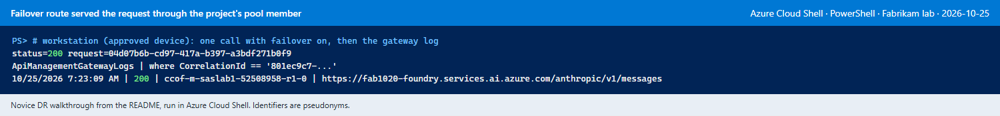

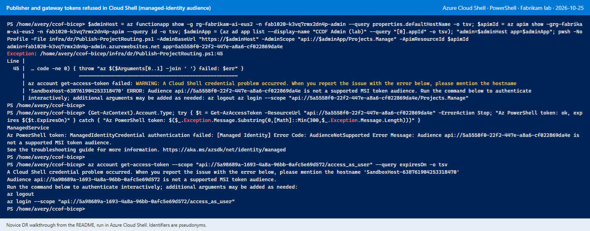

**Check.** Usage stays on the project's primary backend ID; the serving member is in
`ApiManagementGatewayLogs.BackendId` ([admin operations 7D](ADMIN-OPERATIONS.md#d-optional-per-project-backend-failover-admin-33)).

---

## Not deployable yet

These parts of the [DR design](../DR-ACTIVE-PASSIVE.md) have no template or script in this repository
(N-10, N-11, N-14; [DR walkthrough](../DR-NOVICE-WALKTHROUGH-2026-10-25.md)):

| Part | State | Roadmap |
| --- | --- | --- |
| Standby APIM and Function Apps (resolver, sync, reconciler, admin) | No standby-region template; the staged driver has no secondary-region section | DR-07 |
| Second Cosmos DB region | Requires provisioned throughput: a serverless account runs in one region only ([Learn](https://learn.microsoft.com/azure/cosmos-db/serverless#use-serverless-resources)), and the staged default is serverless. New deployments: `stage1.cosmosCapacityMode: provisioned` with `cosmos.capacityMode: provisioned-autoscale` ([deployment guide, configuration table](DEPLOY-STEP-BY-STEP.md#the-configuration-file)). Existing serverless accounts: the one-way, in-place change to provisioned throughput ([Learn](https://learn.microsoft.com/azure/cosmos-db/how-to-change-capacity-mode)), not tested in this lab. The region is added after that; no repository tooling yet | DR-07 |
| Front Door Premium with private origins, and Azure Monitor Private Link Scope (AMPLS) | Design only | DR-07 |
| Role grants for the standby identities (P3) | Needed only once standby apps exist; no script grants them | DR-07 |
| Accounting across two APIM instances and month-history continuity | Design only | DR-05 |
| Promotion of standby writers and failback | Design only | DR-08 |

Status and acceptance criteria per packet: [ROADMAP](../ROADMAP.md).

---

## Undo

| Change | Reversal |
| --- | --- |
| Standby resource group (option A) | `az group delete --name STANDBY-RG` after the resources below are removed |
| Standby VNet, NSG, DNS links, peering, identities (Step 4) | Block below |
| Workspace replication (Step 5) | Step 5 block with `enabled = $false` in place of `enabled = $true; location = $standbyRegion`; a replicated workspace cannot be deleted until replication is off ([Learn](https://learn.microsoft.com/azure/azure-monitor/logs/workspace-replication#deployment-considerations)) |
| Project failover on (Step 6.2) | Project > **Settings** > **Backend failover**: clear the switch > **Review failover** > **Save changes**; state `disabled with pool`; then Step 6.4. The pool and member backends stay in APIM for a later switch-on |
| Registered backends (Step 6.1) | **Backends** page: disable the entry |

```powershell
$c = Get-Content $cfg -Raw | ConvertFrom-Json
$s = $c.secondary
$p = $c.primary.vnetId.Split('/')                  # [2] subscription, [4] resource group, [8] VNet name
az network vnet peering delete --subscription $p[2] -g $p[4] --vnet-name $p[8] -n "to-$($s.vnetName)"
foreach ($z in $c.dnsZones.zoneNames) {
    az network private-dns link vnet delete --subscription $c.dnsZones.subscriptionId -g $c.dnsZones.resourceGroup -z $z -n "$($s.vnetName)-link" --yes
}
az network vnet delete -g $s.resourceGroup -n $s.vnetName
az network nsg delete -g $s.resourceGroup -n $s.apimNsgName
foreach ($n in $c.identityNames) { az identity delete -g $s.resourceGroup -n $n }
pwsh -NoProfile -File infra/dr/Invoke-DrPrerequisites.ps1 -Phase Verify -ConfigPath $cfg -EvidenceDirectory $out
```

**Expect:** no output from the delete commands, then Verify reports `BLOCKERS` with `vnet:missing` and
`identity:NAME:missing` for each identity.

---

## When a step fails

| Message | Step | Meaning | What to do |
| --- | --- | --- | --- |
| Device-code sign-in prompt; "requires the device to be managed" | 1 | `az login` or `AZURE_CONFIG_DIR` was used in Cloud Shell (N-04) | `Remove-Item Env:AZURE_CONFIG_DIR`, or reopen Cloud Shell; no `az login` |
| `Set AZURE_CONFIG_DIR to an isolated profile for the target tenant` in Cloud Shell | 3, 4 | A checkout older than commit `8420a74`, which accepts Cloud Shell's own sign-in (N-05) | `git pull --ff-only` in `$HOME/ccof-bicep`; for that checkout, `$env:AZURE_CONFIG_DIR = "$HOME/.azure"` |
| A message naming `infra/dr/dr.config.example.json` | 3, 4 | `$cfg` does not exist (N-02); in an ephemeral session it was deleted with the session | Step 2.4, or upload the downloaded file and move it to `$cfg` |
| `Configuration refused: FIELD:REASON, ...` | 3, 4 | The named fields are missing or invalid (N-03) | Correct them in Step 2.4; the offline check prints the same list |
| `Subscription ... is not available in this profile` or `account:tenant_mismatch` | 3, 4 | Cloud Shell is signed in to another tenant or subscription | Step 1 `az account set` block; Portal **Switch directory** for another tenant |
| `provider:NAMESPACE:NotRegistered` | 3 | Resource provider not registered | `az provider register -n NAMESPACE` (Contributor on the subscription) |
| `provider:NAMESPACE/TYPE:not_in_REGION` | 3 | The service is not offered in the standby region | Another standby region |
| `network:secondary_overlaps_primary_CIDR` | 3 | The standby range overlaps the primary VNet | Another `secondary.addressSpace` |
| `dns:ZONE:missing` | 3 | The zone is not in `dnsZones.resourceGroup` | Step 2.2 |
| `foundry:NAME:no_claude_deployment` | 3 | The account has no Claude deployment | The account's name and resource group in `foundryAccounts` |
| `entra.admin:azure_cli_not_preauthorized` | 3 | Azure CLI is not a preauthorized client of the admin app; Step 6.3 needs it (N-17) | [Step 2.0](#20-azure-cli-as-an-admin-client-workstation-n-17), then Step 3 again |
| `...:read_denied` | 3, 4 | The account lacks read access to that scope | Reader on the scope named in the blocker |
| `AuthorizationFailed` on `resourceGroups/write` | 4.1 | No permission to create resource groups (N-07) | Option B |
| `resourceGroup:location_is_REGION` | 4 | Existing group in another region without the override (N-08) | `$otherRegionRg = $true` in Step 2.4 |
| `whatIf:changes_existing_N` | 4.2 | The deployment would change resources that it does not own | Read `checks.whatIf` in the evidence file; no apply |
| `peering:not_connected` | 4.3 | The primary side of the peering is missing | Network Contributor on the primary VNet, then 4.3 again |
| `dns:ZONE:link_missing` | 4.3 | A DNS link failed or is still provisioning | 4.3 again after a minute |
| `unrecognized arguments: --replication-location` | 5 | The CLI has no such argument (N-09) | The Step 5 REST block |
| `Audience api://... is not a supported MSI token audience` | 6.3, 6.5 | Cloud Shell cannot get tokens for custom audiences (N-13) | Run the step on the workstation |
| `AADSTS65001` `consent_required` for Microsoft Azure CLI | 6.3 | The admin app does not preauthorize Azure CLI for `Projects.Manage` (N-17) | [Step 2.0](#20-azure-cli-as-an-admin-client-workstation-n-17) |
| HTTP 403 `oauth_client_denied` from `/api/v3/routing/pending` | 6.3 | Azure CLI is missing from the admin app setting `ADMIN_ALLOWED_CLIENT_IDS` | Step 2.0 (its Stage 5 rerun) |
| `pending plans: 0` | 6.3 | No project waits for publication | Project state `verified` (N-12): continue with 6.4; otherwise save the failover change in 6.2 first |
| State stays `pending publication` | 6.2 | The pool is not published | 6.3 |
| `snapshot_group_missing` or a project frozen after 6.4 | 6.4 | A registered group was left out of `$groupIds` | Every active project's groups in `$groupIds`, then 6.4 again |
| `snapshot_older_than_applied` | 6.4 | A newer snapshot was already applied | A fresh snapshot (the `node dist/sync/cli.js snapshot` line) |
| `BackendId` is the primary backend ID, not `ccof-m-...` | 6.5 | Memberships do not carry the pool yet | 6.4, then wait 120 seconds |
| `Serverless accounts do not support multiple regions` | (manual Cosmos change) | Serverless Cosmos DB is single-region (N-11) | [Not deployable yet](#not-deployable-yet) |

No step in this runbook deletes resources; the [Undo](#undo) section lists each reversal.
