# Customer completion workbook - expanded manual configuration

**Local customer context:** approved project `PROJECT01`, existing database `registry`, backend label `registry`. Keep actual verified private inputs; resource examples elsewhere are not instructions to rename existing resources. Use the updated reviewed checkout's `scripts/manual` helpers for the fixed administrator workflow.

**Scope:** existing Function Apps, Cosmos, storage, Application Insights, Log Analytics,
APIM and Entra registrations. Finish configuration, code, policy, seed and acceptance
on the current public-access path. The customer creates DNS/private endpoints later from values they supply (Module 16); we never assume or create network settings.
No infrastructure redeployment, Quickstart execution or Bicep compilation is used.

**Database:** record the exact existing database ID. `registry` is only the example name; do not assume `ccof` or a Function App suffix.

## How to follow this workbook

- Run **one numbered step**. Complete its check before the next step.
- **Path A:** Portal-first. **Path B:** targeted Azure CLI alternative. Choose one
  path for the same change, not both. If the Portal control is absent, use the
  equivalent CLI step. Both still require the same approval and permissions.
- A failed CLI request is not proof that nothing changed. Read back state before
  retrying. Do not continue after an error, empty result, timeout or missing value.
- Read-only inventory may enumerate resources. **No write loop across apps,
  roles, containers, APIs or documents is needed for the default manual path.** Table rows are
  individually numbered steps. The separately approved bundled runner prints a plan before `-Apply`.
- `-Apply` on the local role helpers means **one role definition or one assignment**.
  Without it, the helper reads and prints a plan. Every helper checks CLI exit
  codes. Helpers are loaded by dot-sourcing; they do not run a deployment.
- Native Cosmos data roles and Graph app permissions are not ordinary Azure IAM.
  Do not substitute Contributor, Owner, Cosmos Data Contributor or an Entra
  directory-wide write permission.
- Keep all timers off until their own prerequisites pass. Seed and sync are
  separate. Keep reconciler off on `token-limits-only`.
- App settings, backups, IDs and generated documents are private. Do not commit
  or paste their contents into public issues. Never print bearer tokens or keys.
- Generated defaults are the repository defaults, **not approved customer quotas**.
  Human review of models, budgets, removal guards, admission and cache behavior
  is required before publishing them.

**Validation boundary:** helpers and local artifacts were checked offline with
fictional inputs. No customer deployment acceptance is claimed by this document.
ARM success, a function list, a 401 or an offline test alone is not acceptance.

### Optional bundled runner (`Run-Bundles.ps1`)

For an operator who has already approved the per-step changes, five modules can
run as one command each. They call the same helpers in the same order and keep every check.
Without `-Apply` the command only reads and prints its plan.

```powershell
$r = Join-Path $bundle 'Run-Bundles.ps1'
& $r -Bundle Discovery            # 01 (read-only)
& $r -Bundle Roles;    & $r -Bundle Roles -Apply      # 02 + 03
#   04 Graph - privileged admin, by hand
& $r -Bundle Settings; & $r -Bundle Settings -Apply   # 05
#   06 resolver auth - by hand
& $r -Bundle Publish;  & $r -Bundle Publish -Apply    # 07
#   08.1-08.3 registry/routing JSON - by hand
& $r -Bundle Artifacts            # 08.4-08.5 (local only)
#   09, 10, 11, 12, 13, 14 - one step at a time below
```

A bundle stops at the first failed check, and a rerun reuses whatever already exists.

## Progress sheet

| Module | Finish condition |
|---|---|
| 00 | Correct checkout, shell and private input files |
| 01 | Exact customer IDs, identities, storage and schema verified |
| 02 | One storage/monitoring assignment at a time verified |
| 03 | Three narrow Cosmos role definitions and eleven assignments verified |
| 04 | Three Graph application permissions verified |
| 05 | Each app's settings merged and read back; timers disabled |
| 06 | Resolver authentication restricted to APIM |
| 07 | One app's code published at a time; correct handlers visible |
| 08 | Registry/routing inputs approved; local artifacts validated |
| 09 | Foundry access, API, operation, backend and policy verified |
| 10 | Diagnostics configured without request/response bodies |
| 11 | Registry seeded, every document verified, seed cleaned up |
| 12 | Entitlement sync verified for an approved test developer |
| 13 | Authorized end-to-end request and negative cases verified |
| 14 | Complete chargeback workbook and reader access verified |
| 15 | Optional budget-state activation, separately approved |
| 16 | Deferred private-networking handoff |

---

## 00. Prepare Cloud Shell

### Step 00.1 - Open the right shell

**Path A:** customer Azure Portal > Cloud Shell > **PowerShell**.
Do not run these blocks in Bash. Choose the customer subscription in the Portal.

**Check (read-only):**

```powershell
$PSVersionTable.PSVersion
az account show --query '{tenant:tenantId,subscription:id,name:name}' -o table
if ($LASTEXITCODE -ne 0) { throw 'Cloud Shell account lookup failed.' }
```

Expected: PowerShell 7 and the intended tenant/subscription. If wrong, select the
subscription in the next step; do not infer customer identity from a screenshot.

### Step 00.2 - Select the approved subscription

**Path A:** Cloud Shell subscription selector, where offered.
**Path B (changes CLI selection only):**

```powershell
$sub = 'REPLACE-approved-subscription-guid'
az account set --subscription $sub
if ($LASTEXITCODE -ne 0) { throw 'Subscription selection failed.' }
```

**Check:** rerun the account query in Step 00.1 and compare the tenant too.

### Step 00.3 - Clone the reviewed repository

**Where:** Cloud Shell. No Azure resource writes.

```powershell
$repo = Join-Path $HOME 'ccof-bicep'
if (Test-Path $repo) { throw 'Checkout already exists. Inspect git status and commit; do not overwrite it.' }
git clone --branch main https://github.com/naveenneog/ccof-bicep.git $repo
if ($LASTEXITCODE -ne 0) { throw 'Clone failed.' }
Set-Location $repo
git --no-pager log -1 --oneline
```

**Check:** record the approved commit with `git --no-pager log -1 --oneline`. If using an existing checkout, inspect `git status --short`; do not pull over unreviewed changes.

### Step 00.4 - Select the reviewed helpers in this checkout

The administrator's Cloud Shell checkout contains the helper source; no customer ZIP
or uploaded PowerShell installer is required. The client workstation route in Module 13
has separate no-clone instructions.

```powershell
$bundle = Join-Path $repo 'scripts/manual'
Get-ChildItem $bundle -Name
```

### Step 00.5 - Create private output outside the repository

```powershell
$out = Join-Path $HOME 'ccof-private'
New-Item -ItemType Directory -Force -Path $out | Out-Null
chmod 700 $out
if ($LASTEXITCODE -ne 0) { throw 'Could not restrict the private Cloud Shell folder.' }
. (Join-Path $bundle 'Session-Helpers.ps1')
```

This administrator path targets PowerShell 7 in Linux Cloud Shell. An approved
Windows administration host needs equivalent customer-approved filesystem ACLs.
Do not copy only Session-Helpers.ps1 into a disconnected folder: it imports the
reviewed shared modules from this checkout. Filled inputs, backups and outputs stay private.

### Step 00.6 - Check build tools

```powershell
node --version
npm --version
az version --query '"azure-cli"' -o tsv
```

**Check:** PowerShell 7 and an approved Node version supporting direct `.ts`
execution. Node 24 LTS is recommended for the **local** render/build tools; this
bundle was checked with Node 26.1.0. The **Function Apps stay on Node 22**.
No Bicep tool is required. If a tool is missing, use the customer's approved
installation method or an approved workstation; do not pipe an internet script
straight into a shell.

### Step 00.7 - Restore repository build dependencies

```powershell
Set-Location $repo
npm ci --ignore-scripts --no-audit --no-fund
if ($LASTEXITCODE -ne 0) { throw 'Dependency restore failed.' }
```

**Check:** `npm ls --depth=0` exits zero. This is a local build step, not Azure
deployment. Do not run `Deploy-Quickstart.ps1`.

### Step 00.8 - Create the private customer-inputs file

```powershell
$inputFile = Join-Path $out 'customer-inputs.json'
if (Test-Path $inputFile) { throw 'Private inputs already exist; open them instead of overwriting.' }
Copy-Item (Join-Path $bundle 'customer-inputs.example.json') $inputFile
code $inputFile
```

**Check:** you are editing the private copy, not the example in the repo/bundle.

---

## 01. Collect exact customer values - read-only

### Step 01.1 - List the existing platform resources

**Path A:** `rg-claude-pilot` > Overview > list resources. Copy exact names and IDs from
each resource's **JSON View / Properties**, not from proposed names.
**Path B:**

```powershell
az resource list -g rg-claude-pilot --query '[].{name:name,type:type,resourceId:id,location:location}' -o table
if ($LASTEXITCODE -ne 0) { throw 'Resource inventory failed.' }
```

**Check:** all three Function Apps, the intended Cosmos account, storage accounts,
identities and monitoring resources are present. Never auto-select `[0]` from a
resource list. If resources live in another RG, record full monitoring/APIM IDs.
This helper expects apps, host/deployment storage and Cosmos in the platform RG;
stop for an explicitly reviewed adjustment if that is not true.

### Step 01.2 - Fill the customer-inputs file

**Where:** `code $inputFile`. No Azure write.

| Field | Source / rule |
|---|---|
| `subscriptionId`, `tenantId` | Step 00.1 |
| `resourceGroup` | Actual platform RG |
| `cosmosAccount` | Step 01.1, never first account by position |
| `database` | **`registry`** |
| `workspaceResourceId` | Intended workspace > Properties > Resource ID |
| `apimResourceId` | Intended APIM > JSON View > ID |
| `gatewayAppId` | Combined Gateway/developer registration > Application (client) ID |
| `gatewayIdentifierUri` | That registration > Expose an API > actual Application ID URI |
| `resolverApiAppId` | Separate Resolver API registration > Application (client) ID |
| `apiId`, `apiPath` | Approved API identifier and suffix; defaults `claude-messages`, `anthropic` |
| `apps.*.name` | Exact Function App names; verify sync's suffix |
| `apps.*.storageAccount` | Each app's actual host/deployment account name |
| `apps.resolver.identityResourceId` | `null` for system identity |
| `apps.sync/reconciler.identityResourceId` | Full ID of the chosen UAMI, not its principal/client ID |
| `apps.resolver/sync.appInsightsResourceId` | Each app's actual Insights component ID |
| `apps.reconciler.appInsightsResourceId` | `null`, matching the repository's diagnostic-log design |

**Check:**

```powershell
if ((Get-Content $inputFile -Raw) -match 'REPLACE-') { throw 'Private inputs still contain placeholders.' }
Get-Content $inputFile -Raw | ConvertFrom-Json | Out-Null
```

Do not guess missing registration, group or resource IDs.

### Step 01.3 - Read and verify the live values

```powershell
$valuesFile = Join-Path $out 'customer-values.json'
Read-CcofCustomerValues -InputPath $inputFile -OutputPath $valuesFile
$C = Get-Content $valuesFile -Raw | ConvertFrom-Json -AsHashtable -Depth 100
```

**Check:** helper finishes without an error. It verifies the chosen database,
attached identities, deployment storage identity, Insights-to-workspace links,
gateway scope and v2 registrations. It does not change any resource.
It saves Insights connection strings privately; do not print the whole file.

If directory reads are denied, get the authorized administrator to run the reads.
Do not weaken authentication or invent an APIM client ID from its object ID.

### Step 01.4 - Display only safe summaries

```powershell
$C.apps.GetEnumerator() | ForEach-Object {
    [pscustomobject]@{App=$_.Key;Name=$_.Value.name;PrincipalId=$_.Value.principalId;ClientId=$_.Value.clientId;Storage=$_.Value.storageAccount;Container=$_.Value.deploymentContainer}
} | Format-Table -AutoSize
"Database: $($C.database)"
"APIM object ID: $($C.apimPrincipalId)"
"APIM client ID: $($C.apimClientId)"
```

**Check:** resolver has a principal ID and no selected UAMI client ID; sync and
reconciler have their selected UAMI's client and principal IDs. Deployment
container names are the real Portal-generated names.

### Step 01.5 - Check the eight container IDs and partition keys

**Path A:** Cosmos > Data Explorer > **registry** > each container > Scale & Settings.
**Path B:**

```powershell
az cosmosdb sql container list --subscription $C.subscriptionId -g $C.resourceGroup -a $C.cosmosAccount -d $C.database `
    --query '[].{Container:resource.id,PartitionKey:resource.partitionKey.paths[0]}' -o table
if ($LASTEXITCODE -ne 0) { throw 'Container listing failed.' }
```

| Container | Required partition key |
|---|---|
| `entitlement` | `/personId` |
| `projects` | `/projectId` |
| `subscriptionIndex` | `/subscriptionId` |
| `budgetState` | `/personId` |
| `aggregateBudgetState` | `/scopeId` |
| `syncLease` | `/id` |
| `reconcilerLease` | `/id` |
| `backends` | `/backendId` |

**Check:** exactly these required containers have the shown keys. Unrelated
containers may remain. Wrong partition keys are a migration decision, not an
in-place rename or delete/recreate shortcut.

**If one is missing:** treat creating that one container as a separate step.
Portal: Data Explorer > New Container > existing database `registry`; enter its ID
and exact partition key. For the approved **serverless** account, CLI alternative:

```powershell
$container = 'REPLACE-one-missing-container'
$partitionKey = 'REPLACE-its-exact-partition-key'
az cosmosdb sql container create --subscription $C.subscriptionId -g $C.resourceGroup -a $C.cosmosAccount -d $C.database `
    -n $container --partition-key-path $partitionKey -o none
if ($LASTEXITCODE -ne 0) { throw 'One container creation failed.' }
```

Read that container back before choosing another. Do not set throughput flags on
a serverless account; provisioned-throughput designs need separate approval.

### Step 01.6 - Record current networking without changing it

**Path A:** each app/Storage/Cosmos/Foundry > Networking. Record current public
access and firewall rules. Do not disable public access yet.

**CLI read-only example (Cosmos):**

```powershell
az cosmosdb show --subscription $C.subscriptionId -g $C.resourceGroup -n $C.cosmosAccount `
    --query '{public:publicNetworkAccess,localAuthDisabled:disableLocalAuth,ipRules:ipRules,vnetFilter:isVirtualNetworkFilterEnabled}' -o json
if ($LASTEXITCODE -ne 0) { throw 'Cosmos networking read failed.' }
```

**Check:** current rules allow the selected apps to reach Cosmos/storage/Foundry.
"Public access enabled" does not imply that every firewall or outbound route
allows the apps. Do not turn storage keys on as a workaround.

Also record `cosmosDisableLocalAuth` and each app's
`storageAllowSharedKeyAccess` from the private values: intended configuration
is Cosmos local auth disabled and storage shared-key access disabled. Missing/
different flags require customer review; this workbook never fetches keys or
changes these flags automatically. Function App runtime checks require Node 22,
independently of the newer local build-tool Node version.

### Resume block - after every shell reconnect

Load private files; do not rerun template-copy commands:

```powershell
$repo = Join-Path $HOME 'ccof-bicep'
$bundle = Join-Path $HOME 'ccof-public-workbook'
$out = Join-Path $HOME 'ccof-private'
Set-Location $repo
. (Join-Path $bundle 'Session-Helpers.ps1')
$inputFile = Join-Path $out 'customer-inputs.json'
$valuesFile = Join-Path $out 'customer-values.json'
$C = Get-Content $valuesFile -Raw | ConvertFrom-Json -AsHashtable -Depth 100
Assert-CcofSession $C
```

Back up the private folder through approved customer storage before a
non-persistent Cloud Shell is closed. If unavailable after reconnect, recover
it from that private backup. Never rely on this machine's folder surviving.

---

## 02. Azure IAM - one assignment per step

**Portal references (historical/navigation only; identifier middles masked):**

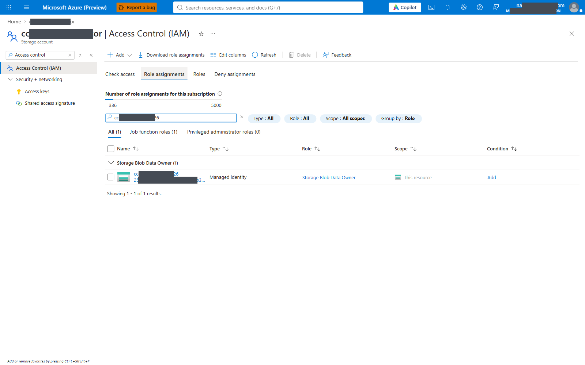

*Storage IAM showing resolver Blob Data Owner; not queue/table role proof.*


**Administrator:** activate the required scoped role-assignment permission/PIM.
The app does not become an administrator. Existing equivalent assignments are
read and reused. Do not remove customer-owned assignments.

**Path A for each numbered row below:** target resource > **Access control
(IAM) > Add > Add role assignment** > exact role > Members > **Managed identity**
> select the resolver **Function App system identity**, or the selected sync/
reconciler **User-assigned managed identity** > Review + assign.

**Path B for each row:** run its command without `-Apply` to inspect. After
approval, run that **same command** with `-Apply` added. It creates at most one
assignment and reads it back.

| Step | Role | Target scope | Member |
|---|---|---|---|
| 02.1 | Storage Blob Data Owner | Resolver storage | Resolver system identity |
| 02.2 | Storage Blob Data Owner | Sync storage | Selected sync UAMI |
| 02.3 | Storage Blob Data Owner | Reconciler storage | Selected reconciler UAMI |
| 02.4 | Monitoring Metrics Publisher | Resolver Insights | Resolver system identity |
| 02.5 | Monitoring Metrics Publisher | Sync Insights | Selected sync UAMI |
| 02.6 | Log Analytics Reader | Intended workspace | Selected reconciler UAMI |

**Step 02.1 CLI:**
```powershell
Grant-CcofAzureRole -C $C -PrincipalId $C.apps.resolver.principalId -Role 'Storage Blob Data Owner' -Scope $C.apps.resolver.storageId
```
**Step 02.2 CLI:**
```powershell
Grant-CcofAzureRole -C $C -PrincipalId $C.apps.sync.principalId -Role 'Storage Blob Data Owner' -Scope $C.apps.sync.storageId
```
**Step 02.3 CLI:**
```powershell
Grant-CcofAzureRole -C $C -PrincipalId $C.apps.reconciler.principalId -Role 'Storage Blob Data Owner' -Scope $C.apps.reconciler.storageId
```
**Step 02.4 CLI:**
```powershell
Grant-CcofAzureRole -C $C -PrincipalId $C.apps.resolver.principalId -Role 'Monitoring Metrics Publisher' -Scope $C.apps.resolver.appInsightsResourceId
```
**Step 02.5 CLI:**
```powershell
Grant-CcofAzureRole -C $C -PrincipalId $C.apps.sync.principalId -Role 'Monitoring Metrics Publisher' -Scope $C.apps.sync.appInsightsResourceId
```
**Step 02.6 CLI:**
```powershell
Grant-CcofAzureRole -C $C -PrincipalId $C.apps.reconciler.principalId -Role 'Log Analytics Reader' -Scope $C.workspaceResourceId
```

**Check after each row:** run the same command again **without** `-Apply`;
expected `Existing or inherited assignment verified; no write`. In Portal,
Role assignments must show the exact member and scope. Azure role read-back does
not eliminate propagation delay; verify runtime access later.

---

## 03. Native Cosmos data access - CLI-only exceptions

There is no equivalent native-SQL role assignment screen in Portal IAM.
Path A (Portal-first) and Path B both use the narrow commands below for this
module. They do not create Cosmos databases or containers.

### Step 03.1 - Define the sync writer role

```powershell
Set-CcofCosmosRole -C $C -Kind sync -Directory $out
```

Review the actions. Run the same command with `-Apply` after approval.
**Check:** rerun without `-Apply`; `Role verified`. Existing differing custom
roles are refused, not rewritten. This role can read/query/change-feed/create/
replace, but not delete or upsert.

### Step 03.2 - Define the reconciler writer role

```powershell
Set-CcofCosmosRole -C $C -Kind reconciler -Directory $out
```

Same plan/apply/check sequence. Read/create/replace/upsert, no delete.

### Step 03.3 - Define the create-only seed role

```powershell
Set-CcofCosmosRole -C $C -Kind seed -Directory $out
```

Same plan/apply/check sequence. Metadata/read/create only; no replace/upsert/delete.

### Steps 03.4-03.14 - Assign one native role at a time

Each row is a separate change with a separate gate. Run the displayed command
as a plan, then add `-Apply` after approval. Rerun without `-Apply` and require
`Existing exact assignment verified`. Never paste the whole table as a batch.

| Step | App | Kind | Scope |
|---|---|---|---|
| 03.4 | resolver | reader | Entire database `registry` |
| 03.5 | sync | sync | `entitlement` |
| 03.6 | sync | sync | `syncLease` |
| 03.7 | sync | reader | `projects` |
| 03.8 | sync | seed | `projects` |
| 03.9 | sync | seed | `backends` |
| 03.10 | reconciler | reader | `projects` |
| 03.11 | reconciler | reader | `entitlement` |
| 03.12 | reconciler | reconciler | `budgetState` |
| 03.13 | reconciler | reconciler | `aggregateBudgetState` |
| 03.14 | reconciler | reconciler | `reconcilerLease` |

**03.4**
```powershell
Grant-CcofCosmosRole -C $C -App resolver -Kind reader
```
**03.5**
```powershell
Grant-CcofCosmosRole -C $C -App sync -Kind sync -Container entitlement
```
**03.6**
```powershell
Grant-CcofCosmosRole -C $C -App sync -Kind sync -Container syncLease
```
**03.7**
```powershell
Grant-CcofCosmosRole -C $C -App sync -Kind reader -Container projects
```
**03.8**
```powershell
Grant-CcofCosmosRole -C $C -App sync -Kind seed -Container projects
```
**03.9**
```powershell
Grant-CcofCosmosRole -C $C -App sync -Kind seed -Container backends
```
**03.10**
```powershell
Grant-CcofCosmosRole -C $C -App reconciler -Kind reader -Container projects
```
**03.11**
```powershell
Grant-CcofCosmosRole -C $C -App reconciler -Kind reader -Container entitlement
```
**03.12**
```powershell
Grant-CcofCosmosRole -C $C -App reconciler -Kind reconciler -Container budgetState
```
**03.13**
```powershell
Grant-CcofCosmosRole -C $C -App reconciler -Kind reconciler -Container aggregateBudgetState
```
**03.14**
```powershell
Grant-CcofCosmosRole -C $C -App reconciler -Kind reconciler -Container reconcilerLease
```

### Step 03.15 - List the native assignments

```powershell
az cosmosdb sql role assignment list --subscription $C.subscriptionId -g $C.resourceGroup -a $C.cosmosAccount `
    --query '[].{principal:principalId,role:roleDefinitionId,scope:scope}' -o table
if ($LASTEXITCODE -ne 0) { throw 'Native Cosmos assignment listing failed.' }
```

**Check:** intended principals and database `registry`. Existing unrelated grants
must not be removed automatically. Keep this private as the access record.

---

## 04. Graph permissions - privileged administrator

For managed identities, Enterprise applications can display the grants, but the
normal app-registration API Permissions workflow is not a dependable creation
path. Use targeted Graph POSTs, one permission per step. No Bicep is involved.

The helper requires active Privileged Role Administrator or Global Administrator
when a missing grant is applied. Customer approval and PIM are required.

### Step 04.1 - Plan GroupMember.Read.All

```powershell
pwsh -NoProfile -File (Join-Path $repo 'infra/quickstart/Grant-SyncGraphPermissions.ps1') `
    -SyncPrincipalId $C.apps.sync.principalId -Permissions 'GroupMember.Read.All' -PlanOnly
if ($LASTEXITCODE -ne 0) { throw 'Graph permission plan failed.' }
```

**Check:** only `GroupMember.Read.All` for the selected sync identity.

### Step 04.2 - Grant GroupMember.Read.All

Run Step 04.1 without `-PlanOnly`. This grants **one** missing application
permission. Record the rollback assignment ID printed by the script.
**Check:** that permission is reported `verified`.

### Step 04.3 - Plan User.Read.All

Run Step 04.1 with `-Permissions 'User.Read.All'`, retaining `-PlanOnly`.
**Check:** only this permission is planned.

### Step 04.4 - Grant User.Read.All

Run Step 04.3 without `-PlanOnly`. **Check:** `verified`.

### Step 04.5 - Plan Application.Read.All

Run Step 04.1 with `-Permissions 'Application.Read.All'`, retaining `-PlanOnly`.
**Check:** only this permission is planned.

### Step 04.6 - Grant Application.Read.All

Run Step 04.5 without `-PlanOnly`. **Check:** `verified`.

### Step 04.7 - Confirm the three grants

**Path A:** Entra > Enterprise applications > filter **Managed identities** >
selected sync identity > Permissions. Confirm all three Graph application roles.
**Path B:** rerun each of the three plan-only commands; each must report
`already granted, skipped`.

The helper's final message refers to Quickstart: **ignore it**. Do not run
Quickstart or change a form. Sync stays disabled until Module 12.
Managed-identity Graph token caches can delay recognition of new permissions.
A restart is not a promise of immediate propagation.

---

## 05. Prepare and merge settings - one app at a time

**Portal references (historical/navigation only; identifier middles masked):**

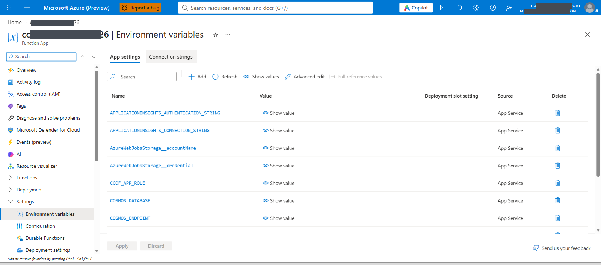

*Resolver environment-variable names; values are hidden.*

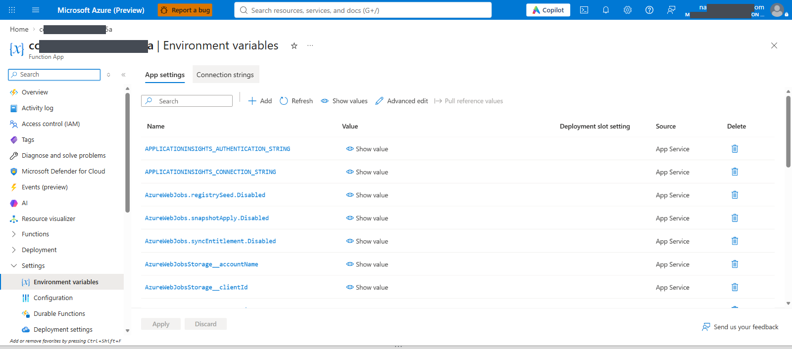

*Sync environment-variable names; hidden values do not prove timers are disabled.*


The settings generator runs locally from the recorded values. It adds the full
repository settings, including the storage account and credential settings
omitted from the earlier abbreviated chat commands.

### Step 05.1 - Back up resolver settings

**Path A:** Resolver > Environment variables > App settings > Advanced edit >
copy the full current JSON into a private backup. Do not publish it.
**Path B:**

```powershell
$live = Invoke-CcofAzJson @('functionapp','config','appsettings','list','--subscription',$C.subscriptionId,'-g',$C.resourceGroup,'-n',$C.apps.resolver.name)
Save-CcofJson @($live) (Join-Path $out 'resolver-before.json')
```

**Check:** private backup exists; no keys or connection strings printed.

### Step 05.2 - Generate resolver settings locally

```powershell
New-CcofAppSettings -C $C -App resolver -Directory $out
code (Join-Path $out 'resolver-settings.portal.json')
```

**Check:** correct database `registry`, endpoint, storage name, Insights connection;
system identity has **no** host-storage client ID.
Initial budget mode is `token-limits-only`, not cost-based budget enforcement.

### Step 05.3 - Merge resolver settings

**Path A:** Resolver > Environment variables > App settings > Advanced edit >
merge `resolver-settings.portal.json` into the existing list, preserving other
settings. Resolve duplicate names; do not paste a second duplicate or replace the
whole list. OK > Apply > confirm restart.
**Path B (one app only):**

```powershell
$file = Join-Path $out 'resolver-settings.object.json'
Invoke-CcofAzWrite @('functionapp','config','appsettings','set','--subscription',$C.subscriptionId,'-g',$C.resourceGroup,'-n',$C.apps.resolver.name,'--settings',"@$file")
```

**Check:**
```powershell
Test-CcofAppSettings -C $C -App resolver -Directory $out
```
Require every expected value to match. The validator names differing keys without
printing their values.

### Step 05.4 - Remove only the resolver's old key-based host setting

Only after Step 05.3 passes and its storage grant exists.
**Path A:** delete the exact setting `AzureWebJobsStorage`, if present, then Apply.
Keep `AzureWebJobsStorage__accountName` and `__credential`.
**Path B:**

```powershell
Invoke-CcofAzWrite @('functionapp','config','appsettings','delete','--subscription',$C.subscriptionId,'-g',$C.resourceGroup,'-n',$C.apps.resolver.name,'--setting-names','AzureWebJobsStorage')
```

**Check:** rerun the settings test and list only host-storage setting **names**:
```powershell
az functionapp config appsettings list -g $C.resourceGroup -n $C.apps.resolver.name `
    --query "[?starts_with(name,'AzureWebJobsStorage')].name" -o tsv
if ($LASTEXITCODE -ne 0) { throw 'Host setting read failed.' }
```
Skip the write if the exact old setting was already absent. Do not delete
deployment-storage configuration or unrelated settings.

### Step 05.5 - Back up sync settings

Repeat **05.1** for **sync**, saving `sync-before.json`. One read/local backup only.
**Check:** private backup exists.

### Step 05.6 - Generate sync settings locally

```powershell
New-CcofAppSettings -C $C -App sync -Directory $out
code (Join-Path $out 'sync-settings.portal.json')
```

**Check:** host/Cosmos/Insights identity use the selected sync **client ID**,
not its principal ID. `SYNC_TENANT_ID` matches the customer tenant.
`AzureWebJobs.syncEntitlement.Disabled` and `AzureWebJobs.registrySeed.Disabled`
both equal `true`. Review schedule and the removal guards (5 removals and 0.1
fraction are repository defaults).

### Step 05.7 - Merge sync settings

**Path A:** same Portal merge as 05.3, on sync.
**Path B:**
```powershell
$file = Join-Path $out 'sync-settings.object.json'
Invoke-CcofAzWrite @('functionapp','config','appsettings','set','--subscription',$C.subscriptionId,'-g',$C.resourceGroup,'-n',$C.apps.sync.name,'--settings',"@$file")
```
**Check:**
```powershell
Test-CcofAppSettings -C $C -App sync -Directory $out
```

### Step 05.8 - Remove only sync's old AzureWebJobsStorage

Repeat **05.4** on sync, if the exact key exists.
**Check:** the sync settings test passes; host `__clientId` remains.

### Step 05.9 - Back up reconciler settings

Repeat **05.1** for **reconciler**, saving `reconciler-before.json`.
**Check:** private backup exists.

### Step 05.10 - Generate reconciler settings locally

```powershell
New-CcofAppSettings -C $C -App reconciler -Directory $out
code (Join-Path $out 'reconciler-settings.portal.json')
```

**Check:** `RECONCILER_LOG_ANALYTICS_WORKSPACE_ID` is the Workspace ID **GUID**,
not the ARM resource ID. `RECONCILER_LEDGER_GATEWAY_RESOURCE_ID` is the APIM
**ARM ID**. Reconciler UAMI client ID is correct. Timer is disabled. With a standby APIM (DR), set
`$C.ledgerGatewayResourceIds = @('REPLACE-PRIMARY-APIM-ARM-ID', 'REPLACE-STANDBY-APIM-ARM-ID')` before
`New-CcofAppSettings`; it adds `RECONCILER_LEDGER_GATEWAY_RESOURCE_IDS` ([budget settings](../BUDGETS.md#disaster-recovery-settings-dr-05)).

### Step 05.11 - Merge reconciler settings

**Path A:** same Portal merge as 05.3, on reconciler.
**Path B:**
```powershell
$file = Join-Path $out 'reconciler-settings.object.json'
Invoke-CcofAzWrite @('functionapp','config','appsettings','set','--subscription',$C.subscriptionId,'-g',$C.resourceGroup,'-n',$C.apps.reconciler.name,'--settings',"@$file")
```
**Check:**
```powershell
Test-CcofAppSettings -C $C -App reconciler -Directory $out
```

### Step 05.12 - Remove only reconciler's old AzureWebJobsStorage

Repeat **05.4** on reconciler, if the exact key exists.
**Check:** reconciler settings test passes; host `__clientId` remains.

### Step 05.13 - List disabled timers before any code upload

**Path A:** sync and reconciler > Environment variables > check `.Disabled` keys.
**Path B (read-only):**

```powershell
foreach ($app in 'sync','reconciler') {
    az functionapp config appsettings list --subscription $C.subscriptionId -g $C.resourceGroup -n $C.apps[$app].name `
        --query "[?ends_with(name,'.Disabled')].{name:name,value:value}" -o table
    if ($LASTEXITCODE -ne 0) { throw "Timer settings read failed: $app" }
}
```

**Check:** all three timers are `true`. Do not proceed if one is enabled.

---

## 06. Restrict resolver authentication

**Portal references (historical/navigation only; identifier middles masked):**

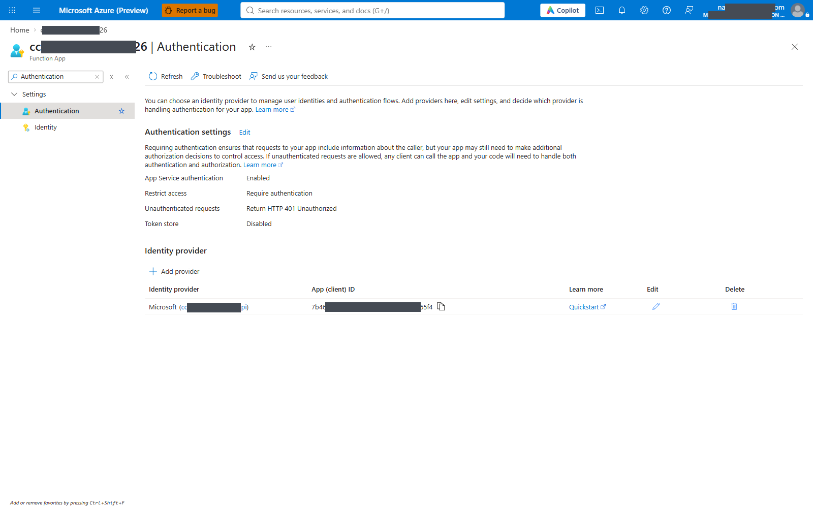

*Resolver requires authentication and returns anonymous 401; caller allow-lists still need verification.*


### Step 06.1 - Back up resolver authentication

**Path A:** Resolver > Authentication > record current provider, audience,
allow-lists and unauthenticated action privately.
**Path B (read-only):**

```powershell
$url = "https://management.azure.com$($C.apps.resolver.id)/config/authsettingsV2?api-version=2024-04-01"
$auth = Invoke-CcofAzJson @('rest','--method','get','--url',$url)
Save-CcofJson $auth (Join-Path $out 'resolver-auth-before.json')
```

**Check:** backup exists. If 404, inspect the Portal; don't treat a permission or
network failure as an empty default.

### Step 06.2 - Review the auth-only plan

```powershell
pwsh -NoProfile -File (Join-Path $repo 'infra/poc/resolver-auth.ps1') `
    -TenantId $C.tenantId -SubscriptionId $C.subscriptionId -ResourceGroup $C.resourceGroup `
    -FunctionAppName $C.apps.resolver.name -ResolverAppId $C.resolverApiAppId `
    -AllowedCallerAppIds $C.apimClientId -AllowedCallerObjectIds $C.apimPrincipalId -PlanOnly
if ($LASTEXITCODE -ne 0) { throw 'Resolver auth plan failed.' }
```

**Check:** existing Resolver API registration, correct tenant, APIM client AND
object IDs. Do not use `-CreateRegistration`, a secret or an excluded path.

### Step 06.3 - Apply resolver authentication

**Path A:** Resolver > Authentication > Microsoft > existing Resolver API app.

| Field | Required value |
|---|---|
| Issuer | `https://login.microsoftonline.com/<tenantId>/v2.0` |
| Audiences | `api://<resolverApiAppId>` and `<resolverApiAppId>` |
| Allowed client applications | APIM **client/app ID** |
| Allowed identities | APIM **principal/object ID** |
| Restrict access | Require authentication |
| Unauthenticated action | HTTP 401 |
| HTTPS only | On |
| Token store | Off |

**Path B:** run 06.2 without `-PlanOnly` (one auth configuration write).
If the UI cannot set both allow-lists, use Path B; do not save an empty list.

**Check:** read back the object from 06.1 and confirm:
`platform.enabled=true`, `globalValidation.requireAuthentication=true`,
`unauthenticatedClientAction=Return401`, and both allow-lists match the single
APIM identity. The helper also reads and verifies its write.

### Step 06.4 - Anonymous resolver rejection

```powershell
$status = curl -sS -o /dev/null -w '%{http_code}' "https://$($C.apps.resolver.defaultHostName)/api/health"
if ($LASTEXITCODE -ne 0) { throw 'Resolver HTTP probe failed.' }
if ($status -ne '401') { throw "Expected unauthenticated 401, received $status." }
```

**Check:** 401. This checks the auth boundary, **not** that Cosmos or the resolver
code works. Never make `/api/health` public just to get a 200.

---

## 07. Build and publish one app

**Portal references (historical/navigation only; identifier middles masked):**

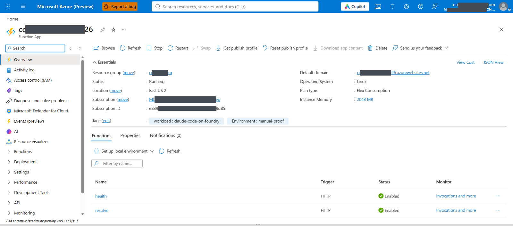

*Resolver health and resolve HTTP functions; not inference acceptance.*


The ZIP builder uses the actual app entry point and production dependencies.
It calls no Azure API and reads no Bicep parameters.
Keep the prior reviewed ZIP for rollback if updating existing code.

### Step 07.1 - Build resolver ZIP locally

```powershell
pwsh -NoProfile -File (Join-Path $repo 'scripts/portal/Build-PortalPackage.ps1') -App resolver -OutputDirectory $out
if ($LASTEXITCODE -ne 0) { throw 'Resolver package build failed.' }
```

**Check:** `resolver.zip` exists; record SHA-256. ZIP root includes `host.json`,
`package.json`, `dist` and production `node_modules`, not a wrapping folder.

### Step 07.2 - Publish resolver code

**Path A:** Portal Deployment Center is not a universal ZIP-upload screen for Flex.
Use this necessary one-app CLI publication, even on the Portal-first path.

```powershell
Invoke-CcofAzWrite @('functionapp','deployment','source','config-zip','--subscription',$C.subscriptionId,'-g',$C.resourceGroup,'-n',$C.apps.resolver.name,'--src',(Join-Path $out 'resolver.zip'))
```

**Path B if that publication method is unavailable:** from an approved workstation,
use the Azure Functions VS Code extension to deploy the **resolver package root**
produced by the builder (`$out/packages/resolver`, containing `host.json`), not
the repository root or another app's package.
Select the exact resolver app and confirm overwrite. If the extension/version
doesn't support the app's Flex plan, stop and fix the publishing tooling; do not
change plans, turn on storage keys or disable authentication.

**Check:** Portal deployment status is successful and runtime starts. Read the
Functions list below. An empty list may be a startup/trigger delay, not necessarily
a failed upload; it remains an incomplete deployment until diagnosed.

### Step 07.3 - Verify resolver handlers

```powershell
az functionapp function list --subscription $C.subscriptionId -g $C.resourceGroup -n $C.apps.resolver.name --query '[].name' -o tsv
if ($LASTEXITCODE -ne 0) { throw 'Resolver function listing failed.' }
```

**Path A:** Resolver > Functions and Log stream / Application Insights.
**Check:** `resolve` and `health`, no sync/reconciler handlers; no host storage,
identity or module startup errors.

### Step 07.4 - Build sync ZIP

Run **07.1** with `-App sync`. **Check:** `sync.zip`, hash and app-specific package.

### Step 07.5 - Publish sync ZIP

Run **07.2** with `$C.apps.sync.name` and `sync.zip`, or use the sync package
root with the VS Code alternative. **Check:** deployment status and startup.

### Step 07.6 - Verify sync handlers

Run **07.3** with `$C.apps.sync.name`.
**Check:** `syncEntitlement` is listed but disabled. `registrySeed` is
**conditionally registered only while CCOF_SEED_DOCUMENTS is present**, so its
absence now is expected. No resolver/reconciler handlers.

### Step 07.7 - Build reconciler ZIP

Run **07.1** with `-App reconciler`.
**Check:** `reconciler.zip`, hash and app-specific package. Review the packaged
rate card and contract schedule before later enabling budget reconciliation.

### Step 07.8 - Publish reconciler ZIP

Run **07.2** with `$C.apps.reconciler.name` and `reconciler.zip`.
**Check:** deployment status and startup.

### Step 07.9 - Verify reconciler handler

Run **07.3** with `$C.apps.reconciler.name`.
**Check:** `reconcileBudgets`, disabled; no handlers from other apps.

---

## 08. Registry and routing inputs - no Bicep

### Step 08.1 - Create the private registry JSON

```powershell
$registry = Join-Path $out 'registry-documents.json'
if (Test-Path $registry) { throw 'Registry already exists; review it instead of overwriting.' }
Copy-Item (Join-Path $bundle 'registry.example.json') $registry
code $registry
```

**Check:** top-level arrays are `projects` and `backends`. Edit the private copy.

### Step 08.2 - Fill the registry records

**Where:** approved private editor, not a deployment.

| Field | Customer source / requirement |
|---|---|
| Project `id` and `projectId` | Same approved identifier, not Foundry project resource name unless intentionally chosen |
| `backendId` | Same identifier as its backend record and later APIM backend entity |
| `designatedSubscriptionId` | Foundry account's subscription GUID |
| `status`, `supersedes`, `retiredAt` | `active`, `null`, `null` for a new seed |
| Classification key | Approved code, e.g. `INT`; identifiers only |
| `groupId` | Exact Entra group **object ID**, not app/client ID |
| `classificationGroupDisplayName` | Actual group display name; may be omitted if unknown, not invented |
| `families.<family>.models` | Exact deployed aliases; a `claude-sonnet-*` name belongs to sonnet, not opus |
| Aggregate and family person/group limits | Approved positive integer TPM/quota and period |
| `personBudget`, `aggregateBudget` | Approved amount/currency/period; budgets do not by themselves enforce dollars |
| `aggregateMode`, `onboardingMode` | Approved `strict`/`notify` and `block`/`warn` choices |
| Backend `auth` | Same-tenant MI: `mode=managed-identity`, resource `https://cognitiveservices.azure.com` |

Template numbers are **examples only**, not a customer approval. Quota period
uses `Monthly` (capital M); budget period uses `monthly`. Keep both
`tokenQuota` and `tokenQuotaPeriod` null together if deliberately disabling that
quota; null is not equivalent to a finite approved limit. Aggregate limits remain
in force independently of family limits.

One project document contains its classifications. Do not create duplicate
project IDs. Duplicate a family entry only for actual admitted families; `fable`
and `mythos` are restricted by the runtime to classification `CYB`.
Backend documents do **not** contain the URL; the URL is in the APIM entity.

**Check (read-only examples):**
```powershell
az ad group show --group 'REPLACE-one-group-object-guid' --query '{id:id,displayName:displayName}' -o json
if ($LASTEXITCODE -ne 0) { throw 'Group identity lookup failed.' }
```
Check one selected group at a time. Do not automatically add users to groups.

### Step 08.3 - Create and fill routing JSON

```powershell
$routing = Join-Path $out 'routing.json'
if (Test-Path $routing) { throw 'Routing already exists; review it instead of overwriting.' }
Copy-Item (Join-Path $bundle 'routing.example.json') $routing
code $routing
```

**Fields:** matching `backendId`, full same-tenant Foundry **account** resource ID,
approved HTTPS URL ending exactly `/anthropic`, and one exact deployment-to-geo
entry. `global` is not inferred from the Azure region. Use the deployment's
approved SKU/geography (`global` or `us`) and the customer's data residency decision.

**Check:** for one chosen account:
```powershell
$foundryId = 'REPLACE-foundry-account-resource-id'
$foundry = Invoke-CcofAzJson @('resource','show','--ids',$foundryId,'--api-version','2025-06-01')
$foundryRg = ($foundry.id -split '/')[4]
$foundrySub = ($foundry.id -split '/')[2]
az cognitiveservices account deployment list --subscription $foundrySub -g $foundryRg -n $foundry.name `
    --query '[].{deployment:name,model:properties.model.name,sku:sku.name}' -o table
if ($LASTEXITCODE -ne 0) { throw 'Foundry deployment listing failed.' }
```
Use Foundry's actual endpoint, not a project inference URL or guessed hostname.
This workbook covers same-tenant MI only; cross-tenant credentials require their
separate approved path.


**Deployment geography:** the key is each exact admitted deployment name, not a
hardcoded Sonnet entry. `GlobalStandard` maps to approved `global`; `us` requires
an actual **US** data-zone deployment. Do not infer US from every `DataZoneStandard`
SKU or from the control-plane location. This renderer accepts `global`/`us` only;
an unsupported geography is a stop, not permission to relabel it. Unknown price
coverage remains unpriced. Include all models admitted in all three classifications.


**Deployment geography:** the key is each exact admitted deployment name, not a
hardcoded Sonnet entry. `GlobalStandard` maps to approved `global`; `us` requires
an actual **US** data-zone deployment. Do not infer US from every `DataZoneStandard`
SKU or from the control-plane location. This renderer accepts `global`/`us` only;
an unsupported geography is a stop, not permission to relabel it. Unknown price
coverage remains unpriced. Include all models admitted in all three classifications.


**Deployment geography:** the key is each exact admitted deployment name, not a
hardcoded Sonnet entry. `GlobalStandard` maps to approved `global`; `us` requires
an actual **US** data-zone deployment. Do not infer US from every `DataZoneStandard`
SKU or from the control-plane location. This renderer accepts `global`/`us` only;
an unsupported geography is a stop, not permission to relabel it. Unknown price
coverage remains unpriced. Include all models admitted in all three classifications.


### Step 08.4 - Validate the registry offline

```powershell
node (Join-Path $bundle 'Validate-Registry.mjs') $repo $registry (Join-Path $out 'sync-settings.object.json')
if ($LASTEXITCODE -ne 0) { throw 'Offline registry validation failed.' }
```

**Check:** every document passes the exact runtime validator and create-only
rerun comparison, using an in-memory fake store. No Cosmos item is created here.

### Step 08.5 - Build local policy, seed and complete workbook

```powershell
pwsh -NoProfile -File (Join-Path $bundle 'Build-LocalArtifacts.ps1') `
    -Repository $repo -ValuesPath $valuesFile -RegistryPath $registry -RoutingPath $routing -OutputDirectory $out
if ($LASTEXITCODE -ne 0) { throw 'Artifact build failed. Do not apply partial output.' }
```

**Check:** `gateway-config.json`, `gateway/<apiId>.policy.xml`, `gateway/render.json`,
`seed-payload.txt`, `seed-id.txt`, per-item `seed-documents` and
`chargeback.workbook.json`. No Azure or Bicep command runs in the builder.

An unchanged rerun preserves the same seed ID. Changed documents with an existing
seed payload are refused. Resolve/clean up an earlier seed before approving
regeneration; do not silently replace its correlation ID.

### Step 08.6 - Review gateway behavior before publishing

Open `gateway-config.json` privately. Review the actual resolver hostname,
audiences/client ID, project header `x-ccof-project`, geography and cache settings.
Defaults include 120 calls/minute per person, allow-cache 120 seconds and a
last-known-good grace of 3600 seconds. Get approval for this behavior, including
delayed membership revocation and degraded resolver behavior.

If editing the configuration, render that edited file directly:
```powershell
node (Join-Path $repo 'infra/gateway/render.ts') --config (Join-Path $out 'gateway-config.json') --out (Join-Path $out 'gateway')
if ($LASTEXITCODE -ne 0) { throw 'Policy render failed.' }
```

Do not rerun the builder afterwards unless you intend to regenerate its defaults.
**Check:** valid XML, recorded digests, no `REPLACE-` or unrendered `{{...}}`.

---

## 09. APIM - one child resource at a time

**Portal references (historical/navigation only; identifier middles masked):**

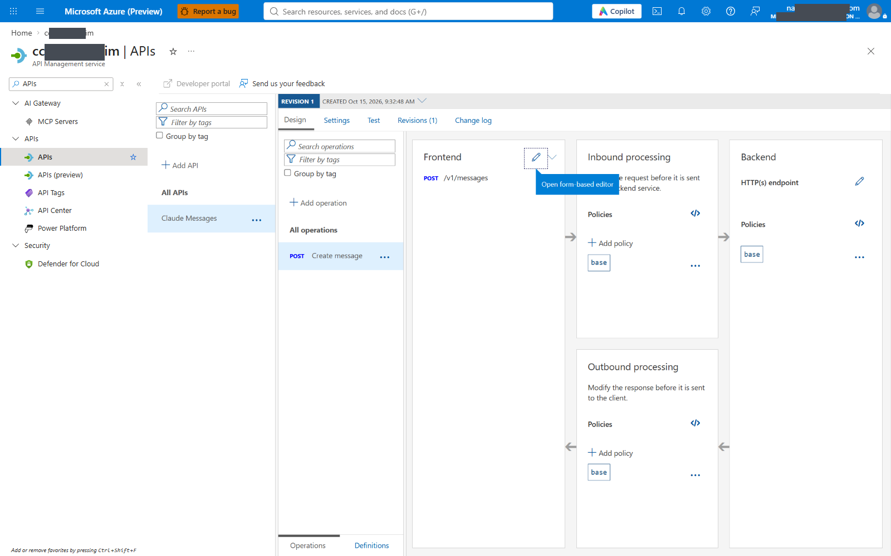

*Selected POST /v1/messages operation.*


### Step 09.1 - Verify APIM access to the chosen Foundry account

If the smoke test already succeeded, verify the assignment rather than assume it
covers a different account.
**Path A:** chosen Foundry account > IAM > Role assignments > APIM system identity >
**Cognitive Services User**.
**Path B:**

```powershell
Grant-CcofAzureRole -C $C -PrincipalId $C.apimPrincipalId -Role 'Cognitive Services User' -Scope $foundryId
```

**Check:** existing/inherited exact role. If missing, obtain approval and run that
one command with `-Apply`. Repeat as separate steps only for additional approved
accounts. Do not use `az apim update` as an identity shortcut.

### Step 09.2 - Create the API

If it already serves traffic, use an approved new revision; do not overwrite the
live revision. Inspect existing APIs first:
```powershell
az apim api list -g $C.apimResourceGroup --service-name $C.apimName --query '[].{apiId:name,path:path}' -o table
if ($LASTEXITCODE -ne 0) { throw 'API inventory failed.' }
```

**Path A:** APIM > APIs > Add API > HTTP > display `Claude Messages`, name
`$C.apiId`, suffix `$C.apiPath`, protocol HTTPS, subscription required Off.
**Path B (only a new API):**
```powershell
Invoke-CcofAzWrite @('apim','api','create','--subscription',($C.apimResourceId -split '/')[2],'-g',$C.apimResourceGroup,'--service-name',$C.apimName,'--api-id',$C.apiId,'--path',$C.apiPath,'--display-name','Claude Messages','--protocols','https','--subscription-required','false')
```
**Check:** API Settings show the exact suffix and subscription requirement Off.
Authentication is Entra policy, not an APIM subscription key.

### Step 09.3 - Add the messages operation

**Path A:** API > Design > Add operation > Name `create-message`, display
`Create message`, method POST, URL `/v1/messages` > Save.
**Path B:**
```powershell
Invoke-CcofAzWrite @('apim','api','operation','create','--subscription',($C.apimResourceId -split '/')[2],'-g',$C.apimResourceGroup,'--service-name',$C.apimName,'--api-id',$C.apiId,'--operation-id','create-message','--display-name','Create message','--method','POST','--url-template','/v1/messages')
```
**Check:** Design lists exactly POST `/v1/messages`.

### Step 09.4 - Create one backend entity

Choose **one** routing record. For additional records, repeat as separate steps.
```powershell
$routingValues = Get-Content $routing -Raw | ConvertFrom-Json -AsHashtable -Depth 100
$backendId = 'REPLACE-one-approved-backend-id'
$chosen = @($routingValues.backends | Where-Object backendId -CEQ $backendId)
if ($chosen.Count -ne 1) { throw 'Backend selection is missing or ambiguous.' }
$b = $chosen[0]
```

**Path A:** APIM > Backends > Create new > name exactly `backendId`, Custom URL,
protocol HTTP with its HTTPS `/anthropic` URL, validate certificate chain/name
On, no secrets/credentials. The rendered policy obtains the MI token.
**Path B:**
```powershell
$bodyFile = Join-Path $out "backend-$backendId.json"
Save-CcofJson @{properties=@{url=$b.url;protocol='http';tls=@{validateCertificateChain=$true;validateCertificateName=$true}}} $bodyFile
Invoke-CcofAzWrite @('rest','--method','put','--url',"https://management.azure.com$($C.apimResourceId)/backends/$backendId`?api-version=2024-05-01",'--body',"@$bodyFile")
```

**Check:**
```powershell
az apim backend show -g $C.apimResourceGroup --service-name $C.apimName --backend-id $backendId `
    --query '{id:name,url:url,protocol:protocol,tls:tls}' -o json
if ($LASTEXITCODE -ne 0) { throw 'Backend read-back failed.' }
```
Registry and routing IDs must match; no fallback/default backend for unknown IDs.

### Step 09.5 - Back up the existing API policy

**Path A:** API > All operations > policy code editor > save existing XML privately.
For a new API, record its initial policy too.
**Path B (read-only):**
```powershell
$policyUrl = "https://management.azure.com$($C.apimResourceId)/apis/$($C.apiId)/policies/policy?api-version=2024-05-01"
$previousPolicy = Invoke-CcofAzJson @('rest','--method','get','--url',$policyUrl)
Save-CcofJson $previousPolicy (Join-Path $out 'api-policy-before.json')
```

If there is no explicit policy child yet, record that in the private evidence
from the Portal; don't silently reinterpret other GET failures as "no policy".

### Step 09.6 - Publish the full rendered API policy

**Path A:** API > Design > **All operations** > inbound `</>` > replace with the
entire `gateway/<apiId>.policy.xml` > Save. Do not paste an unrendered template,
strip JWT validation or remove quota/cache/telemetry sections.
**Path B:**
```powershell
$xml = Get-Content (Join-Path $out "gateway/$($C.apiId).policy.xml") -Raw
$bodyFile = Join-Path $out 'api-policy.json'
Save-CcofJson @{properties=@{format='rawxml';value=$xml}} $bodyFile
Invoke-CcofAzWrite @('rest','--method','put','--url',"https://management.azure.com$($C.apimResourceId)/apis/$($C.apiId)/policies/policy?api-version=2024-05-01",'--body',"@$bodyFile")
```

**Check:** GET the policy URL from 09.5, compare its `properties.value` with
the rendered XML (line-ending differences are not permission to ignore missing
sections). Require the actual resolver hostname and no placeholders.
Policy save-time errors must be fixed in the render/config inputs, not by
deleting the failing authorization/limit policy.

---

## 10. Diagnostics without Bicep

**Portal references (historical/navigation only; identifier middles masked):**

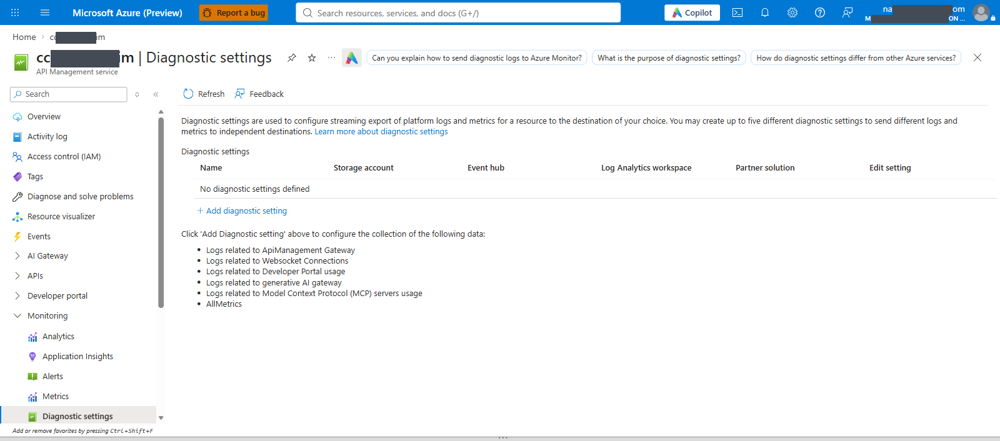

*Diagnostic settings BEFORE configuration: no settings defined; not successful logging proof.*


### Step 10.1 - Inspect available APIM log categories

**Path A:** APIM > Diagnostic settings > Add > inspect available categories.
**Path B (read-only):**
```powershell
az monitor diagnostic-settings categories list --resource $C.apimResourceId -o table
if ($LASTEXITCODE -ne 0) { throw 'Diagnostic categories read failed.' }
```
**Check:** `GatewayLogs` and `GatewayLlmLogs`. If unavailable for this tier/region,
record the blocker; do not claim a complete usage ledger.

### Step 10.2 - Set APIM resource diagnostics

**Path A:** APIM > Diagnostic settings > Add > name `ccof-public-apim` > select
GatewayLogs and GatewayLlmLogs > intended Log Analytics workspace >
resource-specific tables where offered > Save.
**Path B:**
```powershell
$file = Join-Path $out 'apim-logs.json'
Save-CcofJson @{properties=@{workspaceId=$C.workspaceResourceId;logAnalyticsDestinationType='Dedicated';logs=@(@{category='GatewayLogs';enabled=$true},@{category='GatewayLlmLogs';enabled=$true})}} $file
Invoke-CcofAzWrite @('rest','--method','put','--url',"https://management.azure.com$($C.apimResourceId)/providers/Microsoft.Insights/diagnosticSettings/ccof-public-apim?api-version=2021-05-01-preview",'--body',"@$file")
```
**Check:** intended workspace, both categories enabled, Dedicated destination.
Reuse an existing reviewed setting rather than create duplicate ingestion streams.

### Step 10.3 - Configure the APIM Azure Monitor logger

**Path A:** APIM API > Settings > Diagnostics logs > Azure Monitor; the Portal
may manage the built-in logger while configuring diagnostics in 10.4.
If it already exists, inspect it and skip creation.
**Path B (one child write if needed):**
```powershell
$file = Join-Path $out 'azuremonitor-logger.json'
Save-CcofJson @{properties=@{loggerType='azureMonitor';description='CCOF keyless Azure Monitor';isBuffered=$true}} $file
Invoke-CcofAzWrite @('rest','--method','put','--url',"https://management.azure.com$($C.apimResourceId)/loggers/azuremonitor?api-version=2024-06-01-preview",'--body',"@$file")
```
**Check:** logger type azureMonitor, no instrumentation key/secret.

### Step 10.4 - Set API-level diagnostics

**Path A:** APIM > API > Settings > Diagnostics Logs > Azure Monitor >
Enabled, all errors, 100% sampling, Information, client IP Off, every
frontend/backend request/response body byte count **0**, sensitive headers empty,
LLM logs On (where offered).
**Path B:** no Bicep fallback; configure the one child resource directly:

```powershell
$empty = @{body=@{bytes=0};headers=@()}
$file = Join-Path $out 'api-diagnostics.json'
Save-CcofJson @{properties=@{
    loggerId="$($C.apimResourceId)/loggers/azuremonitor";alwaysLog='allErrors'
    sampling=@{samplingType='fixed';percentage=100};verbosity='information';logClientIp=$false
    frontend=@{request=$empty;response=$empty};backend=@{request=$empty;response=$empty}
    largeLanguageModel=@{logs='enabled'}
}} $file
Invoke-CcofAzWrite @('rest','--method','put','--url',"https://management.azure.com$($C.apimResourceId)/apis/$($C.apiId)/diagnostics/azuremonitor?api-version=2024-06-01-preview",'--body',"@$file")
```

**Check:** GET the same URL, confirm `largeLanguageModel.logs=enabled`,
sampling 100%, `logClientIp=false`, zero body bytes and empty headers.
APIM resource diagnostics alone do not configure API-level LLM diagnostics.

### Step 10.5 - Set resolver FunctionAppLogs diagnostics

**Path A:** Resolver > Diagnostic settings > Add > name `ccof-public-functions` >
FunctionAppLogs > same workspace > resource-specific > Save.
**Path B:**
```powershell
$app = 'resolver'
$file = Join-Path $out "$app-logs.json"
Save-CcofJson @{properties=@{workspaceId=$C.workspaceResourceId;logAnalyticsDestinationType='Dedicated';logs=@(@{category='FunctionAppLogs';enabled=$true})}} $file
Invoke-CcofAzWrite @('rest','--method','put','--url',"https://management.azure.com$($C.apps[$app].id)/providers/Microsoft.Insights/diagnosticSettings/ccof-public-functions?api-version=2021-05-01-preview",'--body',"@$file")
```
**Check:** `az monitor diagnostic-settings list --resource $C.apps.resolver.id -o json`
shows FunctionAppLogs to the intended workspace. Check exit status.

### Step 10.6 - Set sync FunctionAppLogs diagnostics

Repeat **10.5** with `$app='sync'` on sync only.
**Check:** that app's diagnostic setting, not the resolver's.

### Step 10.7 - Set reconciler FunctionAppLogs diagnostics

Repeat **10.5** with `$app='reconciler'` on reconciler only.
**Check:** that app's diagnostic setting.

---

## 11. Seed registry - two complete paths

**Portal references (historical/navigation only; identifier middles masked):**

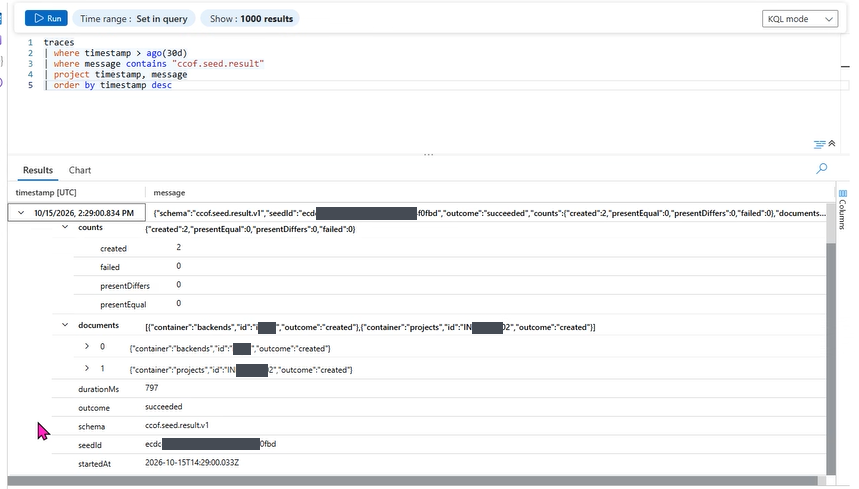

*Historical create-only seed result with two created documents; identifiers middle-masked, not another deployment's seed acceptance.*


**Preferred Path A:** sync's create-only seed handler (Portal settings + read-only
CLI/KQL verification). **Path B:** Cosmos Data Explorer, one new item at a time,
only if an approved operator already has the necessary native data permissions
and network access. Path B is not an excuse to enable Cosmos keys or grant a broad
writer. Choose a path; don't seed through both blindly.

Neither path creates entitlements: entitlement sync does that in Module 12.

### Step 11.1 - Inspect earlier seed results

**Path A UI:** Sync Insights > Logs:
```kusto
traces
| where timestamp > ago(30d)
| where message contains "ccof.seed.result"
| project timestamp, message
| order by timestamp desc
```
**CLI alternative (read-only):**
```powershell
$file = Join-Path $out 'seed-history-query.json'
Save-CcofJson @{query="traces | where timestamp > ago(30d) | where message contains 'ccof.seed.result' | project timestamp, message | order by timestamp desc | take 50";timespan='P30D'} $file
$answer = Invoke-CcofAzJson @('rest','--method','post','--url',"https://management.azure.com$($C.apps.sync.appInsightsResourceId)/api/query?api-version=2020-02-02",'--body',"@$file")
Get-CcofQueryMessages -Response $answer
```

**Check:** earlier successful records correspond to the approved exact
documents, not just a different seed ID. `present-differs` stops the run.
If nothing is returned, it is "no result found", not proof of a failed or successful seed.

### Step 11.2A - Set payload and enable only registrySeed

**Path A UI:** Sync > Environment variables > add `CCOF_SEED_DOCUMENTS` =
entire `seed-payload.txt`; set `AzureWebJobs.registrySeed.Disabled=false`;
leave `AzureWebJobs.syncEntitlement.Disabled=true`; Apply.
**CLI alternative (one settings change):**

```powershell
$payload = (Get-Content (Join-Path $out 'seed-payload.txt') -Raw).Trim()
$file = Join-Path $out 'seed-enable.json'
Save-CcofJson @{CCOF_SEED_DOCUMENTS=$payload;'AzureWebJobs.registrySeed.Disabled'='false';'AzureWebJobs.syncEntitlement.Disabled'='true'} $file
Invoke-CcofAzWrite @('functionapp','config','appsettings','set','--subscription',$C.subscriptionId,'-g',$C.resourceGroup,'-n',$C.apps.sync.name,'--settings',"@$file")
```

**Check:** payload present (inspect its length, not its value), seed disabled
flag false, entitlement sync flag true.
If failure, disconnect or timeout: mandatory cleanup 11.5A/11.6A still applies.

### Step 11.3A - Verify seed trigger registration

**Path A:** Sync > Functions > registrySeed.
**Path B read:**
```powershell
az functionapp function list -g $C.resourceGroup -n $C.apps.sync.name --query '[].name' -o tsv
if ($LASTEXITCODE -ne 0) { throw 'Seed function listing failed.' }
```

**If absent:** wait for app restart and recheck. If still absent, as a separate
single change resync only this app:
```powershell
Invoke-CcofAzWrite @('rest','--method','post','--url',"https://management.azure.com$($C.apps.sync.id)/syncfunctiontriggers?api-version=2024-04-01")
```
**Check again:** registrySeed registered; no host/identity errors. Don't enable
other timers to fix seed registration.

### Step 11.4A - Verify every expected document for this seed

The timer runs each minute after startup while its payload is present. Confirm
registration in 11.3A first. Paste this **whole script block**, not each line
as separate commands; only the last statement after successful assertions prints success.
Both ARM `Tables/Columns/Rows` and data-plane `tables/columns/rows` are parsed
without assuming key case or a fixed message-column index.

```powershell
& {
    $ErrorActionPreference = 'Stop'
    $seedId = (Get-Content (Join-Path $out 'seed-id.txt') -Raw).Trim()
    if ($seedId -cnotmatch '^[a-f0-9]{32}$') { throw 'Invalid local seed ID. Inspect the intended payload.' }
    $file = Join-Path $out 'seed-result-query.json'
    Save-CcofJson @{query="traces | where timestamp > ago(1h) | where message contains 'ccof.seed.result' and message has '$seedId' | project timestamp, message | order by timestamp desc | take 50";timespan='PT1H'} $file
    $answer = Invoke-CcofAzJson @('rest','--method','post','--url',"https://management.azure.com$($C.apps.sync.appInsightsResourceId)/api/query?api-version=2020-02-02",'--body',"@$file")
    $messages = @(Get-CcofQueryMessages -Response $answer)
    if (-not $messages.Count) { throw 'No result for this seed ID yet. Inspect registration/runtime/log ingestion; cleanup remains mandatory.' }
    $result = $messages[0] | ConvertFrom-Json -AsHashtable -Depth 100
    $documents = Get-Content $registry -Raw | ConvertFrom-Json -AsHashtable -Depth 100
    Assert-CcofSeedResult -Result $result -SeedId $seedId -Documents $documents
    'Every expected seed document verified for this seed ID.'
}
```

UI: Sync Application Insights > Logs, filter by the **actual local seed ID** and
compare all expected project/backend records. A different successful old seed is
not automatically this seed. Do not reseed just to resolve an operator's query error.
Missing, failed, refused and `present-differs` outcomes stop the run; never overwrite
existing documents to make the check pass. Complete 11.5A/11.6A even on failure.

### Step 11.5A - Disable registrySeed (mandatory even on failure)

**Path A:** Sync > Environment variables > `AzureWebJobs.registrySeed.Disabled=true`
> Apply. Do this from Portal even if Cloud Shell disconnected.
**Path B:**
```powershell
Invoke-CcofAzWrite @('functionapp','config','appsettings','set','--subscription',$C.subscriptionId,'-g',$C.resourceGroup,'-n',$C.apps.sync.name,'--settings','AzureWebJobs.registrySeed.Disabled=true')
```
**Check:** disabled flag true. Do not enable sync yet.

### Step 11.6A - Delete temporary seed payload (mandatory)

**Path A:** delete only `CCOF_SEED_DOCUMENTS` > Apply.
**Path B:**
```powershell
Invoke-CcofAzWrite @('functionapp','config','appsettings','delete','--subscription',$C.subscriptionId,'-g',$C.resourceGroup,'-n',$C.apps.sync.name,'--setting-names','CCOF_SEED_DOCUMENTS')
```
**Check:** setting absent, seed flag still true. Keep private result/seed ID
evidence; do not regenerate while an earlier enabled seed remains unresolved.

### Step 11.2B - Create one backend item manually

Use only if Path A cannot run and the authorized operator can access Data Explorer
without keys. Keep the sync seed timer disabled and its payload absent.

Cosmos > Data Explorer > **registry > backends > Items > New Item** >
paste **one** `seed-documents/backends-<id>.json` > Save.

**Check:** new item `id=backendId`; partition value is that backendId.
If already present, **do not save over it**: compare every approved seeded field
with the existing item. Match -> record present-equal manually. Difference -> stop.
Repeat for additional backends as separately recorded one-item steps.

### Step 11.3B - Create one project item manually

Cosmos > Data Explorer > **registry > projects > Items > New Item** >
paste **one** `seed-documents/projects-<id>.json` > Save.

**Check:** `id=projectId`, partition value projectId, every classification/group/
family/limit/budget and backendId matches the approved file. Existing different
items must not be overwritten/deleted. Repeat per additional project as a
separate step. This path has manual evidence, not a fabricated timer seed result.

### Step 11.4B - Confirm manual-seed completeness

Compare the expected registry inventory with the created/present-equal items,
one item at a time. Record container, ID, comparison and reviewer privately.
Confirm seed timer disabled and CCOF_SEED_DOCUMENTS absent.
**Gate:** no missing, differing or partially saved item. Then continue Module 12.

---

## 12. Enable and verify entitlement sync

**Portal references (historical/navigation only; identifier middles masked):**

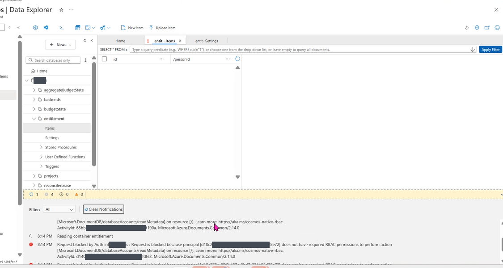

*Data Explorer native data-role denial for the operator; this is not evidence that entitlement storage is empty.*


### Step 12.1 - Verify one approved test membership

**Path A:** Entra > intended group > Members > approved test developer.
**Path B (read-only):**
```powershell
$groupId = 'REPLACE-approved-group-object-guid'
$developerId = 'REPLACE-approved-test-developer-object-guid'
az ad group member check --group $groupId --member-id $developerId --query value -o tsv
if ($LASTEXITCODE -ne 0) { throw 'Group membership check failed.' }
```
**Check:** true, active user, exact group in the registry. Do not add people
without customer approval. Graph grants and seed gate must already be complete.

### Step 12.2 - Enable syncEntitlement only

**Path A:** Sync > Environment variables >
`AzureWebJobs.syncEntitlement.Disabled=false` > Apply.
**Path B:**
```powershell
Invoke-CcofAzWrite @('functionapp','config','appsettings','set','--subscription',$C.subscriptionId,'-g',$C.resourceGroup,'-n',$C.apps.sync.name,'--settings','AzureWebJobs.syncEntitlement.Disabled=false')
```
**Check:** sync false, seed true, payload absent. Reconciler remains disabled.

### Step 12.3 - Verify a successful actual sync

**Path A:** Sync Insights > Logs:
```kusto
traces
| where timestamp > ago(1h)
| where message contains "ccof.sync.run.v1"
| project timestamp, message
| order by timestamp desc
```
**CLI alternative:** reuse the ARM Insights query method in 11.1 with this KQL.

**Check:** an actual `outcome=succeeded`, `writeMode=apply`, intended project/
group/member counts, no unexplained refusals/write failures. A skipped lease
run or enabled setting alone is not proof of successful sync.
If Graph returns 403, inspect the exact grants/token propagation, do not grant
directory write access.

### Step 12.4 - Verify one entitlement item

**Path A:** approved data operator > Data Explorer > registry > entitlement >
locate the test person's item. No editing.
**Path B:** authorized data reader/operator can use the customer's existing
data-plane tooling; ordinary `az cosmosdb sql container show` cannot read items.
Do not claim management metadata proves the entitlement exists.

**Check:** correct person, tenant, project/classification/group and admitted
families/limits/freshness. Record IDs/timestamps, not personal names or tokens.

---

## 13. Hand-configurable developer sign-in and gateway testing

Reference edition updated 2026-10-15T23:44+05:30. **Public manual completion guide; no deployment acceptance claimed.**

**Customer project:** `PROJECT01`. **Gateway example:** `https://sample-apim.azure-api.net/anthropic`.
Use the exact approved values in the customer's configuration if they differ.
The project ID does not establish the Entra group names: use the actual groups and Object IDs in the seeded project.

This chapter is self-contained. All settings, CMD launchers and application-owned
helper source are printed below. No repository clone, ZIP, base64 installer,
downloaded PowerShell script or `Set-ClaudeCodeGateway.ps1` is required on the
developer workstation. The commands are pasted into a normal terminal.
Save files yourself with Notepad or VS Code; do not save them with a hidden `.txt` suffix.

**Scope and proof:** these steps document manual configuration. They do not assert
that customer sign-in, API inference, negative tests or telemetry have passed.
The real customer screenshots below are location references, not a replay of completed setup.
No fresh screenshot of Azure CLI preauthorization, native Windows sign-in, or a
successful customer inference request is available in this guide.

### Step 13.0 - Choose exactly one authentication route

| Route | What the customer installs | Authentication | Gateway changes |
|---|---|---|---|
| **A: manual session - recommended for today's first test** | Approved Azure CLI, Claude Code/VS Code extension | `az login`, then token held only in the current process environment | Admin must authorize Microsoft Azure CLI for the API scope and add its client ID to the existing APIM allowed-client list |
| **A-refresh: optional small CMD helper** | Same as A | Manual `az login`; a four-line CMD file obtains cached/refreshed tokens silently | Same as A |
| **B: original application sign-in helper** | Node.js 22+ and the two approved Microsoft npm packages below | `ccof-token login`; secure local cache and silent token refresh | Uses the original combined gateway/developer client; no Azure CLI client addition required |

Do not mix an `ANTHROPIC_AUTH_TOKEN` session with an `apiKeyHelper` configuration.
Neither route implements Claude's native Cloud gateway `/login` protocol.
The separate Claude apps gateway from the older project is not deployed by this APIM workbook.
Do not point `forceLoginGatewayUrl` at this APIM API.

PowerShell **5.1 is sufficient for the terminal commands in this chapter**. Node.js
is required only for Route B. Azure CLI is required only for Route A/A-refresh.
Customer Conditional Access and MFA apply to both. Use an approved device;
the lab lab's managed-device restriction does not establish the customer's policy.

**Prerequisites:** approved test traffic; successful Module 12 sync, or an explicitly
approved alternate entitlement check; exact registered group membership; seed cleanup
complete; APIM policy and resolver caller restrictions applied. A Portal Data Explorer
read-permission error for the operator is not evidence that sync failed, but keep
that verification pending until equivalent authorized evidence exists. Do not label
Module 13 accepted solely because the operator cannot inspect Cosmos.

### Step 13.1 - Hand-create or inspect the client configuration

If `client-config.json` is already correct, keep it; do not overwrite customer values.
Otherwise create `C:\ccof-client\client-config.json` with the entire JSON below.
Replace the two GUID placeholders. The same gateway application GUID is used in
`clientId` and in the scope only if the API's actual Application ID URI is `api://<that GUID>`.
Use the actual exposed URI if it differs.

| Field | Where the customer obtains it |
|---|---|
| `tenantId` | Entra ID > Overview > Tenant ID |
| `clientId` | Combined gateway/developer app registration > Overview > Application (client) ID; not the resolver API app and not APIM's managed identity |
| `scope` | That gateway registration > Expose an API > copy the full `access_as_user` scope URI |
| `gatewayUrl` | APIM > Overview > Gateway URL, plus the Claude API suffix (`anthropic`); no trailing `/v1` or `/v1/messages` |
| Model values | Actual Foundry deployment names admitted for this test user's classification; examples below must be checked |
| `project.id` | The seeded project ID, confirmed here as `PROJECT01` |
| `desktop.profileId` | A stable client profile GUID, not an Entra identity. Generate once with `[guid]::NewGuid().ToString()` if needed |

```json
{
  "schemaVersion": 1,
  "tenantId": "REPLACE-tenant-guid",
  "clientId": "REPLACE-gateway-app-client-guid",
  "scope": "api://REPLACE-gateway-app-client-guid/access_as_user",
  "gatewayUrl": "https://sample-apim.azure-api.net/anthropic",
  "helperTtlSeconds": 300,
  "minimumTokenLifetimeSeconds": 360,
  "loginTimeoutSeconds": 600,
  "tokenTimeoutSeconds": 30,
  "disableNonessentialTraffic": true,
  "models": {
    "default": "claude-sonnet-5",
    "opus": "claude-opus-5",
    "sonnet": "claude-sonnet-5",
    "haiku": "claude-haiku-4-5",
    "available": ["claude-sonnet-5", "claude-opus-5", "claude-haiku-4-5"]
  },
  "desktop": {
    "profileId": "11111111-2222-4333-8444-555555555555",
    "profileName": "Customer Claude Gateway"
  },
  "project": {
    "id": "PROJECT01",
    "selectorHeader": "x-ccof-project"
  }
}
```

For an STD user not admitted to Opus, remove Opus from `available` and point the
required `opus` alias to an admitted deployment such as the configured Sonnet.
Aliases may share one deployment. Add Fable only for an approved CYB user and an
actual admitted deployment. Client settings do not grant access; APIM enforces admission.
There are no passwords, client secrets, bearer tokens or refresh tokens in this JSON.

### Step 13.2A - Administrator: authorize Azure CLI (Route A/A-refresh only)

This expands the list of trusted OAuth clients and requires customer approval.
Do not perform it when choosing Route B.

1. Entra ID > App registrations > the **combined gateway/user-sign-in app**.
2. Open **Expose an API**, not Authentication and not API permissions.
3. Under **Authorized client applications**, choose **Add a client application**.
4. Client ID: `04b07795-8ddb-461a-bbee-02f9e1bf7b46` (Microsoft Azure CLI).
5. Select the existing **`access_as_user`** scope, then add the application.
6. Retain the original client entries, API audience and scope.

Azure CLI's first-party client ID is not a customer app registration to create.
Do not replace `client-config.json`'s gateway `clientId` with this ID.
Preauthorizing the client does not add users to groups, grant Microsoft Graph
permissions, or bypass Conditional Access.

#### Identifier check before either admin route

| Identifier | Purpose | Change for Azure CLI? |
|---|---|---|
| Customer tenant ID | Token issuer/tenant boundary | No |
| Gateway app client ID / Application ID URI | The API resource/audience being accessed | No; do not substitute Azure CLI's ID |
| `04b07795-8ddb-461a-bbee-02f9e1bf7b46` | OAuth client that signs the user in through Azure CLI | Add to Entra preauthorization and APIM delegated-client allow-list |
| APIM managed identity client/object IDs | APIM calling the resolver and Foundry | No; Azure CLI is not an allowed resolver caller |
| Resolver API app ID | Internal resolver token audience | No |
| Sync managed identity | Background Microsoft Graph reads | No; its Graph permissions are separate |

The flow is: **user -> Azure CLI interactive sign-in -> gateway-audience delegated
token -> APIM JWT/client checks -> group entitlement/model/quota checks -> Foundry**.
The token's authorized-party/client claim identifies Azure CLI, even though its
audience still identifies the gateway API.

#### CLI alternative for 13.2A - Preserve and merge Entra preauthorization

Run this in **PowerShell Cloud Shell** or an approved PowerShell 5.1/7 terminal
with Azure CLI. This is pasted code, not a downloaded `.ps1`. In Windows the
command `az` normally resolves to `az.cmd`; if necessary use `az.cmd` instead.

The operator needs the tenant's approved app-management rights to this gateway
registration and permission to perform the Graph application update. A role name
alone is not a guarantee if tenant consent policy restricts it. Stop on denied
reads/writes; do not grant broad directory privileges as a workaround.
Coordinate changes so another administrator is not editing the client list concurrently.

Replace the two GUID placeholders first. This block creates a **local** backup,
locates the actual enabled scope GUID, preserves all current clients and scope
grants, and writes only the merged `api.preAuthorizedApplications` field.
It does not create scopes, change redirect URIs, grant Graph roles to the sync
identity or modify a resolver registration.

```powershell
& {
  $ErrorActionPreference = 'Stop'
  $tenantId = 'REPLACE-customer-tenant-guid'
  $gatewayAppId = 'REPLACE-gateway-app-client-guid'
  $azureCliId = '04b07795-8ddb-461a-bbee-02f9e1bf7b46'
  if ($tenantId -match 'REPLACE-' -or $gatewayAppId -match 'REPLACE-') { throw 'Fill the customer GUIDs first.' }
  $currentTenant = az account show --query tenantId --output tsv
  if ($LASTEXITCODE -ne 0 -or $currentTenant -ine $tenantId) { throw 'Sign in as the approved administrator in the correct tenant first.' }
  $appText = az ad app show --id $gatewayAppId --output json
  if ($LASTEXITCODE -ne 0) { throw 'Cannot read the gateway registration.' }
  $app = ($appText -join "`n") | ConvertFrom-Json
  $scope = @($app.api.oauth2PermissionScopes | Where-Object { $_.value -ceq 'access_as_user' -and $_.isEnabled })
  if ($scope.Count -ne 1) { throw 'Expected one enabled access_as_user scope on the gateway app.' }
  $clients = @($app.api.preAuthorizedApplications | Where-Object { $null -ne $_ })
  $backupDir = Join-Path $HOME ('ccof-trust-backup-' + [guid]::NewGuid().ToString('N'))
  New-Item -ItemType Directory -Path $backupDir | Out-Null
  $utf8 = [Text.UTF8Encoding]::new($false)
  $beforeFile = Join-Path $backupDir 'gateway-preauth-before.json'
  $before = @{api=@{preAuthorizedApplications=$clients}}
  [IO.File]::WriteAllText($beforeFile, (ConvertTo-Json -InputObject $before -Depth 30), $utf8)
  $cli = @($clients | Where-Object appId -IEQ $azureCliId)
  if ($cli.Count -gt 1) { throw 'Duplicate Azure CLI entries; review before editing.' }
  $changed = $false
  if ($cli.Count -eq 0) {
    $clients += [pscustomobject]@{appId=$azureCliId;delegatedPermissionIds=@($scope[0].id)}
    $changed = $true
  } elseif (@($cli[0].delegatedPermissionIds) -inotcontains $scope[0].id) {
    $cli[0].delegatedPermissionIds = @($cli[0].delegatedPermissionIds) + @($scope[0].id)
    $changed = $true
  }
  if ($changed) {
    $bodyFile = Join-Path $backupDir 'gateway-preauth-merged.json'
    $body = @{api=@{preAuthorizedApplications=$clients}}
    [IO.File]::WriteAllText($bodyFile, (ConvertTo-Json -InputObject $body -Depth 30), $utf8)
    az rest --method patch --url "https://graph.microsoft.com/v1.0/applications/$($app.id)" --headers 'Content-Type=application/json' --body "@$bodyFile" --output none
    if ($LASTEXITCODE -ne 0) { throw 'Preauthorization update failed; inspect state before retrying.' }
  }
  $afterText = az ad app show --id $gatewayAppId --output json
  if ($LASTEXITCODE -ne 0) { throw 'Cannot verify the gateway registration.' }
  $after = ($afterText -join "`n") | ConvertFrom-Json
  $held = @($after.api.preAuthorizedApplications | Where-Object appId -IEQ $azureCliId)
  if ($held.Count -ne 1 -or @($held[0].delegatedPermissionIds) -inotcontains $scope[0].id) {
    throw 'Azure CLI preauthorization not verified. Keep the backup and inspect.'
  }
  "Entra preauthorization verified. Local backup: $beforeFile"
}
```

Verification in the UI: reopen **Expose an API > Authorized client applications**,
select Azure CLI's ID, and confirm the selected permission is `access_as_user`.
An entry in the Authentication redirect list is not this permission.

**Screenshot coverage:** the next image is the customer's combined app's
Authentication page. It illustrates where Route B redirect URIs belong; it is
**not** the Expose an API page or proof that Azure CLI has been authorized.

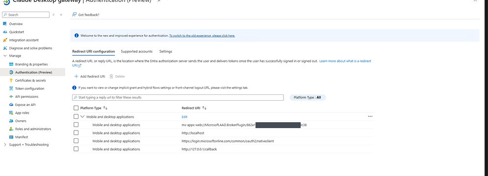

### Step 13.3A - Administrator: add the OAuth client to APIM

Back up/export the full current policy first. If the API already serves users,
use the customer's approved revision/change process.

1. APIM > APIs > **Claude Messages** > Design.
2. Select **All operations**, not just the POST operation.
3. Open the **inbound `</>` policy editor**.
4. Find `var delegatedClients = new string[] { ... };`.
5. Preserve the existing client GUID(s) and append Microsoft's Azure CLI GUID:

```csharp
var delegatedClients = new string[] {
    "REPLACE-keep-existing-gateway-client-guid",
    "04b07795-8ddb-461a-bbee-02f9e1bf7b46"
};
```

This is an **array edit inside the existing policy**, not a replacement policy.
The placeholder above represents the actual existing value; do not paste it
unchanged. Preserve tenant, issuers, audiences, `access_as_user`, resolver calls,
entitlement checks, model restrictions, quotas and telemetry. Save and read back.
Never add Azure CLI's ID as the token audience.

Also record the same allowed client in the local `gateway-config.json` under
`entra.delegatedClientAppIds` if policy is rendered again. The full
Build-LocalArtifacts generator currently regenerates that configuration with its
original default; do not accidentally erase this approved change during a later rebuild.

**Customer UI reference:** the pictured POST operation is selected. Click
**All operations** first, then the inbound code icon. This image is before the
new client edit; it does not prove the edited policy has been saved.

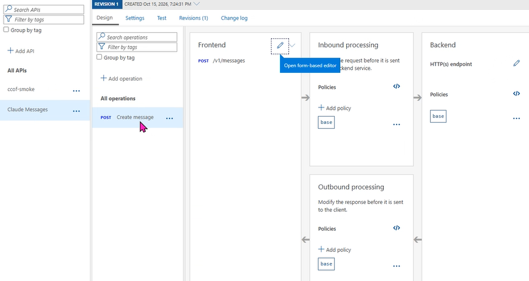

#### CLI alternative for 13.3A - Azure CLI authentication and built-in HTTP

The operator needs approved write access to this APIM API policy. Use the full
APIM ARM resource ID from **APIM > JSON View > id** and the API identifier from
**Claude Messages > Settings** (`claude-messages` in this workbook).
Use a revision-specific API identifier if required by the customer's change process.

This block uses Azure CLI to authenticate and obtain an ARM token, then the
built-in PowerShell `Invoke-RestMethod` for APIM reads/writes. Some Windows Azure
CLI versions fail on the UTF-8 BOM in APIM's policy response; this avoids that
response-decoding bug without weakening TLS or policy validation.
It reads the deployed policy as a JSON contract, backs it up locally,
checks that there is exactly one recognizable GUID-only `delegatedClients` array,
adds Azure CLI without discarding existing IDs, and PUTs that one API policy.
It refuses unfamiliar policy syntax instead of replacing the full security policy
with an example. No Node renderer or PowerShell setup script is required.

```powershell
& {
  $ErrorActionPreference = 'Stop'
  $apimId = 'REPLACE-full-APIM-resource-id'
  $apiId = 'claude-messages'
  $azureCliId = '04b07795-8ddb-461a-bbee-02f9e1bf7b46'
  if ($apimId -match 'REPLACE-' -or -not $apimId.StartsWith('/subscriptions/')) { throw 'Fill the actual APIM resource ID.' }
  $policyUrl = "https://management.azure.com$apimId/apis/$apiId/policies/policy?api-version=2024-05-01"
  $armToken = az account get-access-token --resource 'https://management.azure.com/' --query accessToken --output tsv
  if ($LASTEXITCODE -ne 0 -or [string]::IsNullOrWhiteSpace($armToken)) { throw 'ARM token acquisition failed.' }
  $authHeaders = @{Authorization="Bearer $armToken"}
  $armToken = $null
  $before = Invoke-RestMethod -Method Get -Uri $policyUrl -Headers $authHeaders
  $value = [string]$before.properties.value
  $format = [string]$before.properties.format
  if (-not $value -or $format -notin @('xml','rawxml')) { throw 'Unsupported policy response; use the reviewed UI route.' }
  $backupDir = Join-Path $HOME ('ccof-policy-backup-' + [guid]::NewGuid().ToString('N'))
  New-Item -ItemType Directory -Path $backupDir | Out-Null
  $utf8 = [Text.UTF8Encoding]::new($false)
  $beforeFile = Join-Path $backupDir 'api-policy-before.restore.json'
  $restore = @{properties=@{format=$format;value=$value}}
  [IO.File]::WriteAllText($beforeFile, (ConvertTo-Json -InputObject $restore -Depth 10), $utf8)
  $pattern = '(?s)\bvar\s+delegatedClients\s*=\s*new\s+string\[\]\s*\{(?<ids>.*?)\}\s*;'
  $arrays = [regex]::Matches($value, $pattern)
  if ($arrays.Count -ne 1) { throw 'Expected exactly one delegatedClients array; use the reviewed UI route.' }
  $array = $arrays[0]
  $rawIds = $array.Groups['ids'].Value
  $plainIds = [Net.WebUtility]::HtmlDecode($rawIds)
  $guidPattern = '[0-9a-fA-F]{8}(?:-[0-9a-fA-F]{4}){3}-[0-9a-fA-F]{12}'
  $literalPattern = '^\s*"' + $guidPattern + '"(?:\s*,\s*"' + $guidPattern + '")*\s*,?\s*$'
  if ($plainIds -notmatch $literalPattern) { throw 'Unfamiliar client-array contents; do not modify automatically.' }
  $ids = @([regex]::Matches($plainIds, $guidPattern) | ForEach-Object Value)
  if ($ids -inotcontains $azureCliId) {
    $ids += $azureCliId
    $quote = if ($rawIds -match '&(?:quot|#34|#x22);') { '&quot;' } else { '"' }
    $replacement = 'var delegatedClients = new string[] { ' + (($ids | ForEach-Object { $quote + $_ + $quote }) -join ', ') + ' };'
    $updated = $value.Substring(0, $array.Index) + $replacement + $value.Substring($array.Index + $array.Length)
    $bodyFile = Join-Path $backupDir 'api-policy-updated.json'
    $body = @{properties=@{format=$format;value=$updated}}
    $bodyJson = ConvertTo-Json -InputObject $body -Depth 10
    [IO.File]::WriteAllText($bodyFile, $bodyJson, $utf8)
    $writeHeaders = @{Authorization=$authHeaders.Authorization;'If-Match'='*'}
    Invoke-RestMethod -Method Put -Uri $policyUrl -Headers $writeHeaders -ContentType 'application/json' -Body ([Text.Encoding]::UTF8.GetBytes($bodyJson)) | Out-Null
    $writeHeaders.Clear()
  } else {
    $updated = $value
  }
  $after = Invoke-RestMethod -Method Get -Uri $policyUrl -Headers $authHeaders
  $authHeaders.Clear()
  if (([string]$after.properties.value).Replace("`r`n","`n").Trim() -cne $updated.Replace("`r`n","`n").Trim()) {
    throw 'Policy read-back differs. Review the full policy before testing.'
  }
  "APIM client-array update verified. Local restore body: $beforeFile"
}
```

Do not print the ARM token or authentication headers. The token exists only in
this local script-block scope. Do not use `&format=rawxml` on the GET URL in
this block: some clients then receive raw XML rather than the JSON contract it
expects. Preserve the returned `format`.
The PUT uses `If-Match=*`; coordinate to avoid concurrent policy edits. It is not
a substitute for an approved revision, review or rollback plan.

**Post-change checks, whichever admin route was used:**

1. Azure CLI and the original app are both in the intended client allow-list.
2. The gateway's audiences, tenant, scope and all security/limit policy blocks
   are unchanged. APIM's managed identity remains the only approved resolver caller.
3. Anonymous request still returns 401; authorized request is tested through the
   gateway, not directly against Foundry. Record actual results.
4. Update the local policy configuration record so a later render does not erase
   the new client. No code fix to the artifact generator is implied by this chapter.

**Rollback, only when this was a temporary proof:** UI route removes only the
new Azure CLI scope authorization/client entry and restores the exact prior
APIM client array. CLI route can use the saved minimal Graph PATCH body and
APIM PUT body, after reviewing them against any intervening changes:

```powershell
# Set these to the exact files printed by the two admin blocks, and the gateway app's OBJECT ID.
az rest --method patch --url 'https://graph.microsoft.com/v1.0/applications/REPLACE-gateway-app-object-guid' --headers 'Content-Type=application/json' --body '@REPLACE-full-path-to-gateway-preauth-before.json' --output none
if ($LASTEXITCODE -ne 0) { throw 'Entra rollback failed; inspect state.' }
$armToken = az account get-access-token --resource 'https://management.azure.com/' --query accessToken --output tsv
if ($LASTEXITCODE -ne 0 -or [string]::IsNullOrWhiteSpace($armToken)) { throw 'No ARM token for approved rollback.' }
$restoreJson = Get-Content 'REPLACE-full-path-to-api-policy-before.restore.json' -Raw
Invoke-RestMethod -Method Put -Uri 'https://management.azure.com/REPLACE-full-APIM-resource-path/apis/claude-messages/policies/policy?api-version=2024-05-01' -Headers @{Authorization="Bearer $armToken";'If-Match'='*'} -ContentType 'application/json' -Body ([Text.Encoding]::UTF8.GetBytes($restoreJson)) | Out-Null
$armToken = $null
```

The Graph URL needs the registration's **Object ID**, not its Application/client ID.
The APIM URL needs the full `/subscriptions/.../resourceGroups/.../providers/...`
path, without an extra slash or a literal `REPLACE-` segment.
Do not restore a stale snapshot over another administrator's newer changes.
Read back Entra and APIM after rollback; anonymous 401 alone does not prove the
client allow-list was restored.

### Step 13.4 - Configure the VS Code extension manually

Take a private backup of existing settings first. In VS Code:
**Ctrl+Shift+P > Preferences: Open User Settings (JSON)**.
The file is `%APPDATA%\Code\User\settings.json`.

The customer's screenshot below is the correct file, before configuration:

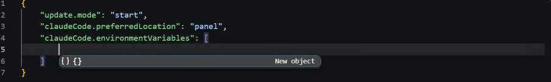

Merge the following entries into existing settings. Preserve unrelated keys,
including `update.mode` and `claudeCode.preferredLocation`. If an entry already
exists, update it rather than duplicating it. There must be one
`claudeCode.environmentVariables` array, with `name`/`value` objects.
Replace the gateway URL/model values if the verified config differs.

```json
{
  "claudeCode.preferredLocation": "panel",
  "claudeCode.disableLoginPrompt": true,
  "claudeCode.environmentVariables": [
    { "name": "ANTHROPIC_BASE_URL", "value": "https://sample-apim.azure-api.net/anthropic" },
    { "name": "ANTHROPIC_CUSTOM_HEADERS", "value": "x-ccof-project: PROJECT01" },
    { "name": "ANTHROPIC_MODEL", "value": "claude-sonnet-5" },
    { "name": "ANTHROPIC_DEFAULT_SONNET_MODEL", "value": "claude-sonnet-5" },
    { "name": "ANTHROPIC_DEFAULT_OPUS_MODEL", "value": "claude-opus-5" },
    { "name": "ANTHROPIC_DEFAULT_HAIKU_MODEL", "value": "claude-haiku-4-5" },
    { "name": "CLAUDE_CODE_USE_FOUNDRY", "value": "0" },
    { "name": "CLAUDE_CODE_USE_BEDROCK", "value": "0" },
    { "name": "CLAUDE_CODE_USE_VERTEX", "value": "0" },
    { "name": "CLAUDE_CODE_USE_ANTHROPIC_AWS", "value": "0" },
    { "name": "CLAUDE_CODE_USE_MANTLE", "value": "0" },
    { "name": "CLAUDE_CODE_DISABLE_NONESSENTIAL_TRAFFIC", "value": "1" }
  ]
}
```

Do not put `apiKeyHelper` in this VS Code file. That belongs in
`%USERPROFILE%\.claude\settings.json`, only for a helper route.
`disableLoginPrompt` suppresses the Anthropic-account prompt; it does not
authenticate or make a failed gateway sign-in succeed.

Remove the **earlier helper-specific** `ANTHROPIC_API_KEY`,
`ANTHROPIC_AUTH_TOKEN` and `CLAUDE_CODE_OAUTH_TOKEN` entries from these settings
and `.claude\settings.json`'s `env`, after backup. An empty token entry can hide
the token inherited from PowerShell. Remove old direct-Foundry provider settings
introduced for a different path. Do not override an IT-managed policy.
Do not inspect or paste the actual values of existing credential environment variables.

### Step 13.5A - Interactive Azure CLI sign-in (no helper, no setup script)

Open **standalone Windows PowerShell 5.1 or PowerShell 7**, not a VS Code
integrated terminal. Azure CLI must already be approved and installed; `az.cmd version`
checks it. If missing, obtain it through IT, not by circumventing software controls.

For this no-helper route, remove the old `apiKeyHelper` added to
`%USERPROFILE%\.claude\settings.json`, after saving a backup.

Paste this whole block. It validates required fields, opens the normal Microsoft
sign-in, obtains a **gateway-audience** token and puts it only in this process's
environment. It does not print or save the token.

```powershell
& {
  $ErrorActionPreference = 'Stop'
  $cfg = Get-Content 'C:\ccof-client\client-config.json' -Raw | ConvertFrom-Json
  if (-not $cfg.tenantId -or -not $cfg.scope -or -not $cfg.gatewayUrl -or -not $cfg.project.id) {
    throw 'Client configuration is incomplete.'
  }
  az.cmd login --tenant $cfg.tenantId --scope $cfg.scope --allow-no-subscriptions --output none
  if ($LASTEXITCODE -ne 0) { throw 'Azure CLI sign-in failed. Do not continue.' }
  $accessToken = az.cmd account get-access-token --tenant $cfg.tenantId --scope $cfg.scope --query accessToken --output tsv
  if ($LASTEXITCODE -ne 0 -or [string]::IsNullOrWhiteSpace($accessToken)) {
    throw 'Gateway token acquisition failed. Do not continue.'
  }
  $env:ANTHROPIC_AUTH_TOKEN = $accessToken.Trim()
  $accessToken = $null
  $env:ANTHROPIC_API_KEY = $null
  $env:CLAUDE_CODE_OAUTH_TOKEN = $null
  $env:ANTHROPIC_BASE_URL = $cfg.gatewayUrl.TrimEnd('/')
  $env:ANTHROPIC_CUSTOM_HEADERS = "$($cfg.project.selectorHeader): $($cfg.project.id)"
  $env:ANTHROPIC_MODEL = $cfg.models.default
  $env:ANTHROPIC_DEFAULT_SONNET_MODEL = $cfg.models.sonnet
  $env:ANTHROPIC_DEFAULT_OPUS_MODEL = $cfg.models.opus
  $env:ANTHROPIC_DEFAULT_HAIKU_MODEL = $cfg.models.haiku
  $env:CLAUDE_CODE_USE_FOUNDRY = '0'
  $env:CLAUDE_CODE_USE_BEDROCK = '0'
  $env:CLAUDE_CODE_USE_VERTEX = '0'
  $env:CLAUDE_CODE_USE_ANTHROPIC_AWS = '0'
  $env:CLAUDE_CODE_USE_MANTLE = '0'
  $env:CLAUDE_CODE_DISABLE_NONESSENTIAL_TRAFFIC = '1'
  'Gateway token ready in this terminal. No token was displayed.'
}
```

Do not run `az account get-access-token` without capturing its token output.
Do not store the token in `settings.json`, `client-config.json`, a CMD file, a
User/Machine environment variable, transcript or screenshot. This no-helper route
does not automatically refresh the token inside the running Claude process.
When it expires, repeat this sign-in/acquisition step and relaunch the client.

### Step 13.6 - Verify anonymous rejection, then an authorized short request

**Anonymous probe:** this PowerShell 5.1/7 block uses a temporary body file, avoids
Windows quoting differences and never supplies a token. It requires Windows `curl.exe`.

```powershell
& {
  $ErrorActionPreference = 'Stop'
  $cfg = Get-Content 'C:\ccof-client\client-config.json' -Raw | ConvertFrom-Json
  $bodyFile = [IO.Path]::GetTempFileName()
  try {
    $body = @{ model=$cfg.models.default; max_tokens=5; messages=@(@{role='user'; content='hi'}) } | ConvertTo-Json -Depth 5
    [IO.File]::WriteAllText($bodyFile, $body, [Text.UTF8Encoding]::new($false))
    $status = curl.exe -sS -o NUL -w '%{http_code}' -X POST ($cfg.gatewayUrl.TrimEnd('/') + '/v1/messages') -H 'content-type: application/json' --data-binary "@$bodyFile"
    if ($LASTEXITCODE -ne 0) { throw 'Network/HTTP probe failed.' }
    "Anonymous HTTP status: $status"
    if ($status -ne '401') { throw 'Expected authentication rejection. Inspect the response before continuing.' }
  } finally {
    Remove-Item -LiteralPath $bodyFile
  }
}
```

Expected: **401**. It demonstrates anonymous rejection, not model inference,
correct caller allow-lists or successful entitlement. A 404 needs investigation;
do not automatically assume its source or count it as authentication proof.

**Authorized Route A REST test:** run after 13.5A, from that same terminal.
This sends one short request; customer-approved test traffic may incur charges.

```powershell
& {
  $ErrorActionPreference = 'Stop'
  if ([string]::IsNullOrWhiteSpace($env:ANTHROPIC_AUTH_TOKEN)) { throw 'No gateway token in this process.' }
  $cfg = Get-Content 'C:\ccof-client\client-config.json' -Raw | ConvertFrom-Json
  $headers = @{
    Authorization = "Bearer $env:ANTHROPIC_AUTH_TOKEN"
    'anthropic-version' = '2023-06-01'
  }
  $headers[$cfg.project.selectorHeader] = $cfg.project.id
  $body = @{
    model = $cfg.models.default
    max_tokens = 20
    messages = @(@{role='user'; content='Reply with exactly: Customer gateway OK'})
  } | ConvertTo-Json -Depth 5
  $reply = Invoke-RestMethod -Method Post -Uri ($cfg.gatewayUrl.TrimEnd('/') + '/v1/messages') -Headers $headers -ContentType 'application/json' -Body $body
  $reply.content | Where-Object type -eq 'text' | Select-Object -ExpandProperty text
}
```

Expect a successful model response. Record the actual result; an exact phrase is
a convenient prompt, not the only criterion for successful inference. For proof,
correlate the request with gateway/resolver/Foundry telemetry without token or body disclosure.
Do not expand a PowerShell error dump or request headers while screen-sharing.

### Step 13.7 - Launch Claude Code and VS Code

For Route A, use the same terminal that contains the token:

```powershell
claude -p "Reply with exactly: Customer gateway OK"
```

For the extension, **exit every VS Code window normally**, then run `code .` from
that standalone authenticated terminal. The newly started VS Code process inherits
its environment. A pre-existing VS Code process, or an environment change in an
integrated terminal, does not reliably update the extension.

For A-refresh or B below, complete the chosen helper configuration, then restart
VS Code. A `/status` view may help inspect provider/settings sources; installed
client versions differ. Do not claim the route solely from a status label.

### Optional 13.A-refresh - Four-line Azure CLI CMD helper

This is optional. Skip it for the first no-helper test. It is **not** `ccof-token`;
it simply calls the installed Microsoft Azure CLI, using its existing sign-in.
It can use Azure CLI's silent refresh while allowed by Entra; it never starts an
interactive login itself. If interaction becomes required, manually repeat
`az.cmd login --tenant <tenant> --scope <gateway-scope> --allow-no-subscriptions`.
The Entra/APIM changes in 13.2A/13.3A remain necessary.

Create `C:\ccof-client\az-gateway-token.cmd` in Notepad, **Save as type: All files**.
Replace the two placeholders with the tenant and full gateway scope from the config.
The complete file is:

```bat
@echo off
setlocal DisableDelayedExpansion
call az.cmd account get-access-token --tenant REPLACE-tenant-guid --scope api://REPLACE-gateway-app-client-guid/access_as_user --query accessToken --output tsv --only-show-errors
exit /b %errorlevel%
```

It is four nonblank lines; `%*` is intentionally unnecessary because this helper
always obtains a token. It needs the real `az.cmd` on the client process's PATH.
Do not run it directly on a shared screen because successful stdout is a bearer token.

In `%USERPROFILE%\.claude\settings.json`, merge:

```json
{
  "apiKeyHelper": "\"C:\\ccof-client\\az-gateway-token.cmd\"",
  "env": {
    "CLAUDE_CODE_API_KEY_HELPER_TTL_MS": "60000"
  }
}
```

For this helper route, remove any static `ANTHROPIC_AUTH_TOKEN` setting. Clear only
the current terminal's manually acquired token before launching the helper client:

```powershell
if (Test-Path Env:ANTHROPIC_AUTH_TOKEN) { Remove-Item Env:ANTHROPIC_AUTH_TOKEN }
```

Keep the shared VS Code configuration in 13.4. CLI users outside VS Code also
need gateway URL, project header and model environment settings in
`.claude\settings.json`'s `env`, using the same values as 13.4.
The 60-second helper cache limits reuse but does not override Entra expiry or
guarantee silent refresh. On sign-in-required errors, authenticate interactively
again; never bypass Conditional Access.

### Optional 13.B - Full original helper, hand-created plain files

Choose this instead of A/A-refresh if the customer's original gateway/developer
client must remain the only allowed OAuth client. This route does not require the
Azure CLI changes above. If they were added solely for a temporary test, remove
them through the approved change process after restoring the original allowed client.

Node.js **22+** is required. Standard Microsoft packages
`@azure/msal-node` and `@azure/msal-node-extensions` must be installed from an
IT-approved npm registry, or furnished through the approved software channel.
Printing our helper source cannot eliminate these authentication dependencies.
Do not disable protected storage, switch to a plaintext token cache, rename
blocked files to evade controls, or bypass script execution policy.

Create the following folders manually in Explorer or VS Code:

```text
C:\ccof-client\
  client-config.json
  client\
    package.json
    bin\
      ccof-token.mjs
      validate-config.mjs
    src\
      cli.mjs
      config.mjs
      desktop-schema.mjs
      errors.mjs
      msal-runtime.mjs
      scopes.mjs
      token-service.mjs
```

Copy **every complete file** from 13.B-source below into the stated location.
The `.mjs` launcher alone does not implement sign-in.
The `desktop-schema.mjs` file is included for completeness; CLI sign-in does not
configure Claude Desktop. A local Desktop addition, when present, has its own
application UI, schema and native sign-in checks.

In a terminal, after creating `package.json`, run:

```powershell
cd C:\ccof-client\client
npm.cmd install --omit=dev --no-audit --no-fund
if ($LASTEXITCODE -ne 0) { throw 'Microsoft authentication dependencies did not install.' }
```

Use `npm.cmd` explicitly on Windows to avoid selecting an npm PowerShell shim.
No package-lock file is supplied in this copy-and-paste route; npm creates one locally.
IT can review it. If access is blocked, stop and arrange approved delivery;
do not bypass the network or software restrictions.

Check the gateway registration's **Authentication** platform is appropriate for
the registered browser/native flow; use the customer's configured redirect URIs.
For the combined gateway/developer application, authentication redirects and
the exposed `access_as_user` scope belong on **that same registration**. The
resolver API registration does not receive user-login redirects.
The helper handles the token-to-self GUID scope spelling internally; do not
change the registered API URI just to work around an AADSTS90009 error.
Device-code fallback is only an option where customer policy permits it.

Validate, then sign in (nothing here prints a token):

```powershell
$env:CCOF_CONFIG_FILE = 'C:\ccof-client\client-config.json'
node.exe C:\ccof-client\client\bin\validate-config.mjs C:\ccof-client\client-config.json
if ($LASTEXITCODE -ne 0) { throw 'Client configuration is invalid.' }
node.exe C:\ccof-client\client\bin\ccof-token.mjs login
if ($LASTEXITCODE -ne 0) { throw 'Interactive sign-in failed.' }
node.exe C:\ccof-client\client\bin\ccof-token.mjs status
```

The helper uses Windows broker when available and browser fallback otherwise.
Its `status` output describes saved state, not proof of current gateway access.
No real user sign-in is claimed by a syntax test or a mock.

Create `%USERPROFILE%\.claude\ccof-token.cmd`. Full content:

```bat
@echo off
setlocal DisableDelayedExpansion
set "CCOF_CONFIG_FILE=C:\ccof-client\client-config.json"
"C:\Program Files\nodejs\node.exe" "C:\ccof-client\client\bin\ccof-token.mjs" %*
exit /b %errorlevel%
```

Use `(Get-Command node.exe).Source` to find Node's actual path if different.
Save the CMD file as plain text/All files, not `ccof-token.cmd.txt`.
The `%*` forwards `login`, `status`, `token` or `logout`.

In `%USERPROFILE%\.claude\settings.json`, merge the following. Replace
`REPLACE-WindowsUser` with the actual Windows profile folder. Preserve unrelated
settings and merge an existing `env` object rather than creating a duplicate.
Do not also retain A-refresh's `apiKeyHelper`.

```json
{
  "apiKeyHelper": "\"C:\\Users\\REPLACE-WindowsUser\\.claude\\ccof-token.cmd\" token",
  "env": {
    "CCOF_CONFIG_FILE": "C:\\ccof-client\\client-config.json",
    "CLAUDE_CODE_API_KEY_HELPER_TTL_MS": "300000"
  }
}
```

The helper cache is 300 seconds and the example requires a token lifetime of more
than 360 seconds. Keep the lifetime greater than the helper cache. Existing helper
source performs expiry, account and scope checks and refuses plaintext persistence.
Do not run `token` by hand or put token material in a document.

If configuring **CLI as well as VS Code**, also merge the gateway URL, project
header, admitted model aliases and provider flags from 13.4 into this `env` object.
Otherwise the settings in VS Code apply to the extension, not an independently
opened terminal. Then restart the relevant client.

#### 13.B-source - Complete copy-and-paste application files

The file blocks below are the complete original application-owned source, not
base64, pseudocode, import stubs without dependencies, or links to a download.
The small `package.json` pins the same two direct Microsoft dependency versions
used by the client. The Microsoft packages themselves are not reproduced here.

#### File `C:\ccof-client\client\package.json`

```json
{
  "name": "ccof-token-manual-client",
  "version": "0.1.0",
  "private": true,
  "type": "module",
  "engines": {
    "node": ">=22"
  },
  "dependencies": {
    "@azure/msal-node": "7.0.1",
    "@azure/msal-node-extensions": "5.5.2"
  }
}
```

#### File `C:\ccof-client\client\bin\ccof-token.mjs`

```javascript
#!/usr/bin/env node
import { runCli } from '../src/cli.mjs';

const exitCode = await runCli(process.argv.slice(2));
await Promise.all([new Promise((resolve) => process.stdout.write('', resolve)),
  new Promise((resolve) => process.stderr.write('', resolve))]);
process.exit(exitCode);
```

#### File `C:\ccof-client\client\bin\validate-config.mjs`

```javascript
import { loadConfig } from '../src/config.mjs';

try {
  const { config } = await loadConfig(process.argv[2]);
  process.stdout.write(`${JSON.stringify(config)}\n`);
} catch {
  process.stderr.write('Client configuration is missing or invalid. Review docs/CLIENTS.md.\n');
  process.exitCode = 1;
}
```

#### File `C:\ccof-client\client\src\cli.mjs`

```javascript
import { ClientError } from './errors.mjs';
import { loadConfig } from './config.mjs';
import { createTokenService } from './token-service.mjs';

const usage = 'Usage: ccof-token login [--device-code] | token | status | logout';

async function defaultService(stderr) {
  const { config, configPath } = await loadConfig();
  const { createRuntime } = await import('./msal-runtime.mjs');
  const runtime = await createRuntime(config, configPath, { report: (code) => stderr(`${code}\n`) });
  return createTokenService(config, runtime);
}

export async function runCli(args, {
  stdout = (value) => process.stdout.write(value),
  stderr = (value) => process.stderr.write(value),
  loadService = () => defaultService(stderr),
} = {}) {
  const [command, flag] = args;
  if (args.length === 1 && ['--help', '-h'].includes(command)) { stdout(`${usage}\n`); return 0; }
  if (!['login', 'token', 'status', 'logout'].includes(command) || args.length > 2 ||
      (flag !== undefined && !(command === 'login' && flag === '--device-code'))) {
    stderr(`${usage}\n`);
    return 2;
  }
  try {
    const service = await loadService();
    if (command === 'token') stdout(`${await service.token()}\n`);
    else if (command === 'login') {
      const status = await service.login({ deviceCode: flag === '--device-code', onDeviceCode: (response) => {
        // Device codes are shown only in the explicitly requested interactive command, never logs.
        stderr(`Open ${response.verificationUri} and enter code ${response.userCode}.\n`);
      } });
      stdout(`${JSON.stringify(status)}\n`);
    } else stdout(`${JSON.stringify(await service[command]())}\n`);
    return 0;
  } catch (error) {
    stderr(error instanceof ClientError ? `${error.code}: ${error.message}\n`
      : 'authentication_unavailable: Cannot access the secure sign-in cache or Entra. Run ccof-token login and retry.\n');
    return 1;
  }
}
```

#### File `C:\ccof-client\client\src\config.mjs`

```javascript
import fs from 'node:fs/promises';
import os from 'node:os';
import path from 'node:path';
import { ClientError } from './errors.mjs';
import { isSelfGuidScope } from './scopes.mjs';

const guid = /^[0-9a-f]{8}-[0-9a-f]{4}-[0-9a-f]{4}-[0-9a-f]{4}-[0-9a-f]{12}$/i;
const deployment = /^[a-zA-Z0-9][a-zA-Z0-9._-]{0,127}$/;
const keys = ['schemaVersion', 'tenantId', 'clientId', 'scope', 'gatewayUrl',
  'helperTtlSeconds', 'minimumTokenLifetimeSeconds', 'loginTimeoutSeconds',
  'tokenTimeoutSeconds', 'disableNonessentialTraffic', 'models', 'desktop'];
const object = (value) => value !== null && typeof value === 'object' && !Array.isArray(value);
const positiveInteger = (value) => Number.isSafeInteger(value) && value > 0;

function invalid(field) {
  throw new ClientError('invalid_configuration',
    `Invalid client configuration: ${field}. Review the administrator's config and run ccof-token login.`);
}

export function validateConfig(value) {
  if (!object(value) || Object.keys(value).some((key) => !keys.includes(key) && key !== 'project')) invalid('keys');
  for (const key of keys) if (!Object.hasOwn(value, key)) invalid(key);
  if (value.schemaVersion !== 1) invalid('schemaVersion');
  if (!guid.test(value.tenantId ?? '') || !guid.test(value.clientId ?? '')) invalid('tenantId/clientId');
  let gateway, scope;
  const selfGuidScope = isSelfGuidScope(value.scope, value.clientId);
  try { gateway = new URL(value.gatewayUrl); scope = selfGuidScope ? null : new URL(value.scope); }
  catch { invalid('gatewayUrl/scope'); }
  if (typeof value.gatewayUrl !== 'string' || /\s/.test(value.gatewayUrl) ||
      gateway.protocol !== 'https:' || gateway.username || gateway.password ||
      gateway.search || gateway.hash || /\/v1(?:\/messages)?\/?$/.test(gateway.pathname)) invalid('gatewayUrl');
  if (!selfGuidScope && (typeof value.scope !== 'string' || /\s/.test(value.scope) ||
      !['api:', 'https:'].includes(scope.protocol) || !scope.hostname ||
      !scope.pathname || scope.pathname === '/' || scope.search || scope.hash ||
      scope.username || scope.password)) invalid('scope');
  for (const key of ['helperTtlSeconds', 'minimumTokenLifetimeSeconds', 'loginTimeoutSeconds', 'tokenTimeoutSeconds']) {
    if (!positiveInteger(value[key]) || value[key] * 1000 > 2_147_483_647) invalid(key);
  }
  if (value.minimumTokenLifetimeSeconds <= value.helperTtlSeconds) invalid('minimumTokenLifetimeSeconds');
  if (typeof value.disableNonessentialTraffic !== 'boolean') invalid('disableNonessentialTraffic');
  const models = value.models;
  if (!object(models) || Object.keys(models).some((key) =>
      !['default', 'opus', 'sonnet', 'haiku', 'available', 'capabilities'].includes(key)) ||
      !Array.isArray(models.available) || !models.available.length ||
      models.available.some((model) => typeof model !== 'string' || !deployment.test(model)) ||
      new Set(models.available).size !== models.available.length) invalid('models.available');
  for (const alias of ['default', 'opus', 'sonnet', 'haiku']) {
    if (!models.available.includes(models[alias])) invalid(`models.${alias}`);
  }
  if (models.capabilities !== undefined && (!object(models.capabilities) ||
      Object.entries(models.capabilities).some(([alias, caps]) =>
        !['opus', 'sonnet', 'haiku'].includes(alias) || typeof caps !== 'string' ||
        !/^[a-z_]+(?:,[a-z_]+)*$/.test(caps)))) invalid('models.capabilities');
  if (!object(value.desktop) || Object.keys(value.desktop).some((key) => !['profileId', 'profileName'].includes(key)) ||
      !guid.test(value.desktop.profileId ?? '') ||
      typeof value.desktop.profileName !== 'string' || !value.desktop.profileName.trim() ||
      /[\r\n]/.test(value.desktop.profileName)) invalid('desktop');
  if (Object.hasOwn(value, 'project')) {
    const project = value.project;
    const reserved = ['authorization', 'proxy-authorization', 'x-api-key', 'api-key', 'cookie',
      'set-cookie', 'host', 'content-type', 'content-length', 'connection', 'transfer-encoding',
      'anthropic-version', 'anthropic-beta'];
    if (!object(project) || Object.keys(project).some((key) => !['id', 'selectorHeader'].includes(key)) ||
        !Object.hasOwn(project, 'id') || (project.id !== null &&
          (typeof project.id !== 'string' || !/^[A-Za-z0-9][A-Za-z0-9_-]{0,79}$/.test(project.id))) ||
        typeof project.selectorHeader !== 'string' || !/^[A-Za-z][A-Za-z0-9-]{0,63}$/.test(project.selectorHeader) ||
        reserved.includes(project.selectorHeader.toLowerCase())) invalid('project');
  }
  return { ...value, gatewayUrl: gateway.toString().replace(/\/+$/, '') };
}

export function defaultConfigPath(env = process.env, platform = process.platform, home = os.homedir()) {
  if (Object.hasOwn(env, 'CCOF_CONFIG_FILE')) {
    if (!env.CCOF_CONFIG_FILE || !path.isAbsolute(env.CCOF_CONFIG_FILE)) {
      throw new ClientError('invalid_configuration', 'CCOF_CONFIG_FILE must be an absolute configuration file path.');
    }
    return env.CCOF_CONFIG_FILE;
  }
  if (platform === 'win32') {
    if (!env.LOCALAPPDATA) invalid('LOCALAPPDATA');
    return path.join(env.LOCALAPPDATA, 'ClaudeGateway', 'config.json');
  }
  if (platform === 'darwin') return path.join(home, 'Library', 'Application Support', 'ClaudeGateway', 'config.json');
  return path.join(env.XDG_CONFIG_HOME || path.join(home, '.config'), 'claude-gateway', 'config.json');
}

export async function loadConfig(configPath = defaultConfigPath()) {
  let value;
  try { value = JSON.parse((await fs.readFile(configPath, 'utf8')).replace(/^\uFEFF/, '')); }
  catch {
    throw new ClientError('configuration_unreadable',
      'Cannot read client configuration. Set CCOF_CONFIG_FILE to the administrator-provided JSON file.');
  }
  return { config: validateConfig(value), configPath: path.resolve(configPath) };
}
```

#### File `C:\ccof-client\client\src\desktop-schema.mjs`

```javascript
import fs from 'node:fs/promises';

function unknownSchema() {
  return new Error('Desktop schema is unrecognized or incomplete; no profile may be written.');
}

export function extractSchema(source) {
  const keys = [...new Set([...source.matchAll(/\bflatKey\s*:\s*["']([A-Za-z][A-Za-z0-9]+)["']/g)]
    .map((match) => match[1]))];
  for (const key of ['inferenceProvider', 'inferenceGatewayBaseUrl', 'inferenceCredentialKind']) {
    if (!keys.includes(key)) throw unknownSchema();
  }
  const kindDefinition = source.match(/[\w$]+\((\[[^\]]+\]|[\w$]+)\)\.optional\(\)\s*,\s*\{\s*flatKey\s*:\s*["']inferenceCredentialKind["']/);
  if (!kindDefinition) throw unknownSchema();
  const expression = kindDefinition[1];
  const literal = expression.startsWith('[') ? expression
    : source.match(new RegExp(`(?:^|[^\\w$])${expression.replaceAll('$', '\\$')}\\s*=\\s*(\\[[^\\]]+\\])`))?.[1];
  if (!literal || !/^\[\s*["'][a-z-]+["'](?:\s*,\s*["'][a-z-]+["'])*\s*\]$/.test(literal)) throw unknownSchema();
  const credentialKinds = [...literal.matchAll(/["']([a-z-]+)["']/g)].map((match) => match[1]);
  if (!credentialKinds.includes('helper-script') && !credentialKinds.includes('external-idp')) throw unknownSchema();
  return { keys: keys.sort(), credentialKinds };
}

export async function readDesktopSchema(asarPath) {
  const file = await fs.open(asarPath, 'r');
  try {
    const stat = await file.stat();
    async function read(size, offset) {
      if (!Number.isSafeInteger(size) || !Number.isSafeInteger(offset) ||
          size < 0 || offset < 0 || size > 64 * 1024 * 1024 || offset + size > stat.size) throw unknownSchema();
      const buffer = Buffer.alloc(size);
      const { bytesRead } = await file.read(buffer, 0, size, offset);
      if (bytesRead !== size) throw unknownSchema();
      return buffer;
    }
    const header = await read(16, 0);
    const dataStart = 8 + header.readUInt32LE(4);
    const jsonSize = header.readUInt32LE(12);
    if (header.readUInt32LE(0) !== 4 || dataStart < 16 + jsonSize) throw unknownSchema();
    const tree = JSON.parse((await read(jsonSize, 16)).toString('utf8'));
    const files = tree.files?.['.vite']?.files?.build?.files;
    if (!files) throw unknownSchema();
    const names = Object.keys(files).filter((name) => name.endsWith('.js'));
    names.sort((a, b) => Number(b === 'index.pre.js') - Number(a === 'index.pre.js'));
    for (const name of names) {
      const entry = files[name];
      if (entry.unpacked || entry.link || !entry.size || !/^\d+$/.test(entry.offset)) continue;
      const source = (await read(entry.size, dataStart + Number(entry.offset))).toString('utf8');
      if (!/flatKey\s*:\s*["']inferenceCredentialKind["']/.test(source)) continue;
      return extractSchema(source);
    }
    throw unknownSchema();
  } finally {
    await file.close();
  }
}
```

#### File `C:\ccof-client\client\src\errors.mjs`

```javascript
export class ClientError extends Error {
  constructor(code, message) {
    super(message);
    this.name = 'ClientError';
    this.code = code;
  }
}

export function signInRequired() {
  return new ClientError('sign_in_required',
    'Sign-in is required. Run ccof-token login, then retry. Token acquisition is silent only.');
}

export async function bounded(operation, seconds) {
  let timer;
  try {
    return await Promise.race([
      operation(),
      new Promise((_, reject) => {
        timer = setTimeout(() => reject(new ClientError('authentication_timeout',
          'Authentication timed out. Run ccof-token login and retry.')), seconds * 1000);
      }),
    ]);
  } finally {
    clearTimeout(timer);
  }
}
```

#### File `C:\ccof-client\client\src\msal-runtime.mjs`

```javascript
import fs from 'node:fs/promises';
import path from 'node:path';
import { createHash } from 'node:crypto';
import { spawn } from 'node:child_process';
import { ClientError } from './errors.mjs';

async function launch(file, args, options) {
  await new Promise((resolve, reject) => {
    const child = spawn(file, args, options);
    child.once('error', reject);
    child.once('exit', (code) => code === 0 ? resolve() : reject(new Error('browser_start_failed')));
  });
}

export async function openSystemBrowser(url, tenantId, platform = process.platform, start = launch) {
  const authority = new URL(url);
  if (authority.protocol !== 'https:' || authority.hostname !== 'login.microsoftonline.com' ||
      authority.username || authority.password || !authority.pathname.startsWith(`/${tenantId}/`)) {
    throw new ClientError('invalid_browser_authority', 'Refusing to open an unexpected sign-in browser authority.');
  }
  const command = platform === 'win32' ? ['rundll32.exe', 'url.dll,FileProtocolHandler', url]
    : platform === 'darwin' ? ['open', url] : ['xdg-open', url];
  await start(command[0], command.slice(1), { shell: false, stdio: 'ignore', windowsHide: true });
}

async function loadLibraries() {
  const [msal, extensions] = await Promise.all([
    import('@azure/msal-node'), import('@azure/msal-node-extensions'),
  ]);
  return { msal, extensions };
}

export async function createRuntime(config, configPath, {
  platform = process.platform, loadLibraries: load = loadLibraries, mkdir = fs.mkdir,
  report = () => {},
} = {}) {
  if (!['win32', 'darwin', 'linux'].includes(platform)) {
    throw new ClientError('unsupported_platform', 'This helper requires Windows, macOS, or Linux secure storage.');
  }
  const { msal, extensions } = await load();
  const namespace = createHash('sha256').update(JSON.stringify([
    config.tenantId, config.clientId, config.scope, config.gatewayUrl, path.resolve(configPath),
  ])).digest('hex');
  const directory = path.join(path.dirname(configPath), 'cache', namespace);
  await mkdir(directory, { recursive: true, mode: 0o700 });
  const loggerOptions = { loggerCallback: () => {}, piiLoggingEnabled: false };
  async function persistence(name) {
    try {
      return await extensions.PersistenceCreator.createPersistence({
        cachePath: path.join(directory, `${name}.bin`),
        dataProtectionScope: extensions.DataProtectionScope.CurrentUser,
        serviceName: `ccof-token-${namespace}`, accountName: name,
        usePlaintextFileOnLinux: false, loggerOptions,
      });
    } catch {
      throw new ClientError('secure_cache_unavailable',
        'The OS secure cache is unavailable. Unlock the Windows profile, Keychain, or Secret Service and run ccof-token login. Plaintext fallback is disabled.');
    }
  }
  const statePersistence = await persistence('account');
  const lockOptions = { retryNumber: config.tokenTimeoutSeconds, retryDelay: 1000 };
  const clients = new Map();
  let transaction, queue = Promise.resolve();
  function activeTransaction() {
    if (!transaction) throw new ClientError('cache_transaction_required', 'Secure cache access requires a transaction.');
    return transaction;
  }
  return {
    brokerAvailable: platform === 'win32',
    report,
    openBrowser: (url) => openSystemBrowser(url, config.tenantId, platform),
    state: {
      async load() { return activeTransaction().value; },
      async save(value) { Object.assign(activeTransaction(), { value, dirty: true }); },
      async clear() { Object.assign(activeTransaction(), { value: null, dirty: true }); },
    },
    runExclusive(operation) {
      const run = queue.then(async () => {
        const state = { value: null, dirty: false };
        const plugin = new extensions.PersistenceCachePlugin(statePersistence, lockOptions);
        const context = { cacheHasChanged: true, tokenCache: {
          serialize: () => JSON.stringify(state.value),
          deserialize: (text) => {
            try { state.value = JSON.parse(text); }
            catch { throw new ClientError('secure_cache_invalid', 'The secure cache is unreadable. Restore or reset it before ccof-token login.'); }
          },
        } };
        try {
          await plugin.beforeCacheAccess(context);
          transaction = state;
          return await operation();
        } finally {
          context.cacheHasChanged = state.dirty;
          await plugin.afterCacheAccess(context);
          transaction = undefined;
        }
      });
      queue = run.catch(() => {});
      return run;
    },
    async getClient(mode) {
      if (!['broker', 'browser'].includes(mode)) throw new ClientError('invalid_sign_in_method', 'Unknown sign-in method.');
      if (clients.has(mode)) return clients.get(mode);
      let nativeBrokerPlugin;
      if (mode === 'broker') {
        if (platform !== 'win32') throw new ClientError('broker_unavailable', 'Windows broker is unavailable.');
        nativeBrokerPlugin = new extensions.NativeBrokerPlugin();
        nativeBrokerPlugin.setLogger?.(loggerOptions);
        if (!nativeBrokerPlugin.isBrokerAvailable) {
          throw new ClientError('broker_unavailable', 'Windows broker is unavailable; use ccof-token login for browser fallback.');
        }
      }
      const pca = new msal.PublicClientApplication({
        auth: { clientId: config.clientId, authority: `https://login.microsoftonline.com/${config.tenantId}` },
        cache: { cachePlugin: new extensions.PersistenceCachePlugin(await persistence('tokens'), lockOptions) },
        system: { loggerOptions },
        ...(nativeBrokerPlugin ? { broker: { nativeBrokerPlugin } } : {}),
      });
      const client = {
        acquireTokenSilent: (request) => pca.acquireTokenSilent(request),
        acquireTokenInteractive: (request) => pca.acquireTokenInteractive(request),
        acquireTokenByDeviceCode: (request) => pca.acquireTokenByDeviceCode(request),
        removeAccount: (account) => pca.signOut({ account }),
      };
      clients.set(mode, client);
      return client;
    },
  };
}
```

#### File `C:\ccof-client\client\src\scopes.mjs`

```javascript
const guidScope = /^([0-9a-f]{8}-[0-9a-f]{4}-[0-9a-f]{4}-[0-9a-f]{4}-[0-9a-f]{12})\/([A-Za-z0-9][A-Za-z0-9_.-]*)$/i;

export function isSelfGuidScope(scope, clientId) {
  const match = typeof scope === 'string' && guidScope.exec(scope);
  return !!match && match[1].toLowerCase() === clientId?.toLowerCase();
}

export function tokenScope(config) {
  const prefix = `api://${config.clientId}/`;
  // AADSTS90009: self-resource tokens require the GUID resource, not its identifier URI.
  return config.scope.toLowerCase().startsWith(prefix.toLowerCase())
    ? `${config.clientId}/${config.scope.slice(prefix.length)}` : config.scope;
}

export function matchesTokenScope(scope, config) {
  if (typeof scope !== 'string') return false;
  const requested = tokenScope(config);
  const equivalent = isSelfGuidScope(requested, config.clientId) ? `api://${requested}` : requested;
  return [requested, equivalent].some((expected) => scope.toLowerCase() === expected.toLowerCase());
}
```

#### File `C:\ccof-client\client\src\token-service.mjs`

```javascript
import { bounded, ClientError, signInRequired } from './errors.mjs';
import { matchesTokenScope, tokenScope } from './scopes.mjs';

export function createTokenService(config, runtime, { now = Date.now } = {}) {
  const scopes = [tokenScope(config)];
  function checkResult(result, expectedAccount) {
    if (!result || typeof result.accessToken !== 'string' || !result.accessToken ||
        /\s/.test(result.accessToken) || !(result.expiresOn instanceof Date) ||
        !Number.isFinite(result.expiresOn.getTime()) || !result.account?.homeAccountId ||
        result.account.tenantId !== config.tenantId ||
        (expectedAccount && result.account.homeAccountId !== expectedAccount.homeAccountId) ||
        !result.scopes?.some((scope) => matchesTokenScope(scope, config))) {
      throw new ClientError('invalid_token_result', 'No valid gateway token was returned. Run ccof-token login.');
    }
  }
  function sufficientLifetime(result) {
    return result.expiresOn.getTime() - now() > config.minimumTokenLifetimeSeconds * 1000;
  }
  function selectedState(result, mode) {
    const { homeAccountId, localAccountId, tenantId, environment, username, nativeAccountId } = result.account;
    return { mode, account: { homeAccountId, localAccountId, tenantId, environment, username, nativeAccountId },
      expiresAt: result.expiresOn.toISOString() };
  }
  async function selection() {
    const saved = await runtime.state.load();
    if (!saved || !['broker', 'browser'].includes(saved.mode) ||
        saved.account?.tenantId !== config.tenantId || !saved.account?.homeAccountId) throw signInRequired();
    return saved;
  }
  function statusOf(saved) {
    return { signedIn: !!saved, accountId: saved?.account.homeAccountId ?? null,
      method: saved?.mode ?? null, expiresAt: saved?.expiresAt ?? null,
      expired: saved ? Date.parse(saved.expiresAt) <= now() : null };
  }
  const methods = {
    async login({ deviceCode = false, onDeviceCode = () => {} } = {}) {
      let mode = 'browser', result;
      if (!deviceCode && runtime.brokerAvailable) {
        try {
          const broker = await runtime.getClient('broker');
          result = await bounded(() => broker.acquireTokenInteractive({ scopes }), config.loginTimeoutSeconds);
          mode = 'broker';
        } catch (error) {
          if (['user_cancelled', 'user_canceled', 'authentication_canceled'].includes(error?.errorCode)) {
            throw new ClientError('sign_in_cancelled', 'Sign-in was cancelled. Run ccof-token login when ready.');
          }
          runtime.report?.('broker_unavailable_using_browser');
        }
      }
      if (!result) {
        const browser = await runtime.getClient('browser');
        result = await bounded(() => deviceCode
          ? browser.acquireTokenByDeviceCode({ scopes, deviceCodeCallback: onDeviceCode })
          : browser.acquireTokenInteractive({ scopes, openBrowser: runtime.openBrowser }),
        config.loginTimeoutSeconds);
      }
      checkResult(result);
      if (!sufficientLifetime(result)) {
        throw new ClientError('token_lifetime_too_short',
          'The token lifetime is shorter than the configured helper cache. Ask the administrator to review TTLs.');
      }
      const state = selectedState(result, mode);
      await runtime.state.save(state);
      return statusOf(state);
    },
    async token() {
      const saved = await selection();
      let result;
      try {
        const client = await runtime.getClient(saved.mode);
        result = await bounded(() => client.acquireTokenSilent({ scopes, account: saved.account }),
          config.tokenTimeoutSeconds);
        checkResult(result, saved.account);
        if (!sufficientLifetime(result)) {
          result = await bounded(() => client.acquireTokenSilent({ scopes, account: saved.account, forceRefresh: true }),
            config.tokenTimeoutSeconds);
          checkResult(result, saved.account);
        }
      } catch (error) {
        if (error instanceof ClientError) throw error;
        throw signInRequired();
      }
      if (!sufficientLifetime(result)) {
        throw new ClientError('token_lifetime_too_short',
          'No token outlives the helper cache. Run ccof-token login or ask the administrator to review TTLs.');
      }
      await runtime.state.save(selectedState(result, saved.mode));
      return result.accessToken;
    },
    async status() {
      const saved = await runtime.state.load();
      return statusOf(saved);
    },
    async logout() {
      const saved = await runtime.state.load();
      // Clear the local selection even when the broker is offline; token then refuses.
      await runtime.state.clear();
      if (saved) {
        const client = await runtime.getClient(saved.mode);
        await client.removeAccount(saved.account);
      }
      return { signedIn: false };
    },
  };
  return Object.fromEntries(Object.entries(methods).map(([name, method]) => [
    name, (...args) => runtime.runExclusive
      ? runtime.runExclusive(() => method(...args)) : method(...args),
  ]));
}
```


### Step 13.8 - Negative tests: one approved request per case

Do not flood production or edit seeded records to test limits. Use an authorized
test identity/project and record correlation/response evidence for each case.
If Route A REST is used, change only the local request variables, not the
persisted config, policy or registry.

| Test | Manual action | Required evidence |
|---|---|---|
| Unregistered model | One request with a model not present in the backend admission policy | Server denies it, no backend inference; a local client refusal alone is not server proof |
| Unregistered project | Same authorized request, but selector header `x-ccof-project: NOPE999` | Denied; no fallback project/backend. Restore the header for subsequent tests |
| Forbidden family | An STD test user requests an actual deployed Opus model not admitted to STD | Denied by gateway admission, not borrowed from PRM/CYB |
| Wrong resolver caller | Approved operator obtains a resolver-audience token that is not APIM's identity, using approved test tooling | Authenticated caller is refused; anonymous 401 alone does not prove the APIM-only allow-lists |
| Rate/quota threshold | Separately approved small limits on a dedicated test project; measured requests with rollback approved in advance | Actual threshold and relevant 429/correlation evidence; don't interpret any 429 as proof of the intended quota |

For Route B, use the supported client for the positive test. A generic curl.exe
request does not acquire a helper token by itself. Do not export tokens to a
shared file just to run a negative test.

### Step 13.9 - Check telemetry and interpret failures

In the customer's workspace Logs, or appropriate resource-based logs:

```kusto
union isfuzzy=true ApiManagementGatewayLogs, ApiManagementGatewayLlmLog, FunctionAppLogs
| where TimeGenerated > ago(1h)
| summarize Rows=count() by Type
```

A fuzzy union succeeding does not prove every table contains data. Confirm each
intended APIM/function table and correlate the actual test request, project
`PROJECT01`, classification, model family and backend. Ensure diagnostics do not
collect prompt/response bodies. Missing usage evidence blocks chargeback/budget
acceptance even if inference works.

| Symptom | Check before changing configuration |
|---|---|
| Consent required | Correct tenant and gateway scope; approved client preauthorization/admin consent. Do not grant Graph permissions to solve a gateway scope error |
| Client not allowed | Route A APIM allowed-client list still omits Azure CLI, or another OAuth client was used |
| 401 | Token missing, expired, wrong audience/scope/issuer or rejected by another boundary; inspect the response/correlation rather than assuming one cause |
| 403 | Entitlement, project/family admission, caller restriction, network/access restrictions or another backend response; correlate the source |
| 404 | API path, operation or backend route may be wrong; identify which hop returned it |
| 429 | APIM quota/rate guard or Foundry throttling; inspect headers/logs to identify which |
| 500/502/503 | Resolver availability, MI authorization, Foundry/network/TLS or policy execution; inspect correlated logs |
| Sign-in blocked by device/MFA policy | Use an approved compliant device/account and follow customer Conditional Access. Do not work around it |
| VS Code still asks for Anthropic login | Confirm supported extension, settings and auth source; suppressing the prompt alone supplies no credentials |
| Missing module/native library | Route B source/dependencies or architecture incomplete. Do not rewrite authentication to use plaintext persistence |

### Step 13.10 - Cleanup, rollback and acceptance

After the successful gateway test and recording its evidence:

1. Delete only the temporary `ccof-smoke` API, if it exists, through APIM > APIs.
   Do not delete Claude Messages or unrelated customer APIs.
2. Close the Route A client sessions, then clear only the current test environment
   token (`if (Test-Path Env:ANTHROPIC_AUTH_TOKEN) { Remove-Item Env:ANTHROPIC_AUTH_TOKEN }`).
3. If reverting the client setup, restore the exact prior User/Claude settings.
   Do not delete an older customer helper or credentials unrelated to this change.
4. To sign out Route B, set `CCOF_CONFIG_FILE` to this config and run
   `node.exe C:\ccof-client\client\bin\ccof-token.mjs logout`.
5. If Azure CLI was temporarily authorized only for the proof, restore the exact
   former Entra preauthorization and APIM client list using the approved change
   process. Do not blanket-delete existing permissions. Azure CLI sign-out
   (`az.cmd logout`) affects its other Azure sessions too; coordinate that action.

**Acceptance remains open until:** approved authenticated inference, negative
tests, actual entitlement/routing/limits evidence, caller restrictions and
correlated telemetry are verified. Token caching, refresh and group-removal/cache
grace require their own approved checks before broad rollout. A configuration
file, screenshot, mock, helper startup, anonymous 401 or one inference response
alone is not full deployment acceptance.

---

## 14. Publish and verify the complete chargeback workbook

**Why:** the local `chargeback.workbook.json` is only a report definition.
Saving it in Azure Monitor makes the report available to approved readers.
It does not create missing APIM logs, grant data access, turn on reconciliation,
or establish a financial spending cap. These are administrator steps in
PowerShell **7**, or the Portal UI, not the developer's PowerShell 5.1 setup.

### Step 14.0 - Confirm inputs, permissions and evidence boundaries

| Input / permission | Source / required check |
|---|---|
| Report JSON | `$out/chargeback.workbook.json` from a successful report build; not the APIM policy or gateway render manifest |
| Workspace resource ID | `$C.workspaceResourceId`; ARM ID, not its customer/workspace GUID |
| Region | `$C.apps.resolver.location`; approved short region such as `eastus2`, not display text such as `East US 2` |
| Reader group/user | Entra Object ID of the approved report reader; this is not the sync identity |
| Workbook publisher | Approved `Microsoft.Insights/workbooks/write` access at the intended resource scope |
| Role administrator | Approved ability to create the two reader assignments at their respective scopes |
| Observations | Module 10 diagnostic settings and Module 13 correlated traffic; missing observations are explicitly no data, not zero spend |

The gallery image is an **archival Portal navigation reference**. It does not
demonstrate that this report is already saved or its queries have passed.

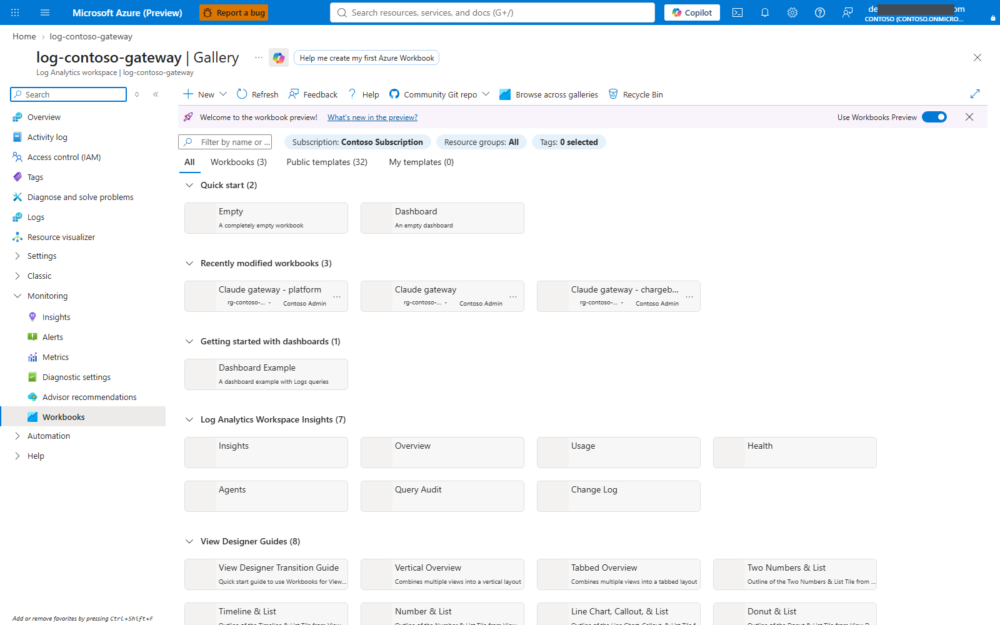

### Step 14.1 - Inspect the local report, not the gateway policy

Open `chargeback.workbook.json` privately in the editor. It should contain
`"version": "Notebook/1.0"` and the complete report `items`, not an empty notebook.
Check the intended workspace/APIM bindings, group mappings, report parameters
and model-family/token-category panels.

**Read-only CLI check:**

```powershell
& {
  $ErrorActionPreference = 'Stop'
  $path = Join-Path $out 'chargeback.workbook.json'
  $report = Get-Content -LiteralPath $path -Raw | ConvertFrom-Json -AsHashtable -Depth 100
  if ($report.version -cne 'Notebook/1.0' -or @($report.items).Count -lt 10) {
    throw 'Report is missing/incomplete. Do not publish an empty workbook shell.'
  }
  "Report present: $((Get-Item $path).Length) bytes; items=$(@($report.items).Count)"
}
```

Expected: report present with the full layout. File existence alone is not a
content-integrity or query-success test. Before the UI route, compare the report's
approved build hash/content with the generated report parameters, not merely a
different `render.json` hash from the gateway policy. The CLI route below performs
an exact content-digest check against the notebook file it will publish.

### Step 14.2 - If the report build failed, rebuild only reporting

Skip this if the report already built successfully and was reviewed.
For the no-Bicep manual helper, reporting inputs are
`workbook.answers.json`, `workbook.groups.json`, and the approved rate card/ledger
paths recorded in the answers. The common display-region error is fixed by
the current Discovery helper, which saves a canonical short location.

For older private values, this block resolves **either** an existing short name
or the provider display name, refusing unknown/ambiguous values. It rebuilds only
the report, so it does not overwrite an approved manual APIM client allow-list.

```powershell
& {
  $ErrorActionPreference = 'Stop'
  $answersFile = Join-Path $out 'workbook.answers.json'
  $groupsFile = Join-Path $out 'workbook.groups.json'
  $answers = Get-Content -LiteralPath $answersFile -Raw | ConvertFrom-Json -AsHashtable -Depth 100
  $text = az account list-locations --subscription $C.subscriptionId --output json
  if ($LASTEXITCODE -ne 0) { throw 'Cannot read approved subscription locations.' }
  $locations = ($text -join "`n") | ConvertFrom-Json
  $match = @($locations | Where-Object {
    $_.name -ieq $answers.location -or $_.displayName -ieq $answers.location -or $_.regionalDisplayName -ieq $answers.location
  } | Select-Object -ExpandProperty name -Unique)
  if ($match.Count -ne 1) { throw 'Region is not an unambiguous provider location. Inspect the answers privately.' }
  $answers.location = $match[0]
  Save-CcofJson $answers $answersFile
  Push-Location $out
  try {
    node (Join-Path $repo 'analytics/workbooks/chargeback.ts') --answers $answersFile --groups $groupsFile
    if ($LASTEXITCODE -ne 0) { throw 'Reporting build refused the input. Inspect the field/detail code; do not publish partial output.' }
    Copy-Item (Join-Path $out '.env.public-workbook/workbook.json') (Join-Path $out 'chargeback.workbook.json') -Force
  } finally { Pop-Location }
}
```

Expected: `ccof.chargeback.build.v1`, `outcome=validated`. The full builder retains
unknown/unpriced usage rather than inventing zero cost. A location error is not
evidence that Fable or another admitted model caused the failure.
The form-based Portal exporter uses its own `.env.qs-workbook` output; follow
its recorded artifact paths instead of mixing those with the no-Bicep helper.

### Step 14.3 - UI route: save the whole notebook

1. Portal > intended **Log Analytics workspace > Workbooks**.
2. Choose **New** / the **Empty** workbook, then **Edit**.
3. Open **Advanced Editor** (`</>`). Select the notebook/gallery JSON editor,
   not a single query tile's KQL editor or an ARM-template editor.
4. Back up any existing notebook JSON before replacing it.
5. Paste the **entire** reviewed `chargeback.workbook.json`.
6. Choose **Apply > Done editing > Save**.
7. Use the approved display name, resource group and location. Record the
   **actual saved workbook Resource ID** from its resource/JSON view.
8. Store that ID privately as `$out/saved-workbook-id.txt`.

Do not paste `gateway-config.json`, `render.json`, a deployment parameters
wrapper, or only `items[0]`. Saving a named empty shell is not completing this step.
Portal labels vary by workbook preview version; follow the actions, not a
historical screenshot's exact placement.

**Capture boundary:** no current Advanced Editor/Save screenshot is available.
The real gallery reference above is deliberately not labelled as one.

### Step 14.4 - CLI alternative: first save one shared workbook

Choose this **instead of** 14.3 for first creation. Do not create a second workbook
after a successful Portal save. This block records a new GUID before the write;
after any error, keep the record, inspect the actual resource and do not generate
another GUID just to retry.

If `saved-workbook-id.txt` already exists, verify that resource using 14.5.
For intentional updates, use the existing resource/ID with a private content
backup and the customer's change process; this first-create block refuses.

```powershell
& {
  $ErrorActionPreference = 'Stop'
  $record = Join-Path $out 'saved-workbook-id.txt'
  if (Test-Path -LiteralPath $record) { throw 'Workbook ID already recorded. Verify/update that resource; do not create another.' }
  $raw = Get-Content (Join-Path $out 'chargeback.workbook.json') -Raw
  $content = $raw | ConvertFrom-Json -AsHashtable -Depth 100
  if ($content.version -cne 'Notebook/1.0' -or @($content.items).Count -lt 10) { throw 'Complete notebook content required.' }
  if ($C.apps.resolver.location -cnotmatch '^[a-z][a-z0-9]+$') { throw 'Use a verified short region name.' }
  $parametersFile = Join-Path $out '.env.public-workbook/parameters.json'
  node (Join-Path $repo 'analytics/workbooks/chargeback.ts') --verify $parametersFile
  if ($LASTEXITCODE -ne 0) { throw 'Generated report parameters/content digest not verified.' }
  $parameters = (Get-Content $parametersFile -Raw | ConvertFrom-Json -AsHashtable -Depth 100).parameters
  if ($parameters.workspaceResourceId.value -ine $C.workspaceResourceId) { throw 'Report parameters belong to another workspace.' }
  $parameters.workbookContent.value = $content
  $publishCheck = Join-Path $out 'workbook-publish-verification.json'
  Save-CcofJson @{parameters=$parameters} $publishCheck
  node (Join-Path $repo 'analytics/workbooks/chargeback.ts') --verify $publishCheck
  if ($LASTEXITCODE -ne 0) { throw 'The actual notebook file differs from its approved content digest. Stop before any workbook write.' }
  $workbookGuid = [guid]::NewGuid().ToString()
  $workbookId = "/subscriptions/$($C.subscriptionId)/resourceGroups/$($C.resourceGroup)/providers/Microsoft.Insights/workbooks/$workbookGuid"
  Save-CcofJson @{location=$C.apps.resolver.location;kind='shared';tags=$parameters.contentTags.value;properties=@{
    displayName='Claude gateway chargeback';category='workbook';sourceId=$C.workspaceResourceId;serializedData=$raw
  }} (Join-Path $out 'workbook-save.json')
  Set-Content -LiteralPath $record -Value $workbookId -Encoding utf8NoBOM
  $armToken = az account get-access-token --subscription $C.subscriptionId --resource 'https://management.azure.com/' --query accessToken --output tsv
  if ($LASTEXITCODE -ne 0 -or -not $armToken) { throw 'ARM token acquisition failed. Keep the workbook ID record.' }
  $body = Get-Content (Join-Path $out 'workbook-save.json') -Raw
  try {
    Invoke-RestMethod -Method Put -Uri "https://management.azure.com$workbookId`?api-version=2022-04-01" -Headers @{Authorization="Bearer $armToken"} -ContentType 'application/json' -Body ([Text.Encoding]::UTF8.GetBytes($body)) | Out-Null
  } finally { $armToken = $null }
  "Workbook write returned. Verify the recorded resource: $workbookId"
}
```

This is one workbook ARM write, not Bicep or a core infrastructure redeployment.
No token is printed or stored. For an existing workbook, a transport timeout is
not proof that nothing changed; read back before retrying.

### Step 14.5 - Verify the saved resource and content

UI: reopen the **actual saved resource** > Workbook. Check its title/source
workspace and the complete panel layout. Do not silently switch to another
workbook with the same display name.

**Read-only CLI verification:**

```powershell
& {
  $ErrorActionPreference = 'Stop'
  $workbookId = (Get-Content (Join-Path $out 'saved-workbook-id.txt') -Raw).Trim()
  $token = az account get-access-token --subscription $C.subscriptionId --resource 'https://management.azure.com/' --query accessToken --output tsv
  if ($LASTEXITCODE -ne 0 -or -not $token) { throw 'No authorized ARM token.' }
  try { $saved = Invoke-RestMethod -Method Get -Uri "https://management.azure.com$workbookId`?api-version=2022-04-01" -Headers @{Authorization="Bearer $token"} }
  finally { $token = $null }
  $notebook = $saved.properties.serializedData | ConvertFrom-Json -AsHashtable -Depth 100
  if ($saved.properties.sourceId -ine $C.workspaceResourceId -or $notebook.version -cne 'Notebook/1.0' -or @($notebook.items).Count -lt 10) {
    throw 'Wrong workspace or incomplete saved content. Do not call this report deployed.'
  }
  "Saved workbook content verified; display name: $($saved.properties.displayName)"
}
```

This is content/resource verification. Actual report queries still need 14.8.

### Step 14.6 - Grant Workbook Reader to one approved principal

UI: actual workbook resource > **Access control (IAM) > Add role assignment >
Workbook Reader > Members** > select the approved Entra group/user > review scope.
One assignment at a time; use PIM if the customer's role-assignment policy requires it.
This is Azure resource RBAC, not a Graph permission or Cosmos data role.

CLI: set the **actual principal Object ID and type**, then check existing grants.
Do not label a group as a service principal. The example type is `Group`; use
`User` or `ServicePrincipal` only when that is the approved reader.

```powershell
$workbookId = (Get-Content (Join-Path $out 'saved-workbook-id.txt') -Raw).Trim()
$readerId = 'REPLACE-approved-reader-object-guid'
$readerType = 'Group'
az role assignment list --subscription $C.subscriptionId --scope $workbookId --include-inherited --all --query "[?principalId=='$readerId'].{role:roleDefinitionName,scope:scope}" --output table
if ($LASTEXITCODE -ne 0) { throw 'Reader role lookup failed.' }
```

Only if Workbook Reader is missing and the grant is approved:

```powershell
az role assignment create --subscription $C.subscriptionId --role 'Workbook Reader' --scope $workbookId --assignee-object-id $readerId --assignee-principal-type $readerType --output none
if ($LASTEXITCODE -ne 0) { throw 'Workbook Reader grant failed; inspect before retrying.' }
```

Read back and confirm the right reader and scope. A broad administrator role on
the test operator does not prove the intended report reader's access.

### Step 14.7 - Grant that reader query access to the intended workspace

UI: workspace > **Access control (IAM) > Log Analytics Reader**, same approved
principal. It is separate from Workbook Reader. Review the data exposure:
the report's project/group selectors are filters, **not** row-level authorization.

CLI: inspect first, then grant only if missing and approved:

```powershell
az role assignment list --subscription $C.subscriptionId --scope $C.workspaceResourceId --include-inherited --all --query "[?principalId=='$readerId'].{role:roleDefinitionName,scope:scope}" --output table
if ($LASTEXITCODE -ne 0) { throw 'Workspace reader lookup failed.' }
```

```powershell
az role assignment create --subscription $C.subscriptionId --role 'Log Analytics Reader' --scope $C.workspaceResourceId --assignee-object-id $readerId --assignee-principal-type $readerType --output none
if ($LASTEXITCODE -ne 0) { throw 'Workspace Reader grant failed; inspect before retrying.' }
```

Do not use subscription-wide Contributor/Owner as a query-access shortcut.
Use customer-approved resource-context/custom access if their workspace model
requires a narrower alternative; verify the real reader experience either way.

### Step 14.8 - Verify ingestion, report semantics and reader experience

Open the report as the approved reader, not only as the administrator.
After an approved short inference request, use workspace Logs to inspect each
intended table and actual correlation. A fuzzy union can omit missing tables;
its success is not proof that every source exists.

```kusto
union isfuzzy=true ApiManagementGatewayLogs, ApiManagementGatewayLlmLog, FunctionAppLogs
| where TimeGenerated > ago(1h)
| summarize Rows=count(), LastSeen=max(TimeGenerated) by Type
```

Expected observations:

- Intended gateway/function records match the tested project, backend and model
  family; investigate missing tables or source filters rather than assuming zero spend.
- Report selectors work; group attribution uses stable IDs plus appropriate
  historical snapshots. Today's group membership must not rewrite older spend.
- Input, output, cache read, cache write 5m and cache write 1h are distinct.
  Missing cache/stream categories remain unknown, not invented zero.
- Unknown aliases/prices/regions appear **unpriced**. Do not add made-up rates
  just to make an empty or partially priced report look complete.
- No prompt/response bodies, bearer tokens, storage keys or client secrets in
  diagnostic payloads. Follow the customer's identity/retention policy.
- Empty/no-data can be a legitimate pre-traffic state, but is **not chargeback acceptance**.

**Gate:** saved complete content + approved reader access + correlated observations
and explicit completeness/unpriced behavior. This is versioned list-price reporting,
not an Azure/Marketplace settled invoice or an instantaneous dollar ceiling.

### Step 14.9 - Reporting rollback

Keep the saved workbook ID and private JSON backups. For a bad content update,
restore the previous complete notebook to **that same workbook** after approval.
For mistaken reader grants, record assignment IDs and remove **only the new
approved-to-revoke assignments**, not all assignments for that reader.
Do not delete usage logs or unrelated customer workbooks to clear a report error.
No financial budget enforcement is enabled or disabled by this module.

---

## 15. Optional budget-state enforcement - separately approved

**Default:** `RESOLVER_BUDGET_ENFORCEMENT=token-limits-only` and
`AzureWebJobs.reconcileBudgets.Disabled=true`. Remaining in that mode is an
explicit supported finish for the basic public path.
Seeded dollar amounts alone do not enforce dollars. An 80/20 blended-token
estimate cannot guarantee a spend ceiling; output, cache, geography, model mix,
discounts and delayed observations change costs.

The reconciler settings screenshot shows the **location of setting names with
values hidden**. It does not prove the timer is enabled, state exists, or money
enforcement has passed.

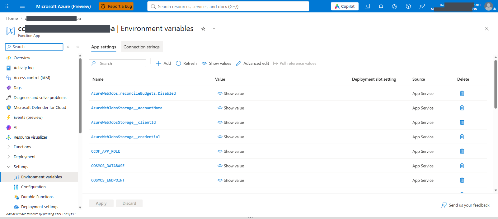

### Step 15.1 - Obtain the explicit budget-mode approval

Record approved project/classifications, period/currency, person and pooled
budgets, rate card and contract schedule versions, permitted unpriced/partial
behavior, ingestion/reconciliation lag, grace/hard-stale windows and rollback owner.
Do not copy example financial numbers or advertise token counters as a dollar guarantee.
If these decisions or usage evidence are missing, **skip activation**, leave the
timer disabled and resolver in token-only mode.

### Step 15.2 - Verify package, access and telemetry before enabling anything

UI: reconciler > **Functions** shows `reconcileBudgets` Disabled; Environment
variables identify the intended UAMI, workspace customer-ID GUID and gateway ARM ID.
The package includes the reviewed `config/rate-card.json`,
`config/contract-schedule.json`, ledger query and reconciler main file.
Use the corrected package builder; do not change pricing assets only in an editor
without rebuilding/publishing the package that actually loads them.

Read-only function check:

```powershell
az functionapp function list --subscription $C.subscriptionId -g $C.resourceGroup -n $C.apps.reconciler.name --query '[].name' --output tsv
if ($LASTEXITCODE -ne 0) { throw 'Cannot read reconciler handler registration.' }
```

Verify its existing scoped Cosmos budget/lease writes and Log Analytics Reader
role. Confirm actual current-month usage fields and pricing completeness.
The workspace setting must be a **workspace GUID**, not the workspace ARM ID.
The gateway setting must be **APIM's ARM ID**, not its URL or managed-identity ID.

### Step 15.3 - Enable only the reconciler timer

UI: reconciler > Environment variables > change exactly
`AzureWebJobs.reconcileBudgets.Disabled` to `false` > Apply. Keep seed payload
absent and `registrySeed` disabled; do not toggle unrelated settings.

CLI alternative (one app setting):

```powershell
az functionapp config appsettings set --subscription $C.subscriptionId -g $C.resourceGroup -n $C.apps.reconciler.name --settings 'AzureWebJobs.reconcileBudgets.Disabled=false' --output none
if ($LASTEXITCODE -ne 0) { throw 'Timer setting write failed; inspect live state.' }
```

The resolver remains in **token-limits-only** until actual state production is verified.

### Step 15.4 - Verify an actual reconciliation and fresh state

Workspace Logs:

```kusto
FunctionAppLogs
| where TimeGenerated > ago(1h)
| where Message contains "ccof.reconciler.run.v1"
| extend Run=parse_json(Message)
| project TimeGenerated, Outcome=tostring(Run.outcome), StatesWritten=tolong(Run.statesWritten),
          ComputedAt=tostring(Run.computedAt), ValidUntil=tostring(Run.validUntil), Message
| order by TimeGenerated desc
```

The implementation's successful run outcome is **`written`**, not `succeeded`.
`skipped_lease_held`, `failed` and `settings_invalid` are not successful state
production. Inspect exact state counts and any partial/unpriced reasons.
An authorized data reader verifies intended items in `budgetState` and
`aggregateBudgetState`: correct person/scope/project, current monthly period,
`computedAt`, `validUntil`, currency, amounts and completeness/freshness.
Do not infer item data from ARM container metadata, or grant the operator broad
write/key access merely to inspect it.

### Step 15.5 - Switch resolver mode only after 15.4 passes

UI: resolver > Environment variables, merge/update the following three settings:

| Setting | Example only - requires approval |
|---|---|
| `RESOLVER_BUDGET_ENFORCEMENT` | `budget-state` |
| `RESOLVER_BUDGET_STATE_GRACE_SECONDS` | `900` |
| `RESOLVER_BUDGET_STATE_HARD_LIMIT_SECONDS` | `3600` |

CLI equivalent:

```powershell
az functionapp config appsettings set --subscription $C.subscriptionId -g $C.resourceGroup -n $C.apps.resolver.name --settings 'RESOLVER_BUDGET_ENFORCEMENT=budget-state' 'RESOLVER_BUDGET_STATE_GRACE_SECONDS=900' 'RESOLVER_BUDGET_STATE_HARD_LIMIT_SECONDS=3600' --output none
if ($LASTEXITCODE -ne 0) { throw 'Resolver mode write failed; inspect live state.' }
```

Read back the exact three values, without printing unrelated secrets. Fresh,
degraded and hard-stale behavior and the gateway cache must be tested using a
separately approved test project. A settings read-back is not those tests.
Reconciliation/caching and in-flight requests can allow overshoot; do not call this
a hard, instantaneous dollar-spend guarantee.

### Step 15.6 - Roll back in the safe order if budget acceptance fails

After approval, **first** return the resolver to token-only mode; then disable
the reconciler timer. Disabling the timer while leaving the resolver dependent
on budget state can produce stale-state failures.

```powershell
az functionapp config appsettings set --subscription $C.subscriptionId -g $C.resourceGroup -n $C.apps.resolver.name --settings 'RESOLVER_BUDGET_ENFORCEMENT=token-limits-only' --output none
if ($LASTEXITCODE -ne 0) { throw 'Resolver rollback failed. Stop before disabling reconciliation.' }
az functionapp config appsettings set --subscription $C.subscriptionId -g $C.resourceGroup -n $C.apps.reconciler.name --settings 'AzureWebJobs.reconcileBudgets.Disabled=true' --output none
if ($LASTEXITCODE -ne 0) { throw 'Reconciler rollback setting not verified.' }
```

Read back both settings and repeat approved admission tests after the relevant
cache window. This intentionally removes monetary-state checks; token
limits remain. Do not delete budget documents or historical telemetry.
Urgent cache-key changes require their own reviewed rollout, not arbitrary
editing of a live registry item.

---

## 16. Customer-owned private networking, cutover and handoff

**Why:** a successful public path does not prove private routing/DNS.
The network owner supplies and approves every VNet, subnet, NSG, route, endpoint,
zone and publishing path. Do not invent their address ranges or modify their
network to make a screenshot look complete. Conditional Access, API authorization
and private routing are different controls; preserve all of them.

The screenshots are historical form/inventory references. They are **not** proof
that the current APIM tier has VNet integration or the customer's private path works.

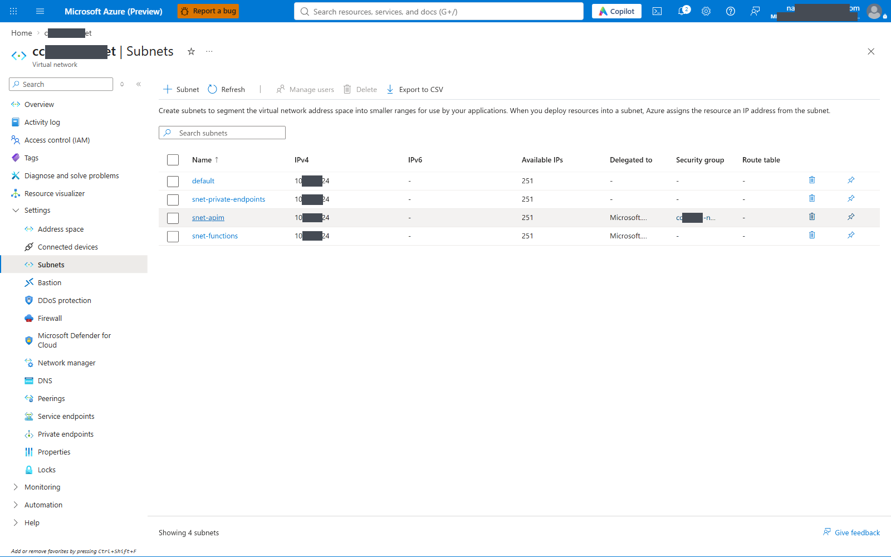

### Step 16.1 - Complete the approved network intake

Have the customer network owner fill `network-inputs.example.json` privately.
Use actual Resource IDs, not display names or proposed subnet ranges.

| Area | Owner must provide / approve |
|---|---|
| Ownership | Team, change ID, maintenance window, rollback owner |
| Actual callers | APIM outbound caller VNet/subnet and each Flex app integration subnet; peering/hub/custom-DNS design |
| Flex delegation | `Microsoft.App/environments`, with the approved subnet capacity/egress plan |
| APIM feature | Exact SKU and supported **outbound integration** configuration; Standard v2 outbound integration is not inbound private endpoint or legacy VNet injection |
| Endpoint NICs | Approved PE subnet, target/subresource and approval owner for Cosmos SQL, each blob store, optionally resolver/Foundry |
| DNS | Actual zones, VNet links/forwarders and resolver ownership; optional targets use `null` when not part of the plan |
| Egress | Approved NSGs/firewall/UDRs/NAT for identity, Graph, Monitor/Insights/LAW, storage, Cosmos and Foundry |
| Publishing | Approved VPN-connected workstation, VNet-connected Cloud Shell or build agent able to publish to private deployment storage; no runner VM assumed |
| Cutover | Per-resource order, tests and rollback; do not close every endpoint at once |

Basic v2 is not the Standard v2 private-outbound integration path used here.
If the chosen tier cannot reach private targets, stop and resolve that architecture
decision with the service owner; the existence of a VNet or PE is not a solution.

### Step 16.2 - Read the supplied resources without changing them

UI: approved VNet > Subnets > inspect delegation, NSG and route table.
Record whether approved egress comes from explicit NAT/firewall routing or
another customer-supported arrangement; do not assume a new subnet has internet egress.

CLI checks:

```powershell
& {
  $ErrorActionPreference = 'Stop'
  $path = Join-Path $out 'network-inputs.json'
  $text = Get-Content -LiteralPath $path -Raw
  if ($text -match 'REPLACE-') { throw 'Network intake is incomplete; ask the owner.' }
  $N = $text | ConvertFrom-Json -AsHashtable -Depth 30
  $ids = @($N.functionSubnetIds.Values) + @($N.privateEndpointSubnetId) + @($N.privateDnsZoneIds.Values)
  foreach ($id in @($ids | Where-Object { $null -ne $_ } | Sort-Object -Unique)) {
    if ($id -notmatch '^/subscriptions/') { throw 'A supplied network value is not a resource ID. Use null only for approved optional resources.' }
    az resource show --ids $id --query '{name:name,type:type}' --output json
    if ($LASTEXITCODE -ne 0) { throw 'Resource not found or no read access. Do not create a replacement.' }
  }
  foreach ($id in @($N.functionSubnetIds.Values | Sort-Object -Unique)) {
    az network vnet subnet show --ids $id --query '{prefix:not_null(addressPrefix,addressPrefixes[0]),delegations:delegations[].serviceName,nsg:networkSecurityGroup.id,routeTable:routeTable.id,defaultOutbound:defaultOutboundAccess}' --output json
    if ($LASTEXITCODE -ne 0) { throw 'Subnet read failed.' }
  }
}
```

The address-prefix fallback supports current array-based ARM responses.
A setting read does not prove traffic traverses that route.

### Step 16.3 - Owner performs one approved network change at a time

UI surfaces:

- Function App > **Networking > Outbound traffic > VNet integration**: the approved
  Flex subnet. Do not confuse this with the app's inbound private endpoint.
- APIM > **Network / Virtual network**: the chosen tier's actual supported outbound
  integration; preserve gateway ingress and all authentication policy.
- Cosmos / each Storage account > **Networking > Private endpoint connections**:
  approved target/subresource and connection state. Deploying a PE without approval
  or routing does not establish connectivity.
- Private DNS zone > **Virtual network links / Recordsets**, or the customer's
  designated forwarder/resolver. VNet peering alone does not share private DNS.

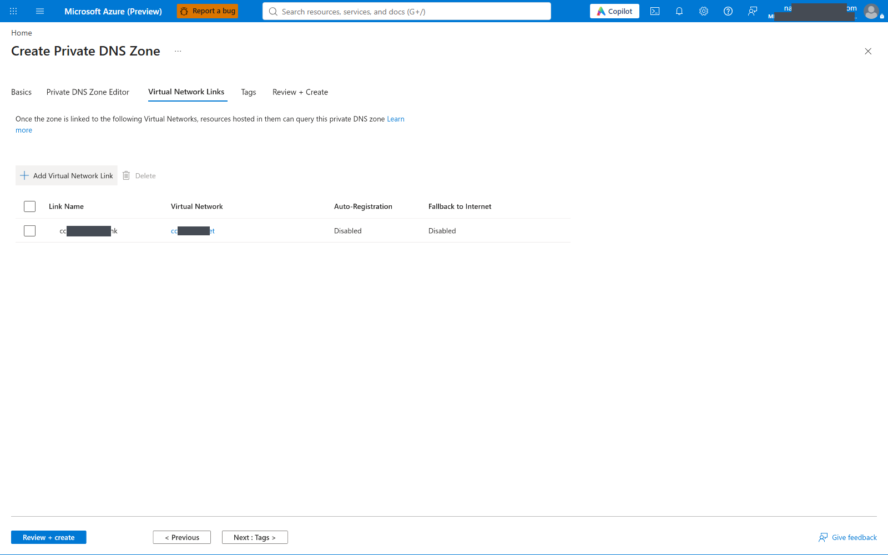

Typical namespaces are `privatelink.documents.azure.com` and
`privatelink.blob.core.windows.net`; optional resolver `privatelink.azurewebsites.net`;
Foundry may require `privatelink.services.ai.azure.com`,
`privatelink.cognitiveservices.azure.com` and/or `privatelink.openai.azure.com`.
Use the **actual endpoint's DNS configuration**, not a guessed blanket list.
The customer owns record/zone/link creation and forwarding approval.

### Step 16.4 - Verify service attachments and the actual caller's DNS/route

Read-only Function App attachment check:

```powershell
foreach ($app in 'resolver','sync','reconciler') {
  az resource show --ids $C.apps[$app].id --api-version 2024-04-01 --query '{name:name,outboundSubnet:properties.virtualNetworkSubnetId}' --output json
  if ($LASTEXITCODE -ne 0) { throw 'Function integration metadata read failed.' }
}
```

Then validate resolution and TLS/traffic from **the actual caller's approved
network path**. A normal Cloud Shell control-plane read is not a private data-plane
test. Do not assume Flex has a Kudu/SCM shell. Use supported networking diagnostics,
an approved equivalent routed probe host and the Function App's own successful
dependency logs. Confirm actual APIM-to-resolver and APIM-to-Foundry reachability
and Function-to-Cosmos/blob reachability.

Examples from an approved Windows probe host, with real target FQDNs substituted:

```powershell
Resolve-DnsName 'REPLACE-cosmos-account.documents.azure.com'
Test-NetConnection 'REPLACE-cosmos-account.documents.azure.com' -Port 443
Resolve-DnsName 'REPLACE-deployment-storage.blob.core.windows.net'
Test-NetConnection 'REPLACE-deployment-storage.blob.core.windows.net' -Port 443
```

A reachable TCP port alone does not prove identity authorization or successful
SQL/blob access. Require approved private address answers where intended,
correct endpoint approval, successful app dependency traffic and repeatable publishing.
Never turn keys/local auth back on or disable TLS verification to pass the test.

### Step 16.5 - Cut over public access one resource at a time

Keep the public path working until its replacement is proven. Under the customer's
change process, close public access for **one** resource, then rerun the unchanged
Module 13 authorized and negative tests before closing the next.
Maintain seed cleanup, Graph permissions and exact project/backend mappings.
The approved private publishing path must work before closing the final deployment
storage ingress. Network restrictions complement APIM JWT/EasyAuth; they never replace them.

**Gate:** DNS/routing/PE state, real app traffic, client access, publishing,
authorization/negative cases and required telemetry all pass at each stage.
A private IP or green deployment status is not acceptance.

### Step 16.6 - Rollback and operations handoff

If a cutover fails, the customer rolls back only that approved change to the
recorded previous exposure/routing state. Leave authentication, data roles and
quota policy intact. Do not enable anonymous access or account keys as rollback.

Record: approved network Resource IDs and DNS owners, saved workbook ID and reader
scopes, deployed package hashes, policy revision/configuration ID, approved
client method, successful test correlations, timer states, remaining permission/
capture gaps and change owner. Keep identifiers and evidence private.
Public screenshots retain only identifier prefixes/suffixes; they are navigation
references, not customer acceptance records. Financial/membership-refresh/cache
behavior and private networking need explicit operations sign-off.

---

## Troubleshooting and rollback - scope to the failed step

| Symptom | Required next check / safe alternative |
|---|---|
| CLI says OK but prior helper printed failure | Earlier chat Grant/CAssign wrappers did not check exit codes. Use this bundle's checked helpers and live read-back. |
| Missing/wrong app name | List resources and correct private input; don't create another app accidentally. |
| Cosmos `Owner resource does not exist` | Explicit account and database ID `registry`; never select the first account or assume `ccof`. |
| Native Cosmos 403 | Exact identity, narrow native role/scopes, propagation and network; Azure IAM Owner is not item access. |
| Graph 403 | Three exact application grants, active consent approval, cached MI tokens; keep sync disabled. |
| Insights query denied/no traces | Operator read permission, telemetry MI grant/settings, linked workspace, ingestion delay; Portal Logs is the alternate read path. |
| Resolver anonymous 200 | Authentication not properly required; stop before public use. |
| APIM caller gets resolver 403 | Resolver audience and both APIM allow-lists; don't empty either list. |
| ZIP upload success but no handlers | Role/package root, CCOF_APP_ROLE, storage auth, host logs, trigger startup/sync. No blanket auth/key weakening. |
| App works but logs absent | Resource diagnostics AND API diagnostics, logger/categories, sampling/body settings and correct workspace. |
| Seed differs/refused/partial | Cleanup seed controls, inspect exact result, approved update/onboarding for changed records. No delete/recreate shortcut. |
| Missing runtime entitlement | Actual sync outcome, group membership/account state, registry validity and freshness. |
| Workbook "unpriced" | Match deployed alias to approved price card through reviewed price mapping; never label unknown usage free. |
| Deployment timeout/disconnect | Read deployment/settings/roles before retry; clean up seed via Portal if active. |

**Rollback:** retain pre-change app settings/auth/API policy and reviewed ZIPs.
Restore only the settings names changed in the failed step, preserving unrelated
customer settings. Re-upload only the previous app ZIP if needed.
Record assignment IDs created during this run; remove only those IDs after
approval, never all roles for an identity. No Cosmos item deletion rollback is
provided because the seed is create-only; data corrections require an approved
data-update decision. Mandatory seed disable/payload cleanup is not optional.

## Bundle contents and source references

| Local file | Purpose |
|---|---|
| `PUBLIC-ACCESS-WORKBOOK.md` | This numbered Portal/CLI workbook |
| `Session-Helpers.ps1` | Checked read/write wrappers, exact discovery, narrow per-change roles, local settings and verification |
| `customer-inputs.example.json` | Names/IDs only; no Bicep form |
| `registry.example.json` | Exact project/backend item shape; example limits need approval |
| `routing.example.json` | Explicit backend endpoint/account and per-deployment geography |
| `Validate-Registry.mjs` | Exact runtime seed validation with fake in-memory storage; no Azure |
| `Build-LocalArtifacts.ps1` | Offline policy/seed/full chargeback artifacts, using existing renderer/workbook builder |

Repository mechanisms used: `scripts/portal/Build-PortalPackage.ps1`,
`infra/poc/resolver-auth.ps1`, `infra/quickstart/Grant-SyncGraphPermissions.ps1`
(explicit principal and one permission per call, no infrastructure deploy),
`infra/gateway/render.ts`, `src/sync/registry-seed.ts`,
`analytics/workbooks/chargeback.ts`, `infra/quickstart/modules/app-settings.bicep`
and `cosmos-data.bicep` as **read-only source references**, not executed templates.

---

<!-- ADMIN-HAND-CONFIG-APPENDIX-START -->

<a id="admin-hand-configuration"></a>

## Appended hand-configuration modules - continue without changing Modules 00-16

**Added after the original workbook. Do not restart or repeat completed modules.**
The original Step 13 client/helper code and Modules 00-16 above remain unchanged.
Module 17 consolidates the client completion checks and the native Desktop route.
Modules 18-24 add the **separate** admin console/API at the end of the same workbook.

**Different scope from the original workbook:** these optional modules create new admin resources
by hand, one resource at a time. They do not run Bicep/Quickstart, redeploy the three existing
Functions, change their settings/identities/permissions, or edit the existing APIM APIs/policy.
They do add a Cosmos native role/assignment and a new private-endpoint connection on the
existing account after separate approval. Preserve the existing Cosmos public-access setting:
if already Disabled, it stays Disabled; if the customer is still in the public phase,
do not disable it as part of this admin installation. Coordinate its cutover through Module 16.
Do not modify the existing CCOF VNet or DNS zone to follow this route.

**Use Cloud Shell PowerShell 7**, as in Module 00. All blocks below are PowerShell unless
explicitly labelled otherwise. Run one numbered step, then its **Check**, before continuing.
**Path A** is Portal; **Path B** is the checked CLI alternative. Choose one path per change.
Some operations (native Cosmos custom roles and local packaging) have no equivalent Portal
control; these are explicitly labelled exceptions, not reasons to grant broad access.

**If the admin app/resources already exist:** inspect that numbered step, compare every relevant
value, then record **already present - verified** and skip its create command. Do not PUT an
existing app/VNet/storage/registration to force it to match the example. Resume at the first
missing approved item. A mismatched resource is a stop for review, not permission to overwrite.

| Added module | Finish condition |
|---|---|
| 17 | Step 13 client completion, including Desktop, understood and verified independently |
| 18 | Approved admin inventory; new group/network/storage/plan/Function/log resources read back |
| 19 | New storage/monitoring grants and private deployment-storage path verified |
| 20 | Separate admin Entra registration, scope, roles and SPA sign-in configured; no Graph consent |
| 21 | Admin-only app settings, reviewed ZIP and console routes verified |
| 22 | Admin identity's Cosmos native role and container-only assignment verified |
| 23 | Dedicated admin Cosmos private endpoint, private DNS and in-app point-read verified |
| 24 | STD/PRM/CYB UI, approved data tests, access restrictions and operations handoff verified |

**Optional faster path, only if cloning is approved:** [admin quick modular stages](../ADMIN-QUICK-STAGES.md). Keep the numbered Portal-first steps below when a clone or template is not permitted. The faster path does not bypass private-storage or Cosmos-network requirements.

**Acceptance boundary:** a ready health probe proves a point read from the Function App.
It does not prove list/create/replace, audit delivery, membership projection or inference.
The developer UI/API client never connects to Cosmos; all registry writes happen in the
**admin Function App using its own managed identity**. Entra group lookup is not part of
this API/UI: paste the group's Object ID from Entra manually.

## 17. Step 13 completion addendum - CLI, VS Code and Claude Desktop

### Step 17.1 - Reuse the existing Step 13 files, not a second installation

**Path A:** continue **13.0-13.7** above with the customer's already reviewed
`client-config.json`, gateway URL, project ID and deployment aliases.
The complete CMD/MJS source stays in **13.A-refresh / 13.B-source**; no repository
clone or downloaded installer is required on a developer machine.

**Path B:** use exactly the chosen commands printed in Step 13, not a new configuration
script. Route A is interactive Azure CLI; Route B is the original interactive helper.
Do not silently switch the OAuth client or repeat APIM/consent changes if already approved.

**Check:** same tenant, gateway audience, scope, allowed client and `x-ccof-project`.
The UI's admin registration in Module 20 is **not** the developer/gateway registration.
Group codes STD/PRM/CYB are classifications, not the project-header value.

### Step 17.2 - Verify CLI and VS Code separately

**Path A:** in VS Code, inspect the existing user settings from **13.4**; keep the
approved gateway environment and helper path. Fully reload VS Code after changes.
In the separate terminal, launch Claude Code using **13.7**.

**Path B:** rerun the single approved short-request check from **13.6** only when
its token/session is valid. A successful curl request does not prove either client.

**Check:** a real Claude Code reply and a real VS Code extension reply, each on the
intended model/project with telemetry correlation. Do not paste session tokens into settings.

### Step 17.3 - Desktop: inspect the supported configuration interface

**Path A:** Claude Desktop > Help/About: record the installed version. If permitted,
Help > Troubleshooting > Enable Developer Mode, then
**Developer > Configure Third-Party Inference**. A managed/read-only profile must
be changed through the desktop administrator; do not remove policy to unlock it.

**Path B:** if the interface is missing, use the installed-schema inspection approach
already described in the local Step 13 Desktop edition, or obtain the approved build
through IT. Do not write guessed registry/profile keys or install an unrelated build.

**Check:** the actual build supports either legacy `interactive` + `inferenceGatewayOidc`
or newer `external-idp` + `inferenceIdpOidc`. Do not mix those key sets.
This is **Claude Desktop**, not VS Code or Claude Code.

### Step 17.4 - Desktop: verify its native sign-in registration

**Path A:** Entra > the **existing gateway/user-sign-in app** > Authentication.
For browser-based native Desktop OIDC, verify Mobile/Desktop includes
`http://127.0.0.1/callback`; preserve all existing redirects and broker settings.
Verify the existing `access_as_user` scope. Native Desktop does not require
Azure CLI preauthorization merely because CLI uses a different route.

**Path B (read-only):**

```powershell
az ad app show --id 'REPLACE-existing-gateway-client-guid' --query '{appId:appId,publicClient:publicClient,api:api}' -o json
if ($LASTEXITCODE -ne 0) { throw 'Gateway registration read failed.' }
```

**Check:** correct app, platform and actual callback. If the editor refuses the IP-loopback
URI, have the app owner preserve its manifest and add the URI to `publicClient.redirectUris`
through the approved manifest editor; never replace the redirect list. If Conditional Access
requires broker, use the supported broker flow and its approved redirect, not a bypass.
This is a **separately approved Step 13 registration change**, not part of admin deployment.

### Step 17.5 - Desktop: enter connection, project header and admitted models

**Path A:** in the native third-party inference UI:

| Field | Value |
|---|---|
| Provider / URL / scheme | Gateway / exact existing `gatewayUrl`, ending `/anthropic`, not `/v1` / Bearer |
| Credential kind | Interactive sign-in on a legacy-key build, External identity provider only on a supporting build |
| Client ID | Existing gateway/user-sign-in app client GUID, not the admin app or resolver MI |
| Issuer | `https://login.microsoftonline.com/<tenant-guid>/v2.0` |
| Scope for the combined gateway app | `<gateway-client-guid>/access_as_user` |
| Bearer token type | **access_token**, not id_token |
| Custom headers | `{"x-ccof-project":"PROJECT01"}` with the actual project ID |
| Models | Exact deployments admitted by that person's classification; default first |

**Path B (manual profile alternative):** only if the installed build supports these
**legacy** keys, enter this complete object in its approved profile editor.
Do not replace another profile or its `_meta.json` entries:

```json
{
  "inferenceProvider": "gateway",
  "inferenceGatewayBaseUrl": "https://sample-apim.azure-api.net/anthropic",
  "inferenceGatewayAuthScheme": "bearer",
  "inferenceCredentialKind": "interactive",
  "inferenceGatewayOidcAuthFlow": "browser",
  "inferenceGatewayOidc": {
    "issuer": "https://login.microsoftonline.com/REPLACE-tenant-guid/v2.0",
    "clientId": "REPLACE-gateway-client-guid",
    "scopes": "REPLACE-gateway-client-guid/access_as_user",
    "bearerTokenType": "access_token"
  },
  "inferenceCustomHeaders": { "x-ccof-project": "PROJECT01" },
  "inferenceModels": [{ "name": "claude-sonnet-4-5" }]
}
```

For the **newer** supported schema only, replace `inferenceCredentialKind` with
`external-idp`, and use `inferenceIdpAuthFlow` / `inferenceIdpOidc` instead of the two
legacy Gateway keys. Everything else must still match the installed schema.
`%APPDATA%\Claude\claude_desktop_config.json` is **not** the inference-profile library.
Native profile types are real JSON objects/arrays, not registry string encodings.

**Check:** the chosen deployment exists and is allowed; no API key or static token.
The models listed here are examples, not permission to deploy or enable another model.

### Step 17.6 - Desktop: apply, sign in and correlate one real conversation

**Path A:** Apply Changes for the local pilot. Fully quit Desktop through its normal menu,
reopen, select the profile and sign in with the approved work account/MFA/device policy.
Send one short approved message, for example `Reply with exactly: gateway OK`.

**Path B:** where native OIDC is unsupported, use the approved helper fallback already
printed in Step 13; first perform its **interactive login**. Do not substitute a static
API key or a token copied from the terminal. A helper-backed client still needs its
own Desktop configuration and a real reply.

**Check:** actual Desktop reply plus APIM/resolver/Foundry correlation for this project.
The CLI's successful login is not Desktop acceptance. For rollback, select/restore the
previous profile without deleting other profiles, MDM settings or shared token caches.

**Client gate:** finish **13.8-13.10** for negative tests and cleanup. Nothing in
Modules 18-24 is required simply to keep those developer clients working.
References: [Desktop Gateway](https://claude.com/docs/third-party/claude-desktop/gateway),
[in-app configuration](https://claude.com/docs/third-party/claude-desktop/in-app-configuration).

### Step 17.8a - Choose the automatic Azure CLI sign-in variant

This optional variant **replaces only the four-line CMD file in 13.A-refresh** and
removes the need for a developer to type `az login`. Keep all existing Step 13
configuration until this change is approved; do not run both helpers.

**Path A:** approve Azure CLI as the delegated OAuth client, as in **13.2A/13.3A**.
This is the **existing inference gateway registration and APIM policy**, not the
new admin-console app from Module 20. No Graph lookup permission is requested.
**Path B:** record the existing tenant GUID, gateway client GUID/Application ID URI,
full `access_as_user` scope, gateway URL, project ID and admitted deployment names.

**Check:** the helper tries a cached/refreshed gateway token first. If that fails,
it attempts **one interactive Azure CLI sign-in**, then requests the token again.
On current Windows Azure CLI, the interactive UI is normally **WAM/account picker**;
on an approved browser-login configuration it is the browser. SSO can still require
account selection, MFA, device compliance or consent. Do not disable broker or CA to
force a password-free browser flow.

Claude Code's **`/login` is not wired to this CMD file**. Starting Claude Code or a
request that invokes `apiKeyHelper` triggers it. The CMD file contains the `az login
--tenant ...` command; no login command is added to the Entra application manifest.

### Step 17.8b - Authorize Azure CLI on the existing gateway API

**Path A:** Entra > App registrations > existing gateway/user-sign-in app >
**Expose an API > Authorized client applications > Add a client application**.
Enter **`04b07795-8ddb-461a-bbee-02f9e1bf7b46`**, select the enabled
**access_as_user** scope and save. Preserve original clients/scopes/redirects.
**Path B:** run the complete preserve-and-merge CLI block in **13.2A** once under
an approved application administrator. If already granted, verify and skip.

**Check:** Azure CLI's entry is bound to the gateway's actual scope GUID. Do not
replace the gateway `clientId`, add a new tenant, create another Azure CLI app, add
Graph permissions or put Azure CLI into the internal resolver's MI allow-list.

### Step 17.8c - Add Azure CLI to the existing APIM caller allow-list

**Path A:** back up the current API policy; APIM > APIs > Claude Messages >
**All operations** > inbound policy editor. Add Azure CLI's client ID to the
existing `delegatedClients` array without removing its current values:

```csharp
var delegatedClients = new string[] {
    "REPLACE-actual-existing-gateway-client-guid",
    "04b07795-8ddb-461a-bbee-02f9e1bf7b46"
};
```

**Path B:** use the complete checked API-policy edit block in **13.3A**, preserving
the policy and change/revision process. Don't replace a full policy with this fragment.

**Check:** the token audience still identifies the gateway; only the permitted caller
client list expands. Preserve issuer/tenant, scope, resolver, entitlement, model and quota
checks. Record the same approved client in `entra.delegatedClientAppIds` in the private
gateway-render config so a later regeneration does not remove it.
Neither this nor Entra preauthorization grants project membership.

### Step 17.8d - Hand-create the auto-sign-in CMD helper

**Path A:** on each approved **Windows developer machine**, confirm Azure CLI is
installed and on PATH. In Explorer create `C:\ccof-client` if needed. Back up the
previous `az-gateway-token.cmd`. Open Notepad, paste **all** code below, set the two
values and save as **All files**, name **az-gateway-token.cmd**, not `.cmd.txt`.
**Path B (read-only prerequisites, PowerShell 5.1 or 7):**

```powershell
where.exe az.cmd
if ($LASTEXITCODE -ne 0) { throw 'Azure CLI is missing from PATH. Obtain it through IT.' }
az.cmd version
if ($LASTEXITCODE -ne 0) { throw 'Azure CLI cannot run.' }
```

Complete file (same as the public example
[`az-gateway-token-auto-login.cmd`](../examples/az-gateway-token-auto-login.cmd)):

```bat
@echo off
setlocal DisableDelayedExpansion
set "TENANT=REPLACE-tenant-guid"
set "SCOPE=api://REPLACE-gateway-app-client-guid/access_as_user"
set "AZURE_CORE_LOGIN_EXPERIENCE_V2=off"
if "%TENANT:~0,8%"=="REPLACE-" (
  >&2 echo Configure the customer TENANT and SCOPE in this file first.
  exit /b 1
)
if "%SCOPE:~0,14%"=="api://REPLACE-" (
  >&2 echo Configure the gateway SCOPE in this file first.
  exit /b 1
)
where az.cmd >nul 2>nul
if errorlevel 1 (
  >&2 echo Azure CLI az.cmd is not on PATH. Contact your desktop administrator.
  exit /b 1
)
call az.cmd account get-access-token --tenant "%TENANT%" --scope "%SCOPE%" --query accessToken --output tsv --only-show-errors 2>nul
if not errorlevel 1 exit /b 0
>&2 echo Gateway token unavailable. Starting Microsoft interactive sign-in.
call az.cmd login --tenant "%TENANT%" --scope "%SCOPE%" --allow-no-subscriptions --output none --only-show-errors <nul 1>&2
if errorlevel 1 exit /b 1
call az.cmd account get-access-token --tenant "%TENANT%" --scope "%SCOPE%" --query accessToken --output tsv --only-show-errors
exit /b %errorlevel%
```

**Check:** `TENANT` is the customer's tenant; `SCOPE` is the **existing full gateway
scope**, not Azure CLI's client ID or the admin console's Projects.Manage scope.
If the exposed Application ID URI differs from `api://<guid>`, use that exact URI.
`setlocal` keeps the subscription-selector override local to this helper. It does
not change broker configuration, log out the user or clear the shared Azure cache.
Interactive login can update the user's existing Azure CLI context; coordinate if
they use the same profile for Azure administration.

Only the token goes to stdout. The initial cache-probe error is suppressed;
interactive/final errors go to stderr and return nonzero. This fallback attempts
sign-in on any failed initial acquisition, so a network/service/permission problem
can also produce one unnecessary prompt. It is not a sign-in-error classifier.
No infinite retries; token values are never written to a helper-owned file.

### Step 17.8e - Merge the Claude Code user settings

**Path A:** back up and edit **`%USERPROFILE%\.claude\settings.json`** in Notepad or
VS Code. Merge these fields, preserving unrelated keys and environment entries.
`apiKeyHelper` belongs at the top level of this file, not in VS Code User settings.
**Path B:** no installer is needed; the complete JSON fragment is:

```json
{
  "apiKeyHelper": "\"C:\\ccof-client\\az-gateway-token.cmd\"",
  "env": {
    "ANTHROPIC_BASE_URL": "https://sample-apim.azure-api.net/anthropic",
    "ANTHROPIC_CUSTOM_HEADERS": "x-ccof-project: PROJECT01",
    "ANTHROPIC_MODEL": "claude-sonnet-5",
    "ANTHROPIC_DEFAULT_SONNET_MODEL": "claude-sonnet-5",
    "ANTHROPIC_DEFAULT_OPUS_MODEL": "claude-opus-5",
    "ANTHROPIC_DEFAULT_HAIKU_MODEL": "claude-haiku-4-5",
    "CLAUDE_CODE_USE_FOUNDRY": "0",
    "CLAUDE_CODE_USE_BEDROCK": "0",
    "CLAUDE_CODE_USE_VERTEX": "0",
    "CLAUDE_CODE_USE_ANTHROPIC_AWS": "0",
    "CLAUDE_CODE_USE_MANTLE": "0",
    "CLAUDE_CODE_DISABLE_NONESSENTIAL_TRAFFIC": "1",
    "CLAUDE_CODE_API_KEY_HELPER_TTL_MS": "60000"
  }
}
```

**Check:** substitute the actual existing gateway URL/project/deployments. Do not
copy sample aliases to enable a model the project does not admit. Preserve other
required custom headers using newline-separated headers. Keep one `apiKeyHelper`.
The TTL is helper-output cache time, not token lifetime or a guarantee of silent refresh.

### Step 17.8f - Remove only old credential overrides and retain VS Code routing

**Path A:** after backup, remove this gateway route's stale `ANTHROPIC_AUTH_TOKEN`,
`ANTHROPIC_API_KEY` and `CLAUDE_CODE_OAUTH_TOKEN` values from the Claude/VS Code settings
and any customer-owned persistent environment overrides. Do not inspect or share
their values or change IT-managed settings. Keep the noncredential routing settings
in **13.4**. Leave `claudeCode.disableLoginPrompt=true`; it suppresses the irrelevant
Anthropic account prompt, not Microsoft authentication.

**Path B (current PowerShell process only):**

```powershell
Remove-Item Env:ANTHROPIC_AUTH_TOKEN -ErrorAction SilentlyContinue
Remove-Item Env:ANTHROPIC_API_KEY -ErrorAction SilentlyContinue
Remove-Item Env:CLAUDE_CODE_OAUTH_TOKEN -ErrorAction SilentlyContinue
```

**Check:** no static credential still takes precedence over the helper. A process-only
removal doesn't clear user/machine environment or a managed profile; review the correct
source with the desktop administrator. Do not run `az logout` or `az account clear`.

### Step 17.8g - Launch, allow interactive SSO, then verify each client

**Path A:** start Claude Code or send its first request. When the helper needs a token,
it starts Microsoft WAM/browser sign-in itself; the user completes the required
account/MFA/device interaction. They **do not type az login** and **do not use /login**
to invoke this helper. A valid existing CLI session can avoid showing any sign-in UI.

**Path B (actual short request; no token printed):**

```powershell
claude -p "Reply with exactly: gateway OK"
```

Fully quit/reopen VS Code through its normal menus and test a real extension
conversation separately. Native Claude Desktop remains on **17.3-17.6**, not this CLI setting.

**Check:** actual admitted-model reply, gateway route/credential source and APIM
correlation. Group membership and a successful Module 12 entitlement projection remain
mandatory. Never treat a Microsoft account picker or successful CLI login as inference acceptance.

### Step 17.8h - Handle slow SSO or failures without exposing tokens

**Path A:** if the client terminates the helper during a slow interactive sign-in,
run **the same CMD helper itself** once with stdout discarded, outside the client's
helper timeout. This still requires no user-written `az login` command. Don't assume
a failed request left a completed sign-in behind.
**Path B (PowerShell 5.1/7):**

```powershell
& 'C:\ccof-client\az-gateway-token.cmd' > $null
if ($LASTEXITCODE -ne 0) { throw 'Gateway sign-in failed. Review the Microsoft/Azure CLI error; do not bypass policy.' }
```

**Check:** login completes, helper exits 0 without displaying a token, then retry Claude.
For a managed environment, distribute an approved sign-in shortcut that calls the same
helper with stdout redirected, rather than putting an access token in a file.
The interactive UI remains subject to the installed CLI/OS/session; a headless or
blocked broker/browser environment is not verified by the mocked helper tests.

| Symptom | Step to revisit |
|---|---|
| Consent/preauthorization refusal | 17.8b / 13.2A; exact client, scope and tenant approval |
| Token obtained, gateway 401/403 | 17.8c plus JWT audience/scope/client, then entitlement/model checks |
| Repeated sign-in prompts | Exact CLI error, profile/session access, CA and failed silent refresh; don't weaken CA |
| No helper invocation | Conflicting credential source, managed settings, helper path and VS Code restart |
| Helper timeout | Complete 17.8h outside the client timeout, then retry; no guarantee of auto-retry |
| User runs /login | Explain that this is Anthropic login, not this gateway's SSO entry point |

**Rollback:** restore the previous helper/settings bytes. Restore Entra/APIM client
trust only through the separate approved **13.2A/13.3A** rollback, preserving concurrent
administrator edits. Nothing here changes a Function App or requests Graph permissions.
Sources: [Azure CLI interactive sign-in/WAM](https://learn.microsoft.com/cli/azure/authenticate-azure-cli-interactively),
[Claude Code gateway helper contract](https://code.claude.com/docs/en/llm-gateway-connect#rotate-credentials-with-apikeyhelper).
The helper's control flow is tested with mock Azure CLI; real managed-device SSO and
gateway inference require the acceptance above.

## 18. Separate admin resources - inventory and one resource per step

### Step 18.1 - Record authority and approved new names

**Path A:** change owner approves this resource list. Existing CCOF apps stay untouched.
In a fresh Cloud Shell PowerShell session, reload **only** the checked helpers and private
`$C`, `$out`, `$repo` from Modules 00-01; this is not a rerun of those modules.

**Path B (local state only):**

```powershell
$ErrorActionPreference = 'Stop'
. (Join-Path $repo 'scripts/manual/Session-Helpers.ps1')
Assert-CcofSession -C $C
$Admin = @{
  subscriptionId = $C.subscriptionId
  tenantId = $C.tenantId
  resourceGroup = 'REPLACE-new-admin-resource-group'
  networkResourceGroup = 'REPLACE-new-admin-network-resource-group'
  location = 'REPLACE-approved-region-name'
  name = 'REPLACE-globally-unique-admin-function-name'
  planName = 'REPLACE-new-admin-flex-plan'
  storageName = 'REPLACE-new-lowercase-admin-storage'
  workspaceName = 'REPLACE-new-admin-log-workspace'
  insightsName = 'REPLACE-new-admin-insights'
  vnetName = 'REPLACE-new-admin-vnet'
  addressPrefix = 'REPLACE-approved-unused-vnet-cidr'
  integrationPrefix = 'REPLACE-approved-functions-subnet-cidr'
  endpointPrefix = 'REPLACE-approved-private-endpoints-subnet-cidr'
  integrationSubnetName = 'snet-admin-functions'
  endpointSubnetName = 'snet-admin-private-endpoints'
  cosmosAccount = $C.cosmosAccount
  cosmosResourceGroup = ($C.cosmosResourceId -split '/')[4]
  cosmosResourceId = $C.cosmosResourceId
  cosmosEndpoint = $C.cosmosEndpoint
  database = $C.database
  container = 'projects'
}
if (($Admin | ConvertTo-Json) -match 'REPLACE-') { throw 'Fill the approved admin names and CIDRs first.' }
$adminOut = Join-Path $out 'admin-hand-config'
New-Item -ItemType Directory -Path $adminOut -Force | Out-Null
$Admin.rgId = "/subscriptions/$($Admin.subscriptionId)/resourceGroups/$($Admin.resourceGroup)"
$Admin.networkRgId = "/subscriptions/$($Admin.subscriptionId)/resourceGroups/$($Admin.networkResourceGroup)"
$Admin.appId = "$($Admin.rgId)/providers/Microsoft.Web/sites/$($Admin.name)"
$Admin.planId = "$($Admin.rgId)/providers/Microsoft.Web/serverfarms/$($Admin.planName)"
$Admin.storageId = "$($Admin.rgId)/providers/Microsoft.Storage/storageAccounts/$($Admin.storageName)"
$Admin.workspaceId = "$($Admin.rgId)/providers/Microsoft.OperationalInsights/workspaces/$($Admin.workspaceName)"
$Admin.insightsId = "$($Admin.rgId)/providers/Microsoft.Insights/components/$($Admin.insightsName)"
$Admin.vnetId = "$($Admin.networkRgId)/providers/Microsoft.Network/virtualNetworks/$($Admin.vnetName)"
$Admin.integrationSubnetId = "$($Admin.vnetId)/subnets/$($Admin.integrationSubnetName)"
$Admin.endpointSubnetId = "$($Admin.vnetId)/subnets/$($Admin.endpointSubnetName)"
Save-CcofJson $Admin (Join-Path $adminOut 'admin-values.private.json')
```

**Check:** database is the customer's exact existing ID, not a hardcoded `ccof`.
For the customer's earlier workbook it may be `registry`; never copy lab names.
No overlapping CIDRs; region supports Flex Consumption; both subnets sized for the
approved capacity (at least /27 for Flex; use larger if required).

| Operator permission | Why needed |
|---|---|
| Resource-group create/write and resource-provider access | New plan, app, storage, logs and network resources |
| `Microsoft.Authorization/roleAssignments/write` on **new** storage/Insights | Storage Blob Data Owner and Monitoring Metrics Publisher grants |
| Approved Entra app ownership/application admin and role-assignment authority | New admin registration, enterprise app and admin-user role |
| Cosmos `sqlRoleDefinitions/write`, `sqlRoleAssignments/write` | Native data role; ordinary Azure IAM is not item access |
| Network/Private DNS write and Cosmos PE approval authority | New endpoint, link, DNS records and account connection |

PIM/privileged administrators perform only their numbered grants; don't elevate the
Function identity to Owner/Contributor or give developers these administrator permissions.

### Step 18.2 - Create the admin resource group

**Path A:** Resource groups > Create > approved subscription/name/region.
**Path B:**

```powershell
Invoke-CcofAzWrite @('group','create','--subscription',$Admin.subscriptionId,'-n',$Admin.resourceGroup,'-l',$Admin.location)
```

**Check:** Resource groups > open exactly this group, or
`az group show -n <approved-admin-rg>`. Existing group: verify and skip create.

### Step 18.3 - Create the admin network resource group

**Path A:** repeat Resource groups > Create for the approved **network** group only.
**Path B:**

```powershell
Invoke-CcofAzWrite @('group','create','--subscription',$Admin.subscriptionId,'-n',$Admin.networkResourceGroup,'-l',$Admin.location)
```

**Check:** exact separate group; no move/delete of existing CCOF resources.

### Step 18.4 - Create the admin VNet

**Path A:** Virtual networks > Create > network resource group and region > approved
address space. Use only approved new subnets; do not select or edit the CCOF VNet.
If the wizard creates the two subnets too, verify each in 18.5/18.6 and skip their writes.
**Path B (one new VNet, no subnets yet):**

```powershell
$file = Join-Path $adminOut 'vnet.json'
Save-CcofJson @{location=$Admin.location;properties=@{addressSpace=@{addressPrefixes=@($Admin.addressPrefix)};subnets=@()}} $file
Invoke-CcofAzWrite @('rest','--method','put','--url',"https://management.azure.com$($Admin.vnetId)?api-version=2024-05-01",'--body',"@$file")
```

**Check:** VNet > Address space contains only the approved CIDR. Wait for Succeeded
before adding a subnet. Never run this empty-subnets PUT on an existing VNet.

### Step 18.5 - Create the Functions integration subnet

**Path A:** new admin VNet > Subnets > Add > approved Functions CIDR >
delegate to **Microsoft.App/environments**.
**Path B:**

```powershell
Invoke-CcofAzWrite @('network','vnet','subnet','create','--subscription',$Admin.subscriptionId,'-g',$Admin.networkResourceGroup,'--vnet-name',$Admin.vnetName,'-n',$Admin.integrationSubnetName,'--address-prefixes',$Admin.integrationPrefix,'--delegations','Microsoft.App/environments')
```

**Check:** correct prefix and delegation. No private endpoints belong in this subnet.
Do not use the App Service `Microsoft.Web/serverFarms` delegation for Flex.

### Step 18.6 - Create the private-endpoint subnet

**Path A:** same admin VNet > Subnets > Add > approved PE CIDR > no delegation.
**Path B:**

```powershell
Invoke-CcofAzWrite @('network','vnet','subnet','create','--subscription',$Admin.subscriptionId,'-g',$Admin.networkResourceGroup,'--vnet-name',$Admin.vnetName,'-n',$Admin.endpointSubnetName,'--address-prefixes',$Admin.endpointPrefix)
```

**Check:** separate from integration; enough addresses for storage and Cosmos regional IPs.
The approved NSG/route policies, if present, must allow the required private connections.

### Step 18.7 - Create the admin storage account

**Path A:** Storage accounts > Create > admin resource group > approved name/region >
Standard LRS (or approved alternative). Advanced: minimum TLS 1.2, secure transfer,
anonymous blob access off, shared-key access off. Networking: public access Disabled.
Do not use or reconfigure the existing sync/resolver/reconciler storage.
**Path B:**

```powershell
Invoke-CcofAzWrite @('storage','account','create','--subscription',$Admin.subscriptionId,'-g',$Admin.resourceGroup,'-n',$Admin.storageName,'-l',$Admin.location,'--sku','Standard_LRS','--kind','StorageV2','--https-only','true','--min-tls-version','TLS1_2','--allow-blob-public-access','false','--allow-shared-key-access','false','--public-network-access','Disabled')
```

**Check:** read the actual values; tenant policy may modify them.
Private storage cannot serve a deployment package until Module 19's path and grants exist.

### Step 18.8 - Create the deployment container

**Path A:** storage > Containers > create **app-package**, private, if the operator has
data-plane access through the private network. Ordinary Cloud Shell may not.
**Path B (ARM control plane, no keys/data access needed):**

```powershell
$file = Join-Path $adminOut 'container.json'
Save-CcofJson @{properties=@{publicAccess='None'}} $file
Invoke-CcofAzWrite @('rest','--method','put','--url',"https://management.azure.com$($Admin.storageId)/blobServices/default/containers/app-package?api-version=2024-01-01",'--body',"@$file")
```

**Check:** container exists and is not public. ARM creation does not prove the host can read it.

### Step 18.9 - Create the new Log Analytics workspace

**Path A:** Log Analytics workspaces > Create > admin group/region > approved name >
approved retention (example 30 days; change if policy requires).
**Path B:**

```powershell
$file = Join-Path $adminOut 'workspace.json'
Save-CcofJson @{location=$Admin.location;properties=@{sku=@{name='PerGB2018'};retentionInDays=30}} $file
Invoke-CcofAzWrite @('rest','--method','put','--url',"https://management.azure.com$($Admin.workspaceId)?api-version=2023-09-01",'--body',"@$file")
```

**Check:** correct retention and new workspace ID. Do not change the existing reporting workspace.

### Step 18.10 - Create workspace-based Application Insights

**Path A:** Application Insights > Create > admin group/name/region >
workspace from **18.9**. Require Entra-authenticated ingestion; do not leave local
authentication enabled just to avoid the monitoring role.
**Path B:**

```powershell
$file = Join-Path $adminOut 'insights.json'
Save-CcofJson @{location=$Admin.location;kind='web';properties=@{Application_Type='web';WorkspaceResourceId=$Admin.workspaceId;DisableLocalAuth=$true}} $file
Invoke-CcofAzWrite @('rest','--method','put','--url',"https://management.azure.com$($Admin.insightsId)?api-version=2020-02-02",'--body',"@$file")
```

**Check:** new workspace linkage and `DisableLocalAuth=true`.
Record the connection string privately for 21.2; it is not a developer token.

### Step 18.11 - Create the Flex plan

**Path A:** Function App creation may create its plan. Name it explicitly and record
the ID; do not create a second plan if that wizard already created this one.
**Path B (one plan):**

```powershell
$file = Join-Path $adminOut 'plan.json'
Save-CcofJson @{location=$Admin.location;sku=@{name='FC1';tier='FlexConsumption'};properties=@{reserved=$true}} $file
Invoke-CcofAzWrite @('rest','--method','put','--url',"https://management.azure.com$($Admin.planId)?api-version=2024-04-01",'--body',"@$file")
```

**Check:** Linux Flex Consumption FC1; not the existing apps' plans.

### Step 18.12 - Create the separate admin Function App

**Path A:** Function App > Create > **Flex Consumption**, Linux, Node 22 > approved
new app/plan/storage. Enable its **system-assigned** identity, integrate only with
18.5's subnet and choose identity-based deployment storage **app-package**.
If the wizard cannot set these exact identity-based options, stop and use Path B.
Do not accept replacement storage, shared keys or changes to an existing Function.
**Path B (one new app):**

```powershell
$file = Join-Path $adminOut 'function.json'
$storage = Invoke-CcofAzJson @('storage','account','show','--subscription',$Admin.subscriptionId,'-g',$Admin.resourceGroup,'-n',$Admin.storageName)
$deploymentUrl = "$($storage.primaryEndpoints.blob)app-package"
if (-not $storage.primaryEndpoints.blob) { throw 'Storage blob endpoint missing.' }
Save-CcofJson @{
  location=$Admin.location;kind='functionapp,linux';identity=@{type='SystemAssigned'}
  properties=@{
    serverFarmId=$Admin.planId;httpsOnly=$true;virtualNetworkSubnetId=$Admin.integrationSubnetId
    functionAppConfig=@{
      deployment=@{storage=@{type='blobContainer';value=$deploymentUrl;authentication=@{type='SystemAssignedIdentity'}}}
      runtime=@{name='node';version='22'}
      scaleAndConcurrency=@{maximumInstanceCount=40;instanceMemoryMB=2048}
    }
    siteConfig=@{minTlsVersion='1.2';ftpsState='Disabled'}
  }
} $file
Invoke-CcofAzWrite @('rest','--method','put','--url',"https://management.azure.com$($Admin.appId)?api-version=2024-04-01",'--body',"@$file")
```

**Check:** new app, HTTPS, system identity, Node 22, exact Flex storage URL/auth and admin
integration subnet. Maximum 40/memory 2048 are example capacity values requiring approval.
Do not infer host readiness from successful provisioning; identity grants follow.

### Step 18.13 - Read back the admin identity and hostname

**Path A:** admin app > Identity > System assigned: copy Object/principal ID.
Overview: record hostname. These differ from the UI app registration's client ID.
**Path B (read-only):**

```powershell
$site = Invoke-CcofAzJson @('resource','show','--ids',$Admin.appId,'--api-version','2024-04-01')
$Admin.principalId = [string]$site.identity.principalId
$Admin.hostName = [string]$site.properties.defaultHostName
if (-not $Admin.principalId -or -not $Admin.hostName) { throw 'Admin identity or hostname missing.' }
Save-CcofJson $Admin (Join-Path $adminOut 'admin-values.private.json')
```

**Check:** deployed admin identity, not any existing app's principal.

## 19. Admin storage/monitoring grants and private deployment path

### Step 19.1 - Grant Storage Blob Data Owner on the new storage only

**Path A:** new storage > Access control (IAM) > Add role assignment >
**Storage Blob Data Owner** > Managed identity > Function App > **admin app**.
**Path B:**

```powershell
Invoke-CcofAzWrite @('role','assignment','create','--subscription',$Admin.subscriptionId,'--assignee-object-id',$Admin.principalId,'--assignee-principal-type','ServicePrincipal','--role','b7e6dc6d-f1e8-4753-8033-0f276bb0955b','--scope',$Admin.storageId)
```

**Check:** principal/scope exact. Do not grant subscription Owner, Storage Account Contributor,
or roles on the old storage accounts. Allow role propagation before publishing.

### Step 19.2 - Grant Monitoring Metrics Publisher on the new Insights only

**Path A:** new Application Insights > IAM > Add >
**Monitoring Metrics Publisher** > admin Function identity.
**Path B:**

```powershell
Invoke-CcofAzWrite @('role','assignment','create','--subscription',$Admin.subscriptionId,'--assignee-object-id',$Admin.principalId,'--assignee-principal-type','ServicePrincipal','--role','3913510d-42f4-4e42-8a64-420c390055eb','--scope',$Admin.insightsId)
```

**Check:** correct new component. This permits authenticated telemetry ingestion,
not human access to read logs.

### Step 19.2a - Grant an approved human log reader on the new workspace

**Path A:** new Log Analytics workspace > IAM > Add role assignment >
**Log Analytics Reader** > approved operator/group, not the Function identity.
**Path B (one separately approved assignment):**

```powershell
$Admin.logReaderId = 'REPLACE-approved-human-or-group-object-guid'
$Admin.logReaderType = 'User'
# For an approved group, use Group, not User.
Invoke-CcofAzWrite @('role','assignment','create','--subscription',$Admin.subscriptionId,'--assignee-object-id',$Admin.logReaderId,'--assignee-principal-type',$Admin.logReaderType,'--role','Log Analytics Reader','--scope',$Admin.workspaceId)
```

**Check:** human/group reader on the new workspace only. If existing approved permissions
already supply this access, record the evidence and skip the grant.

### Step 19.2b - Grant that log reader on the new Insights component

**Path A:** new Application Insights > IAM > Add > **Monitoring Reader** >
same approved operator/group.
**Path B:**

```powershell
Invoke-CcofAzWrite @('role','assignment','create','--subscription',$Admin.subscriptionId,'--assignee-object-id',$Admin.logReaderId,'--assignee-principal-type',$Admin.logReaderType,'--role','Monitoring Reader','--scope',$Admin.insightsId)
```

**Check:** only the new component. This is human query access, not an additional runtime grant.

### Step 19.3 - Create the admin blob private DNS zone

**Path A:** Private DNS zones > Create > **admin network group** >
`privatelink.blob.core.windows.net`. Keep the existing CCOF zone separate.
**Path B:**

```powershell
Invoke-CcofAzWrite @('network','private-dns','zone','create','--subscription',$Admin.subscriptionId,'-g',$Admin.networkResourceGroup,'-n','privatelink.blob.core.windows.net')
```

**Check:** correct group and zone. If already present, compare and skip.

### Step 19.4 - Link blob DNS to the admin VNet

**Path A:** zone > Virtual network links > Add > admin VNet > auto registration Off.
**Path B:**

```powershell
Invoke-CcofAzWrite @('network','private-dns','link','vnet','create','--subscription',$Admin.subscriptionId,'-g',$Admin.networkResourceGroup,'--zone-name','privatelink.blob.core.windows.net','-n','admin-blob-link','--virtual-network',$Admin.vnetId,'--registration-enabled','false')
```

**Check:** exact VNet link; no duplicate blob zone linked to the same VNet.
If custom DNS is configured, the DNS owner must forward private-zone queries correctly.

### Step 19.5 - Create the blob private endpoint

**Path A:** Private endpoints > Create > admin network group/region >
Storage account from 18.7 > target **blob** > admin VNet > **PE subnet**.
If the wizard creates the DNS group, record it and verify/skip 19.7.
**Path B:**

```powershell
Invoke-CcofAzWrite @('network','private-endpoint','create','--subscription',$Admin.subscriptionId,'-g',$Admin.networkResourceGroup,'-n',"$($Admin.name)-blob-pe",'-l',$Admin.location,'--subnet',$Admin.endpointSubnetId,'--private-connection-resource-id',$Admin.storageId,'--group-id','blob','--connection-name',"$($Admin.name)-blob-connection")
```

**Check:** storage target and blob group, Approved connection, assigned private IPs.
Never place this endpoint in the delegated Functions subnet.

### Step 19.6 - Approve only this connection if Pending

**Path A:** **new storage** > Networking > Private endpoint connections >
select this blob connection > Approve with the change reference.
**Path B:** use the ID of this exact connection, read from its target resource:

```powershell
$blobPe = Invoke-CcofAzJson @('network','private-endpoint','show','--subscription',$Admin.subscriptionId,'-g',$Admin.networkResourceGroup,'-n',"$($Admin.name)-blob-pe")
$connections = @(Invoke-CcofAzJson @('network','private-endpoint-connection','list','--id',$Admin.storageId))
$match = @($connections | Where-Object { $_.properties.privateEndpoint.id -ieq $blobPe.id })
if ($match.Count -ne 1) { throw 'Expected exactly this storage PE connection; inspect before approving.' }
$blobStatus = $match[0].properties.privateLinkServiceConnectionState.status
if ($blobStatus -ceq 'Pending') {
  Invoke-CcofAzWrite @('network','private-endpoint-connection','approve','--id',$match[0].id,'--description','Approved separate admin storage endpoint')
} elseif ($blobStatus -cne 'Approved') { throw "Storage connection is $blobStatus; stop for review." }
```

**Check:** reread this one connection and require Approved, not just successful endpoint
creation. Do not approve all pending connections in a loop.

### Step 19.7 - Attach the blob DNS zone group

**Path A:** new PE > DNS configuration > Add configuration > select the **admin**
blob zone, not the old CCOF group.
**Path B:**

```powershell
$blobZone = Invoke-CcofAzJson @('network','private-dns','zone','show','--subscription',$Admin.subscriptionId,'-g',$Admin.networkResourceGroup,'-n','privatelink.blob.core.windows.net')
Invoke-CcofAzWrite @('network','private-endpoint','dns-zone-group','create','--subscription',$Admin.subscriptionId,'-g',$Admin.networkResourceGroup,'--endpoint-name',"$($Admin.name)-blob-pe",'-n','blob','--private-dns-zone',$blobZone.id,'--zone-name','blob')
```

**Check:** DNS zone group, storage A record and link. Do not enable public storage or shared
keys to work around a package upload 403. No queue/table endpoints are assumed by this
HTTP-only package; add only dependencies actually required by an approved future trigger.

## 20. New admin Entra app - no Graph lookup/consent

### Step 20.1 - Register the separate single-tenant admin app

**Path A:** Entra > App registrations > New registration > **CCOF Admin** >
Accounts in this organizational directory only. No client secret.
**Path B:**

```powershell
$registration = Invoke-CcofAzJson @('ad','app','create','--display-name','CCOF Admin','--sign-in-audience','AzureADMyOrg')
$Admin.clientId = $registration.appId
$Admin.applicationObjectId = $registration.id
if (-not $Admin.clientId -or -not $Admin.applicationObjectId) { throw 'Admin registration IDs missing.' }
Save-CcofJson $Admin (Join-Path $adminOut 'admin-values.private.json')
```

**Check:** new client ID and application Object ID. Never edit the developer, gateway or resolver
registration. If the new registration already exists, open its Overview or `az ad app show`
using its **exact** ID and record these fields instead of creating a duplicate by display name.

### Step 20.2 - Set the Application ID URI

**Path A:** new app > Expose an API > Application ID URI >
`api://<new-admin-client-id>`.
**Path B:**

```powershell
$file = Join-Path $adminOut 'admin-uri.json'
Save-CcofJson @{identifierUris=@("api://$($Admin.clientId)")} $file
Invoke-CcofAzWrite @('rest','--method','patch','--url',"https://graph.microsoft.com/v1.0/applications/$($Admin.applicationObjectId)",'--body',"@$file")
```

**Check:** exact URI. These are administrator Graph management calls, not Graph
permissions granted to the deployed app.

### Step 20.3 - Require v2 access tokens

**Path A:** app > Manifest (Microsoft Graph format) > set only
`api.requestedAccessTokenVersion=2`, preserving other API properties.
**Path B:**

```powershell
$file = Join-Path $adminOut 'admin-token-version.json'
Save-CcofJson @{api=@{requestedAccessTokenVersion=2}} $file
Invoke-CcofAzWrite @('rest','--method','patch','--url',"https://graph.microsoft.com/v1.0/applications/$($Admin.applicationObjectId)",'--body',"@$file")
```

**Check:** manifest value 2. `ADMIN_AUDIENCE` later uses this app's client GUID.

### Step 20.4 - Add the Projects.Manage delegated scope

**Path A:** Expose an API > Add a scope > name **Projects.Manage** >
approved consent wording and consent policy > Enabled. Record its scope ID.
**Path B (new app only; stop if scopes already exist):**

```powershell
$Admin.scopeId = [guid]::NewGuid().ToString()
$file = Join-Path $adminOut 'admin-scope.json'
Save-CcofJson @{api=@{oauth2PermissionScopes=@(@{
  id=$Admin.scopeId;value='Projects.Manage';type='Admin';isEnabled=$true
  adminConsentDisplayName='Manage CCOF projects'
  adminConsentDescription='Read and change CCOF project models and token limits as the signed-in administrator.'
})}} $file
Invoke-CcofAzWrite @('rest','--method','patch','--url',"https://graph.microsoft.com/v1.0/applications/$($Admin.applicationObjectId)",'--body',"@$file")
```

**Check:** enabled custom scope; not `GroupMember.Read.All`. The authorized app administrator
controls consent/preauthorization for this **own API**, not tenant-wide Graph access.
On an existing app preserve its scope list and reuse this scope's exact ID.

### Step 20.5 - Add the Reader app role

**Path A:** App roles > Create app role > `CCOF.Projects.Read` >
Users/Groups > Enabled. Record role ID.
**Path B (preserves the role list; refuses an unexpected duplicate):**

```powershell
$reg = Invoke-CcofAzJson @('ad','app','show','--id',$Admin.clientId)
if (@($reg.appRoles | Where-Object value -CEQ 'CCOF.Projects.Read').Count) { throw 'Reader role exists; inspect and reuse it, do not create another.' }
$Admin.readerRoleId = [guid]::NewGuid().ToString()
$file = Join-Path $adminOut 'reader-role.json'
$readerRole = @{id=$Admin.readerRoleId;value='CCOF.Projects.Read';displayName='CCOF project reader';description='View CCOF projects, models and token limits.';allowedMemberTypes=@('User');isEnabled=$true}
Save-CcofJson @{appRoles=@($reg.appRoles)+@($readerRole)} $file
Invoke-CcofAzWrite @('rest','--method','patch','--url',"https://graph.microsoft.com/v1.0/applications/$($Admin.applicationObjectId)",'--body',"@$file")
```

**Check:** Users/Groups role, not an application permission.

### Step 20.6 - Add the Editor app role

**Path A:** App roles > Create > `CCOF.Projects.Write` > Users/Groups > Enabled.
**Path B:**

```powershell
$reg = Invoke-CcofAzJson @('ad','app','show','--id',$Admin.clientId)
if (@($reg.appRoles | Where-Object value -CEQ 'CCOF.Projects.Write').Count) { throw 'Editor role exists; inspect and reuse it.' }
$Admin.editorRoleId = [guid]::NewGuid().ToString()
$file = Join-Path $adminOut 'editor-role.json'
$editorRole = @{id=$Admin.editorRoleId;value='CCOF.Projects.Write';displayName='CCOF project editor';description='Create CCOF projects and change model and token policies.';allowedMemberTypes=@('User');isEnabled=$true}
Save-CcofJson @{appRoles=@($reg.appRoles)+@($editorRole)} $file
Invoke-CcofAzWrite @('rest','--method','patch','--url',"https://graph.microsoft.com/v1.0/applications/$($Admin.applicationObjectId)",'--body',"@$file")
```

**Check:** two roles; no change to old Entra registrations.

### Step 20.7 - Register the SPA redirect

**Path A:** Authentication > Add platform > **Single-page application** >
`https://<actual-admin-hostname>/api/console`. Do not use Mobile/Desktop or `/api/admin`.
**Path B (new app; preserve redirects when any already exist):**

```powershell
$reg = Invoke-CcofAzJson @('ad','app','show','--id',$Admin.clientId)
$redirects = @(@($reg.spa.redirectUris) + @("https://$($Admin.hostName)/api/console") | Sort-Object -Unique)
$file = Join-Path $adminOut 'spa-redirect.json'
Save-CcofJson @{spa=@{redirectUris=$redirects}} $file
Invoke-CcofAzWrite @('rest','--method','patch','--url',"https://graph.microsoft.com/v1.0/applications/$($Admin.applicationObjectId)",'--body',"@$file")
```

**Check:** exact hostname/path/case. No wildcard, query string, secret or implicit-flow enablement.
The console uses MSAL authorization code + PKCE.

### Step 20.8 - Authorize the console client for its own scope

**Path A:** Expose an API > Authorized client applications > Add >
new **admin client ID itself**, select **Projects.Manage**.
**Path B (preserves unrelated entries; inspect existing self-entry before a rerun):**

```powershell
$reg = Invoke-CcofAzJson @('ad','app','show','--id',$Admin.clientId)
$scope = @($reg.api.oauth2PermissionScopes | Where-Object value -CEQ 'Projects.Manage')
if ($scope.Count -ne 1) { throw 'Expected one Projects.Manage scope.' }
if (@($reg.api.preAuthorizedApplications | Where-Object appId -EQ $Admin.clientId).Count) { throw 'Console preauthorization exists; compare its scope, then skip this write.' }
$file = Join-Path $adminOut 'console-preauthorization.json'
Save-CcofJson @{api=@{preAuthorizedApplications=@($reg.api.preAuthorizedApplications)+@(@{appId=$Admin.clientId;delegatedPermissionIds=@($scope[0].id)})}} $file
Invoke-CcofAzWrite @('rest','--method','patch','--url',"https://graph.microsoft.com/v1.0/applications/$($Admin.applicationObjectId)",'--body',"@$file")
```

**Check:** own API scope only. No Graph permission request. Do not add Azure CLI to this
registration by default; that is a separate optional scripting-client decision.

### Step 20.9 - Create or verify the enterprise application

**Path A:** Enterprise applications > filter by exact Application ID. Portal app registration
may already have created it. Record its **service principal Object ID**.
**Path B:** only if it is absent:

```powershell
$sp = Invoke-CcofAzJson @('ad','sp','create','--id',$Admin.clientId)
$Admin.servicePrincipalId = $sp.id
if (-not $Admin.servicePrincipalId) { throw 'New enterprise app ID missing.' }
```

**Check:** this ID is different from application Object ID and Function managed identity.
If already present, use `az ad sp show --id <admin-client-id>` instead and record its `id`.

### Step 20.10 - Assign one approved editor

**Path A:** this enterprise app > Users and groups > Add user/group >
approved administrator > role **CCOF project editor**. Group-based assignment
depends on tenant licensing/policy; use approved individual assignments when necessary.
**Path B (one user, not a loop):**

```powershell
$Admin.editorUserId = 'REPLACE-approved-editor-user-object-guid'
$file = Join-Path $adminOut 'editor-assignment.json'
Save-CcofJson @{principalId=$Admin.editorUserId;resourceId=$Admin.servicePrincipalId;appRoleId=$Admin.editorRoleId} $file
Invoke-CcofAzWrite @('rest','--method','post','--url',"https://graph.microsoft.com/v1.0/servicePrincipals/$($Admin.servicePrincipalId)/appRoleAssignedTo",'--body',"@$file")
```

**Check:** explicit editor identity and correct app role. Assign a reader with the same
single-user procedure using `readerRoleId` as a separately recorded grant.
Do not grant directory roles to the Function App.

### Step 20.11 - Require assignment

**Path A:** enterprise app > Properties > **Assignment required? Yes**.
**Path B:**

```powershell
$file = Join-Path $adminOut 'require-assignment.json'
Save-CcofJson @{appRoleAssignmentRequired=$true} $file
Invoke-CcofAzWrite @('rest','--method','patch','--url',"https://graph.microsoft.com/v1.0/servicePrincipals/$($Admin.servicePrincipalId)",'--body',"@$file")
Save-CcofJson $Admin (Join-Path $adminOut 'admin-values.private.json')
```

**Check:** only assigned users can sign in. Assignment and permitted client/scope/token
validation are still checked by the API. The deployment script's broad ID allow-lists
are not needed when using roles; leave those settings empty.

## 21. Admin settings and package - only the new app

### Step 21.1 - Back up the admin app's current settings

**Path A:** admin Function > Environment variables > Advanced edit > save privately.
Do not open/copy settings from the existing three apps for this task.
**Path B (read/private backup):**

```powershell
$before = Invoke-CcofAzJson @('functionapp','config','appsettings','list','--subscription',$Admin.subscriptionId,'-g',$Admin.resourceGroup,'-n',$Admin.name)
Save-CcofJson @($before) (Join-Path $adminOut 'admin-settings-before.private.json')
```

**Check:** backup belongs to the new admin app; don't print or publish settings.

### Step 21.2 - Prepare the admin app's settings privately

**Path A:** create these entries in a private review sheet before applying.
**Path B (reads and local file only):**

```powershell
$ai = Invoke-CcofAzJson @('resource','show','--ids',$Admin.insightsId,'--api-version','2020-02-02')
if (-not $ai.properties.ConnectionString) { throw 'New Insights connection string missing.' }
$settings = @{
  AzureWebJobsStorage__accountName=$Admin.storageName
  AzureWebJobsStorage__credential='managedidentity'
  APPLICATIONINSIGHTS_CONNECTION_STRING=$ai.properties.ConnectionString
  APPLICATIONINSIGHTS_AUTHENTICATION_STRING='Authorization=AAD'
  COSMOS_ENDPOINT=$Admin.cosmosEndpoint
  COSMOS_DATABASE=$Admin.database
  ADMIN_PROJECTS_CONTAINER=$Admin.container
  ADMIN_TENANT_ID=$Admin.tenantId
  ADMIN_AUDIENCE=$Admin.clientId
  ADMIN_SCOPE='Projects.Manage'
  ADMIN_ALLOWED_CLIENT_IDS=$Admin.clientId
  ADMIN_UI_CLIENT_ID=$Admin.clientId
  ADMIN_UI_SCOPE="api://$($Admin.clientId)/Projects.Manage"
  ADMIN_READER_IDS=''
  ADMIN_EDITOR_IDS=''
}
Save-CcofJson $settings (Join-Path $adminOut 'admin-settings.private.json')
```

**Check:** no shared storage key, no client secret, no Graph endpoint/permission,
no sync/reconciler settings. Admin uses its own system identity; no UAMI client ID.
Cosmos is the **normal account hostname**, not the `privatelink` hostname or a private IP.

### Step 21.3 - Merge settings on the new admin app

**Path A:** admin app > Environment variables > merge reviewed name/value pairs,
preserving unrelated settings > Apply.
**Path B (single app-settings merge):**

```powershell
$file = Join-Path $adminOut 'admin-settings.private.json'
Invoke-CcofAzWrite @('functionapp','config','appsettings','set','--subscription',$Admin.subscriptionId,'-g',$Admin.resourceGroup,'-n',$Admin.name,'--settings',"@$file")
```

**Check:** read back privately; compare values, not just names. App restarts are expected.
Don't set or change `CCOF_APP_ROLE` on existing apps.

### Step 21.4 - Build the reviewed admin ZIP offline

**Path A (local build; no Portal equivalent):** approved operator builds the separate
`admin` package from the reviewed feature/release source. Customer developers need
neither repository access nor npm for using the browser console.
**Path B (build workstation, not ordinary Cloud Shell):**

```powershell
pwsh -NoProfile -File (Join-Path $repo 'admin/Build-AdminPackage.ps1')
if ($LASTEXITCODE -ne 0) { throw 'Admin package build/tests failed; do not publish.' }
Get-FileHash (Join-Path $repo 'admin/admin.zip') -Algorithm SHA256
```

**Check:** reviewed hash and approved delivery to the deployment operator. ZIP root:
`host.json`, `package.json`, `package-lock.json`, `dist`, `ui-dist`, production `node_modules`.
No `dev/serve.ts`, demo authenticator/data, secrets or parent wrapper directory.
Package delivery via the approved software channel is unavoidable for deploying code;
it is not an instruction to clone on locked-down developer machines.

### Step 21.5 - Publish only the admin ZIP

**Path A:** use an approved Flex-compatible deployment action if the Portal exposes one;
otherwise use the checked CLI publishing exception below. Upload the approved ZIP to
Cloud Shell using **Manage files > Upload**; no repo clone is required for this manual path.
Do not use Kudu Advanced Tools, `/api/zipdeploy` directly, or set
`WEBSITE_RUN_FROM_PACKAGE` on a Flex app.
**Path B (Flex-aware Azure CLI publishing):**

```powershell
$adminZip = 'REPLACE-absolute-path-to-approved-admin.zip'
if (-not (Test-Path -LiteralPath $adminZip -PathType Leaf)) { throw 'Approved admin ZIP missing.' }
Get-FileHash -LiteralPath $adminZip -Algorithm SHA256
# Compare the hash with 21.4 before executing the next statement.
Invoke-CcofAzWrite @('functionapp','deployment','source','config-zip','--subscription',$Admin.subscriptionId,'-g',$Admin.resourceGroup,'-n',$Admin.name,'--src',$adminZip)
```

Despite its name, `az functionapp deployment source config-zip` detects Flex Consumption
and uses its managed package publishing path (`/api/publish`), not the legacy Kudu ZIP
API. This is the command Microsoft documents for Flex. The generic preview command
`az functionapp deploy --type zip` returned **415** in the Azure CLI 2.91.0 lab test;
do not use it for this workbook's Flex deployment.

The deployment service stores the package in the `app-package` container configured in
18.12 using its configured identity, then refreshes the app. Do not add
`WEBSITE_RUN_FROM_PACKAGE`, `SCM_DO_BUILD_DURING_DEPLOYMENT` or request remote build:
the approved ZIP already contains compiled code and production `node_modules`.

**Check:** CLI exits 0. Read back the expected deployment target/state (this check
alone does **not** prove the new ZIP is running):

```powershell
$site = Invoke-CcofAzJson @('resource','show','--ids',$Admin.appId,'--api-version','2024-04-01')
$site.properties.functionAppConfig.deployment.storage | ConvertTo-Json -Depth 5
if ($site.properties.state -cne 'Running') { throw 'Admin app is not Running after deployment.' }
```

Deployment storage must still show the `app-package` URL with `SystemAssignedIdentity`.
Then perform 21.6's handler/console checks and confirm the served UI matches the approved
release; an older package can keep working after a failed upload. Storage 403 means check
19.1-19.7 (role, propagation, private endpoint/DNS), not public storage or shared keys.
An SCM hostname in an error does not itself mean Kudu was used: Flex also has a publishing
endpoint on that hostname.
Reference: [Microsoft's Flex package deployment command](https://learn.microsoft.com/azure/azure-functions/deployment-zip-push#deploy-by-using-azure-cli).

### Step 21.6 - Verify handlers and the console assets

**Path A:** new app > Functions: `projects`, `project`, `classificationPolicy`, `adminUi`,
`adminHealth`. Browse `https://<actual-host>/api/console`.
**Path B (read-only):**

```powershell
$names = @()
foreach ($attempt in 1..6) {
  $names = @(az functionapp function list --subscription $Admin.subscriptionId -g $Admin.resourceGroup -n $Admin.name --query '[].name' -o tsv)
  if ($LASTEXITCODE -ne 0) { throw 'Admin handler listing failed.' }
  if ($names.Count -ge 5) { break }
  Start-Sleep -Seconds 20
}
$names
foreach ($handler in 'projects','project','classificationPolicy','adminUi','adminHealth') {
  if (-not ($names -match "/$handler$|^$handler$")) { throw "Handler $handler not registered; check the ZIP root and app logs." }
}
$page = Invoke-WebRequest "https://$($Admin.hostName)/api/console"
if ($page.StatusCode -ne 200) { throw 'Console page did not load.' }
```

**Check:** all five handlers registered (Flex can take a minute to sync triggers after
One Deploy), correct routes and strict CSP; `/api/admin` is reserved by Functions,
so use `/api/console`. Static HTML success does not prove Cosmos access; 23.8 does.
If inbound rules already block Cloud Shell, test from the approved network instead.

## 22. Native Cosmos grants - admin identity on projects only

### Step 22.1 - Inspect the exact account, database and container

**Path A:** Cosmos > Overview/Settings > Data Explorer tree: record the existing database
ID and `projects` container. Viewing the tree may itself be limited by private access.
Identity review: admin app > Identity > Object ID.
**Path B (ARM metadata, no data-plane access):**

```powershell
$cosmos = Invoke-CcofAzJson @('cosmosdb','show','--subscription',$Admin.subscriptionId,'-g',$Admin.cosmosResourceGroup,'-n',$Admin.cosmosAccount)
$container = Invoke-CcofAzJson @('cosmosdb','sql','container','show','--subscription',$Admin.subscriptionId,'-g',$Admin.cosmosResourceGroup,'-a',$Admin.cosmosAccount,'-d',$Admin.database,'-n',$Admin.container)
if ($cosmos.id -ine $Admin.cosmosResourceId) { throw 'Wrong Cosmos account.' }
if ($cosmos.publicNetworkAccess -cnotin @('Enabled','Disabled')) { throw 'Unexpected Cosmos public-access state; stop for review.' }
$Admin.cosmosOriginalPublicNetworkAccess = $cosmos.publicNetworkAccess
Save-CcofJson $Admin (Join-Path $adminOut 'admin-values.private.json')
if (@($container.resource.partitionKey.paths).Count -ne 1 -or $container.resource.partitionKey.paths[0] -cne '/projectId') { throw 'Unexpected project partition key.' }
```

**Check:** exact existing account/database/container and recorded public-access state.
Do not create another database, change keys, enable public access or disable a live public path.
The new private endpoint can be added while the existing public phase continues; Module 16 owns
the separately approved public-access cutover. Health success alone does not prove the private
route: also verify the admin VNet integration, DNS zone group/link and approved PE.

### Step 22.2 - Prepare the native role definition

**Path A:** Cosmos native data RBAC is **not** the ordinary Azure IAM blade. This custom
role needs the CLI/ARM route; do not substitute Cosmos DB Built-in Data Contributor.
The security owner reviews the following six actions before the next write.
**Path B (local JSON only):**

```powershell
$Admin.cosmosRoleId = [guid]::NewGuid().ToString()
$Admin.cosmosRoleName = "ccof-admin-project-editor-$($Admin.name)"
$file = Join-Path $adminOut 'admin-cosmos-role.json'
Save-CcofJson @{
  Id=$Admin.cosmosRoleId;RoleName=$Admin.cosmosRoleName;Type='CustomRole'
  AssignableScopes=@($Admin.cosmosResourceId)
  Permissions=@(@{DataActions=@(
    'Microsoft.DocumentDB/databaseAccounts/readMetadata'
    'Microsoft.DocumentDB/databaseAccounts/sqlDatabases/containers/executeQuery'
    'Microsoft.DocumentDB/databaseAccounts/sqlDatabases/containers/readChangeFeed'
    'Microsoft.DocumentDB/databaseAccounts/sqlDatabases/containers/items/read'
    'Microsoft.DocumentDB/databaseAccounts/sqlDatabases/containers/items/create'
    'Microsoft.DocumentDB/databaseAccounts/sqlDatabases/containers/items/replace'
  )})
} $file
Save-CcofJson $Admin (Join-Path $adminOut 'admin-values.private.json')
```

**Check:** no delete, upsert or wildcard. SDK queries require **both executeQuery and
readChangeFeed**; otherwise health can pass while the project list fails.
On a retry reuse the saved role ID/file, not another new GUID.

### Step 22.3 - Create the one native role definition

**Path A:** CLI-only native custom-role exception; privileged owner executes this step.
**Path B:**

```powershell
$file = Join-Path $adminOut 'admin-cosmos-role.json'
Invoke-CcofAzWrite @('cosmosdb','sql','role','definition','create','--subscription',$Admin.subscriptionId,'-g',$Admin.cosmosResourceGroup,'-a',$Admin.cosmosAccount,'--body',"@$file")
```

**Check:** native role definition's name/ID and exact six actions. This alone grants no identity access.

### Step 22.4 - Assign it only to the admin identity on projects

**Path A:** native Cosmos role-assignment CLI/ARM exception. Grant to **admin Function MI**,
not the UI client, user, APIM, sync MI or entire subscription.
**Path B (one assignment):**

```powershell
$Admin.cosmosAssignmentId = [guid]::NewGuid().ToString()
$Admin.cosmosScope = "/dbs/$($Admin.database)/colls/$($Admin.container)"
Invoke-CcofAzWrite @('cosmosdb','sql','role','assignment','create','--subscription',$Admin.subscriptionId,'-g',$Admin.cosmosResourceGroup,'-a',$Admin.cosmosAccount,'--role-definition-id',$Admin.cosmosRoleId,'--role-assignment-id',$Admin.cosmosAssignmentId,'--principal-id',$Admin.principalId,'--scope',$Admin.cosmosScope)
Save-CcofJson $Admin (Join-Path $adminOut 'admin-values.private.json')
```

**Check:** scope ends in `/dbs/<actual-database>/colls/projects`, never account/database scope.
No grant on `entitlement`, `backends`, budget or lease containers.

### Step 22.5 - Read back the new assignment

**Path A:** use the native read-back exception; ordinary IAM listings do not show this grant.
**Path B (read-only):**

```powershell
az cosmosdb sql role assignment list --subscription $Admin.subscriptionId -g $Admin.cosmosResourceGroup -a $Admin.cosmosAccount --query '[].{id:id,principal:principalId,role:roleDefinitionId,scope:scope}' -o table
if ($LASTEXITCODE -ne 0) { throw 'Native role read-back failed.' }
```

**Check:** exact new principal/role/scope; all previous assignments remain. Wait for propagation.
`forbidden_data_role` can be returned during metadata initialization before the network path
has been fully exercised; do not diagnose networking solely from that earlier 403.

## 23. Private Cosmos access from the admin app - dedicated endpoint, no peering

### Step 23.1 - Verify the admin integration and PE subnet

**Path A:** admin app > Networking > VNet integration: **admin VNet / Functions subnet**.
Admin VNet > Subnets: separate PE subnet, no delegation. No edits to the original CCOF VNet.
**Path B (read-only):**

```powershell
$site = Invoke-CcofAzJson @('resource','show','--ids',$Admin.appId,'--api-version','2024-04-01')
if ($site.properties.virtualNetworkSubnetId -ine $Admin.integrationSubnetId) { throw 'Admin app integration subnet differs.' }
az network vnet subnet show --subscription $Admin.subscriptionId -g $Admin.networkResourceGroup --vnet-name $Admin.vnetName -n $Admin.endpointSubnetName --query '{id:id,prefix:addressPrefix,delegations:delegations}' -o json
if ($LASTEXITCODE -ne 0) { throw 'PE subnet read failed.' }
```

**Check:** VNet integration is outbound; it is not an inbound private endpoint for the UI.

### Step 23.2 - Create the admin documents private DNS zone

**Path A:** Private DNS zones > Create > admin network group >
`privatelink.documents.azure.com`. Don't reuse/edit the old CCOF zone.
**Path B:**

```powershell
Invoke-CcofAzWrite @('network','private-dns','zone','create','--subscription',$Admin.subscriptionId,'-g',$Admin.networkResourceGroup,'-n','privatelink.documents.azure.com')
```

**Check:** new zone in the correct resource group. Same DNS zone name can exist in a
different resource group; only the admin copy is linked here.

### Step 23.3 - Link documents DNS to the admin VNet

**Path A:** this new zone > Virtual network links > Add > admin VNet >
auto registration **Off**.
**Path B:**

```powershell
Invoke-CcofAzWrite @('network','private-dns','link','vnet','create','--subscription',$Admin.subscriptionId,'-g',$Admin.networkResourceGroup,'--zone-name','privatelink.documents.azure.com','-n','admin-cosmos-link','--virtual-network',$Admin.vnetId,'--registration-enabled','false')
```

**Check:** link succeeded. With custom DNS, arrange forwarding through the customer's
approved Azure/private resolver; don't point an on-premises server directly at Azure's VNet DNS IP.

### Step 23.4 - Create the dedicated Cosmos private endpoint

**Path A:** Private endpoints > Create > admin network group and VNet region >
resource **Microsoft.DocumentDB/databaseAccounts**, exact existing Cosmos account >
target sub-resource **Sql** > admin VNet / **PE subnet**.
If the wizard adds DNS integration, select the **admin group's** documents zone and
record its DNS group; verify/skip 23.6 rather than adding a second DNS group.
**Path B:**

```powershell
$Admin.cosmosPeName = "$($Admin.name)-cosmos-pe"
Invoke-CcofAzWrite @('network','private-endpoint','create','--subscription',$Admin.subscriptionId,'-g',$Admin.networkResourceGroup,'-n',$Admin.cosmosPeName,'-l',$Admin.location,'--subnet',$Admin.endpointSubnetId,'--private-connection-resource-id',$Admin.cosmosResourceId,'--group-id','Sql','--connection-name',"$($Admin.name)-cosmos-connection")
```

**Check:** one new PE with account global/regional private IPs, no peering. This adds a
private-endpoint connection to the existing Cosmos account; it does not replace the old connection.

### Step 23.5 - Approve the new Cosmos connection if required

**Path A:** Cosmos > Networking > Private access > select **only this admin endpoint**
connection > Approve with change reference. Already Approved: record and skip.
**Path B (find the exact connection, then one approval):**

```powershell
$pe = Invoke-CcofAzJson @('network','private-endpoint','show','--subscription',$Admin.subscriptionId,'-g',$Admin.networkResourceGroup,'-n',$Admin.cosmosPeName)
$connections = @(Invoke-CcofAzJson @('network','private-endpoint-connection','list','--id',$Admin.cosmosResourceId))
$match = @($connections | Where-Object { $_.properties.privateEndpoint.id -ieq $pe.id })
if ($match.Count -ne 1) { throw 'Expected exactly one connection for this new PE; inspect Portal, do not bulk-approve.' }
$Admin.cosmosConnectionId = $match[0].id
# Run the following write only if that exact connection is Pending and approved by the owner.
Invoke-CcofAzWrite @('network','private-endpoint-connection','approve','--id',$Admin.cosmosConnectionId,'--description','Approved separate CCOF admin endpoint')
```

**Check:** Approved on both PE/account; do not approve unrelated pending requests.

### Step 23.6 - Attach the documents DNS zone group

**Path A:** new PE > DNS configuration > Add configuration >
admin documents zone. Skip create if already attached by the wizard.
**Path B:**

```powershell
$zone = Invoke-CcofAzJson @('network','private-dns','zone','show','--subscription',$Admin.subscriptionId,'-g',$Admin.networkResourceGroup,'-n','privatelink.documents.azure.com')
Invoke-CcofAzWrite @('network','private-endpoint','dns-zone-group','create','--subscription',$Admin.subscriptionId,'-g',$Admin.networkResourceGroup,'--endpoint-name',$Admin.cosmosPeName,'-n','cosmos','--private-dns-zone',$zone.id,'--zone-name','cosmos')
```

**Check:** the zone group populates **all** account/regional A records. Don't hand-create
only one A record. Keep the normal `COSMOS_ENDPOINT` and preserve the account's recorded
public-access setting. If already Disabled, it stays Disabled.

### Step 23.7 - Refresh only the admin Function

**Path A:** admin app > Overview > Restart after role/DNS propagation.
**Path B:**

```powershell
Invoke-CcofAzWrite @('functionapp','restart','--subscription',$Admin.subscriptionId,'-g',$Admin.resourceGroup,'-n',$Admin.name)
```

**Check:** no existing Function restarted. If NSGs/UDRs/firewalls exist, allow required
host/auth/storage/monitoring and Cosmos traffic; consult SDK/Private Link port requirements,
not just a 443-only assumption. An endpoint, private IP or restart alone is not acceptance.

### Step 23.8 - Probe Cosmos from inside the Function App

**Path A:** get the **adminHealth** function's key via its Function keys UI, store it only
in the private session, then call from an approved network. Do not share a key-bearing URL.
**Path B (reads only; never prints key):**

```powershell
$keys = Invoke-CcofAzJson @('functionapp','keys','list','--subscription',$Admin.subscriptionId,'-g',$Admin.resourceGroup,'-n',$Admin.name)
$healthKey = [string]$keys.functionKeys.default
if (-not $healthKey) { throw 'Health key missing.' }
try {
  $response = Invoke-WebRequest "https://$($Admin.hostName)/api/health" -Headers @{'x-functions-key'=$healthKey} -SkipHttpErrorCheck -TimeoutSec 90
  $result = $response.Content | ConvertFrom-Json -AsHashtable
  $result | ConvertTo-Json -Depth 5
  if ($response.StatusCode -ne 200 -or $result.status -cne 'ready' -or $result.checks.cosmos -cne 'ok') { throw 'Admin app is not ready. Resolve this exact failure before continuing.' }
} finally {
  $healthKey = $null
  $keys = $null
}
```

**Check:** HTTP 200, `status=ready`, `auth=configured`, `cosmos=ok`.
This endpoint uses a Function key and performs a **point read inside the Function**;
ordinary Cloud Shell need not be on the Cosmos VNet. If UI inbound restrictions block
Cloud Shell, run from an allowed admin machine instead of relaxing the restrictions.

| Probe result | Next check |
|---|---|
| `forbidden_data_role` | Admin MI Object ID, six role actions, exact container/database scope, propagation |
| `blocked_by_network` / `unreachable` | Approval, DNS zone group/link, app integration, custom DNS/NSG/UDR |
| Auth not configured | New app's ADMIN_* values and client registration |
| 403 before JSON | App inbound policy; test from the approved network |
| Ready, but project list fails | SDK query grants, especially `readChangeFeed`, and actual database |

## 24. Admin UI, access restrictions and handoff - final module

### Step 24.1 - Open the deployed console and sign in

**Path A:** approved browser/network > `https://<admin-host>/api/console` >
Sign in with Microsoft. Use the assigned editor, not an ordinary developer.
**Path B:** browser is required for the interactive UI test; no CLI token is pasted into it.

**Check:** Reader/Editor label reflects the API's authenticated `/api/console/me`.
If sign-in succeeds but registry is unavailable, this is not an empty project list.
The local demo's fictional projects are never deployed or copied into Cosmos.

### Step 24.2 - List and open an existing project - read only

**Path A:** use Find a project > open the customer's real project.
**Path B:** customer-written tools may call `GET /api/projects` and
`GET /api/projects/{id}` with a valid delegated access token from an explicitly
approved OAuth client. A browser-console preauthorization does not authorize Azure CLI.

**Check:** actual stored groups/model families/limits/budgets. No create/edit required.
`GET /api/projects/{id}` returns an ETag; listing is distinct from the point-read health check.

### Step 24.3 - Inspect STD, PRM and CYB entry controls without saving

**Path A:** New project > Classification groups. STD is selected initially.
Tick PRM and CYB only if required; expand their independent settings.
**Path B:** review the POST schema in `admin/openapi.yaml`; no write in this step.

**Check:** one, two or three groups may be included. Each selected classification
needs its **own Entra group Object ID**, label, model family/deployments, token limits
and budgets. Unchecked classifications are omitted; at least one is required.
Display names cannot resolve/validate identity without Graph.
Never reuse one Object ID across classifications of the same project.
The UI's initial numbers are **examples**, not approved budgets/quotas.

### Step 24.4 - Create one approved test project

**Path A:** change owner approves a dedicated test project, correct existing backend,
actual Foundry subscription and actual assigned security groups. Choose safe membership
(for example an approved empty/test group), models and finite test limits.
Preview the registry document, then **Create project** once.
**Path B:** one approved `POST /api/projects` with that same reviewed document.
Do not use a display name as `groupId`; the API validates its GUID format but does not
query Graph. It does not provision Entra groups, Foundry deployments or APIM backends.

**Check:** 201, exact saved document and ETag; no duplicate ID and no automatic inference
acceptance. The existing sync may discover the record on its next run, so treat this
as a real access/configuration change, not harmless demo data. There is no DELETE API;
agree the retained test record/cleanup procedure **before** creating it.

### Step 24.5 - Review and save one test-classification limit change

**Path A:** open that test project > select PRM (or the approved test classification) >
Edit limits and models > alter one approved value > **Review changes** >
verify before/after diff > Save. Record the request correlation privately.
**Path B:** `PATCH /api/projects/{id}/classifications/{code}/limits`, supplying the exact
current ETag as `If-Match`; never `*`. Or PUT that classification's full `family-policy`.

**Check:** 200 and new ETag; STD/CYB/other classifications unchanged. Check by rereading.
Zero/negative/fractional/string limits are invalid; periodic quota and period must
both be null or both set. Aggregate and model-family ceilings both apply.
Editing limits does not reset usage counters or grant Foundry capacity.

### Step 24.6 - Verify stale edit and read-only access

**Path A:** with approval, use two tabs on the **test** project. Save one reviewed
change in tab A. Tab B's stale save must show **Someone else changed this project**,
with Load latest version, and must not overwrite A. Separately sign in as the
assigned reader; no edit/create controls should appear.
**Path B:** test API 412 for stale If-Match, 428 without it, 403 for a reader write,
and 401 without a valid token. Don't change a production record for negative tests.

**Check:** persisted record contains only the accepted update; hiding a button is
not authorization proof. DELETE, project rename, group/backend changes, status and
budgets are not implemented by this phase; don't claim full CRUD.

### Step 24.7 - Verify audit and entitlement propagation separately

**Path A:** **new admin Insights** > Logs:

```kusto
traces
| where timestamp > ago(1h)
| where message contains "ccof.admin.audit.v1"
| project timestamp, message
| order by timestamp desc
```

**Path B:** approved log reader can reuse the ARM Insights query method in **11.1**,
changing only the target to the **admin** component. Do not grant the app log-reader
permissions merely so humans can inspect it.

**Check:** who/operation/project/classification/ETags and before/after changed values,
no tokens, prompts or secret values. Ingestion may take minutes.
Then verify the existing sync's successful apply (Module 12) and the member's actual
entitlement. Snapshot mode needs a **new** approved snapshot containing all required
groups; the admin API does not enable timers or apply snapshots. Allow gateway cache TTL.
No live developer limit claim until these checks pass.

### Step 24.8 - Choose and record the inbound access model before restricting it

**Path A:** networking/security owner records one of:

| Model | Required reachability |
|---|---|
| Public hostname with IP allow-list | Only approved corporate egress CIDRs; default Deny, authentication still required |
| Private-only console/API | A **sites** private endpoint for the admin app, private DNS, corporate VPN/ExpressRoute/approved private reach, public app access Disabled |

**Path B:** prepare the next steps with the approved CIDRs or private endpoint inputs.
Do not copy example CIDRs or assume the administrator's home address is approved.
**Check:** know how to reach the page **and deploy packages afterwards** before applying.
An outbound Cosmos endpoint or VNet integration does not make the UI private.

### Step 24.9 - Add one approved admin-network Allow rule

**Path A:** **admin app only** > Networking > Access restrictions >
Main site > Add > IP Address > actual approved corporate CIDR > Allow > priority 100.
**Path B:**

```powershell
$approvedAdminCidr = 'REPLACE-approved-corporate-egress-cidr'
if ($approvedAdminCidr -match 'REPLACE' -or $approvedAdminCidr -in @('0.0.0.0/0','::/0')) { throw 'Approved narrow admin CIDR required.' }
Invoke-CcofAzWrite @('functionapp','config','access-restriction','add','--subscription',$Admin.subscriptionId,'-g',$Admin.resourceGroup,'-n',$Admin.name,'--rule-name','corporate-admin-egress','--action','Allow','--ip-address',$approvedAdminCidr,'--priority','100')
```

**Check:** actual allowed route works; first explicit rule may implicitly deny unmatched
traffic. Confirm this before applying and keep an approved management-plane recovery path.
Add any second corporate range as a separately approved, separately checked rule.
Never allow `AzureCloud`, `0.0.0.0/0` or guest/home networks merely to make Cloud Shell pass.

### Step 24.10 - Set unmatched traffic to Deny

**Path A:** Main site > unmatched rule/default action **Deny**.
**Path B (only this new app's web configuration property):**

```powershell
Invoke-CcofAzWrite @('resource','update','--ids',"$($Admin.appId)/config/web",'--api-version','2024-04-01','--set','properties.ipSecurityRestrictionsDefaultAction=Deny')
```

**Check:** from corporate egress, console 200; outside, 403 before app code.
Keep Entra sign-in/roles active; network rules are additional protection, not a replacement.

### Step 24.11 - Restrict deployment/SCM access separately

**Path A:** admin app > Access restrictions > SCM/Advanced tools >
use the same restrictions, or a reviewed stricter deployment policy.
**Path B:**

```powershell
Invoke-CcofAzWrite @('functionapp','config','access-restriction','set','--subscription',$Admin.subscriptionId,'-g',$Admin.resourceGroup,'-n',$Admin.name,'--use-same-restrictions-for-scm-site','true')
```

**Check:** approved package publishing still works from the approved deployment network.
Ordinary public Cloud Shell may now be blocked. Do not remove restrictions automatically.

### Step 24.12a - Private-only alternative: create the sites DNS zone

**Path A:** only for an approved private-only console, Private DNS zones > Create >
admin network group > `privatelink.azurewebsites.net`.
**Path B:**

```powershell
Invoke-CcofAzWrite @('network','private-dns','zone','create','--subscription',$Admin.subscriptionId,'-g',$Admin.networkResourceGroup,'-n','privatelink.azurewebsites.net')
```

**Check:** admin-owned zone; do not alter an existing zone linked to CCOF production apps.

### Step 24.12b - Private-only alternative: link sites DNS to the admin VNet

**Path A:** that zone > Virtual network links > Add > admin VNet > auto registration Off.
**Path B:**

```powershell
Invoke-CcofAzWrite @('network','private-dns','link','vnet','create','--subscription',$Admin.subscriptionId,'-g',$Admin.networkResourceGroup,'--zone-name','privatelink.azurewebsites.net','-n','admin-sites-link','--virtual-network',$Admin.vnetId,'--registration-enabled','false')
```

**Check:** arrange approved corporate DNS forwarding/routing before making the UI private.
Any other client VNet link is another separately recorded step, not a write loop.

### Step 24.12c - Private-only alternative: create the admin sites endpoint

**Path A:** if **private-only** was approved instead of the allow-list route:
Private endpoint > new endpoint in approved admin PE subnet > target this **admin
Function App**, sub-resource **sites** > integrate private DNS
`privatelink.azurewebsites.net`. Link the zone to every approved client-resolution
VNet and arrange corporate DNS forwarding. Provision **that zone/link** as separate
resources first if absent.
**Path B (one endpoint after the approved zone/link exist):**

```powershell
Invoke-CcofAzWrite @('network','private-endpoint','create','--subscription',$Admin.subscriptionId,'-g',$Admin.networkResourceGroup,'-n',"$($Admin.name)-sites-pe",'-l',$Admin.location,'--subnet',$Admin.endpointSubnetId,'--private-connection-resource-id',$Admin.appId,'--group-id','sites','--connection-name',"$($Admin.name)-sites-connection")
```

**Check:** Approved. The storage/Cosmos zones do not resolve the console hostname.
This branch requires corporate/private reachability **before** the next step.

### Step 24.12d - Private-only alternative: attach the sites DNS group

**Path A:** sites PE > DNS configuration > Add > the admin sites zone.
**Path B:**

```powershell
$sitesZone = Invoke-CcofAzJson @('network','private-dns','zone','show','--subscription',$Admin.subscriptionId,'-g',$Admin.networkResourceGroup,'-n','privatelink.azurewebsites.net')
Invoke-CcofAzWrite @('network','private-endpoint','dns-zone-group','create','--subscription',$Admin.subscriptionId,'-g',$Admin.networkResourceGroup,'--endpoint-name',"$($Admin.name)-sites-pe",'-n','sites','--private-dns-zone',$sitesZone.id,'--zone-name','sites')
```

**Check:** app and SCM DNS records resolve privately from the approved admin/deployment
network. Before disabling public access, prove a real authenticated console/API request
travels through the private path; a DNS record alone is not acceptance.

### Step 24.13 - Private-only alternative: disable the admin app's public endpoint

**Path A:** after an actual console request succeeds over the sites private endpoint,
admin app > Networking > Public network access **Disabled**.
**Path B:**

```powershell
Invoke-CcofAzWrite @('resource','update','--ids',$Admin.appId,'--api-version','2024-04-01','--set','properties.publicNetworkAccess=Disabled')
```

**Check:** private authorized user still reaches console and API; public requests are
blocked. A private endpoint alone does not disable the public address. Ordinary Cloud
Shell/developer home internet won't reach this private-only console by design.
If no private client connectivity exists, use the approved IP allow-list instead.

### Step 24.14 - Close the append-only handoff

**Path A:** record the new resource IDs, admin principal, role-definition/assignment IDs,
scope, PE approvals/DNS links, Entra registration/scope/role/user assignments, package
hash, version/commit, access restrictions and actual UI/data/audit/sync evidence.
**Path B (private local save only):**

```powershell
Save-CcofJson $Admin (Join-Path $adminOut 'admin-values.private.json')
```

**Check:** prior CCOF app code/settings/identities, API policies and old role assignments
are unchanged. No Graph grant was added. Failed steps remain failed/pending, not
success-shaped defaults. Roll back only the new admin settings/package or separately
approved new grant/endpoint by its recorded ID; never bulk-delete grants or account data.

**References:** [Cosmos native actions and SDK query requirements](https://learn.microsoft.com/azure/cosmos-db/reference-data-plane-security),
[Cosmos Private Link](https://learn.microsoft.com/azure/cosmos-db/how-to-configure-private-endpoints),
[Function App networking](https://learn.microsoft.com/azure/azure-functions/functions-networking-options),
[`docs/ADMIN-API.md`](../ADMIN-API.md), [`admin/openapi.yaml`](../../admin/openapi.yaml).
The condensed Bash procedure is an optional reference, **not** a replacement for
these individually approved Portal/CLI steps.

<!-- ADMIN-HAND-CONFIG-APPENDIX-END -->

---

## Current staged-deployment correction — 16 October 2026

Modules **00–16 above remain unchanged** as the historical completion workbook.
For new customer deployments and the private v1→v2 VDI update path, start with
[STAGED-CUSTOMER-DEPLOYMENT.md](STAGED-CUSTOMER-DEPLOYMENT.md).
It provides the actual new `infra\staged` resource-only Bicep entry point:

1. Create **new service resources only**; no network components/integration,
   no IAM/native data grants or Entra operations. APIM's provider constraint
   requires an explicit approved **new public shell** bootstrap or a recorded
   deferral; existing production public access is never loosened.
2. Receive the **separate identity/access team's** registrations/roles/consent
   handoff before dependent application operations. This team owns the original
   workbook's permission steps, including reporting readers when their scopes exist.
3. Build/configure/publish code, initialize only missing schema and use **create-only**
   initial seed. Never reset/upsert existing project data; a v2 code update is not
   an infrastructure redeployment or initial-seed rerun.
4. Customer hand-configures network/private endpoints/central DNS; run scoped
   diagnostics and authenticated read-only health. If private storage/SCM blocks
   stage 3, prepare that network path first and resume stage 3 from approved VDI.

**Module 14 corrections are in the staged runbook:** serialize groups with
`ConvertTo-Json -InputObject @($groups)` even for one group; use a real
`Authorization="Bearer $armToken"` / `"Bearer $token"` header, not the masked
header shown in the preserved blocks; request `canFetchContent=true` on workbook
content GET. Preserve unknown/unpriced/unattributed usage as unknown, not `$0`.

**Network interpretation:** a dynamic APIM `set-backend-service` policy need not
have a fixed operation backend URL. A private-only Foundry network 403 can be
wrapped as a 502 credential message. Central DNS often resides in another
subscription/RG and needs scoped Reader; links do not propagate through peering.
Compare DNS with actual PE NIC IPs, including approved `100.104.x.x` addresses,
from the relevant host—not ordinary public Cloud Shell. Missing CNAME or absent
route-table attachment alone does not establish DNS failure or “no firewall”.

**Existing private app publishing:** use Flex-aware
`az functionapp deployment source config-zip` from the approved VDI/private path,
retain the previous ZIP for rollback, keep PNA/SCM restrictions intact and use
the staged runbook's protected `GET /api/health` with `x-functions-key`. Static
checker success is not live-path or production acceptance. V1 remains
`feat/project-admin-api`; v2 source is `feat/admin-console-v2` with its own
reviewed commit/package contract.

For v2's optional integration settings, the `adminConfig` schema (`/scopeId`),
private-VDI publishing and **tag-compatible** v1 rollback, follow
[ADMIN-V2.md](../ADMIN-V2.md) alongside the staged runbook. Optional capability
permissions are separate access-team work, not automatic grants from stage 1.
