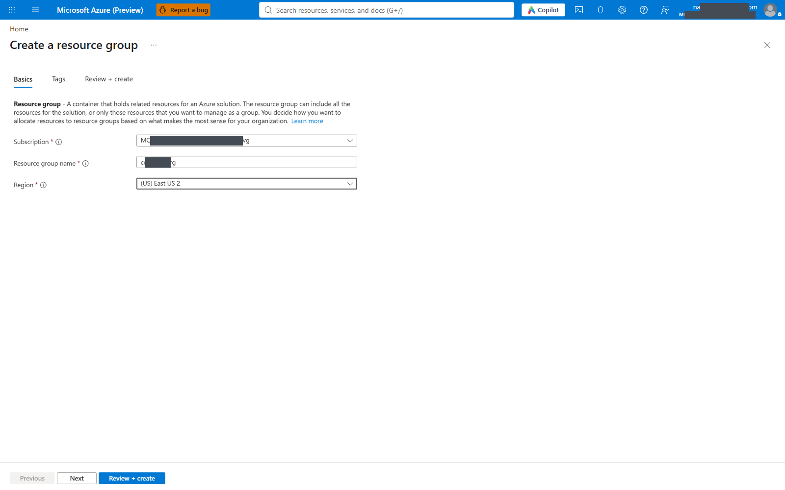
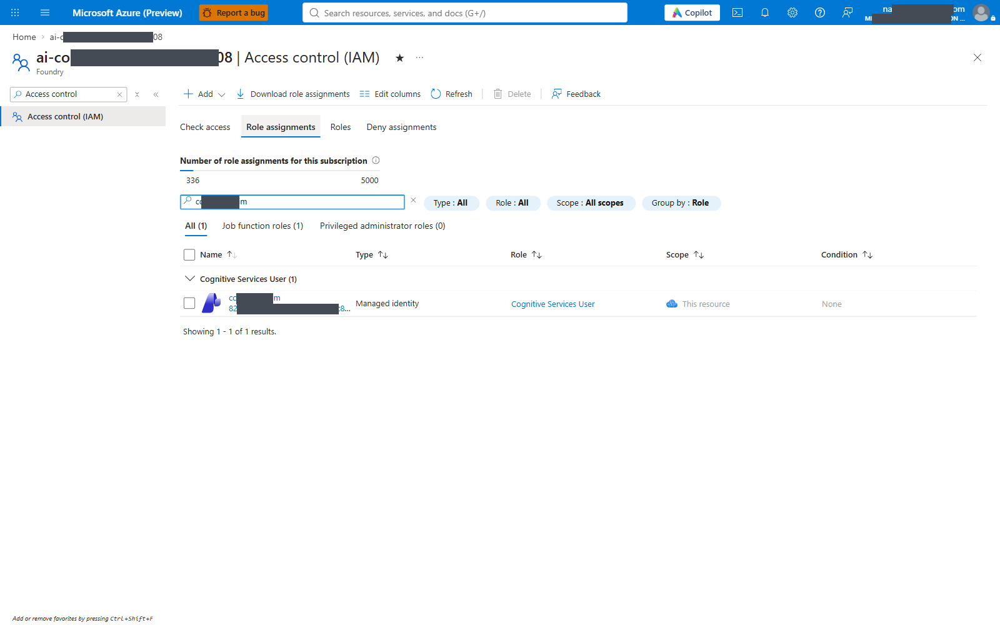
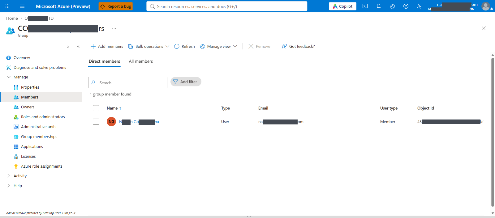
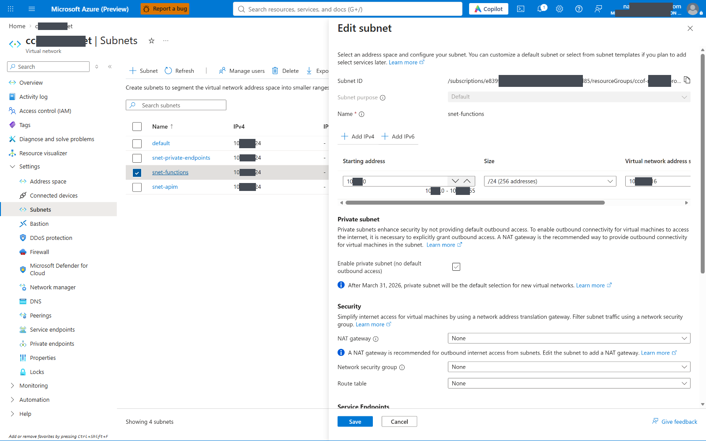

# Configurable staged deployment

Customer-facing procedures: [deployment](DEPLOYMENT-RUNBOOK.md),
[admin operations and additional Foundry backends](ADMIN-OPERATIONS.md),
[user and Intune onboarding](USER-ONBOARDING.md). This page is the driver reference.

CCOF deploys in nine stages, run one at a time by
[`infra/staged/Invoke-StagedDeployment.ps1`](../../infra/staged/Invoke-StagedDeployment.ps1).
Each stage has its own operator permission boundary, a preview, an apply, and a read-back
verification.

The network is the last setup stage (Stage 6), as in the
[manual deployment](AZURE-PORTAL-DEPLOYMENT.md): the customer usually designs and builds the VNet,
subnets, private DNS zones, private endpoints and VNet integrations. With the default
`network.mode: verify`, Stage 6 changes nothing and runs the read-only check
[`scripts/manual/Test-NetworkConfiguration.ps1`](../../scripts/manual/Test-NetworkConfiguration.ps1).
Stages 2-5 (schema, grants, Entra, configuration) use Azure Resource Manager and Microsoft Graph
only and do not need the network. Publishing (Stage 7) and acceptance (Stage 8) run after it,
because the apps reach their private storage and Cosmos only through the VNet.

Order before 2026-10-21: network was Stage 2, followed by schema 3, grants 4, Entra 5 and
configuration 6. The [live run report](../STAGED-LIVE-RUN-2026-10-20.md) and the
[Standard v2 and Foundry run report](../STAGED-STDV2-RUNS-2026-10-20.md) use that numbering; the
driver moves an existing `state.json` to the new numbers on first read (backup
`state.layout1.json`).

Standard v2 APIM with a new private Foundry account ran in two tenants on 2026-10-20: the
Fabrikam lab subscription (shared resource group, existing Entra objects) passed end to end
with 200 responses; Contoso (new Entra objects) passed every stage, with model calls blocked
because its sandbox subscription cannot buy the Claude offer.
The [manual Portal walkthrough](#manual-portal-walkthrough) maps each stage to Portal checks.

The [four-stage runbook](STAGED-CUSTOMER-DEPLOYMENT.md) and the
[quickstart](../QUICKSTART.md) remain available. This path reuses the quickstart's Bicep modules
and PowerShell functions; it does not change them.

## How a stage runs

The entry script holds parameters and dispatch; the stages live in `Staged.Common.ps1`
(configuration, state, Azure and Graph helpers), `Staged.Resources.ps1` (stages 0-3 and 6),
`Staged.Entra.ps1` (stage 4) and `Staged.Application.ps1` (stages 5, 7 and 8).

```powershell
$cfg = 'C:\private\ccof\staged.config.json'   # private copy of infra\staged\staged.config.example.json
pwsh -File infra\staged\Invoke-StagedDeployment.ps1 -Stage 1 -ConfigPath $cfg          # preview only
pwsh -File infra\staged\Invoke-StagedDeployment.ps1 -Stage 1 -ConfigPath $cfg -Apply   # change, then verify
```

- **Preview** is the default. Bicep stages run `az deployment group what-if`; script stages print
  their plan. Nothing changes.
- **Apply** deploys, then reads the result back from Azure (or Entra). A failed read-back stops
  the stage with `verify_failed: <reason>` and records nothing. In `network.mode: verify`,
  Stage 6 apply only runs the check.
- **State.** Each verified stage writes its outputs to `<config dir>\.staged-state\state.json`.
  A stage refuses to start before the stages it reads (`stage_order`), and refuses to reuse a
  prerequisite that was re-run with different outputs (`stage_dependency_changed`). Read-back
  evidence is written to `.staged-state\evidence\`.
- **Rerun.** Every stage can be rerun; deployments are Incremental with deterministic names.
  Stage 1 alone refuses a non-empty resource group, except to resume and verify a
  `stage1-services` deployment that already succeeded there.
- **Windows.** `az.cmd` passes arguments through cmd.exe, so no argument holds `( ) | & < > ^`;
  bodies and queries travel in files or over REST. Entra display names are limited to letters,
  digits, space, `.`, `_` and `-` for the same reason.
- Use a separate `AZURE_CONFIG_DIR` for the operator profile; the driver and the network check
  never run `az login` or `az account set`.
- **One target per state directory.** `state.json` records tenant, subscription and resource
  group; another target stops with `state_target_mismatch`. Use `-StateDirectory` (or a separate
  configuration folder) per environment.
- **One Stage 7 at a time per checkout.** Stage 7 runs `npm ci` in `admin/`; two concurrent runs
  from the same checkout failed with EPERM on `admin/node_modules`. A lock file now stops the
  second run with `stage7_busy`.

## Stages and permission boundaries

Operator permissions are the person or pipeline running the stage. Runtime grants are what
the deployed identities receive, and are created only by Stage 3.

| Stage | Entry point | Creates or changes | Operator permission | Verified by read-back |
| --- | --- | --- | --- | --- |
| 0 | driver only | Nothing (read-only) | Reader on the target subscription, RG and backend accounts; directory read of groups | Tenant, empty RG, providers, Flex region, backend deployments, operator |
| 1 | [`main.bicep`](../../infra/staged/main.bicep) | Workspace, Cosmos account, identities, four Flex apps with storage and Insights, optional new APIM and Foundry | RG Contributor; subscription `resourceGroups/write` to create the RG | Apps with zero settings, keyless storage, no database, zero role assignments |
| 2 | [`stage2-schema.bicep`](../../infra/staged/stage2-schema.bicep) | Cosmos database and containers | Cosmos database/container write (Contributor on the account) | Containers and partition keys; no data roles yet |
| 3 | [`stage3-grants.bicep`](../../infra/staged/stage3-grants.bicep) | Azure RBAC, Cosmos SQL role definitions and assignments, APIM grant on Foundry | Role Based Access Control Administrator (or Owner) at each scope, including the Foundry account; Cosmos `sqlRoleDefinitions/write` and `sqlRoleAssignments/write` | Every assignment by principal and scope; none for other principals |
| 4 | driver (Microsoft Graph) | App registrations (new or merged), scopes, roles, preauthorized clients, groups and members | Application owner or Application Administrator; group owner or Groups Administrator | Identifier URI, v2 tokens, `access_as_user` scope |
| 5 | [`stage5-config.bicep`](../../infra/staged/stage5-config.bicep) | App settings, resolver authentication, APIM API/backends/policy, API telemetry, workbook | Site config write, APIM service contributor, workbook write | Setting names per app, resolver `Return401`, API path, policy hash; timers off |
| 6 | `verify` (default): [`Test-NetworkConfiguration.ps1`](../../scripts/manual/Test-NetworkConfiguration.ps1). `existing`/`create`: [`stage6-network.bicep`](../../infra/staged/stage6-network.bicep) + VNet integration | `verify`: nothing. `existing`: private endpoints and integrations in the customer's subnets. `create` (lab): also the VNet, subnets and DNS zones | `verify`: Reader on the VNet, endpoints, zones and apps. `existing`/`create`: Network Contributor on the VNet, private DNS zone write and link, site write | Subnet delegations, endpoints Approved with DNS zone groups, zones linked to the VNet, every app and the Standard v2 APIM integrated |
| 7 | driver | Code packages, registry seed, delegated membership snapshot, client file | Function publishing (site write); settings write on the sync app; Graph read of the groups (delegated) | Functions listed, seed outcomes, sync run counts, client validator |
| 8 | driver | Model calls only | A gateway caller identity; Log Analytics read | 401/200/403 matrix, admin endpoints, LLM logs in the workspace |

Stages 2-5 do not need the network and can run while the customer builds it. Stage 7 requires a
verified Stage 6: with private storage, a Flex app reads its package from its own deployment
storage through its VNet.

## Configuration file

One JSON file drives every stage:
[`infra/staged/staged.config.example.json`](../../infra/staged/staged.config.example.json).
The driver refuses it until the placeholders are replaced. Sections:

| Section | Read by | Notes |
| --- | --- | --- |
| `tenantId`, `subscriptionId`, `resourceGroup`, `location`, `tags` | all | GUIDs are validated |
| `stage1` | 1 | Exactly the `main.bicep` parameters. Defaults: every public network access `Disabled`, APIM deferred, `StandardV2` |
| `cosmos` | 2, 3 | Database name, capacity mode, custom role names |
| `apim` | 3, 5 | `existing` APIM, or the Stage 1 one; API id, path and display name |
| `stage1.foundry` | 0, 1, 6 | Optional new Foundry account: `create`, `accountName`, `publicNetworkAccess` (default `Disabled`), `deployments` [{ name, model, version, sku, capacity }], `modelProviderData` { organizationName, countryCode, industry } (required with deployments), or `modelDeploymentsBlocked` with the reason |
| `sharedResourceGroup` | 1 | `true` to deploy beside existing resources: apply only when what-if shows no Modify or Delete outside the exact resource IDs recorded by the prior Stage 1 deployment |
| `backends` | 0, 3, 5, 6 | Foundry accounts, deployment names and inference geography; `privateEndpoint: true` makes Stage 6 check (or, in modes `existing`/`create`, create) its private endpoint and DNS |
| `entra` | 4 | Display names to create, or `existing` app IDs to merge into; `allowAzureCliClient` |
| `groups` | 4, 7 | Project, classification, `groupId` or `groupDisplayName`, members, family policy and budgets |
| `resolver`, `sync`, `reconciler`, `budgetState`, `gateway`, `syncTimerEnabled` | 5 | Same meaning as in the quickstart |
| `rateCard`, `workbook` | 5, 7 | Repository-relative rate card; a new workbook GUID |
| `admin` | 5 | `v3Enabled`; `extraAllowedClientIds` (empty; test clients only) |
| `network` | 6 | `mode: verify` (default; customer-built, checked only) with `existing` subnet IDs in one VNet; `existing` (driver creates endpoints and integrations; also zone IDs); `create` (lab only; driver also creates the VNet from `create`) |
| `client` | 7 | Project, classification and model aliases for `config.json` |
| `acceptance` | 8 | Allowed and denied project/model pairs with the expected status |

## Stage notes

### Stage 0: read-only checks
Fails on a provider that is not registered, a region without Flex Consumption, or a backend that
lacks a configured deployment. Registering providers needs subscription Contributor and is not
done by the driver.

### Stage 1: resources only
No settings, schema, grants, network attachment or code. With
`approveNewPublicApimBootstrap: true` a new APIM is created through
[`apim-service.bicep`](../../infra/staged/apim-service.bicep), with public ingress (APIM cannot be
created with public access disabled before a private endpoint exists). `BasicV2` has no VNet
integration; use `StandardV2` when any backend is private. Application Insights adds one
"Failure Anomalies" smart-detector rule per component a few minutes after creation
([Microsoft Learn](https://learn.microsoft.com/en-us/azure/azure-monitor/alerts/proactive-failure-diagnostics)).

### Stage 1: Foundry (optional)
`stage1.foundry.create` adds a keyless AIServices account and its Claude deployments
([`foundry-account.bicep`](../../infra/staged/foundry-account.bicep)). Claude deployments are
Marketplace offers:

- `modelProviderData` (organizationName, countryCode, lowercase industry) is required and is
  accepted only by API version `2025-10-01-preview`; earlier versions fail with
  `InvalidModelProviderData`. These values are the Anthropic attestation that accepts the offer
  for the real organization ([Microsoft Learn](https://learn.microsoft.com/en-us/azure/developer/ai/how-to/deploy-claude-foundry)).
- Internal or sandbox subscriptions cannot buy it ("Only $0.00 products or test products can be
  purchased"). Record that with `modelDeploymentsBlocked`; the rest of the stages still deploy.
- The operator needs to create resources and accept the Marketplace offer on the subscription;
  Owner on one resource group was sufficient in the Fabrikam lab run.

### Stage 1 in a shared resource group
With `sharedResourceGroup: true`, Stage 1 runs what-if first and refuses a Modify or Deploy for a
resource ID not recorded by the prior Stage 1 deployment operations. It always refuses Delete,
including for a prior target. This permits an exact retry after a failed Stage 1 apply without
treating a matching name prefix as ownership. Read-back and grant checks consider only this
deployment's resources.

### Stage 2: schema
The container list equals the quickstart's; `adminConfig` is added when the admin app is included.
`tests/Test-StagedStages.ps1` compares the two lists. Before Stage 3 has run, the read-back also
confirms that no Cosmos data-role assignment exists.

### Stage 3: runtime grants
| Principal | Grants |
| --- | --- |
| Each app | Storage Blob Data Owner on its own storage; Monitoring Metrics Publisher on its own Insights |
| Reconciler, admin | Log Analytics Reader on the workspace |
| Resolver | Cosmos Built-in Data Reader on the database |
| Sync | Entitlement writer on `entitlement` and `syncLease`; reader and create-only writer on `projects`; create-only writer on `backends`; Data Reader on `adminConfig` when admin is included (3.2 removal-limit override) |
| Reconciler | Reader on `projects` and `entitlement`; state writer on `budgetState`, `aggregateBudgetState`, `reconcilerLease` |
| Admin | Project editor (read, query, create, replace; no delete or upsert) on `projects` and `adminConfig` |
| APIM identity | Cognitive Services User on each Foundry account |

Removing a principal from the configuration does not delete an assignment made earlier.

### Stage 4: Entra
Creates or reuses three registrations: gateway API plus developer sign-in (one app,
`access_as_user`, v2 tokens, public client), resolver API, and admin (`Projects.Manage`,
`CCOF.Projects.Read`/`Write`, SPA redirects for `/api/console` and `/api/console-v3`, assignment
required). For `existing` apps every list is merged: redirect URIs, identifier URIs,
preauthorized clients, scopes and roles keep their current entries. The Microsoft Graph
application permission for unattended sync is not part of this stage; `sync.mode:
delegated-snapshot` needs none ([PERMISSIONS.md](../PERMISSIONS.md), rows 2-3).

`entra.allowAzureCliClient` preauthorizes Azure CLI on the gateway app and adds its client ID to
the gateway policy's delegated clients. Developers can then use `az account get-access-token`
([client modes](../CLIENTS.md)); Stage 8 uses it for its test calls.
`admin.extraAllowedClientIds` is also preauthorized on the admin app for `Projects.Manage`
and read back after the merge.

### Stage 5: configuration
Application settings are written as a complete set per app; this stage is the only settings
writer, so rerun it rather than editing settings by hand. The resolver accepts only the APIM
identity. Stage 1 owns the resource-log diagnostic settings; Stage 5 adds only the API-level
logger and diagnostic. Timers stay off until `syncTimerEnabled` or `reconciler.timerEnabled` is
set and Stage 5 is rerun. Nothing in this stage needs the network.

### Stage 6: network (last setup stage)
**`network.mode: verify` (default).** The customer builds the network, for example with the
[manual Portal guide](#6-check-the-customer-network) or their own landing-zone templates:

- a VNet with an undelegated private-endpoint subnet, a Functions subnet delegated to
  `Microsoft.App/environments`, and (for a new Standard v2/Premium v2 APIM) an APIM subnet
  delegated to `Microsoft.Web/serverFarms` with an NSG;
- private endpoints for the Cosmos account (`Sql`), each app's storage account (`blob`) and each
  backend with `privateEndpoint: true` (`account`), each Approved with a DNS zone group;
- `privatelink.documents.azure.com`, `privatelink.blob.core.windows.net` and, for private
  Foundry, the `cognitiveservices`, `openai` and `services.ai` zones, linked to the VNet (or to a
  hub VNet);
- VNet integration of every Function App on the Functions subnet and outbound VNet integration of
  the Standard v2 APIM on the APIM subnet.

`network.existing` names the three subnets; they must be in one VNet. Stage 6 apply runs
[`Test-NetworkConfiguration.ps1`](../../scripts/manual/Test-NetworkConfiguration.ps1) with the
Stage 1 resource IDs and stops with `verify_failed` on any FAIL row. Its rows are saved in
`.staged-state\network-check.json` and `evidence\stage6.verify.json`. The check reads private
endpoints in the VNet's resource group and zones in the deployment subscription; it does not test
DNS resolution from inside the VNet or firewall egress. Read access is enough to run it.

**`network.mode: existing` (opt-in).** The driver deploys
[`stage6-network.bicep`](../../infra/staged/stage6-network.bicep) into the customer's subnets and
zones (subnet and zone IDs in `network.existing`), attaches each Function App to the Functions
subnet one at a time (parallel joins failed with `ServiceAssociationLinkLease`) and, for a
Stage 1 Standard v2 APIM, sets outbound VNet integration (`virtualNetworkType: External`, through
an ARM PATCH that keeps the system-assigned identity). Ingress stays public.

**`network.mode: create` (lab only).** As `existing`, and also creates the VNet, subnets and zones
with [`infra/prereqs/network.bicep`](../../infra/prereqs/network.bicep), whose subnet list is
authoritative: run it once per VNet. A retry with saved Stage 6 state skips the network deployment
and verifies or reconciles the integrations. If the VNet exists without Stage 6 state, the driver
stops with `network_create_existing_vnet`; switch to `verify` or `existing`. The lab run took
11 minutes, mostly private endpoint creation.

### Stage 7: code and initial data
Requires a verified Stage 6. Publishes with `az functionapp deployment source config-zip` (the
Flex publishing path), seeds `projects` and `backends` through the sync app's `registrySeed`
function (create only), loads group membership from a delegated snapshot through
`snapshotApply`, and writes `config.json` for the selected project, checked by
`client/bin/validate-config.mjs`.

### Stage 8: acceptance
Requires the `acceptance` matrix. Checks: anonymous 401 at the gateway and at the resolver;
each allowed pair 200; each denied pair the expected status; admin root 302 to V3, console 200,
API 401 without a token. Telemetry: every allowed response's `x-ccof-request-id` (APIM
`context.RequestId`) must appear as a `CorrelationId` in `ApiManagementGatewayLlmLog` within
15 minutes; older rows do not count. With no allowed pair, telemetry is recorded as not applicable.

## Recovery

- A failed apply records nothing. Read the deployment operations and fix the cause.
- Stage 6 in `verify` mode changes nothing: fix the network rows reported as FAIL and rerun it.
  Rerun `create` only when its VNet was not created; otherwise use `verify` or `existing` with
  explicit IDs.
- A partially created Stage 1 is resumed only when `stage1-services` succeeded; otherwise empty
  or replace the RG under a separate approval.
- Stage 4 never deletes Entra objects. Stage 3 never removes earlier assignments.
- No recovery step enables public Cosmos/storage access, account keys or anonymous APIs.

## Manual Portal walkthrough

### Evidence and scope

Each Portal step below lists the blade that shows the result of a stage. Images under
`images/staged-portal/` are captures of the Contoso Standard v2 deployment (2026-10-21), taken by
the Playwright walkthrough from the signed-in Portal. Resource names, IDs and the subscription name
were then replaced with pseudonyms of the same shape (Contoso lab resources appear as `cto1020-...`);
the signed-in account is hidden. The five historical images are middle-masked captures
from the earlier manual guide and show navigation, not a new deployment's result
([image manifest](images/portal/screenshots.json)). The
[Standard v2 and Foundry run report](../STAGED-STDV2-RUNS-2026-10-20.md) holds the read-back
evidence of the Fabrikam lab and Contoso runs and the status of the Playwright Portal
walkthrough, which visits each step's blade on those runs' real resources.

| Environment | Standard v2 + new private Foundry | Directory permissions exercised |
| --- | --- | --- |
| Fabrikam lab (Fabrikam tenant) | Stages 0-8 verified, 200 for admitted models, correlated telemetry | Merge into existing registrations; operator cannot create new ones (directory quota) |
| Contoso | Stages 0-8 verified; Claude not purchasable on the sandbox subscription | New registrations and groups created; Graph application consent needs PIM activation |

### 0. Confirm the directory, subscription and permissions

1. Open [Azure Portal](https://portal.azure.com). The account menu's **Switch directory**
   selects the intended directory. **Subscriptions** shows the subscription name and ID.
   The Fabrikam lab and the personal subscription are different subscriptions in the same tenant.
2. Open the selected subscription's **Access control (IAM) > Check access > View my access**.
   Record the effective Azure role and scope for the operator.
3. Open **Microsoft Entra ID > Roles and administrators**. Record the directory role used
   for registrations, groups and consent; activate eligible access through PIM where required.
   A tenant administrator is not automatically an Azure subscription Owner.
4. Open **Subscriptions > Resource providers**. Check the providers required by Stage 0.
   A denied read is not evidence that a provider or resource is absent.

**Evidence:** directory, subscription, effective Azure role/scope and effective Entra role
are recorded separately. Resource provisioning and consent are not started from the
wrong directory.

### 1. Create and inspect the resources

1. Open **Resource groups > Create**, select the approved subscription, group name and region,
   then **Review + create**. The historical image below shows this form.
2. For the Bicep path, Stage 1 in this guide creates the service resources. For a hand-created
   resource path, the separate
   [Azure Portal-first workbook](AZURE-PORTAL-DEPLOYMENT.md) describes the individual forms.
   These are alternative paths; they do not run over each other's resource names.
3. For the requested new API Management instance, the selected SKU is **Standard v2**,
   not Basic v2 or classic Standard. Record its system-assigned identity from
   **API Management > Identity > System assigned**.
4. Open **Resource group > Deployments > stage1-services** for a Bicep deployment.
   **Deployment details** shows the individual resource operations; **Outputs** contains the
   IDs and principal IDs needed later. A green parent deployment alone is not runtime proof.




### Foundry prerequisite: account, deployment and endpoint

Stage 1 can create the account and its Claude deployments (`stage1.foundry`); the customer creates its
private endpoint and DNS, which Stage 6 checks (`backends[].privateEndpoint`; modes `existing`/`create`
let the driver create them). An existing account works as a backend
too. Either way, these Portal checks confirm the setup:

1. In the intended subscription, open or create the approved Foundry resource using the
   Microsoft Foundry service. Record the account resource ID and location.
2. Open its Foundry portal and model catalog. Select the approved Claude model.
   The offer's availability, subscription eligibility, Marketplace terms, region and
   model quota must be resolved before a deployment can complete. A directory role alone
   does not prove these prerequisites.
3. Record the exact deployment name, version and inference geography shown by Foundry.
   `backends[].deploymentInferenceGeo` and the project's model allow-list use deployment
   names that actually exist; examples are not evidence of provisioned capacity.
4. Copy the account's actual Anthropic endpoint from its endpoint information. This is not
   a Foundry project URL. The backend URL includes the expected `/anthropic` base path;
   the gateway operation adds `/v1/messages`.
5. For private Foundry, open the account's **Networking > Private endpoint connections**.
   Record its approved private endpoint and DNS configuration. Public access is disabled
   only after the approved private path is verified.

In the Foundry portal's deployment form, the Anthropic attestation fields (organization,
country, industry) are required for Claude. Microsoft Q&A reports cases where the form does not
show them; the Bicep path sends them as `modelProviderData`. An internal or sandbox subscription
cannot purchase the offer at all.


### 2. Verify the Cosmos structure

Open **Cosmos DB account > Data Explorer**, where network access and the operator's
data-plane permissions allow it. Compare the database, container IDs and partition keys
with Stage 2 outputs. When Data Explorer cannot reach a private account, the ARM
read-back used by the driver verifies schema without opening public access.
Neither check creates seed documents or grants item access.

### 3. Verify each runtime permission

1. For Azure roles, open the exact target resource's **Access control (IAM) > Role
   assignments**. Filter by the managed identity, check the role name, and check
   **Scope** rather than assuming a subscription-wide assignment is required.
2. On the Foundry account, confirm **Cognitive Services User** for the new APIM
   system-assigned identity. The historical image below shows this view.
3. Compare every app's storage, telemetry and workspace permissions with the
   Stage 3 matrix above. Cosmos item access is a separate permission system.
4. Cosmos SQL role definitions and assignments remain the explicit Bicep/CLI
   operation in Stage 3; the general **IAM** blade is not a replacement for them.




### 4. Verify registrations, membership and consent

1. Open **Microsoft Entra ID > App registrations > gateway application**. Check
   **Expose an API**, its `api://...` URI, `access_as_user`, v2 token configuration,
   and the public-client redirect configuration.
2. Check the separate resolver registration. On the admin registration, check the
   `Projects.Manage` scope, reader/editor app roles and both SPA redirects:
   `https://<admin-host>/api/console` and `https://<admin-host>/api/console-v3`.
3. Open **Enterprise applications > admin application > Users and groups** and verify
   the intended editor/reader assignments. Assignment-required is a separate check.
4. Open each classification group under **Groups > Members** and check the intended
   user's object ID. Membership still needs synchronization to reach the gateway.
5. For unattended sync, the approved Graph application grants are a separate
   privileged operation using `Grant-SyncGraphPermissions.ps1`. Tenant-admin consent
   is not implied by an Azure role. The earlier run used delegated snapshots instead;
   it does not prove unattended consent or timer execution.




### 5. Verify the configuration

1. Open each Function App's **Settings > Environment variables** and inspect only the
   reviewed settings. Setting values containing credentials are not part of screenshots.
   The resolver's **Authentication** page must require authentication and restrict its caller.
2. Open **API Management > APIs > Claude API**. Verify the messages operation, backend,
   rendered policy and diagnostic configuration. This check does not edit an existing
   production API.


### 6. Check the customer network

This is the last setup step, as in the manual deployment. The customer creates these items
in the Portal (below) or with their own templates; Stage 6 (`network.mode: verify`) then runs the
read-only [`Test-NetworkConfiguration.ps1`](../../scripts/manual/Test-NetworkConfiguration.ps1)
against the Stage 1 resources and changes nothing.

1. Open the VNet's **Subnets**. Functions and APIM use separate integration subnets.
   Flex Functions use `Microsoft.App/environments`; Standard v2 APIM uses its documented
   integration delegation (`Microsoft.Web/serverFarms`) and an associated NSG.
   The historical Functions form below is a navigation reference.
2. Open each Function App's **Networking > VNet integration** and select the approved
   Functions subnet. Verify each app independently.
3. Open **API Management > Network > Outbound traffic > VNet integration**. Select the
   dedicated APIM subnet. The VNet and Standard v2 APIM must be in the same subscription
   and region; the subnet cannot be shared with another resource.
   [Microsoft's outbound integration guide](https://learn.microsoft.com/en-us/azure/api-management/integrate-vnet-outbound)
   describes the requirements.
4. Open each private endpoint and verify its connection is **Approved**. In
   **Private DNS zones > Virtual network links**, verify the links to the caller VNet.
   The Foundry zone is a separate dependency from the blob and Cosmos zones.
5. Test resolution and connectivity from the real caller network. A Portal DNS record
   or an approved connection alone does not prove this.

In modes `existing` and `create`, Stage 6 performs steps 2-4 for a Stage 1 Standard v2 APIM and
for backends marked `privateEndpoint`. Outbound APIM integration does not make its ingress private.





### 7-8. Publishing and acceptance

Publishing needs the verified network from step 6.

1. Build/publish, native Cosmos data access, delegated snapshots and client-file validation
   remain the explicit commands in Stages 3 and 7. A Portal-only ZIP upload is not equivalent
   to the documented Flex publishing command.
2. Run the Stage 8 positive and negative cases. Confirm fresh request IDs reach Log Analytics;
   old workspace rows are not evidence of the current test run.
3. Open the real Admin V3 URL, complete Microsoft sign-in, and inspect overview,
   project detail, chargeback and onboarding downloads. A demo-mode browser interception
   does not verify sign-in. Capture the final UI without one.


**Acceptance still needed for each target:** genuine signed-in Admin V3 screenshots. The Portal
walkthrough of the steps above ran against both targets on 2026-10-21
([results](../STAGED-STDV2-RUNS-2026-10-20.md#portal-walkthrough-with-playwright)); Standard v2
networking, Foundry setup, Azure permissions, Entra registrations, allowed and denied requests and
correlated telemetry are covered by the stage read-backs and Stage 8. Graph application consent
remains a separate privileged step (refused in Contoso without an active admin role).

### Review findings

| Finding | Status |
| --- | --- |
| Network ran as Stage 2 and was created by the driver, although the customer usually builds it | Fixed 2026-10-21: network is Stage 6, the last setup stage; default `verify` only checks it |
| Standard v2 selection did not configure APIM outbound VNet integration | Fixed: Stage 6 integrates it (modes `existing`/`create`) or checks it (`verify`) |
| Foundry provisioning was outside the stages | Fixed: optional Stage 1 account and deployments; Stage 6 private endpoint and DNS (both runs) |
| State was not bound to the deployment target | Fixed: `state_target_mismatch`; offline test with a negative control |
| Telemetry acceptance was not tied to the run | Fixed: correlation by request ID (Fabrikam lab: 2 of 2 found) |
| Claude deployment requires `modelProviderData` | Fixed: required configuration, API `2025-10-01-preview` |
| Concurrent Stage 7 runs from one checkout collide in `admin/node_modules` | Documented: one Stage 7 at a time per checkout |
| Graph application consent cannot be activated from Azure CLI | Open by design: interactive PIM activation, then `Grant-SyncGraphPermissions.ps1` |

## References

- [Live run report, 2026-10-20](../STAGED-LIVE-RUN-2026-10-20.md) and the
  [Stage 1 report](../STAGE1-LIVE-VERIFICATION.md).
- [Bicep deployment permissions](https://learn.microsoft.com/en-us/azure/azure-resource-manager/bicep/deploy-cli);
  [role assignments in templates](https://learn.microsoft.com/en-us/azure/role-based-access-control/role-assignments-template);
  [Cosmos DB data-plane RBAC](https://learn.microsoft.com/en-us/azure/cosmos-db/how-to-setup-rbac);
  [Flex Consumption deployment](https://learn.microsoft.com/azure/azure-functions/deployment-zip-push#deploy-by-using-azure-cli);
  [APIM private endpoints](https://learn.microsoft.com/en-us/azure/api-management/private-endpoint).
- Tests: `tests/Test-StagedStages.ps1` (stage boundaries, negative control, Cosmos contract,
  network-last order and state migration, network verify mode, driver, configuration) and `tests/Test-StagedCustomerDeployment.ps1` (Stage 1).
